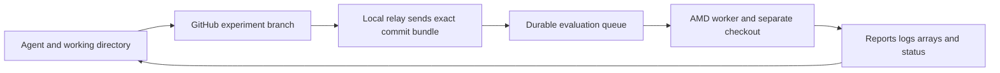
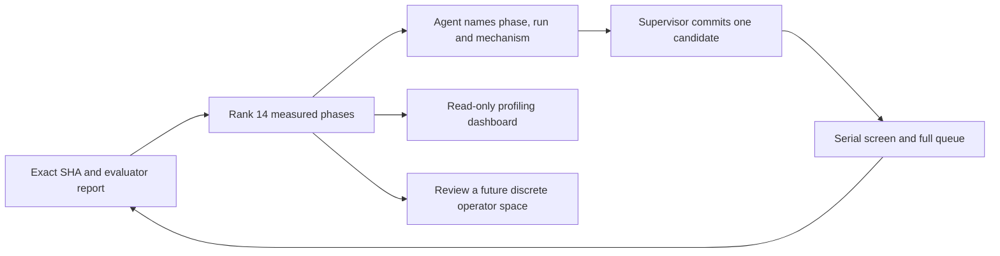

# Experiment architecture

Agents may run on a laptop or on the AMD instance. They use the same submission and feedback workflow. The evaluator owns scheduling and benchmark execution; an agent owns its editable branch and research notes.



## Identities

| Record | Purpose | Minimum information |
| --- | --- | --- |
| Direction | A research hypothesis that can continue across sessions | Name, branch, starting commit, current best candidate |
| Agent session | One bounded attempt to explore a direction | Session identifier, agent/model, working directory, branch, start time, budget, status |
| Candidate | An exact code revision proposed for measurement | Full commit SHA, parent candidate, direction, agent, hypothesis |
| Evaluation run | One execution of one candidate under a recorded configuration | Run identifier, profile, environment, CPU, status, timings, correctness and artifact paths |

A branch is a moving pointer; a queued evaluation must use a full commit SHA. The submission path imports the required commit and pins it before acknowledging the job. Later pushes cannot alter a queued candidate. Intentional repeated measurements create separate runs of the same candidate.

## GitHub and the initial relay

GitHub is the source of truth for source history. In the initial deployment, the local supervisor pushes the candidate branch to the private repository, creates a small incremental Git bundle, and sends it over SSH to the AMD instance. The worker imports that bundle into its bare repository and pins the exact submitted SHA.

This relay reuses the laptop's existing GitHub access and the instance's established SSH access. Personal GitHub tokens stay off the instance. It also avoids making each evaluation depend on the AMD network proxy's direct GitHub access. A direct repository fetch from the instance can be added later with separately configured repository credentials.

The client configuration is a local, Git-ignored `.lab/client.json` file. It identifies the SSH host `amd-hackathon` and remote lab root `/workspace/feyer-lab`; it must not contain embedded account tokens.

## Branch and directory ownership

Use `main` for reviewed integration work and `explore/<direction>` for an investigation. If two agents explore one direction independently, use separate branches such as `explore/noise-solves/agent-a` and `explore/noise-solves/agent-b`.

Each active branch has one writer and each agent has its own working directory. [Git worktrees](https://git-scm.com/docs/git-worktree) share repository history while providing separate files. Agents must not share an editable checkout or force-push experiment history. Preserve failed experiments in commits and notes; they explain which paths were already tried.

The evaluator creates a separate detached worktree for each run. The agent may keep editing its own directory while the worker evaluates the pinned commit. Candidate code does not replace the trusted worker or evaluator code.

## Queue and worker

The initial design uses Python and SQLite on persistent `/workspace` storage. Submission records a candidate and a queued run. A worker claims a run atomically, records a heartbeat and executes the candidate in a separate process group. A global evaluator lock prevents two worker processes from accidentally starting simultaneous benchmarks.

The run lifecycle is:

```text
queued → running → completed
                 → failed
                 → interrupted
```

Correctness is recorded separately from process completion. A completed screen does not establish full validation. Timeouts and stale worker leases produce a visible failure or interruption; resubmission is explicit and keeps the earlier run's evidence.

The worker records stdout/stderr, elapsed process time, peak resident memory where available, benchmark JSON, arrays and plots appropriate to the selected profile. The artifact directory belongs to a run identifier, not a branch name.

## Evaluation profiles

`screen` computes the complete 101-frequency, 193-variable workload once in a fresh process, using the official staged structure and double precision. It checks finite outputs, positive reference-matching sensitivities and a nonzero full gradient. It omits warm repetitions and the independent finite-difference gradient check. The screen is a separate tool; the official benchmark is unchanged.

`full` runs the unchanged `benchmark.py` with one logical CPU and three warm repetitions, including its numerical gradient check. Finalists need repeated full runs under matching conditions. A shared best result must be fully validated.

An optional reduced-frequency smoke test is a future debugging convenience. It must not enter the full-workload ranking. Smaller shapes can change JAX compilation and algorithm behavior, so their speedup need not transfer to the official workload.

## Feedback loop

The initial local supervisor owns committing, pushing, submitting and waiting on behalf of its Codex agent. The agent edits its permitted files and returns a structured hypothesis and readiness signal. The supervisor checks the changed paths, creates the candidate commit, evaluates it, then resumes the same Codex conversation with the report so the agent can decide what to try next. A managed agent must not make Git commits, push, or independently submit a duplicate job.

The operating-system process may end between steps, but the recorded Codex conversation, worktree, branch and notes are retained. A manual operator can instead commit changes and use the client to submit, wait and read results. The session's chosen submission owner must remain explicit.

The agent response contains `summary`, `hypothesis`, `ready_for_evaluation`, `stop` and `notes`. When both readiness and stop are true, the supervisor evaluates that last candidate before finishing. Codex uses its ordinary workspace sandbox with automatic approval review; the supervisor does not bypass approval or sandbox checks. The model and provider inherit the user's configuration.

Start with a serial evaluator. If agents later run on the AMD instance, account for their profiling and compilation processes in the same resource budget. Final comparisons should run without competing experiments. Additional agents and evaluator slots require a deliberate concurrency change, not ad hoc terminal launches.

## Measured profiling feedback

The [phase profiler](profiling.md) reads existing synchronized evaluator reports and ranks where each exact candidate spends its complete first-run time. The supervisor stores that attribution in candidate feedback and supplies it to the next Codex or Claude turn. The same versioned report feeds the read-only frontend. This adds no physics execution or overhead to the official benchmark.



This is operational feedback, separate from candidate ancestry. Complete first-run time remains the objective; screens, warm timings and hypothetical phase savings cannot establish a winner. Native operator attribution remains unknown without a separately admitted diagnostic. A fixed `--deadline-unix` is retained across resumes; the profiler grants no additional budget or evaluator concurrency.
