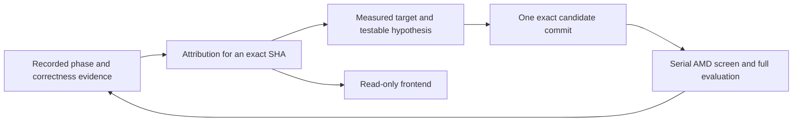

# Profiling feedback

The first question is which parts of the complete first evaluation consume the most time. The profiler ranks the existing evaluator measurements for an exact candidate and returns that evidence to the next agent turn. Operator-level tracing is a later diagnostic capability; a large phase alone does not identify its internal cause.

## Measurement layers

The unchanged official benchmark already records 14 synchronized phases: imports, CPU initialization, input loading, setup building, trace/lower and compilation for each of the forward, sensitivity and gradient programs, execution of those three programs, and host transfer. The screening harness records the same first-run phase structure. Full evaluation adds warm repetitions and correctness evidence.

The current integration analyzes those reports without rerunning the physics. It keeps first-run, warm, and total worker wall time separate. It exposes a descending phase ranking, phase share of the recorded first-run total, candidate and run provenance, validation status, and comparisons only where the measurement cohorts match. The same attribution data serves the agent feedback and frontend; neither should infer operator timings from source code or treat an absent measurement as zero.

Generate the attribution artifact with the profiler CLI:

```bash
python3 -m lab.profiler --repo ROOT --output FILE
```

Use the repository containing the evidence ledger as `ROOT`, including when the command runs from an isolated infrastructure worktree. Each attribution must identify its source SHA, run, profile and report. A screen pass remains provisional. An official pass and the additional strict saved-array comparison are separate facts. Preserve all observations and failed candidates rather than replacing their evidence with the best timing.

For repeated runs, show the count and range alongside a median. Independently calculated phase medians need not sum to the median total: use one actual run for an additive timeline, or label a median summary accordingly. A single low timing does not establish a repeat-confirmed improvement.

## What the evidence currently says

The original three-run baseline has a median complete first run of 35.737065 seconds. Compilation and lowering account for approximately 19.665 seconds, forward execution 12.127 seconds, gradient execution 2.935 seconds and setup 1.029 seconds. These independently calculated medians are descriptive, not one additive run.

A later observed candidate, `05508471e6b65e62ac44fb7f1dacbd31ca990fee`, completed full run `cb43b777416649429d8b0cb868cee75b` in 21.648769 seconds. Its report records:

| Measurement | Seconds | Share of first-run total |
| --- | ---: | ---: |
| Forward execution and saved AD residuals | 8.170837 | 37.74% |
| Forward compilation alone | 7.581405 | 35.02% |
| All six lowering and compilation phases | 11.040983 | 51.00% |
| Gradient execution | 1.296718 | 5.99% |

The compilation subtotal includes forward compilation; these rows must not be added together. This is one observation, not a repeat-confirmed gain or a permanent choice of starting candidate. Its official and strict checks passed, but its gradient maximum normalized error was 0.949078 against a failure boundary of 1. The maximum absolute gradient error was approximately 0.000245019 and relative L2 error approximately 4.1112e-9. Future numerical rewrites must inspect this narrow strict margin and all saved-output comparisons rather than relying on a boolean pass.

These facts establish expensive phases. They do not establish whether forward time is dominated by factorization, triangular solves, matrix assembly, component dispatch, allocation, or AD residual handling. That attribution remains unknown until measured on the selected exact revision. Rank the selected candidate's evidence again after changes; the original baseline's bottleneck is not a permanent optimization target.

## Research and evaluation loop



This diagram represents operational feedback. Scientific ancestry remains a separate DAG of immutable parent and child candidate commits; feedback does not create a backwards ancestry edge.

Each proposal cites a measured phase and source run, explains a proposed mechanism, predicts which metric should change, and estimates the maximum useful saving. For a phase costing `p` seconds, reducing only that phase can save at most `p` seconds; halving it predicts at most `p / 2` seconds saved before considering regressions elsewhere. Treat that ceiling as prioritization guidance, not a measured result.

The objective remains complete first-run time under unchanged official conditions. Phase savings help diagnose a result but do not replace the objective. Compare each candidate with its exact parent and retained best eligible candidate in a matching cohort. Keep the baseline for context and correctness regression; do not select a favorable reference to manufacture progress. Recheck all affected phases, memory evidence and numerical errors before retaining a rewrite.

The supervisor owns commit, submission and resumption. It attaches attribution to feedback so the next turn can select a new measured target or revise a failed hypothesis. A new Claude run uses its launch record's exact seed and explicit bounded deadline; the accompanying [agent brief](../experiments/briefs/profiler-guided.md) specifies the research contract. This documentation does not itself launch or extend a session.

Enumeration or SMAC may be appropriate after profiling motivates a small space of legal implementation choices, such as a reviewed batching or dispatch strategy. Admit such a space in a new frozen reviewed round with its own objective, constraints and budget. Do not optimize the 193 physical inputs, reduce frequencies, or change the optical task to obtain a better timing.

## Later diagnostic tracing: design, not implemented here

A deeper profiler should be a distinct diagnostic mode admitted through the existing serial evaluator and resource guards. It must retain the exact SHA, full workload, fixed environment and CPU affinity. Instrumented results must be explicitly excluded from ranking. Do not run independent remote profiles alongside queued evaluations.

The smallest useful diagnostic harness preserves the three existing JIT stages and captures separate compilation and execution traces. Stage annotations, complete-pytree synchronization, one first execution and a separately labelled warm execution provide the initial evidence. Capture nonblocking trace files with `create_perfetto_trace=True` and `create_perfetto_link=False`; the latter avoids waiting for an operator to open a browser. These APIs and `ProfileOptions` are present in the pinned [JAX 0.9.0 profiler source](https://raw.githubusercontent.com/jax-ml/jax/jax-v0.9.0/jax/_src/profiler.py).

Use host tracing to inspect CPU execution, increasing trace detail only when necessary. Python tracing can help investigate setup or lowering, but Python call timings do not explain native compiled execution. Preserve an unknown or unattributed category when trace coverage is insufficient. Nested or overlapping events must not be summed as independent wall time. [JAX profiling documentation](https://docs.jax.dev/en/latest/profiling.html)

JAX can dispatch CPU work asynchronously. Synchronize the complete returned pytree at stage boundaries, as the official harness already does, so measurement includes completion rather than only dispatch. Do not introduce extra synchronization or separate JIT boundaries inside the official simulation to manufacture section timings. [Asynchronous dispatch](https://docs.jax.dev/en/latest/async_dispatch.html)

Optional `jax.named_scope` annotations can connect logical regions such as carrier assembly, signal solve and noise propagation with staged operations. They provide labels, not evidence that those regions dominate execution. [Named scopes](https://docs.jax.dev/en/latest/_autosummary/jax.named_scope.html)

Save optional lowered and compiled text, compiler cost analysis, and memory analysis with the diagnostic report. Treat their outputs as backend-dependent inspection aids; they are not measured runtime or guaranteed process peak RSS. Record unavailable fields explicitly and parse defensively. Continue deleting old pullbacks between evaluations to avoid retaining multiple large AD tapes. [Ahead-of-time compilation and analysis caveats](https://docs.jax.dev/en/latest/aot.html)

Refresh expensive diagnostic traces when a structural change or unexplained regression warrants them. Ordinary iterations can use the existing phase measurements. Deep tracing, operator attribution and a new diagnostic queue mode are design work described here, not shipped features of the phase-feedback integration.

## Interface and operation

`lab.profiler.profile_job(job)` emits `feyer-profiler-v1`: exact `candidate_sha` and `job_id`, profile, recorded observation time, source, cohort, validation, descending `phases` and `groups`, and separate first/warm/worker timings. Shares are fractions of the same recorded first-run total. Every halving scenario is marked hypothetical. Malformed reports and conflicting copies stay visible and cannot become eligible full evidence. `eligible_full` comes from the existing evidence adapter; it is not a new promotion policy.

`collect_profiles` gathers ledgers, campaign results, session artifacts and worktree feedback, deduplicates exact job IDs, and emits `feyer-profiler-collection-v1` with `profiler_reports`, `issues`, `limits` and a collection timestamp. The collection timestamp does not refresh each run's observation time. Collection never pools candidates or cohorts.

For the local frontend, atomically refresh the ignored artifact every fifteen seconds:

```bash
python3 -m lab.profiler --repo ROOT --output ROOT/.lab/profiler/report.json --watch 15
```

The watcher reads local evidence only and adds no evaluator jobs. The local dashboard consumes that file. Hosted copies are explicitly saved snapshots, not live access to the laptop or evaluator. Re-export and publish to update a hosted snapshot.

The supervisor attaches `feedback.profiler` to versioned receipts and recalculates prompt guidance from raw evidence when resuming. Start a new isolated session with `--agent-provider claude --agent-model claude-opus-5-5`, the committed direction `--brief`, `--profile-seed` containing a trusted eligible full job for the exact initial HEAD, and a fixed `--deadline-unix`. Seed numerical errors remain in the prompt, alongside phase attribution. The adapter verifies the actual model and conversation identity before accepting a successful turn.

To redirect an existing conversation, use `--resume --continuation-guidance PATH`.
Unlike the initial brief, this text is appended to resumed prompts separately from
the evaluator evidence. It does not extend the saved deadline or change archived
results. The supervisor reads the file once per invocation (UTF-8, at most 64 KiB),
retains a content-addressed guidance receipt, and records its text and digest in
subsequent candidate context. Supply the option again on later invocations when
the guidance should continue to apply.

New dispatched turns also retain their complete prompt in the ignored session
directory as `turn-NN-prompt-SHA256.json`. Candidate feedback links that artifact
through `input_receipt` (`path`, prompt `sha256`, `turn`, preceding `thread_id`).
This is the exact constructed input, including runtime instructions and feedback;
the transcript may contain additional provider-side context. Historical turns
without this artifact must not be presented as exact captured inputs. A local
artifact path is not a downloadable hosted link. Keep full prompts private and
expose only reviewed evidence in shared graph cards.

Fable 5.2 was verified as the current high-capability option, but its account preflight returned a usage-credit requirement. The user explicitly selected Opus 5.5 instead, conditional on completed integration, tests, commits, coordination and hosting. This is an explicit selection, not a silent fallback. Existing agent deadlines and frozen SMAC campaigns remain unchanged.
