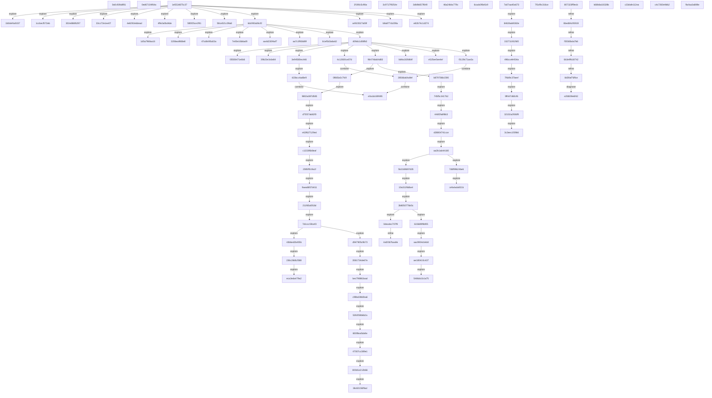

# Team search queue

Human-driven search; Qwen and SMAC are optional. See `.wiki/team-search.md` on main.

Claims and decisions live in this branch. Timing comparisons require the same instance and cohort.

| Task | Kind | State | Owner / instance | Parents |
| --- | --- | --- | --- | --- |
| inventory-search-frontier-v1 | diagnose | ready | — / — | f3139c71ae2a, 4c12600ce07d |

## Comparison regime

Current mode: **concurrent**, epoch 14.

Concurrent and unverified timing imports are exploratory and excluded from winner assessment.

Receipt: https://github.com/timbtz/feyer-search-lab/issues/6

User authorized expanded CPU capacity. Conservatively exclude new timing imports until all overlapping work drains and fresh serial confirmation begins; this admission does not assert that lane 2 has started.

## Scientific lineage

Every edge records intended inputs, not proof of speedup.

Recorded jobs: 13. Decisions/events: 119.

## External research records

| Executor | Kind | Candidate | Target phases | Recorded status |
| --- | --- | --- | --- | --- |
| claude-noise-reuse | explore | f3139c71ae2a | unknown | completed |
| claude-noise-reuse | explore | e525ee5ee4ef | unknown | completed |
| claude-noise-reuse | explore | bb9a183fd64f | unknown | completed |
| claude-noise-reuse | explore | 96474bdd4d83 | unknown | completed |
| claude-noise-reuse | explore | 05508471e6b6 | unknown | completed |
| claude-noise-reuse | combine | 28566a64a9ef | unknown | completed |
| claude-structure-solve | explore | 4c12600ce07d | unknown | completed |
| claude-structure-solve | explore | 39b23e3c6e84 | unknown | completed |
| claude-structure-solve | explore | 3e94580ec446 | unknown | completed |
| claude-structure-solve | explore | 423bcc4ad6e9 | unknown | completed |
| layout-numerical-v2 | combine | e0a1dc69f495 | unknown | evaluated |
| codex-profile-guided-v1 | explore | 7d1ccc59cef3 | unknown | completed |
| claude-profile-guided-v1 | explore | 7d6f99624be6 | unknown | completed |
| claude-profile-guided-v1 | explore | unknown | compilation | current |
| codex-profile-guided-v1 | explore | unknown | compilation, forward | proposed |
| codex-profile-guided-v1 | explore | unknown | compilation, forward | current |
| layout-numerical-v2 | refine | unknown | unknown | menu_exhausted |
| layout-numerical-lane1 | refine | unknown | unknown | budget_exhausted |
| astra-independent-v1 | explore | unknown | unknown | current |
| claude-guided-v2 | combine | unknown | setup, compilation | current |
| astra-guided-v2 | explore | unknown | compilation, forward, gradient | current |
| astra-group-numerical-v3 | refine | unknown | gradient_compile, forward_compile, gradient, forward | current |
| claude-guided-v2 | explore | 633689f9bf05 | unknown | completed |
| claude-guided-v2 | diagnose | unknown | unknown | current |
| claude-guided-v2 | explore | 5b2169697d35 | unknown | completed |
| claude-guided-v2 | explore | 10a311f6dbe4 | unknown | completed |
| claude-guided-v2 | explore | 3b805077bb5c | unknown | completed |
| astra-independent-v1 | explore | 8463bab9382e | unknown | completed |
| astra-independent-v1 | explore | 32102a2936f9 | unknown | completed |
| astra-independent-v1 | explore | 3c3eec1f39b6 | unknown | completed |
| astra-independent-v1 | explore | 7f6d9c37beef | unknown | completed |
| astra-independent-v1 | explore | 9ff447d60cf6 | unknown | completed |
| astra-independent-v1 | explore | 332711932fd5 | unknown | completed |
| astra-independent-v1 | explore | 496ccefe934a | unknown | completed |
| codex-component-specialization | explore | 302e886f6297 | unknown | completed |
| codex-component-specialization | explore | 58ce521c09a8 | unknown | completed |
| codex-component-specialization | explore | 4e8292e6dead | unknown | completed |
| codex-component-specialization | explore | 585f25ce1f91 | unknown | completed |
| codex-component-specialization | explore | 6dc993a06cf2 | unknown | completed |
| codex-component-specialization | explore | 4ffe2a0bd4de | unknown | completed |
| codex-component-specialization | explore | b8a877cb209a | unknown | completed |
| codex-component-specialization | explore | a4923527a59f | unknown | completed |
| codex-component-specialization | explore | 33cc72e1ee07 | unknown | completed |
| codex-component-specialization | explore | 1ccbecf572eb | unknown | completed |
| codex-component-specialization | explore | 1b0def4a9157 | unknown | completed |
| codex-component-specialization | explore | e82b74c1d274 | unknown | completed |
| seed-agent | explore | 2f190c5cffda | unknown | completed |
| seed-agent | explore | c4c7260e9db2 | unknown | completed |
| seed-agent | explore | 0a0c93fa8f81 | unknown | completed |
| seed-agent | explore | fbcfaa3a889e | unknown | completed |
| seed-agent | explore | 3c9717f9254e | unknown | completed |
| seed-agent | explore | 7f3cf9c316ce | unknown | completed |
| seed-agent | explore | 6cadc0f6e5c9 | unknown | completed |
| claude-guided-v2 | explore | ae180410c437 | unknown | completed |
| claude-guided-v2 | explore | 5466dc1b1a75 | unknown | completed |
| claude-guided-v2 | explore | aac9904cb4dd | unknown | completed |
| claude-profile-guided-v1 | explore | b879706b1590 | unknown | completed |
| claude-profile-guided-v1 | explore | d28804741cce | unknown | completed |
| claude-profile-guided-v1 | explore | 745f5c3417b2 | unknown | completed |
| claude-profile-guided-v1 | explore | 446f2fa8f663 | unknown | completed |
| claude-frequency-batching | explore | aa4d230f4af7 | unknown | completed |
| claude-frequency-batching | explore | 1d5a796faa16 | unknown | completed |
| claude-frequency-batching | explore | b1ef5d3a6a62 | unknown | completed |
| claude-frequency-batching | explore | 3206ea9fd8e8 | unknown | completed |
| claude-frequency-batching | explore | 7e00e16b6ad9 | unknown | completed |
| claude-frequency-batching | explore | aa7c3f93b89f | unknown | completed |
| claude-frequency-batching | explore | 47cd6495a53a | unknown | completed |
| astra-guided-v2 | explore | d947905c9b73 | unknown | completed |
| astra-guided-v2 | explore | 800f8ea5da9e | unknown | completed |
| astra-guided-v2 | explore | 47007cc389e1 | unknown | completed |
| astra-guided-v2 | explore | c99bd28b0ba6 | unknown | completed |
| astra-guided-v2 | explore | 800d1e212b66 | unknown | completed |
| astra-guided-v2 | explore | 36c82156f9ad | unknown | completed |
| astra-guided-v2 | explore | 5392f38b6b2a | unknown | completed |
| astra-guided-v2 | explore | 3581734de67e | unknown | completed |
| astra-guided-v2 | explore | bec798863aad | unknown | completed |
| codex-profile-guided-v1 | explore | 0f865e2c7fc9 | unknown | completed |
| codex-profile-guided-v1 | explore | 2085ff2c9a1f | unknown | completed |
| codex-profile-guided-v1 | explore | 9aea8857d411 | unknown | completed |
| codex-profile-guided-v1 | explore | e63f627129ed | unknown | completed |
| codex-profile-guided-v1 | explore | 211f65a5f18d | unknown | completed |
| codex-profile-guided-v1 | explore | c1233f6b8eaf | unknown | completed |
| codex-profile-guided-v1 | explore | 9802a087d585 | unknown | completed |
| codex-profile-guided-v1 | explore | d7f257ab82f0 | unknown | completed |
| codex-profile-guided-v1 | explore | 43b6ed2b405b | unknown | completed |
| codex-profile-guided-v1 | explore | 236c28db2588 | unknown | completed |
| codex-profile-guided-v1 | explore | eca3eda479a2 | unknown | completed |
| claude-profile-guided-v1 | explore | cefa4ada921b | unknown | completed |
| claude-profile-guided-v1 | explore | aa2b1ab44180 | unknown | completed |
| claude-frequency-batching | explore | d09dc1d08fb0 | unknown | completed |
| seed-agent | explore | 46a24bbc779c | unknown | completed |
| seed-agent | explore | 1e552d675c37 | unknown | completed |
| seed-agent | explore | c33dafe112ea | unknown | completed |
| claude-linear-algebra | explore | 3db9b657f849 | unknown | completed |
| claude-linear-algebra | explore | 0ed67104f64a | unknown | completed |
| claude-linear-algebra | explore | b68b6a18328b | unknown | completed |
| akshat-host-engine | explore | 807323ff9ecb | unknown | evaluated |
| akshat-host-engine | refine | 8bed84c95919 | compilation, forward, gradient, setup | evaluated |
| akshat-host-engine | refine | f5f2b5bda7b6 | compilation, forward, gradient, setup | evaluated |
| akshat-host-engine | refine | 6b3e9fb18742 | compilation, forward, gradient, setup | evaluated |
| akshat-host-engine | refine | 8d39af76ffce | compilation, forward, gradient, setup | evaluated |
| claude-sparse-adjoint | explore | 0dea4ec707f9 | forward, gradient | failed |
| claude-sparse-adjoint | refine | 4af20b7baa9e | forward, gradient | evaluated |
| teammate-review | diagnose | e2fd659e6f42 | setup, compilation, forward, sensitivity, gradient, transfer | evaluated |

These records are evidence, not competing task claims or winner declarations.
