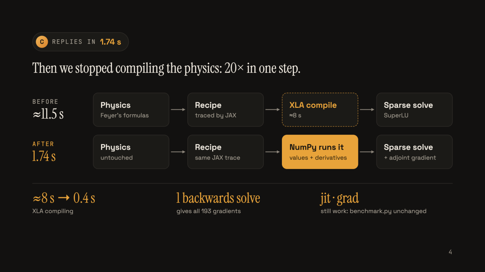
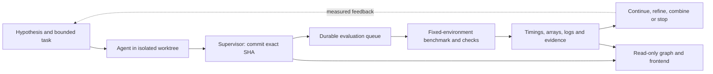
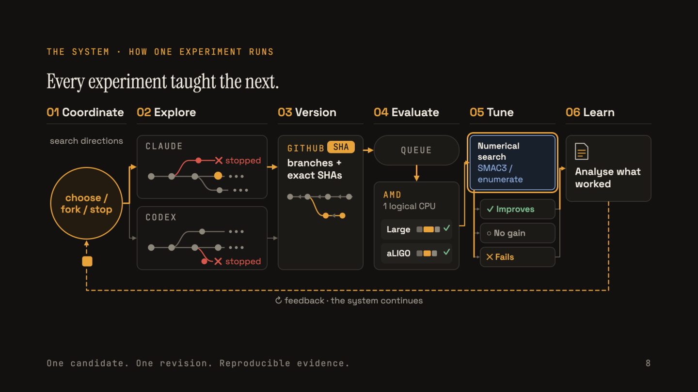
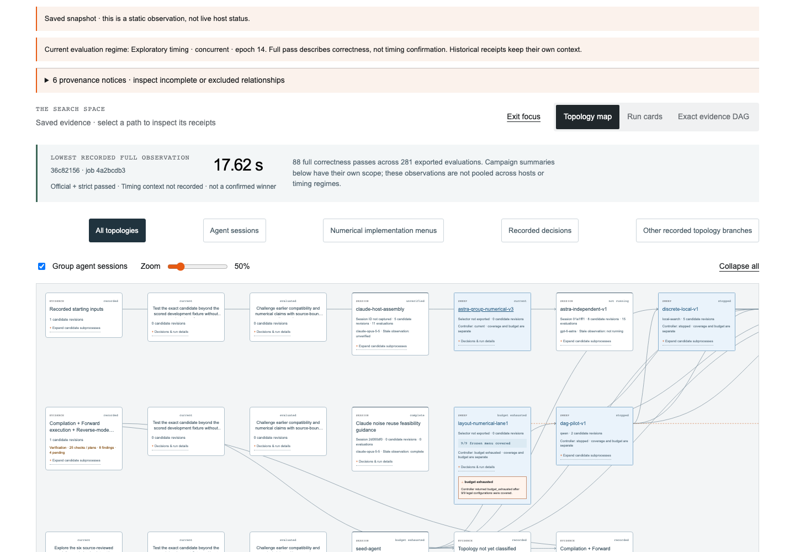

# Faster Answers · Feyer Search Lab

**Faster physics, with a Git-traceable system for finding and checking improvements.**

Our START Hack Munich 2026 project brings together a faster optical simulator, an agentic experiment loop, and a graph that makes the search inspectable. The final pitch tells the journey from **35.8 s to 0.66 s** per complete first evaluation. The lab connects hypotheses, exact code revisions, benchmark runs, validation, and the next decision.

[Final presentation (PDF)](presentation/faster-answers.pdf) · [Challenge brief (PDF)](challenge.pdf) · [Results & evidence](docs/RESULTS.md) · [System architecture](docs/ARCHITECTURE.md) · [Frontend repository](https://github.com/timbtz/feyer-search-frontend)

[](presentation/faster-answers.pdf)

*The 0.66 s / approximately 55× headline is reported in the final presentation. It is distinct from the lab’s selected submission and conservative repair. [Measurement scopes and exact revisions](docs/RESULTS.md) keep those results separate; this infrastructure checkout does not automatically contain the headline implementation.*

## One project, two repositories

| Repository | Responsibility | Start here |
| --- | --- | --- |
| **[feyer-search-lab](https://github.com/timbtz/feyer-search-lab)** — this repo | Simulator source, experiment coordination, Git provenance, evaluation queue, validation, profiling, and feedback | [Architecture](docs/ARCHITECTURE.md) · [Operating guide](.wiki/README.md) |
| **[feyer-search-frontend](https://github.com/timbtz/feyer-search-frontend)** | Read-only search graph, challenge story, exact-source submission view, timing profiles, and run archive | [Frontend README](https://github.com/timbtz/feyer-search-frontend#readme) |

The **lab is the operating system for the experiments**. Git records what changed; the evaluator measures an immutable revision; the coordinator turns that evidence into the next task. The frontend is its observatory. It can display live observations, a dated saved snapshot, or a clearly labelled synthetic demo. Opening it does not start an agent or a benchmark.

## The challenge

[Differometor](README.upstream.md) models optical instruments such as gravitational-wave detectors. A useful answer includes both the simulated detector sensitivity and the gradients needed to improve the design.

Feyer asked us to accelerate the **complete first run**: imports, initialization, input preparation, all three compilation stages, simulation, sensitivity, gradients, and result transfer. The supplied workload keeps **101 frequencies, 193 design variables, and double precision**. Validation and reporting sit outside the timer; warm execution is reported separately.

See the [challenge brief](challenge.pdf), [judging criteria](judging-criteria.pdf), and [original setup and benchmark guide](docs/CHALLENGE.md).

## How we reduced the wait

We measured the phases first. In the presentation’s starting run, roughly **19.5 s went into compilation** and **15.3 s into computation**. Two changes drove the solution:

1. **Exploit the optical system’s sparsity.** The example has 2,533 nonzero matrix entries out of 564,001. Structural sparse assembly and SuperLU avoid dense work on zeros; solve reuse reduces repeated preparation. The presentation’s sparse milestone is approximately **11.5 s**.
2. **Change how the physics executes.** Keep the component formulas, trace their recipe with JAX, and execute values and derivatives on the host with NumPy and sparse solves. The host-engine milestone is **1.74 s**, approximately 20× faster than the starting baseline. First-order reverse differentiation uses an adjoint solve.

Later changes reduced setup dispatch, small compilations, and derivative work, with fallback handling for unsupported components. The presentation ends at **0.66 s**, including an organizer-approved compiler setting. These are selected team milestones, not one reconstructed commit chain or isolated causal measurements.

[](presentation/faster-answers.pdf#page=4)

The tested fast-path interface supports `jit` and first-order reverse gradients. It does not establish GPU, JVP, Hessian, or higher-order parity. [Results & evidence](docs/RESULTS.md) explains validation, exact candidate identities, and the limits of the speedup claims.

## The agentic loop

An agent explores an owned branch and worktree. The supervisor checks the edit scope, commits a candidate, submits its exact SHA, and resumes the session with measured feedback. A manual operator can own submission instead; ownership remains explicit.



Research agents explore implementation changes. Bounded numerical search refines admitted choices: earlier campaigns used SMAC3; the final six-setting SuperLU sweep enumerated the entire menu. Every combination is a new candidate and needs its own evaluation. A faster stopwatch reading is useful only when the required checks pass.

[](presentation/faster-answers.pdf#page=8)

## What the graph shows

The graph connects **research directions → agent sessions → candidate revisions → evaluation runs → recorded decisions**. A session can create several candidates; one SHA can have several runs. Each result stays attached to its setup, environment, validation policy, and timing context.

- **Candidate ancestry** is a DAG of explicit scientific parents, including multiple parents for combinations.
- **Session and lane groups** organize the display; they do not prove ancestry.
- **Feedback links** show recorded information returning to the next proposal, separately from ancestry.
- **Run details** expose official checks, extra comparisons, timing phases, source links, and retained logs. Missing evidence stays unknown.

Explore the topology map for the broad search, the exact evidence DAG for provenance, and the Submission and Run archive views for individual revisions. The [architecture guide](docs/ARCHITECTURE.md) maps each part to its code.

[](https://github.com/timbtz/feyer-search-frontend)

*Frontend screenshot of the dated saved snapshot. The visible historical campaign measurements have their own scope; they are not the final pitch result.*

## Correctness shaped the search

The team checked the full supplied example, a second aLIGO topology, saved outputs and gradients, a 14-case regression suite, and source-level numerical assumptions. Review found unsafe approximate adjoint reuse in an experimental branch; a conservative repair used explicit adjoint solves.

The final finite sweep is a useful example: **all six configurations passed both official benchmarks, but only the default passed the additional seed-relative suite**. The decision was to keep the repaired starting candidate. Finite checks provide evidence for tested cases, not a proof for every optical setup.

## Explore locally

**See the project and saved experiment evidence** — Python 3.9+, no model or evaluator credentials:

```bash
git clone https://github.com/timbtz/feyer-search-frontend.git
cd feyer-search-frontend
python3 serve.py
```

Open <http://localhost:8770>. Choose **Challenge & solution** for the presentation, **Search map** for the graph, or **Submission** for the selected revision. Use `python3 serve.py --demo` for explicitly synthetic examples. The included snapshot is a dated observation.

**Read your local lab state** — run from this repository:

```bash
python3 -m lab.live_dashboard --repo . --port 8765
```

Open <http://localhost:8765>. An empty checkout has no private `.lab` history; it does not recreate the team’s running services. To connect the standalone frontend to that observatory, run from the frontend repo:

```bash
python3 serve.py --api-url http://127.0.0.1:8765
```

For simulator installation and a baseline run, follow the [challenge guide](docs/CHALLENGE.md). For actual optimization work, follow the [lab runbook](.wiki/runbook.md), [portable AMD setup](.wiki/portable-amd.md), and [experiment rules](AGENTS.md). Managed experiments use the fixed evaluator environment and exact committed revisions.

## Repository map

| Path | Contents |
| --- | --- |
| [`differometor/`](differometor/) | Simulator in this checkout; optimized implementations are identified by exact revisions |
| [`lab/`](lab/) | Supervisors, search controllers, evaluator client/queue/worker, profiling, observatory |
| [`lab/dashboard/`](lab/dashboard/) | Embedded frontend copy; synced deliberately with the standalone repo |
| [`experiments/`](experiments/) | Briefs, research notes, published analysis, submission manifest |
| [`.wiki/`](.wiki/README.md) | Operating guides and historical experiment records |
| [`docs/`](docs/ARCHITECTURE.md) | Combined architecture, results guide, original challenge instructions |
| [`presentation/`](presentation/README.md) | Final PDF, original slide exports, presentation evidence and source map |
| [`tests/`](tests/) | Infrastructure and evidence-integrity checks |

The public challenge derives from [Artificial Scientist Lab’s Differometor](https://github.com/artificial-scientist-lab/Differometor); source provenance is retained in [UPSTREAM.json](UPSTREAM.json) and [README.upstream.md](README.upstream.md). Project code uses the [MIT license](LICENSE). The frontend retains the separate Porsche Design System license and notices.
