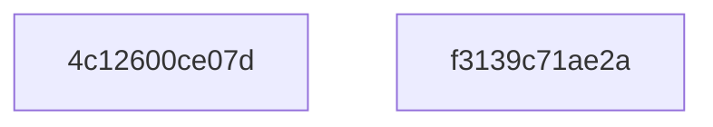

# Team search queue

Human-driven search; Qwen and SMAC are optional. See `.wiki/team-search.md` on main.

Claims and decisions live in this branch. Timing comparisons require the same instance and cohort.

| Task | Kind | State | Owner / instance | Parents |
| --- | --- | --- | --- | --- |
| inventory-search-frontier-v1 | diagnose | ready | — / — | f3139c71ae2a, 4c12600ce07d |

## Scientific lineage

Every edge records intended inputs, not proof of speedup.

Recorded jobs: 12. Decisions/events: 13.
