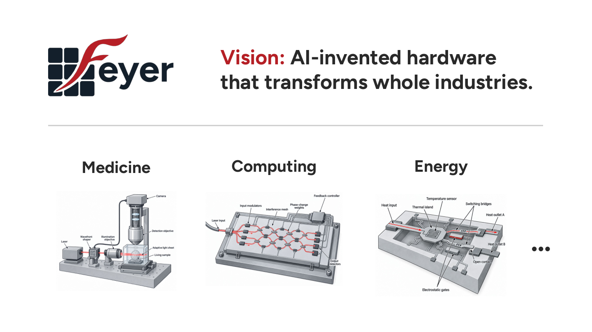
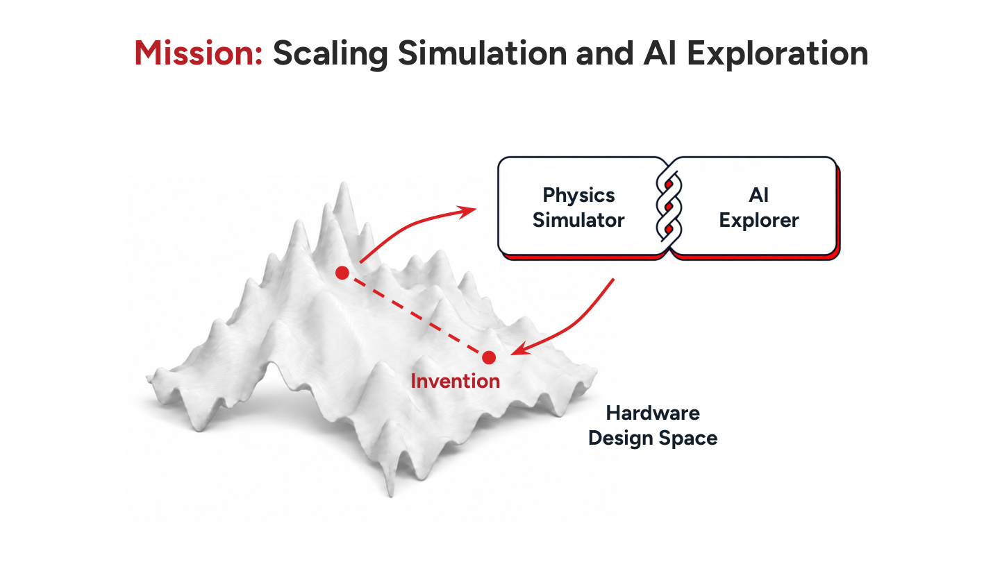
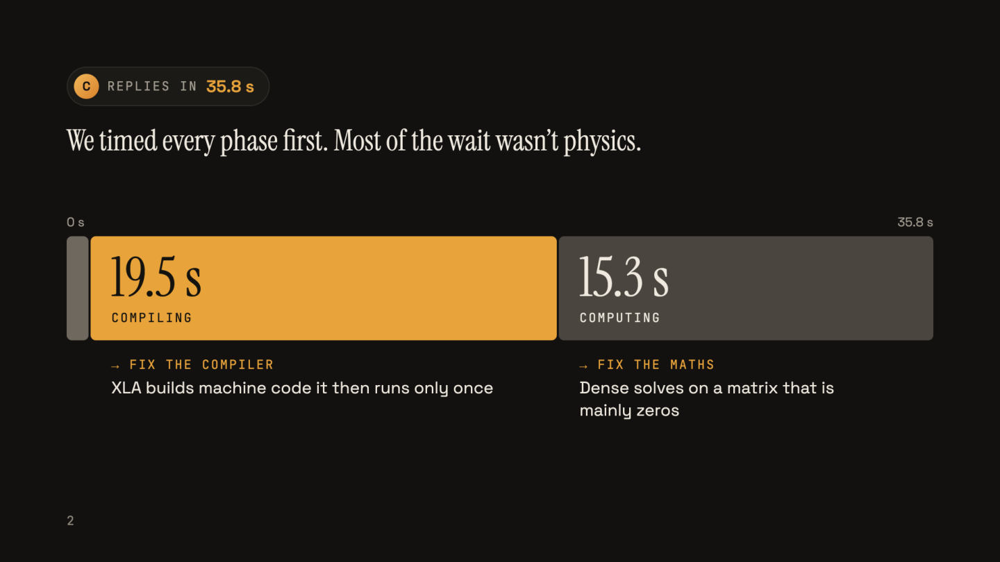
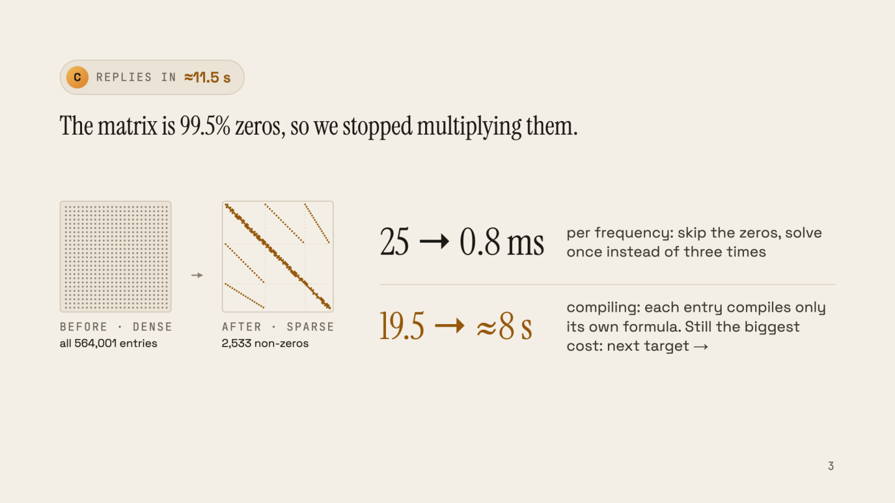
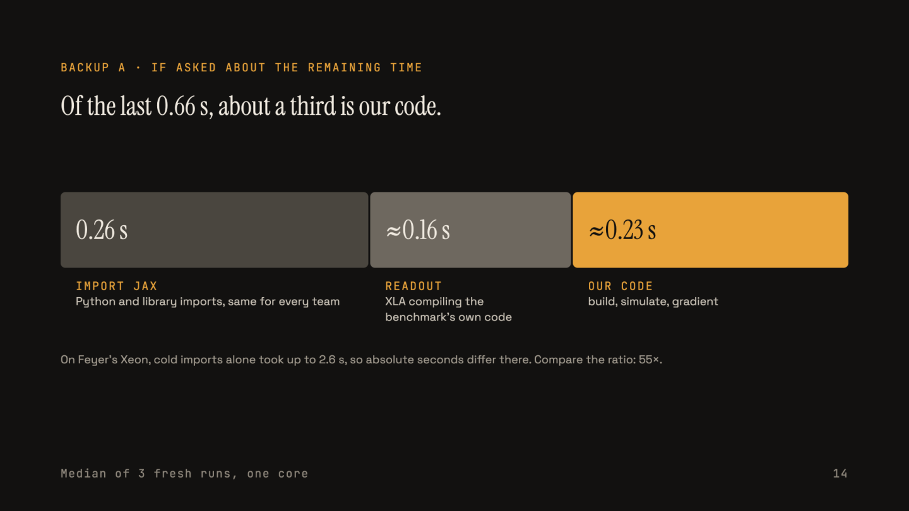
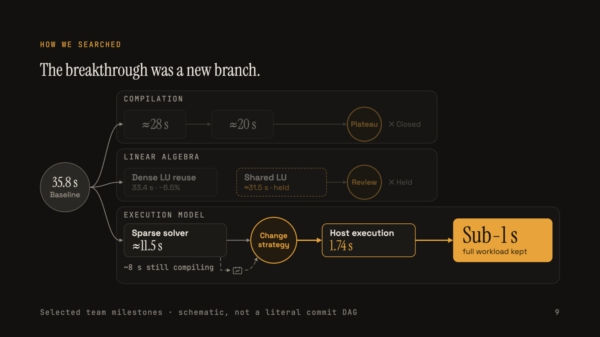

# Faster Answers

**Feyer Challenge · START Hack Munich 2026**

Faster optical simulations. A Git-traceable lab for finding, testing, and explaining improvements.

[**Our presentation ↗**](presentation/faster-answers.pdf) · [**Feyer’s introduction ↗**](presentation/feyer-challenge.pdf) · [**Frontend ↗**](https://github.com/timbtz/feyer-search-frontend)

## The challenge

**Our task:** accelerate Differometor’s complete first evaluation. **101 frequencies · 193 variables · double precision · physical outputs and gradients preserved.** [Challenge rules →](challenge.pdf)

## Where the original time went: 44.20 seconds

*Feyer’s published baseline on one Intel Xeon logical CPU. On our AMD machine, the starting workload took **35.8 s**—the baseline for our speedup.*

## How we solved it

**Exploit sparsity. Execute the traced physics on the host.**

## From 35.8 seconds to 0.66

*Final-pitch measurements; approximately 55× overall. The host-engine slide’s 20× compares against the original baseline. [Exact revisions, validation, and measurement scopes →](docs/RESULTS.md)*

## The Git-traceable operating loop

**Explore → commit → evaluate → learn. Every candidate has a revision; every result has evidence.**

*Search-story schematic. Inspect recorded ancestry and individual runs in the [frontend](https://github.com/timbtz/feyer-search-frontend).*

## Two repositories, one system

| [Challenge lab](https://github.com/timbtz/feyer-search-lab) | [Search frontend](https://github.com/timbtz/feyer-search-frontend) |
| --- | --- |
| Agents, Git history, evaluator, validation, feedback | Search graph, exact revisions, timings, recorded decisions |

[**Architecture**](docs/ARCHITECTURE.md) · [**Run the lab**](lab/README.md) · [**Run the frontend**](https://github.com/timbtz/feyer-search-frontend#try-it) · [**Benchmark setup**](docs/CHALLENGE.md) · [**Full slide deck**](presentation/faster-answers.pdf)

Based on [Differometor](README.upstream.md) · [MIT license](LICENSE).
