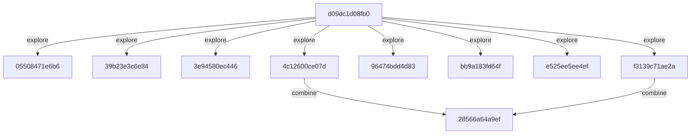

# Team search queue

Human-driven search; Qwen and SMAC are optional. See `.wiki/team-search.md` on main.

Claims and decisions live in this branch. Timing comparisons require the same instance and cohort.

| Task | Kind | State | Owner / instance | Parents |
| --- | --- | --- | --- | --- |
| inventory-search-frontier-v1 | diagnose | ready | — / — | f3139c71ae2a, 4c12600ce07d |

## Comparison regime

Current mode: **concurrent**, epoch 14.

Concurrent and unverified timing imports are exploratory and excluded from winner assessment.

Receipt: https://github.com/timbtz/feyer-search-lab/issues/6

User authorized expanded CPU capacity. Conservatively exclude new timing imports until all overlapping work drains and fresh serial confirmation begins; this admission does not assert that lane 2 has started.

## Scientific lineage

Every edge records intended inputs, not proof of speedup.

Recorded jobs: 13. Decisions/events: 24.

## External research records

| Executor | Kind | Candidate | Target phases | Recorded status |
| --- | --- | --- | --- | --- |
| claude-noise-reuse | explore | f3139c71ae2a | unknown | completed |
| claude-noise-reuse | explore | e525ee5ee4ef | unknown | completed |
| claude-noise-reuse | explore | bb9a183fd64f | unknown | completed |
| claude-noise-reuse | explore | 96474bdd4d83 | unknown | completed |
| claude-noise-reuse | explore | 05508471e6b6 | unknown | completed |
| claude-noise-reuse | combine | 28566a64a9ef | unknown | completed |
| claude-structure-solve | explore | 4c12600ce07d | unknown | completed |
| claude-structure-solve | explore | 39b23e3c6e84 | unknown | completed |
| claude-structure-solve | explore | 3e94580ec446 | unknown | completed |

These records are evidence, not competing task claims or winner declarations.
