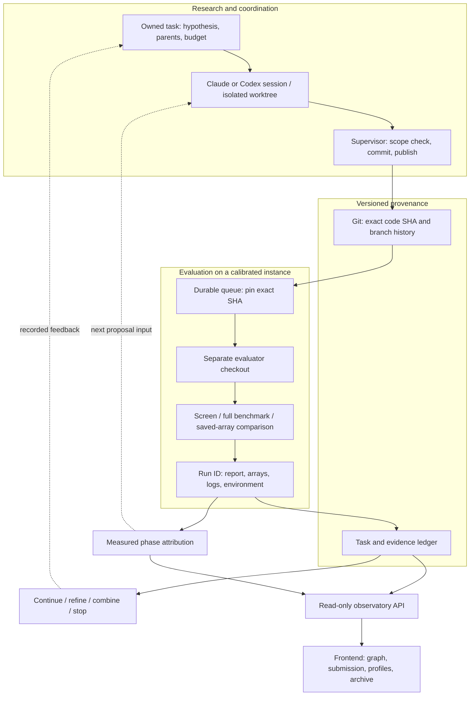

# One project: simulator, operating loop, observatory

[Project home](../README.md) · [Results](RESULTS.md) · [Lab guides](../.wiki/README.md) · [Frontend](https://github.com/timbtz/feyer-search-frontend)

The challenge lab is a Git-traceable operating system for optimization experiments. The frontend makes its recorded work understandable. Together they connect a hypothesis to code, a measurement, a correctness decision, and the next experiment.

## Three connected parts

| Part | Input → output | Ownership |
| --- | --- | --- |
| Physics implementation | Optical setup and parameters → fields, noise, sensitivity, powers and gradients | `differometor/` at an exact candidate SHA |
| Experiment lab | Bounded hypothesis → candidate → evaluated evidence → next task | This repo’s supervisor, search controllers and evaluator |
| Observatory | Recorded evidence → graphs, phase profiles, source comparisons and run archive | Standalone frontend and embedded `lab/dashboard/` |

The simulator’s internal computation, the graph of research candidates, and the operational feedback loop are different structures. The frontend visualizes the latter two; it does not claim to draw every tensor operation inside the simulator.

## How an experiment runs

GitHub holds source history, task ownership, and published evidence. Controllers and workers execute the loop; GitHub itself does not run the AMD benchmark. The initial relay transports exact commits as Git bundles using established access. Raw artifacts live with evaluator runs, with selected evidence published separately.

## Identities that make it traceable

| Identity | Why it is separate |
| --- | --- |
| Research direction | A hypothesis can outlive one session. |
| Agent session | A bounded conversation owns a worktree and can produce several candidates. |
| Candidate SHA | Immutable code to evaluate; a branch name alone is insufficient. |
| Evaluation job / request | Repeats of one candidate remain distinct runs. |
| Instance and comparison cohort | Hardware, environment, validation policy and timing regime determine comparability. |
| Decision / feedback record | Explains continuation, combination or stopping; delivery to a later session requires its own record. |

Process completion, numerical correctness, and performance improvement are separate states. The dashboard preserves all three. An absent result never becomes a pass or a zero-second measurement.

## Reading the graph

**Topology map:** groups recorded agent sessions, candidates, numerical menus, and decisions. Expand a session to inspect candidate revisions, then exact screen/full jobs. Known relationships determine grouping; shared names or approximate timestamps do not establish ownership.

**Run cards:** show the chronology of a recorded research branch and its measured feedback. Workflow guide lines explain intended progression without inventing parent relationships.

**Exact evidence DAG:** shows declared scientific parents and recorded dependencies. Multiple parents represent a combination. Membership edges are distinct from ancestry. Optional feedback overlays connect execution artifacts without turning the scientific DAG into a feedback cycle.

**Timing profile, Submission, Run archive:** expose exact jobs, source differences, correctness records and phase timings. Complete first-run, warm runtime, import time, compilation, and job wall time retain separate meanings. Comparisons stay within compatible measurement contexts.

## Two levels of search

The outer loop explores implementation strategies: imports, assembly, compilation, linear algebra, and host execution. The inner loop refines a reviewed, frozen menu of implementation settings. Earlier campaigns used SMAC3; deterministic search supports enumeration and local search. The final six-setting SuperLU sweep was enumeration.

Combining compatible ideas creates a new implementation requiring new checks. Phase savings from separate branches cannot be added to predict a measured result. A stopping record means a budget, menu or correctness decision ended that direction; it does not prove a global optimum.

## Code map

| Responsibility | Entry points |
| --- | --- |
| Supervised proposal → commit → feedback | [`lab/agent_loop.py`](../lab/agent_loop.py), [`lab/claude_turn.py`](../lab/claude_turn.py) |
| Team tasks and ownership | [`lab/team_search.py`](../lab/team_search.py) |
| Candidate/evidence ledger and frozen rounds | [`lab/evolution.py`](../lab/evolution.py), [`lab/evolution_evidence.py`](../lab/evolution_evidence.py) |
| Bounded numerical search | [`lab/discrete_search.py`](../lab/discrete_search.py), [`lab/smac_search.py`](../lab/smac_search.py), [`lab/topology_run.py`](../lab/topology_run.py) |
| Exact-revision submission and execution | [`lab/client.py`](../lab/client.py), [`lab/queue.py`](../lab/queue.py), [`lab/worker.py`](../lab/worker.py) |
| Screening and numerical comparison | [`lab/screen.py`](../lab/screen.py), [`lab/compare_arrays.py`](../lab/compare_arrays.py) |
| Attribution and feedback | [`lab/profiler.py`](../lab/profiler.py), [`lab/profiler_feedback.py`](../lab/profiler_feedback.py), [`lab/research_lineage.py`](../lab/research_lineage.py) |
| Read-only API and source dossiers | [`lab/live_dashboard.py`](../lab/live_dashboard.py), [`lab/submission_report.py`](../lab/submission_report.py) |
| Frontend and consumer contract | [Frontend repository](https://github.com/timbtz/feyer-search-frontend), [API contract](https://github.com/timbtz/feyer-search-frontend/blob/main/docs/API_CONTRACT.md) |

## Live, saved, and synthetic

The lab observatory reads local records and can optionally poll configured remote sources. The browser refreshes while visible. Source timestamps and stale observations remain visible; a refresh timestamp alone does not establish that a worker is alive.

The standalone frontend defaults to an included, dated, sanitized snapshot. `--api-url` connects it to an existing observatory; `--demo` uses labelled synthetic data. Both servers bind to localhost and expose read-only data. Publishing the repositories does not deploy an evaluator or public dashboard service.

The two frontend copies are not automatically synchronized. Review each copy’s changes before syncing shared presentation assets; keep repository-specific servers, configuration and recorded data separate.

## Operating constraints

Agents own isolated worktrees and bounded budgets. A supervisor owns commits and submissions in managed sessions. Evaluators use fixed environments and pinned revisions; full workloads, double precision and the official staged benchmark remain intact. Initial evaluation is serial; later capacity policies have explicit records. Final comparisons need their recorded, matching conditions.

Start with the [runbook](../.wiki/runbook.md), [team workflow](../.wiki/team-search.md), and [experiment rules](../AGENTS.md). Host placement and optional model services in older records describe their particular deployment, not prerequisites for viewing the project.
