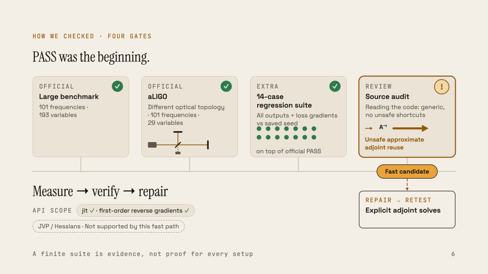

# Performance, correctness, and exact revisions

[Project home](../README.md) · [Final pitch](../presentation/faster-answers.pdf) · [Architecture](ARCHITECTURE.md)

The final pitch presents a **35.8 s → 0.66 s** journey, approximately **55×** faster. This page separates that presentation narrative from the lab’s exact candidate records and later numerical review. These are retained results, not new benchmark runs performed for this documentation.

## What the clock measures

The scored quantity is complete first-run time in a fresh process: imports, initialization, setup, tracing/lowering/compilation, forward simulation, sensitivity, gradients, and result transfer. Validation and reporting are outside that timer. Warm runtime and total evaluation-job duration are different measurements.

The supplied large setup keeps 101 frequencies and 193 variables. The separately tested aLIGO setup has 101 frequencies and 29 variables. Double precision and each setup’s full physical outputs remain required. Compare matching hardware, CPU limits, software and validation policies; a ratio measured on one machine is not guaranteed on another.

## The presentation journey

| Milestone | Complete first run | Mechanism / scope |
| --- | ---: | --- |
| Starting example | 35.8 s | Approximately 19.5 s compilation and 15.3 s computation |
| Structural sparse solves | ≈11.5 s | Avoid dense work on a matrix that is approximately 99.5% zeros |
| Host execution engine | 1.74 s | Execute the traced component recipe with NumPy and sparse linear algebra; approximately 20× against the starting baseline |
| Host setup and callback cleanup | 0.82 s | Reduce small compilations and dispatch overhead |
| Leaner derivatives / fallback | ≈0.74 s | Reduce unnecessary derivative work and retain fallback behavior |
| Final pitch | 0.66 s | Includes the compiler setting described as organizer-approved in the deck |

Source: [slides 2–5](../presentation/faster-answers.pdf#page=2). These are selected team milestones, not a literal Git ancestry chain. “Approximately 8 s” on the sparse-stage slide is remaining **compilation**, not total runtime. The approximately 20× host-engine figure compares 1.74 s with the original baseline, not the preceding 11.5 s milestone.

The 0.66 s headline is attributed to the supplied final deck. Its exact final-revision report is not identified by the checked-in submission manifest; do not attach it to that manifest’s selected SHA. The [presentation evidence notes](../presentation/search-story/EVIDENCE.md) retain this distinction.

## Exact code you can inspect

| Record | Revision | Meaning |
| --- | --- | --- |
| Lab source baseline | [`02ec741d`](https://github.com/timbtz/feyer-search-lab/commit/02ec741d8a1bf1a2278294ea74f9fc1d68f08f1f) | Unchanged source baseline; three AMD baseline totals had a median of 35.737065 s |
| Existing selected submission | [`53f38d34`](https://github.com/timbtz/feyer-search-lab/commit/53f38d342c3228c052785e8c9d63b6ce9c832dd1) | Approximately one-second host/sparse candidate selected in the dashboard; selection does not override numerical findings |
| Conservative explicit-adjoint repair | [`3b107d69`](https://github.com/timbtz/feyer-search-lab/commit/3b107d69d9d083f7aaa5f11b952f0098ed0ba528) | Starting candidate retained by the final finite sweep |

The [submission manifest](../experiments/submission/candidates.json) specifies the dashboard selection and source annotations. The main infrastructure checkout retains its own simulator revision; cloning it is not a checkout of every optimized candidate. Use the SHA belonging to the result you intend to reproduce and follow the [evaluator runbook](../.wiki/runbook.md).

In a separate three-pair, cold-checkout comparison, teammate simulator import `be4949e1` measured **0.703439 s** on the large setup and **0.542659 s** on aLIGO; repair `3b107d69` measured **0.855262 s** and **0.538566 s** respectively. All 12 official checks passed. This is a distinct measurement policy and implementation comparison, not a remeasurement of the pitch’s 0.66 s result. See the [head-to-head analysis](https://github.com/timbtz/feyer-search-lab/blob/control/overnight-20261122/experiments/campaigns/overnight-20261122/peer-comparison/analysis.md).

## Validation beyond PASS

The official checks test positive reference-matching sensitivities, finite physical outputs and gradients, nonzero gradients, and gradient sanity. The large setup’s sensitivity bound is `abs(log(S) - log(S_ref)) <= 1e-5`; the separately published aLIGO harness uses `1e-6`.

Additional checks compared saved arrays and all gradients, exercised 14 setup/parameter/mode cases, reviewed generic matrix construction, and inspected differentiation assumptions. Source review identified approximate adjoint reuse that could discard small cotangent components amplified by an ill-conditioned inverse. The conservative branch replaced that shortcut with explicit adjoint solves.

Passing the official suite or agreeing with one seed does not prove correctness for every input. Seed-relative regression is not an independent high-precision oracle. The tested host path supports `jit` and first-order reverse gradients; JVPs, Hessians, higher derivatives and GPU execution are outside that demonstrated scope.

## The final bounded search: a useful negative result

The final sweep exhaustively enumerated six SuperLU settings. Each row is **one fresh-checkout first-run sample**, not a median. Both official workloads passed for every setting; only the default passed the additional seed-relative suite.

| Setting | Large / s | aLIGO / s | Official checks | Extra seed checks |
| --- | ---: | ---: | --- | --- |
| Default | 0.852731 | 0.530437 | Pass | Pass |
| Relax 4 | 0.855784 | 0.530816 | Pass | Fail |
| Panel 8 | 0.855807 | 0.531165 | Pass | Fail |
| Panel 8 + relax 4 | 0.845224 | 0.522221 | Pass | Fail |
| Panel 16 | 0.860740 | 0.528449 | Pass | Fail |
| Panel 16 + relax 4 | 0.844503 | 0.527698 | Pass | Fail |

**Decision: no admissible improvement in this sweep; retain the repaired starting candidate.** Some configurations measured lower times but failed additional checks. No paired promotion was triggered, and this result makes no claim of a global optimum.

The [machine-readable evidence](../presentation/search-story/evidence.json) retains exact SHAs and request IDs. The [published campaign](https://github.com/timbtz/feyer-search-lab/tree/control/overnight-20261122/experiments/campaigns/overnight-finite-v1) retains the underlying results. Earlier SMAC3 campaigns and this final enumeration are separate searches.

## Reproduction and attribution

Start with the [original benchmark guide](CHALLENGE.md) for a local baseline or [portable evaluator guide](../.wiki/portable-amd.md) for managed comparisons. Use the checked-in client help for queue commands. Keep the full workload and official harness intact, and retain the exact SHA, environment, run IDs, correctness details and arrays.

The public CPU reference in `benchmarks/cpu-baseline.json` is **44.204 s on an Intel Xeon**, a different baseline from the team’s approximately 35.8 s AMD runs. Do not pool them. The frontend’s saved snapshot is a historical observation, not evidence of currently running agents.

Future optical-design search is an application of this system proposed in the final presentation. This challenge optimized the simulator; it did not optimize away the prescribed physical workload or demonstrate a completed search for new instruments.
