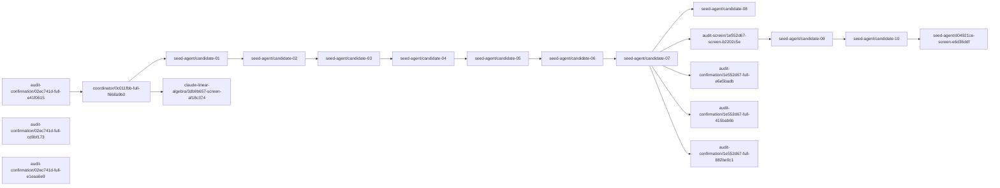

# Candidate phase comparison

Snapshot: 2026-11-21T15:52:58.907816+00:00

Magnitude exceeds max(0.02 seconds, 3% of baseline phase median, baseline phase range). Heuristic, not statistical significance.

Exact observed dominance on six first-run phase groups; only full official + strict-array passes with matching environment. Baseline point uses phase medians from three runs.

Single candidate runs are provisional. Baseline medians are calculated independently per phase and need not sum to the median total. First-run and warm timings remain separate. Memory is recorded but not a Pareto objective. Causal attribution requires controlled/repeated runs.

All times below are first-run seconds. Positive savings mean faster.

| Candidate evaluation | Official / strict | Total | Setup | Compilation | Forward | Sensitivity | Gradient | Transfer | Improved / regressed vs baseline |
| --- | --- | ---: | ---: | ---: | ---: | ---: | ---: | ---: | --- |
| Baseline medians | passed | 35.7371 | 1.0290 | 19.6652 | 12.1273 | 0.0009 | 2.9348 | 0.0005 | reference |
| coordinator/0c011fbb-full-f668a9b0 (0c011fbb) | passed / passed | 36.3319 | 1.0581 | 20.0483 | 12.1980 | 0.0009 | 3.0262 | 0.0005 | improved: none; regressed: gradient |
| seed-agent/candidate-01 (2f190c5c) | passed / passed | 36.9963 | 1.1349 | 20.7550 | 12.1456 | 0.0009 | 2.9596 | 0.0003 | improved: none; regressed: setup, compilation |
| seed-agent/candidate-02 (7f3cf9c3) | passed / failed | 34.7485 | 1.0584 | 19.6608 | 11.2359 | 0.0009 | 2.7922 | 0.0003 | improved: forward, gradient; regressed: none |
| seed-agent/candidate-03 (6cadc0f6) | passed / passed | 31.7782 | 1.0224 | 15.9226 | 12.0269 | 0.0028 | 2.8028 | 0.0006 | improved: compilation, gradient; regressed: none |
| seed-agent/candidate-04 (fbcfaa3a) | passed / passed | 29.9210 | 1.0450 | 14.1016 | 11.9348 | 0.0009 | 2.8382 | 0.0003 | improved: compilation, gradient; regressed: none |
| seed-agent/candidate-05 (3c9717f9) | passed / passed | 28.9718 | 1.0364 | 13.7218 | 12.3734 | 0.0009 | 1.8390 | 0.0003 | improved: compilation, gradient; regressed: none |
| seed-agent/candidate-06 (c4c7260e) | passed / passed | 30.7190 | 1.5644 | 13.8071 | 11.7006 | 0.0009 | 3.6457 | 0.0003 | improved: compilation, forward; regressed: setup, gradient |
| seed-agent/candidate-07 (0a0c93fa) | passed / passed | 30.5640 | 1.0330 | 15.3675 | 12.3014 | 0.0009 | 1.8608 | 0.0004 | improved: compilation, gradient; regressed: none |
| seed-agent/candidate-08 (1e552d67) | passed / passed | 28.0135 | 1.0306 | 12.7695 | 12.3137 | 0.0009 | 1.8985 | 0.0004 | improved: compilation, gradient; regressed: none |
| seed-agent/candidate-09 (c33dafe1) | passed / passed | 28.7739 | 1.1151 | 13.2071 | 12.5254 | 0.0009 | 1.9250 | 0.0004 | improved: compilation, gradient; regressed: setup, forward |
| seed-agent/candidate-10 (46a24bbc) | passed / passed | 28.7648 | 1.0907 | 13.0232 | 12.7735 | 0.0009 | 1.8761 | 0.0004 | improved: compilation, gradient; regressed: setup, forward |
| seed-agent/d04921ce-screen-e6d36ddf (d04921ce) | not_run / not_run | 28.3792 | 1.0865 | 12.9645 | 12.3453 | 0.0009 | 1.9815 | 0.0004 | improved: compilation, gradient; regressed: setup |
| audit-confirmation/02ec741d-full-cd9bf173 (02ec741d) | passed / passed | 35.7201 | 1.0306 | 19.6300 | 12.0904 | 0.0009 | 2.9678 | 0.0004 | improved: none; regressed: none |
| audit-confirmation/1e552d67-full-e6e5badb (1e552d67) | passed / passed | 28.0935 | 1.0324 | 12.7776 | 12.3995 | 0.0009 | 1.8829 | 0.0003 | improved: compilation, gradient; regressed: none |
| audit-confirmation/1e552d67-full-415bab6b (1e552d67) | passed / passed | 28.0400 | 1.0238 | 12.7568 | 12.3821 | 0.0009 | 1.8760 | 0.0004 | improved: compilation, gradient; regressed: none |
| audit-confirmation/02ec741d-full-e1eaa6e9 (02ec741d) | passed / passed | 35.9469 | 1.0407 | 19.7398 | 12.2198 | 0.0009 | 2.9452 | 0.0005 | improved: none; regressed: none |
| audit-confirmation/02ec741d-full-e41f0615 (02ec741d) | passed / passed | 35.6383 | 1.0312 | 19.5305 | 12.1191 | 0.0009 | 2.9563 | 0.0003 | improved: none; regressed: none |
| audit-confirmation/1e552d67-full-882be0c1 (1e552d67) | passed / passed | 28.5743 | 1.0996 | 13.1709 | 12.4001 | 0.0011 | 1.9022 | 0.0004 | improved: compilation, gradient; regressed: setup |
| claude-linear-algebra/3db9b657-screen-af18c374 (3db9b657) | not_run / not_run | 31.4285 | 1.0551 | 19.5952 | 8.0434 | 0.0009 | 2.7336 | 0.0004 | improved: forward, gradient; regressed: none |
| audit-screen/1e552d67-screen-b2202c5e (1e552d67) | not_run / not_run | 28.1541 | 1.0428 | 12.8646 | 12.3320 | 0.0009 | 1.9135 | 0.0003 | improved: compilation, gradient; regressed: none |

## Exploration ancestry

Edges represent commit ancestry, not proof of causal attribution.

## Candidate details

### coordinator/0c011fbb-full-f668a9b0

Verify canonical full benchmark and strict array comparison through the queue

Classification: regression. Observed Pareto frontier: True.

Memory enforcement evidence: unknown_historical; kernel cap: None; budget bytes: None.

[Code](https://github.com/timbtz/feyer-search-lab/commit/0c011fbbff6edb4ca095f12b5c762652da788f73)

### seed-agent/candidate-01

Deferred the visualization import while preserving named imports, wildcard exports and the original callable. Candidate 1 is ready for screening.

Classification: regression. Observed Pareto frontier: True.

Memory enforcement evidence: unknown_historical; kernel cap: None; budget bytes: None.

[Code](https://github.com/timbtz/feyer-search-lab/commit/2f190c5cffdaf8f86701dfae49dddae6a1efe028)

### seed-agent/candidate-02

Prepared candidate 2: removed the final noise covariance solve using the existing adjoint weights. Restored baseline imports after candidate 1 showed no measured gain.

Classification: improvement_without_detected_regression. Observed Pareto frontier: False.

Memory enforcement evidence: unknown_historical; kernel cap: None; budget bytes: None.

[Code](https://github.com/timbtz/feyer-search-lab/commit/7f3cf9c316ce87a98afccb402bffc34e4ff71532)

Validation: Official benchmark passed, but strict baseline array comparison failed

### seed-agent/candidate-03

Prepared candidate 3: restored baseline noise arithmetic and changed component dispatch from vmap to lax.map, retaining frequency batching.

Classification: improvement_without_detected_regression. Observed Pareto frontier: True.

Memory enforcement evidence: unknown_historical; kernel cap: None; budget bytes: None.

[Code](https://github.com/timbtz/feyer-search-lab/commit/6cadc0f6e5c9d4799b53af7c9a6d24f35a4d221e)

### seed-agent/candidate-04

Prepared final candidate 4: reuse a JIT helper for scalar component dispatch to target tracing overhead.

Classification: improvement_without_detected_regression. Observed Pareto frontier: True.

Memory enforcement evidence: unknown_historical; kernel cap: None; budget bytes: None.

[Code](https://github.com/timbtz/feyer-search-lab/commit/fbcfaa3a889e5d1e21a6054a50a8bdb05d7d8685)

### seed-agent/candidate-05

Prepared candidate 5: replace three signal-matrix conjugation updates with one equivalent masked operation, retaining validated candidate 4 improvements.

Classification: improvement_without_detected_regression. Observed Pareto frontier: True.

Memory enforcement evidence: unknown_historical; kernel cap: None; budget bytes: None.

[Code](https://github.com/timbtz/feyer-search-lab/commit/3c9717f9254e94d5b441401a75dbc79b7b4b4d8c)

### seed-agent/candidate-06

Prepared candidate 6: assemble the conjugated signal regions with disjoint slices and concatenation instead of a mask.

Classification: tradeoff. Observed Pareto frontier: True.

Memory enforcement evidence: unknown_historical; kernel cap: None; budget bytes: None.

[Code](https://github.com/timbtz/feyer-search-lab/commit/c4c7260e9db22591182f434eb25e6a566c2096f8)

### seed-agent/candidate-07

Prepared candidate 7: restore candidate 5’s masked conjugation and recompute small component intermediates during the reverse pass.

Classification: improvement_without_detected_regression. Observed Pareto frontier: True.

Memory enforcement evidence: unknown_historical; kernel cap: None; budget bytes: None.

[Code](https://github.com/timbtz/feyer-search-lab/commit/0a0c93fa8f814e0c9c2eab87117d6030a0e87b40)

### seed-agent/candidate-08

Prepared candidate 8: move intermediate recomputation inside each component branch rather than around the entire switch.

Classification: improvement_without_detected_regression. Observed Pareto frontier: True.

Memory enforcement evidence: unknown_historical; kernel cap: None; budget bytes: None.

[Code](https://github.com/timbtz/feyer-search-lab/commit/1e552d675c3795265be8af1ac23ffb61f90f30b1)

### seed-agent/candidate-09

Prepared candidate 9: inline the component JIT helper while retaining candidate 8’s validated changes.

Classification: tradeoff. Observed Pareto frontier: False.

Memory enforcement evidence: unknown_historical; kernel cap: None; budget bytes: None.

[Code](https://github.com/timbtz/feyer-search-lab/commit/c33dafe112eab30fda33ff9d794e2ca1a333d158)

### seed-agent/candidate-10

Prepared candidate 10: reuse JIT wrappers for individual checkpointed component branches, restoring candidate 8’s helper boundary.

Classification: tradeoff. Observed Pareto frontier: True.

Memory enforcement evidence: unknown_historical; kernel cap: None; budget bytes: None.

[Code](https://github.com/timbtz/feyer-search-lab/commit/46a24bbc779cdccd8126ef3a02398f0a16ea2bc9)

### seed-agent/d04921ce-screen-e6d36ddf

A fresh evaluation will test whether candidate 8’s lower first-run time is reproducible.

Classification: tradeoff. Observed Pareto frontier: False.

Memory enforcement evidence: unknown_historical; kernel cap: None; budget bytes: None.

[Code](https://github.com/timbtz/feyer-search-lab/commit/d04921ce5fbdd872ed5fe5820516f5a3b47c5744)

### audit-confirmation/02ec741d-full-cd9bf173

Confirmation study 2026-11-21, run 1, pair 1, baseline; independent fresh process under identical monitored32GB envelope

Classification: within_noise_band. Observed Pareto frontier: True.

Memory enforcement evidence: sampled_process_group_rss; kernel cap: False; budget bytes: 32000000000.

[Code](https://github.com/timbtz/feyer-search-lab/commit/02ec741d8a1bf1a2278294ea74f9fc1d68f08f1f)

### audit-confirmation/1e552d67-full-e6e5badb

Confirmation study 2026-11-21, run 2, pair 1, candidate; independent fresh process under identical monitored32GB envelope

Classification: improvement_without_detected_regression. Observed Pareto frontier: True.

Memory enforcement evidence: sampled_process_group_rss; kernel cap: False; budget bytes: 32000000000.

[Code](https://github.com/timbtz/feyer-search-lab/commit/1e552d675c3795265be8af1ac23ffb61f90f30b1)

### audit-confirmation/1e552d67-full-415bab6b

Confirmation study 2026-11-21, run 3, pair 2, candidate; independent fresh process under identical monitored32GB envelope

Classification: improvement_without_detected_regression. Observed Pareto frontier: True.

Memory enforcement evidence: sampled_process_group_rss; kernel cap: False; budget bytes: 32000000000.

[Code](https://github.com/timbtz/feyer-search-lab/commit/1e552d675c3795265be8af1ac23ffb61f90f30b1)

### audit-confirmation/02ec741d-full-e1eaa6e9

Confirmation study 2026-11-21, run 4, pair 2, baseline; independent fresh process under identical monitored32GB envelope

Classification: within_noise_band. Observed Pareto frontier: True.

Memory enforcement evidence: sampled_process_group_rss; kernel cap: False; budget bytes: 32000000000.

[Code](https://github.com/timbtz/feyer-search-lab/commit/02ec741d8a1bf1a2278294ea74f9fc1d68f08f1f)

### audit-confirmation/02ec741d-full-e41f0615

Confirmation study 2026-11-21, run 5, pair 3, baseline; independent fresh process under identical monitored32GB envelope

Classification: within_noise_band. Observed Pareto frontier: True.

Memory enforcement evidence: sampled_process_group_rss; kernel cap: False; budget bytes: 32000000000.

[Code](https://github.com/timbtz/feyer-search-lab/commit/02ec741d8a1bf1a2278294ea74f9fc1d68f08f1f)

### audit-confirmation/1e552d67-full-882be0c1

Confirmation study 2026-11-21, run 6, pair 3, candidate; independent fresh process under identical monitored32GB envelope

Classification: tradeoff. Observed Pareto frontier: False.

Memory enforcement evidence: sampled_process_group_rss; kernel cap: False; budget bytes: 32000000000.

[Code](https://github.com/timbtz/feyer-search-lab/commit/1e552d675c3795265be8af1ac23ffb61f90f30b1)

### claude-linear-algebra/3db9b657-screen-af18c374

Read from source: the baseline factors A^H separately from A in the forward stage (101 complex LUs at n=751, an estimated ~1e11 flops). It may also factor A twice unless XLA CSE merges the signal and covariance getrf calls. The JIT stages save the LUs as AD residuals. Reusing LU(A) for the A^H system (solve via U^H L^H P) should remove at least one LU batch from the forward stage. It should also remove the ~0.9 GB materialized A^H and one ~0.9 GB LU residual. Expected result: lower forward-stage and complete first-run time and lower peak memory. Gradient-stage cost and compile time should be about the same, and the outputs should differ only at rounding level (carrier and signal essentially identical).

Classification: improvement_without_detected_regression. Observed Pareto frontier: False.

Memory enforcement evidence: sampled_process_group_rss; kernel cap: False; budget bytes: 32000000000.

[Code](https://github.com/timbtz/feyer-search-lab/commit/3db9b657f8496d40a9f195fd9864e5e048c7df5b)

### audit-screen/1e552d67-screen-b2202c5e

Verify audited screening schema and 32GB sampled-RSS policy on already validated candidate8

Classification: improvement_without_detected_regression. Observed Pareto frontier: False.

Memory enforcement evidence: sampled_process_group_rss; kernel cap: False; budget bytes: 32000000000.

[Code](https://github.com/timbtz/feyer-search-lab/commit/1e552d675c3795265be8af1ac23ffb61f90f30b1)
