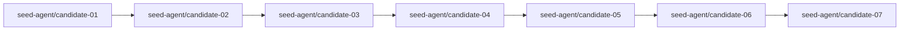

# Candidate phase comparison

Snapshot: 2026-11-21T15:18:43.567798+00:00

Magnitude exceeds max(0.02 seconds, 3% of baseline phase median, baseline phase range). Heuristic, not statistical significance.

Exact observed dominance on six first-run phase groups; only full official + strict-array passes with matching environment. Baseline point uses phase medians from three runs.

Single candidate runs are provisional. Baseline medians are calculated independently per phase and need not sum to the median total. First-run and warm timings remain separate. Memory is recorded but not a Pareto objective. Causal attribution requires controlled/repeated runs.

All times below are first-run seconds. Positive savings mean faster.

| Candidate | Full + strict checks | Total | Setup | Compilation | Forward | Sensitivity | Gradient | Transfer | Improved / regressed vs baseline |
| --- | --- | ---: | ---: | ---: | ---: | ---: | ---: | ---: | --- |
| Baseline medians | passed | 35.7371 | 1.0290 | 19.6652 | 12.1273 | 0.0009 | 2.9348 | 0.0005 | reference |
| seed-agent/candidate-01 (2f190c5c) | PASS | 36.9963 | 1.1349 | 20.7550 | 12.1456 | 0.0009 | 2.9596 | 0.0003 | improved: none; regressed: setup, compilation |
| seed-agent/candidate-02 (7f3cf9c3) | not validated | 34.7485 | 1.0584 | 19.6608 | 11.2359 | 0.0009 | 2.7922 | 0.0003 | improved: forward, gradient; regressed: none |
| seed-agent/candidate-03 (6cadc0f6) | PASS | 31.7782 | 1.0224 | 15.9226 | 12.0269 | 0.0028 | 2.8028 | 0.0006 | improved: compilation, gradient; regressed: none |
| seed-agent/candidate-04 (fbcfaa3a) | PASS | 29.9210 | 1.0450 | 14.1016 | 11.9348 | 0.0009 | 2.8382 | 0.0003 | improved: compilation, gradient; regressed: none |
| seed-agent/candidate-05 (3c9717f9) | PASS | 28.9718 | 1.0364 | 13.7218 | 12.3734 | 0.0009 | 1.8390 | 0.0003 | improved: compilation, gradient; regressed: none |
| seed-agent/candidate-06 (c4c7260e) | PASS | 30.7190 | 1.5644 | 13.8071 | 11.7006 | 0.0009 | 3.6457 | 0.0003 | improved: compilation, forward; regressed: setup, gradient |
| seed-agent/candidate-07 (0a0c93fa) | PASS | 30.5640 | 1.0330 | 15.3675 | 12.3014 | 0.0009 | 1.8608 | 0.0004 | improved: compilation, gradient; regressed: none |

## Exploration ancestry

Edges represent commit ancestry, not proof of causal attribution.

## Candidate details

### seed-agent/candidate-01

Deferred the visualization import while preserving named imports, wildcard exports and the original callable. Candidate 1 is ready for screening.

Classification: regression. Observed Pareto frontier: True.

[Code](https://github.com/timbtz/feyer-search-lab/commit/2f190c5cffdaf8f86701dfae49dddae6a1efe028)

### seed-agent/candidate-02

Prepared candidate 2: removed the final noise covariance solve using the existing adjoint weights. Restored baseline imports after candidate 1 showed no measured gain.

Classification: improvement_without_detected_regression. Observed Pareto frontier: False.

[Code](https://github.com/timbtz/feyer-search-lab/commit/7f3cf9c316ce87a98afccb402bffc34e4ff71532)

Validation: Official benchmark passed, but strict baseline array comparison failed

### seed-agent/candidate-03

Prepared candidate 3: restored baseline noise arithmetic and changed component dispatch from vmap to lax.map, retaining frequency batching.

Classification: improvement_without_detected_regression. Observed Pareto frontier: True.

[Code](https://github.com/timbtz/feyer-search-lab/commit/6cadc0f6e5c9d4799b53af7c9a6d24f35a4d221e)

### seed-agent/candidate-04

Prepared final candidate 4: reuse a JIT helper for scalar component dispatch to target tracing overhead.

Classification: improvement_without_detected_regression. Observed Pareto frontier: True.

[Code](https://github.com/timbtz/feyer-search-lab/commit/fbcfaa3a889e5d1e21a6054a50a8bdb05d7d8685)

### seed-agent/candidate-05

Prepared candidate 5: replace three signal-matrix conjugation updates with one equivalent masked operation, retaining validated candidate 4 improvements.

Classification: improvement_without_detected_regression. Observed Pareto frontier: True.

[Code](https://github.com/timbtz/feyer-search-lab/commit/3c9717f9254e94d5b441401a75dbc79b7b4b4d8c)

### seed-agent/candidate-06

Prepared candidate 6: assemble the conjugated signal regions with disjoint slices and concatenation instead of a mask.

Classification: tradeoff. Observed Pareto frontier: True.

[Code](https://github.com/timbtz/feyer-search-lab/commit/c4c7260e9db22591182f434eb25e6a566c2096f8)

### seed-agent/candidate-07

Prepared candidate 7: restore candidate 5’s masked conjugation and recompute small component intermediates during the reverse pass.

Classification: improvement_without_detected_regression. Observed Pareto frontier: True.

[Code](https://github.com/timbtz/feyer-search-lab/commit/0a0c93fa8f814e0c9c2eab87117d6030a0e87b40)
