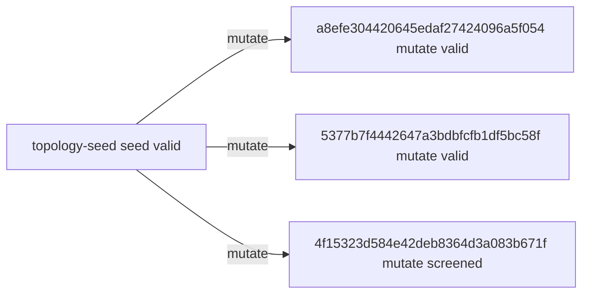

# Campaign astra-group-numerical-v3

Export schema: `feyer-campaign-export-v1`. Snapshot: `ba7e54a1837b90c43f8000966e465980566520829d40803be96cbdd7d0c0f102`.

[Frozen proposer context](contexts/505f15a2e90942201c88d38a204e4e6feb5de2545db30dde0a72195ca495ef51.json) — SHA256 `505f15a2e90942201c88d38a204e4e6feb5de2545db30dde0a72195ca495ef51`.

This is an evidence ledger. Scientific parents describe chosen inputs to an experiment; they are not necessarily Git parents. Phase changes are observations, not proof that one edit caused the difference. A failed attempt remains part of the history.

## Ownership and frozen policy

Campaign specification digest: `8b8410471ed01c330053fe804096c8192d1f88f6f479870966200d4be25156bd`.

| Actor | Role | Ownership version | Active |
| --- | --- | --- | --- |
| coordinator | coordinator | 1 | True |

## Scientific lineage

Edges come from declared scientific parents, not inferred chronology or Git ancestry.



## Candidate outcomes

| Candidate | Round / lane | Scientific parents | Exact commit | State | First-run seconds | Evidence IDs |
| --- | --- | --- | --- | --- | --- | --- |
| topology-seed | topology-001 / tune | root | d947905c9b73e310257235cf00cb065c31572ecd | valid | 21.5603 | 15ca7b7e27964b7c94b545d4b95849b8:deef0589aa1f4f4cd34404821f265dbb6b22a4cc8efb2b28e471412e2828c87d |
| a8efe304420645edaf27424096a5f054 | topology-001 / tune | topology-seed | 8e563b0f10de42042b6de999fbcbe4f45b6182e0 | valid | 21.5900 | 2e72e220fa5244fab7452f0c12aff35e:7a03c406f01a87714828cb4b6886e227c3fe96065470d40e76157c21fec930ab, 0e3f62edcd6342e38c75c4073aa992e3:da2f5671f047d61394923cfa45d8d58e0b4a9ab029cbd002a542dec7c459138f |
| 5377b7f4442647a3bdbfcfb1df5bc58f | topology-001 / tune | topology-seed | a2719aa311a04520945dfff7a501c76146a20c91 | valid | 22.8629 | db7b6b67b4964fe586dc49bdd9245f2a:937fe6563a2111470d83c6b6485d1b1c5484fb693cc55718d1371687aca96ae7, 9404a4c5dc9640aa8c56d3fa91ba0604:90a55005bc976cd346b56de9409c170a3dc3beb829a4c7fc9fb4dc2ee738a740 |
| 4f15323d584e42deb8364d3a083b671f | topology-001 / tune | topology-seed | 6831f87953fdd54f793364d07bfae77ff063d895 | screened | unknown | 7a20d98ff20349cfaab85ae39a170c0d:f3428fa1a8ec49ee70519a6cbd2abb74638d5afc5b8c8f55b235bd8100604d5e |

## Round decisions and stalled work

### Round topology-001

Frozen specification: `91641037b53366cbe8399a98c9e9109c18a3bc364ffea17edc3a90b025ff54ce`; version: 1; closed: False.

```json
{
  "budget": {
    "deadline_unix": 1795299882.878179,
    "max_evaluations": 10,
    "max_model_calls": 0,
    "max_proposals": 7
  },
  "dimensions": {
    "group_checkpoint": [
      "existing",
      "cse_barrier",
      "disabled"
    ],
    "group_inline": [
      true,
      false
    ]
  },
  "lanes": {
    "tune": {
      "dimensions": [
        "group_inline",
        "group_checkpoint"
      ],
      "max_proposals": 6,
      "owner": "coordinator",
      "stall_limit": 6
    }
  },
  "materializer_version": "exact-topology-finite-v1",
  "progress": {
    "absolute": 0.02,
    "relative": 0.01
  },
  "recipes": {
    "tune": {
      "dimensions": [
        "group_inline",
        "group_checkpoint"
      ]
    }
  },
  "round_id": "topology-001",
  "seed_parameters": {
    "group_checkpoint": "existing",
    "group_inline": true
  }
}
```

- topology-001/tune: active; owner coordinator; strikes 2; reason not recorded

## Candidate evidence and proposed changes

### topology-seed

```json
{
  "cohort_digest": "d78b193bdd3e61a0c054f0ba4b2645e67f80f7007e9e5fd6acea817f876795f6",
  "commit_sha": "d947905c9b73e310257235cf00cb065c31572ecd",
  "content_sha256": "fe4f9f610d353d13baebe4189a1e5fa83a5b98450168b3ccf7958ce4b484c95e",
  "context_sha256": null,
  "evaluation_requests": [
    {
      "attempt": 1,
      "candidate_id": "topology-seed",
      "evidence_id": "15ca7b7e27964b7c94b545d4b95849b8:deef0589aa1f4f4cd34404821f265dbb6b22a4cc8efb2b28e471412e2828c87d",
      "imported": true,
      "job_id": "15ca7b7e27964b7c94b545d4b95849b8",
      "profile": "full",
      "request_id": "04eefb40a74d4b709e0a87e29e4fa06a",
      "status": "valid"
    }
  ],
  "evidence": [
    {
      "artifact_digest": "deef0589aa1f4f4cd34404821f265dbb6b22a4cc8efb2b28e471412e2828c87d",
      "artifact_digests": {
        "comparison.json": "a757270aa2d5140cc4d0cdfdea136f573407c914e2f72027d11df12b7dae87d6",
        "report.json": "3c144030e30133af3e7de6906854e908b7863911abcdd9cba1b1636348c1f8d1",
        "result": "de937061ee2777d1bb2b1d631184042af1de7953c9b8d103072d8ea6fd12546a"
      },
      "candidate_sha": "d947905c9b73e310257235cf00cb065c31572ecd",
      "category": "valid",
      "checks": {
        "official": "passed",
        "precision": "passed",
        "resource": "passed",
        "source": "passed",
        "strict": "passed",
        "workload": "passed"
      },
      "cohort": {
        "adapter_schema": "feyer-evolution-evidence-v1",
        "container_limits": {
          "cpu.max": "1600000 100000",
          "cpuset.cpus.effective": "0-127",
          "memory.max": "59055800320",
          "memory.swap.max": "0"
        },
        "memory_policy": {
          "budget_bytes": 16000000000,
          "enforcement": "sampled_process_group_rss",
          "kernel_memory_limit_enforced": false
        },
        "profile": "full",
        "protected_baseline_sha": "02ec741d8a1bf1a2278294ea74f9fc1d68f08f1f",
        "signature": {
          "environment": {
            "backend": "cpu",
            "cpu_affinity_ids": [
              34
            ],
            "cpu_model": "AMD EPYC 9334 32-Core Processor",
            "jax_enable_x64": true,
            "packages": {
              "differometor": "0.0.6",
              "jax": "0.9.0",
              "jaxlib": "0.9.0",
              "numpy": "2.5.5",
              "optax": "0.2.6"
            },
            "persistent_compilation_cache": false,
            "python": "3.12.15",
            "requested_logical_cpus": 1,
            "thread_limits": {
              "MKL_NUM_THREADS": "1",
              "NUMEXPR_NUM_THREADS": "1",
              "OMP_NUM_THREADS": "1",
              "OPENBLAS_NUM_THREADS": "1"
            },
            "xla_flags": null
          },
          "inputs": {
            "frequency_count": 101,
            "gradient_parameter_count": 193,
            "reference_sha256": "726f2cfe6986cb991fa48d5a28127b9330c3dc7e69d5bd193c8748acef03adc3",
            "setup_sha256": "ff4ba353a2a03cdce7f3e61bad729c2e00888d842c28ba9cf699f95afb87e138"
          },
          "timing": {
            "benchmark": "start-munich-2026-public-differometor-uifo-v2",
            "evaluator_sha256": "d5950bbd872e5b00ad63f0bd7081e5096fb14ba9c96c80a6854a3b714719bd4e",
            "phase_keys": [
              "build",
              "forward",
              "forward_compile",
              "forward_lower",
              "gradient",
              "gradient_compile",
              "gradient_lower",
              "host_transfer",
              "imports",
              "initialize",
              "load",
              "sensitivity",
              "sensitivity_compile",
              "sensitivity_lower"
            ],
            "scope": {
              "excluded": "validation and benchmark harness bookkeeping, repeated profiling, plot/report generation; interpreter launch before the first timer",
              "forward_residuals": "saved for separately compiled reverse pass",
              "gradient_coordinates": "physical parameter values; public grid-length tying",
              "objective": "mean(log10(sensitivity / public_reference))",
              "optimizer_steps": 0,
              "total_scope": "imports, CPU initialization, input I/O, setup, all lowering/compilation, forward, sensitivity/powers/loss, reverse-mode gradient and host transfer"
            }
          }
        },
        "strict_policy": {
          "evaluator_sha256": "1bc9b39fe0023afc3db93211b9e3d6cd37ed2b13ee281f142749c2237a16ea8f",
          "reference_arrays_sha256": "c3f6cba045f8b41f488dc19c960f5056b5f2e75cfa64f9a687b52f2a9ba2751e",
          "rtol": 1e-07,
          "scale_atol": 1e-12
        },
        "worker_sha256": "d3c212da0ab1215187407d9cd21dc2cbb5f88dc0b5ee7885135bf7f002d14b58"
      },
      "cohort_digest": "d78b193bdd3e61a0c054f0ba4b2645e67f80f7007e9e5fd6acea817f876795f6",
      "cost": {
        "comparison_wall_seconds": 0.284583380445838,
        "peak_rss_bytes": 8030789632,
        "peak_rss_kib": 7842568,
        "total_worker_wall_seconds": 90.31826015748084,
        "wall_seconds": 90.033676777035
      },
      "eligible_full": true,
      "evidence_digest": "8dd39cfed5e1f9cf6551203e4d75e848a1304d9c5eeb6b90dd9aa002508f5814",
      "evidence_id": "15ca7b7e27964b7c94b545d4b95849b8:deef0589aa1f4f4cd34404821f265dbb6b22a4cc8efb2b28e471412e2828c87d",
      "execution_status": "completed",
      "issues": [],
      "job_id": "15ca7b7e27964b7c94b545d4b95849b8",
      "metrics": {
        "compilation": 9.826732682064176,
        "forward": 9.00551001727581,
        "gradient": 1.5804204046726227,
        "peak_rss_bytes": 8030789632,
        "runtime": 10.587104961276054,
        "sensitivity": 0.0008732229471206665,
        "setup": 1.1464195474982262,
        "total": 21.560257190838456,
        "transfer": 0.00030131638050079346
      },
      "phases": {
        "build": 0.8380487989634275,
        "forward": 9.00551001727581,
        "forward_compile": 3.554601876065135,
        "forward_lower": 0.765934482216835,
        "gradient": 1.5804204046726227,
        "gradient_compile": 4.759547900408506,
        "gradient_lower": 0.32987051270902157,
        "host_transfer": 0.00030131638050079346,
        "imports": 0.3042175006121397,
        "initialize": 0.0027419906109571457,
        "load": 0.0014112573117017746,
        "sensitivity": 0.0008732229471206665,
        "sensitivity_compile": 0.33775004744529724,
        "sensitivity_lower": 0.07902786321938038
      },
      "profile": "full",
      "resource_evidence": {
        "budget_bytes": 16000000000,
        "container_limits": {
          "cpu.max": "1600000 100000",
          "cpuset.cpus.effective": "0-127",
          "memory.max": "59055800320",
          "memory.swap.max": "0"
        },
        "limitation": "Sampled process-group RSS is not a kernel-enforced memory cap.",
        "memory_monitoring": {
          "budget_bytes": 16000000000,
          "enforcement": "sampled_process_group_rss",
          "exceeded": false,
          "kernel_memory_limit_enforced": false,
          "notes": "RSS sampling can miss brief peaks and counts shared pages in each process. It excludes GPU VRAM and does not reserve RAM or constrain other instance work.",
          "sampled_process_group_peak_rss_bytes": 8031838208,
          "samples": 322
        }
      },
      "schema_version": "feyer-evolution-evidence-v1",
      "scientific_strike": false,
      "screen_passed": false,
      "source_digests": {
        "clean_diff_sha256": "e3b0c44298fc1c149afbf4c8996fb92427ae41e4649b934ca495991b7852b855",
        "comparison_evaluator_sha256": "1bc9b39fe0023afc3db93211b9e3d6cd37ed2b13ee281f142749c2237a16ea8f",
        "evaluator_sha256": "d5950bbd872e5b00ad63f0bd7081e5096fb14ba9c96c80a6854a3b714719bd4e",
        "reference_arrays_sha256": "c3f6cba045f8b41f488dc19c960f5056b5f2e75cfa64f9a687b52f2a9ba2751e",
        "simulator_files_sha256": {
          "differometor/__init__.py": "505d559d5a17409680a91f555882edf23f78cbb7c98ee28845018fa9bfeba7e7",
          "differometor/build.py": "40f79573097e6037f70a5c89e1098f96cbffb9c8a87fc94d2ed34ab6756ab63d",
          "differometor/components.py": "2e857e19d468d94b46594f71a76221d9d8b677bad05f6cf03b9e57b0e1613593",
          "differometor/plot.py": "16735e0fb14902f2c024e3da9f2655cbea634c4dd9e06c48af1247e12d0cf606",
          "differometor/setups.py": "478b1a7391b28604c36d8245e13ffa4f6d0f6dc32eeac6c6feaf5c08aa06a76b",
          "differometor/simulate.py": "37ac18d969cebcda6fb1b26ae394be1ad39b062c3a2703b3450c90fe81ecc5df",
          "differometor/utils.py": "73ee8a862cbc435363904addc363071ed7dc8b1546956f82e1746998fe3b09ff"
        },
        "worker_sha256": "d3c212da0ab1215187407d9cd21dc2cbb5f88dc0b5ee7885135bf7f002d14b58"
      },
      "validated_output_scope": "last_warm_evaluation",
      "warm_metrics": {
        "forward": 9.370900511741638,
        "gradient": 1.5783772002905607,
        "host_transfer": 0.00020226649940013885,
        "sensitivity": 0.18347955495119095
      },
      "worker_error": null
    }
  ],
  "evidence_ids": [
    "15ca7b7e27964b7c94b545d4b95849b8:deef0589aa1f4f4cd34404821f265dbb6b22a4cc8efb2b28e471412e2828c87d"
  ],
  "git_parents": null,
  "heuristic_id": null,
  "hypothesis": null,
  "improved": false,
  "kind": "seed",
  "lane_id": "tune",
  "metrics": {
    "compilation": 9.826732682064176,
    "forward": 9.00551001727581,
    "gradient": 1.5804204046726227,
    "peak_rss_bytes": 8030789632,
    "runtime": 10.587104961276054,
    "sensitivity": 0.0008732229471206665,
    "setup": 1.1464195474982262,
    "total": 21.560257190838456,
    "transfer": 0.00030131638050079346
  },
  "model_manifest": null,
  "owner": "coordinator",
  "owner_version": 1,
  "parameters": {
    "group_checkpoint": "existing",
    "group_inline": true
  },
  "parameters_after": {
    "group_checkpoint": "existing",
    "group_inline": true
  },
  "parameters_before": null,
  "parents": [],
  "prompt_sha256": null,
  "proposal": {
    "candidate_id": "topology-seed",
    "commit_sha": "d947905c9b73e310257235cf00cb065c31572ecd",
    "content_sha256": "fe4f9f610d353d13baebe4189a1e5fa83a5b98450168b3ccf7958ce4b484c95e",
    "kind": "seed",
    "lane_id": "tune",
    "parameters": {
      "group_checkpoint": "existing",
      "group_inline": true
    },
    "parents": [],
    "proposal_id": "topology-seed",
    "provenance": {
      "heuristic_id": "import-exact-claude-topology",
      "model_calls": 0
    },
    "recipe": null,
    "round_id": "topology-001"
  },
  "proposal_id": "topology-seed",
  "provenance": {
    "heuristic_id": "import-exact-claude-topology",
    "model_calls": 0
  },
  "recipe": null,
  "response_sha256": null,
  "round_id": "topology-001",
  "target_symbols": null,
  "uncertainty": "No repeat-confirmation or causality is inferred from this export. Inspect exact job evidence and matching cohorts.",
  "valid": true
}
```

### a8efe304420645edaf27424096a5f054

```json
{
  "cohort_digest": "d78b193bdd3e61a0c054f0ba4b2645e67f80f7007e9e5fd6acea817f876795f6",
  "commit_sha": "8e563b0f10de42042b6de999fbcbe4f45b6182e0",
  "content_sha256": "b286499ea4c5ea83e10894d206c17c1c60cc0eec9e87ef6773a8227d5857295a",
  "context_sha256": null,
  "evaluation_requests": [
    {
      "attempt": 1,
      "candidate_id": "a8efe304420645edaf27424096a5f054",
      "evidence_id": "2e72e220fa5244fab7452f0c12aff35e:7a03c406f01a87714828cb4b6886e227c3fe96065470d40e76157c21fec930ab",
      "imported": false,
      "job_id": "2e72e220fa5244fab7452f0c12aff35e",
      "profile": "screen",
      "request_id": "ac3d64ca25c844dc99415694a70f9d87",
      "status": "screen"
    },
    {
      "attempt": 1,
      "candidate_id": "a8efe304420645edaf27424096a5f054",
      "evidence_id": "0e3f62edcd6342e38c75c4073aa992e3:da2f5671f047d61394923cfa45d8d58e0b4a9ab029cbd002a542dec7c459138f",
      "imported": false,
      "job_id": "0e3f62edcd6342e38c75c4073aa992e3",
      "profile": "full",
      "request_id": "e044dde5597c46cb825245067a640db1",
      "status": "valid"
    }
  ],
  "evidence": [
    {
      "artifact_digest": "7a03c406f01a87714828cb4b6886e227c3fe96065470d40e76157c21fec930ab",
      "artifact_digests": {
        "report.json": "33d666f7e1f98c8c9450bff1fdc0d46f3e8156c2e9b618d3331f453741b1c3d9",
        "result": "4902bf765818a2e1660469badef6d0d1cbec1f17ec48f8cb47309df39336d0d0"
      },
      "candidate_sha": "8e563b0f10de42042b6de999fbcbe4f45b6182e0",
      "category": "screen",
      "checks": {
        "official": "not_run",
        "precision": "passed",
        "resource": "passed",
        "source": "passed",
        "strict": "not_run",
        "workload": "passed"
      },
      "cohort": {
        "adapter_schema": "feyer-evolution-evidence-v1",
        "container_limits": {
          "cpu.max": "1600000 100000",
          "cpuset.cpus.effective": "0-127",
          "memory.max": "59055800320",
          "memory.swap.max": "0"
        },
        "memory_policy": {
          "budget_bytes": 16000000000,
          "enforcement": "sampled_process_group_rss",
          "kernel_memory_limit_enforced": false
        },
        "profile": "screen",
        "protected_baseline_sha": "02ec741d8a1bf1a2278294ea74f9fc1d68f08f1f",
        "signature": {
          "environment": {
            "backend": "cpu",
            "cpu_affinity_ids": [
              34
            ],
            "cpu_model": "AMD EPYC 9334 32-Core Processor",
            "jax_enable_x64": true,
            "packages": {
              "differometor": "0.0.6",
              "jax": "0.9.0",
              "jaxlib": "0.9.0",
              "numpy": "2.5.5",
              "optax": "0.2.6"
            },
            "persistent_compilation_cache": false,
            "python": "3.12.15",
            "requested_logical_cpus": 1,
            "thread_limits": {
              "MKL_NUM_THREADS": "1",
              "NUMEXPR_NUM_THREADS": "1",
              "OMP_NUM_THREADS": "1",
              "OPENBLAS_NUM_THREADS": "1"
            },
            "xla_flags": null
          },
          "inputs": {
            "frequency_count": 101,
            "gradient_parameter_count": 193,
            "reference_sha256": "726f2cfe6986cb991fa48d5a28127b9330c3dc7e69d5bd193c8748acef03adc3",
            "setup_sha256": "ff4ba353a2a03cdce7f3e61bad729c2e00888d842c28ba9cf699f95afb87e138"
          },
          "timing": {
            "benchmark": "start-munich-2026-public-differometor-uifo-v2",
            "evaluator_sha256": "d5950bbd872e5b00ad63f0bd7081e5096fb14ba9c96c80a6854a3b714719bd4e",
            "phase_keys": [
              "build",
              "forward",
              "forward_compile",
              "forward_lower",
              "gradient",
              "gradient_compile",
              "gradient_lower",
              "host_transfer",
              "imports",
              "initialize",
              "load",
              "sensitivity",
              "sensitivity_compile",
              "sensitivity_lower"
            ],
            "scope": {
              "excluded": "validation and benchmark harness bookkeeping, repeated profiling, plot/report generation; interpreter launch before the first timer",
              "forward_residuals": "saved for separately compiled reverse pass",
              "gradient_coordinates": "physical parameter values; public grid-length tying",
              "objective": "mean(log10(sensitivity / public_reference))",
              "optimizer_steps": 0,
              "total_scope": "imports, CPU initialization, input I/O, setup, all lowering/compilation, forward, sensitivity/powers/loss, reverse-mode gradient and host transfer"
            }
          }
        },
        "strict_policy": null,
        "worker_sha256": "d3c212da0ab1215187407d9cd21dc2cbb5f88dc0b5ee7885135bf7f002d14b58"
      },
      "cohort_digest": "465a1051caf482041d73c67eca828452830dcc12021b720faaa0f3ab3e41cebb",
      "cost": {
        "peak_rss_bytes": 7941005312,
        "peak_rss_kib": 7754888,
        "total_worker_wall_seconds": 22.744121845811605,
        "wall_seconds": 22.744121845811605
      },
      "eligible_full": false,
      "evidence_digest": "9d9fb0b9bc32798763249f1fd9f0a8d5424a1248f81ef86e724937cea8b732cf",
      "evidence_id": "2e72e220fa5244fab7452f0c12aff35e:7a03c406f01a87714828cb4b6886e227c3fe96065470d40e76157c21fec930ab",
      "execution_status": "completed",
      "issues": [],
      "job_id": "2e72e220fa5244fab7452f0c12aff35e",
      "metrics": {
        "compilation": 9.989615915343165,
        "forward": 9.079870471730828,
        "gradient": 1.5653937757015228,
        "peak_rss_bytes": 7941005312,
        "runtime": 10.646420745179057,
        "sensitivity": 0.0008527897298336029,
        "setup": 1.1465247087180614,
        "total": 21.782561369240284,
        "transfer": 0.000303708016872406
      },
      "phases": {
        "build": 0.8387385979294777,
        "forward": 9.079870471730828,
        "forward_compile": 3.5928042251616716,
        "forward_lower": 0.7264001052826643,
        "gradient": 1.5653937757015228,
        "gradient_compile": 4.776316195726395,
        "gradient_lower": 0.44448350742459297,
        "host_transfer": 0.000303708016872406,
        "imports": 0.30354522727429867,
        "initialize": 0.0027593187987804413,
        "load": 0.0014815647155046463,
        "sensitivity": 0.0008527897298336029,
        "sensitivity_compile": 0.3779987581074238,
        "sensitivity_lower": 0.07161312364041805
      },
      "profile": "screen",
      "resource_evidence": {
        "budget_bytes": 16000000000,
        "container_limits": {
          "cpu.max": "1600000 100000",
          "cpuset.cpus.effective": "0-127",
          "memory.max": "59055800320",
          "memory.swap.max": "0"
        },
        "limitation": "Sampled process-group RSS is not a kernel-enforced memory cap.",
        "memory_monitoring": {
          "budget_bytes": 16000000000,
          "enforcement": "sampled_process_group_rss",
          "exceeded": false,
          "kernel_memory_limit_enforced": false,
          "notes": "RSS sampling can miss brief peaks and counts shared pages in each process. It excludes GPU VRAM and does not reserve RAM or constrain other instance work.",
          "sampled_process_group_peak_rss_bytes": 7942053888,
          "samples": 81
        }
      },
      "schema_version": "feyer-evolution-evidence-v1",
      "scientific_strike": false,
      "screen_passed": true,
      "source_digests": {
        "clean_diff_sha256": "e3b0c44298fc1c149afbf4c8996fb92427ae41e4649b934ca495991b7852b855",
        "evaluator_sha256": "2bf4249e453271d1f665c35356485739ad66a9b0327153d678a5b34d81192458",
        "simulator_files_sha256": {
          "differometor/__init__.py": "505d559d5a17409680a91f555882edf23f78cbb7c98ee28845018fa9bfeba7e7",
          "differometor/build.py": "40f79573097e6037f70a5c89e1098f96cbffb9c8a87fc94d2ed34ab6756ab63d",
          "differometor/components.py": "2e857e19d468d94b46594f71a76221d9d8b677bad05f6cf03b9e57b0e1613593",
          "differometor/plot.py": "16735e0fb14902f2c024e3da9f2655cbea634c4dd9e06c48af1247e12d0cf606",
          "differometor/setups.py": "478b1a7391b28604c36d8245e13ffa4f6d0f6dc32eeac6c6feaf5c08aa06a76b",
          "differometor/simulate.py": "71c1c353c569b4fcf32913b73af8e53e3b4e68529fcd0540ac73edb0d66cfac3",
          "differometor/utils.py": "73ee8a862cbc435363904addc363071ed7dc8b1546956f82e1746998fe3b09ff"
        },
        "worker_sha256": "d3c212da0ab1215187407d9cd21dc2cbb5f88dc0b5ee7885135bf7f002d14b58"
      },
      "validated_output_scope": "first_evaluation",
      "warm_metrics": {},
      "worker_error": null
    },
    {
      "artifact_digest": "da2f5671f047d61394923cfa45d8d58e0b4a9ab029cbd002a542dec7c459138f",
      "artifact_digests": {
        "comparison.json": "a757270aa2d5140cc4d0cdfdea136f573407c914e2f72027d11df12b7dae87d6",
        "report.json": "700907fcf54e592c06698f79262d13a1173870933bd4c6642ff5e94ad9d0e281",
        "result": "2eb7370f4cb710215c958fd6ed469dcb8297cf91ddf9acecf22710a158d30530"
      },
      "candidate_sha": "8e563b0f10de42042b6de999fbcbe4f45b6182e0",
      "category": "valid",
      "checks": {
        "official": "passed",
        "precision": "passed",
        "resource": "passed",
        "source": "passed",
        "strict": "passed",
        "workload": "passed"
      },
      "cohort": {
        "adapter_schema": "feyer-evolution-evidence-v1",
        "container_limits": {
          "cpu.max": "1600000 100000",
          "cpuset.cpus.effective": "0-127",
          "memory.max": "59055800320",
          "memory.swap.max": "0"
        },
        "memory_policy": {
          "budget_bytes": 16000000000,
          "enforcement": "sampled_process_group_rss",
          "kernel_memory_limit_enforced": false
        },
        "profile": "full",
        "protected_baseline_sha": "02ec741d8a1bf1a2278294ea74f9fc1d68f08f1f",
        "signature": {
          "environment": {
            "backend": "cpu",
            "cpu_affinity_ids": [
              34
            ],
            "cpu_model": "AMD EPYC 9334 32-Core Processor",
            "jax_enable_x64": true,
            "packages": {
              "differometor": "0.0.6",
              "jax": "0.9.0",
              "jaxlib": "0.9.0",
              "numpy": "2.5.5",
              "optax": "0.2.6"
            },
            "persistent_compilation_cache": false,
            "python": "3.12.15",
            "requested_logical_cpus": 1,
            "thread_limits": {
              "MKL_NUM_THREADS": "1",
              "NUMEXPR_NUM_THREADS": "1",
              "OMP_NUM_THREADS": "1",
              "OPENBLAS_NUM_THREADS": "1"
            },
            "xla_flags": null
          },
          "inputs": {
            "frequency_count": 101,
            "gradient_parameter_count": 193,
            "reference_sha256": "726f2cfe6986cb991fa48d5a28127b9330c3dc7e69d5bd193c8748acef03adc3",
            "setup_sha256": "ff4ba353a2a03cdce7f3e61bad729c2e00888d842c28ba9cf699f95afb87e138"
          },
          "timing": {
            "benchmark": "start-munich-2026-public-differometor-uifo-v2",
            "evaluator_sha256": "d5950bbd872e5b00ad63f0bd7081e5096fb14ba9c96c80a6854a3b714719bd4e",
            "phase_keys": [
              "build",
              "forward",
              "forward_compile",
              "forward_lower",
              "gradient",
              "gradient_compile",
              "gradient_lower",
              "host_transfer",
              "imports",
              "initialize",
              "load",
              "sensitivity",
              "sensitivity_compile",
              "sensitivity_lower"
            ],
            "scope": {
              "excluded": "validation and benchmark harness bookkeeping, repeated profiling, plot/report generation; interpreter launch before the first timer",
              "forward_residuals": "saved for separately compiled reverse pass",
              "gradient_coordinates": "physical parameter values; public grid-length tying",
              "objective": "mean(log10(sensitivity / public_reference))",
              "optimizer_steps": 0,
              "total_scope": "imports, CPU initialization, input I/O, setup, all lowering/compilation, forward, sensitivity/powers/loss, reverse-mode gradient and host transfer"
            }
          }
        },
        "strict_policy": {
          "evaluator_sha256": "1bc9b39fe0023afc3db93211b9e3d6cd37ed2b13ee281f142749c2237a16ea8f",
          "reference_arrays_sha256": "c3f6cba045f8b41f488dc19c960f5056b5f2e75cfa64f9a687b52f2a9ba2751e",
          "rtol": 1e-07,
          "scale_atol": 1e-12
        },
        "worker_sha256": "d3c212da0ab1215187407d9cd21dc2cbb5f88dc0b5ee7885135bf7f002d14b58"
      },
      "cohort_digest": "d78b193bdd3e61a0c054f0ba4b2645e67f80f7007e9e5fd6acea817f876795f6",
      "cost": {
        "comparison_wall_seconds": 0.28395477682352066,
        "peak_rss_bytes": 8033804288,
        "peak_rss_kib": 7845512,
        "total_worker_wall_seconds": 90.45707897469401,
        "wall_seconds": 90.1731241978705
      },
      "eligible_full": true,
      "evidence_digest": "844cb6b98df0f97bb75ced147fd88aac35a61d5a69473e5b2b325d0e32c844dd",
      "evidence_id": "0e3f62edcd6342e38c75c4073aa992e3:da2f5671f047d61394923cfa45d8d58e0b4a9ab029cbd002a542dec7c459138f",
      "execution_status": "completed",
      "issues": [],
      "job_id": "0e3f62edcd6342e38c75c4073aa992e3",
      "metrics": {
        "compilation": 9.893160538747907,
        "forward": 8.978566970676184,
        "gradient": 1.5744429118931293,
        "peak_rss_bytes": 8033804288,
        "runtime": 10.554205989465117,
        "sensitivity": 0.0009061601012945175,
        "setup": 1.1426018830388784,
        "total": 21.589968411251903,
        "transfer": 0.0002899467945098877
      },
      "phases": {
        "build": 0.8366882391273975,
        "forward": 8.978566970676184,
        "forward_compile": 3.583995508030057,
        "forward_lower": 0.760169830173254,
        "gradient": 1.5744429118931293,
        "gradient_compile": 4.7827414739876986,
        "gradient_lower": 0.33257670514285564,
        "host_transfer": 0.0002899467945098877,
        "imports": 0.3016676288098097,
        "initialize": 0.0027449019253253937,
        "load": 0.0015011131763458252,
        "sensitivity": 0.0009061601012945175,
        "sensitivity_compile": 0.34247826784849167,
        "sensitivity_lower": 0.09119875356554985
      },
      "profile": "full",
      "resource_evidence": {
        "budget_bytes": 16000000000,
        "container_limits": {
          "cpu.max": "1600000 100000",
          "cpuset.cpus.effective": "0-127",
          "memory.max": "59055800320",
          "memory.swap.max": "0"
        },
        "limitation": "Sampled process-group RSS is not a kernel-enforced memory cap.",
        "memory_monitoring": {
          "budget_bytes": 16000000000,
          "enforcement": "sampled_process_group_rss",
          "exceeded": false,
          "kernel_memory_limit_enforced": false,
          "notes": "RSS sampling can miss brief peaks and counts shared pages in each process. It excludes GPU VRAM and does not reserve RAM or constrain other instance work.",
          "sampled_process_group_peak_rss_bytes": 8034852864,
          "samples": 322
        }
      },
      "schema_version": "feyer-evolution-evidence-v1",
      "scientific_strike": false,
      "screen_passed": false,
      "source_digests": {
        "clean_diff_sha256": "e3b0c44298fc1c149afbf4c8996fb92427ae41e4649b934ca495991b7852b855",
        "comparison_evaluator_sha256": "1bc9b39fe0023afc3db93211b9e3d6cd37ed2b13ee281f142749c2237a16ea8f",
        "evaluator_sha256": "d5950bbd872e5b00ad63f0bd7081e5096fb14ba9c96c80a6854a3b714719bd4e",
        "reference_arrays_sha256": "c3f6cba045f8b41f488dc19c960f5056b5f2e75cfa64f9a687b52f2a9ba2751e",
        "simulator_files_sha256": {
          "differometor/__init__.py": "505d559d5a17409680a91f555882edf23f78cbb7c98ee28845018fa9bfeba7e7",
          "differometor/build.py": "40f79573097e6037f70a5c89e1098f96cbffb9c8a87fc94d2ed34ab6756ab63d",
          "differometor/components.py": "2e857e19d468d94b46594f71a76221d9d8b677bad05f6cf03b9e57b0e1613593",
          "differometor/plot.py": "16735e0fb14902f2c024e3da9f2655cbea634c4dd9e06c48af1247e12d0cf606",
          "differometor/setups.py": "478b1a7391b28604c36d8245e13ffa4f6d0f6dc32eeac6c6feaf5c08aa06a76b",
          "differometor/simulate.py": "71c1c353c569b4fcf32913b73af8e53e3b4e68529fcd0540ac73edb0d66cfac3",
          "differometor/utils.py": "73ee8a862cbc435363904addc363071ed7dc8b1546956f82e1746998fe3b09ff"
        },
        "worker_sha256": "d3c212da0ab1215187407d9cd21dc2cbb5f88dc0b5ee7885135bf7f002d14b58"
      },
      "validated_output_scope": "last_warm_evaluation",
      "warm_metrics": {
        "forward": 9.396551072597504,
        "gradient": 1.5546341706067324,
        "host_transfer": 0.00022040866315364838,
        "sensitivity": 0.19029697962105274
      },
      "worker_error": null
    }
  ],
  "evidence_ids": [
    "2e72e220fa5244fab7452f0c12aff35e:7a03c406f01a87714828cb4b6886e227c3fe96065470d40e76157c21fec930ab",
    "0e3f62edcd6342e38c75c4073aa992e3:da2f5671f047d61394923cfa45d8d58e0b4a9ab029cbd002a542dec7c459138f"
  ],
  "git_parents": null,
  "heuristic_id": null,
  "hypothesis": null,
  "improved": false,
  "kind": "mutate",
  "lane_id": "tune",
  "metrics": {
    "compilation": 9.893160538747907,
    "forward": 8.978566970676184,
    "gradient": 1.5744429118931293,
    "peak_rss_bytes": 8033804288,
    "runtime": 10.554205989465117,
    "sensitivity": 0.0009061601012945175,
    "setup": 1.1426018830388784,
    "total": 21.589968411251903,
    "transfer": 0.0002899467945098877
  },
  "model_manifest": null,
  "owner": "coordinator",
  "owner_version": 1,
  "parameters": {
    "group_checkpoint": "cse_barrier",
    "group_inline": true
  },
  "parameters_after": {
    "group_checkpoint": "cse_barrier",
    "group_inline": true
  },
  "parameters_before": null,
  "parents": [
    "topology-seed"
  ],
  "prompt_sha256": null,
  "proposal": {
    "candidate_id": "a8efe304420645edaf27424096a5f054",
    "commit_sha": "8e563b0f10de42042b6de999fbcbe4f45b6182e0",
    "content_sha256": "b286499ea4c5ea83e10894d206c17c1c60cc0eec9e87ef6773a8227d5857295a",
    "kind": "mutate",
    "lane_id": "tune",
    "parameters": {
      "group_checkpoint": "cse_barrier",
      "group_inline": true
    },
    "parents": [
      "topology-seed"
    ],
    "proposal_id": "a8efe304420645edaf27424096a5f054",
    "provenance": {
      "context": {
        "bytes": 1386,
        "path": "contexts/8030afbf0f1c2566c033645307a93b62afb24271301dc60920460ba01d9ec31f.json",
        "sha256": "8030afbf0f1c2566c033645307a93b62afb24271301dc60920460ba01d9ec31f"
      },
      "context_sha256": "4e4e2f35f348888931ce437f0c81cc99d79135b59d1d670548a478257e0c8474",
      "heuristic_id": "exact-topology-smac-v1",
      "hypothesis": "Measure registered topology parameters under unchanged full correctness checks",
      "model": "SMAC3 random forest + expected improvement",
      "model_calls": 0,
      "model_trained": false,
      "origin": "local-startup",
      "selection_origin": "local-startup",
      "training_configurations": 1
    },
    "recipe": "tune",
    "round_id": "topology-001"
  },
  "proposal_id": "a8efe304420645edaf27424096a5f054",
  "provenance": {
    "context": {
      "bytes": 1386,
      "path": "contexts/8030afbf0f1c2566c033645307a93b62afb24271301dc60920460ba01d9ec31f.json",
      "sha256": "8030afbf0f1c2566c033645307a93b62afb24271301dc60920460ba01d9ec31f"
    },
    "context_sha256": "4e4e2f35f348888931ce437f0c81cc99d79135b59d1d670548a478257e0c8474",
    "heuristic_id": "exact-topology-smac-v1",
    "hypothesis": "Measure registered topology parameters under unchanged full correctness checks",
    "model": "SMAC3 random forest + expected improvement",
    "model_calls": 0,
    "model_trained": false,
    "origin": "local-startup",
    "selection_origin": "local-startup",
    "training_configurations": 1
  },
  "recipe": "tune",
  "response_sha256": null,
  "round_id": "topology-001",
  "target_symbols": null,
  "uncertainty": "No repeat-confirmation or causality is inferred from this export. Inspect exact job evidence and matching cohorts.",
  "valid": true
}
```

### 5377b7f4442647a3bdbfcfb1df5bc58f

```json
{
  "cohort_digest": "d78b193bdd3e61a0c054f0ba4b2645e67f80f7007e9e5fd6acea817f876795f6",
  "commit_sha": "a2719aa311a04520945dfff7a501c76146a20c91",
  "content_sha256": "20dbe2daa0bdca2ba5cca4469fe112480c149a7539f7aa69347330b4b874a903",
  "context_sha256": null,
  "evaluation_requests": [
    {
      "attempt": 1,
      "candidate_id": "5377b7f4442647a3bdbfcfb1df5bc58f",
      "evidence_id": "db7b6b67b4964fe586dc49bdd9245f2a:937fe6563a2111470d83c6b6485d1b1c5484fb693cc55718d1371687aca96ae7",
      "imported": false,
      "job_id": "db7b6b67b4964fe586dc49bdd9245f2a",
      "profile": "screen",
      "request_id": "7da63ca03bd540c6ad123461753b8478",
      "status": "screen"
    },
    {
      "attempt": 1,
      "candidate_id": "5377b7f4442647a3bdbfcfb1df5bc58f",
      "evidence_id": "9404a4c5dc9640aa8c56d3fa91ba0604:90a55005bc976cd346b56de9409c170a3dc3beb829a4c7fc9fb4dc2ee738a740",
      "imported": false,
      "job_id": "9404a4c5dc9640aa8c56d3fa91ba0604",
      "profile": "full",
      "request_id": "e56e28a3182b47119d4c80e258c267df",
      "status": "valid"
    }
  ],
  "evidence": [
    {
      "artifact_digest": "937fe6563a2111470d83c6b6485d1b1c5484fb693cc55718d1371687aca96ae7",
      "artifact_digests": {
        "report.json": "ae1f9720ba3c55b68e3513c560f8f3152990b548df07d3b6c4af3b3d95aa2edb",
        "result": "4016ee2dd23d3ced6526954473ef46d42058203fdbae58e0c8f8b846d57e465f"
      },
      "candidate_sha": "a2719aa311a04520945dfff7a501c76146a20c91",
      "category": "screen",
      "checks": {
        "official": "not_run",
        "precision": "passed",
        "resource": "passed",
        "source": "passed",
        "strict": "not_run",
        "workload": "passed"
      },
      "cohort": {
        "adapter_schema": "feyer-evolution-evidence-v1",
        "container_limits": {
          "cpu.max": "1600000 100000",
          "cpuset.cpus.effective": "0-127",
          "memory.max": "59055800320",
          "memory.swap.max": "0"
        },
        "memory_policy": {
          "budget_bytes": 16000000000,
          "enforcement": "sampled_process_group_rss",
          "kernel_memory_limit_enforced": false
        },
        "profile": "screen",
        "protected_baseline_sha": "02ec741d8a1bf1a2278294ea74f9fc1d68f08f1f",
        "signature": {
          "environment": {
            "backend": "cpu",
            "cpu_affinity_ids": [
              34
            ],
            "cpu_model": "AMD EPYC 9334 32-Core Processor",
            "jax_enable_x64": true,
            "packages": {
              "differometor": "0.0.6",
              "jax": "0.9.0",
              "jaxlib": "0.9.0",
              "numpy": "2.5.5",
              "optax": "0.2.6"
            },
            "persistent_compilation_cache": false,
            "python": "3.12.15",
            "requested_logical_cpus": 1,
            "thread_limits": {
              "MKL_NUM_THREADS": "1",
              "NUMEXPR_NUM_THREADS": "1",
              "OMP_NUM_THREADS": "1",
              "OPENBLAS_NUM_THREADS": "1"
            },
            "xla_flags": null
          },
          "inputs": {
            "frequency_count": 101,
            "gradient_parameter_count": 193,
            "reference_sha256": "726f2cfe6986cb991fa48d5a28127b9330c3dc7e69d5bd193c8748acef03adc3",
            "setup_sha256": "ff4ba353a2a03cdce7f3e61bad729c2e00888d842c28ba9cf699f95afb87e138"
          },
          "timing": {
            "benchmark": "start-munich-2026-public-differometor-uifo-v2",
            "evaluator_sha256": "d5950bbd872e5b00ad63f0bd7081e5096fb14ba9c96c80a6854a3b714719bd4e",
            "phase_keys": [
              "build",
              "forward",
              "forward_compile",
              "forward_lower",
              "gradient",
              "gradient_compile",
              "gradient_lower",
              "host_transfer",
              "imports",
              "initialize",
              "load",
              "sensitivity",
              "sensitivity_compile",
              "sensitivity_lower"
            ],
            "scope": {
              "excluded": "validation and benchmark harness bookkeeping, repeated profiling, plot/report generation; interpreter launch before the first timer",
              "forward_residuals": "saved for separately compiled reverse pass",
              "gradient_coordinates": "physical parameter values; public grid-length tying",
              "objective": "mean(log10(sensitivity / public_reference))",
              "optimizer_steps": 0,
              "total_scope": "imports, CPU initialization, input I/O, setup, all lowering/compilation, forward, sensitivity/powers/loss, reverse-mode gradient and host transfer"
            }
          }
        },
        "strict_policy": null,
        "worker_sha256": "d3c212da0ab1215187407d9cd21dc2cbb5f88dc0b5ee7885135bf7f002d14b58"
      },
      "cohort_digest": "465a1051caf482041d73c67eca828452830dcc12021b720faaa0f3ab3e41cebb",
      "cost": {
        "peak_rss_bytes": 8293421056,
        "peak_rss_kib": 8099044,
        "total_worker_wall_seconds": 23.888009851798415,
        "wall_seconds": 23.888009851798415
      },
      "eligible_full": false,
      "evidence_digest": "376346770eb733096fee4c53015004b766b9529490769324b93577d62c9b885e",
      "evidence_id": "db7b6b67b4964fe586dc49bdd9245f2a:937fe6563a2111470d83c6b6485d1b1c5484fb693cc55718d1371687aca96ae7",
      "execution_status": "completed",
      "issues": [],
      "job_id": "db7b6b67b4964fe586dc49bdd9245f2a",
      "metrics": {
        "compilation": 11.184351423755288,
        "forward": 9.01009339094162,
        "gradient": 1.51260244846344,
        "peak_rss_bytes": 8293421056,
        "runtime": 10.523910546675324,
        "sensitivity": 0.0008947513997554779,
        "setup": 1.1433004885911942,
        "total": 22.851562459021807,
        "transfer": 0.00031995587050914764
      },
      "phases": {
        "build": 0.8369490932673216,
        "forward": 9.01009339094162,
        "forward_compile": 7.689889689907432,
        "forward_lower": 0.848998062312603,
        "gradient": 1.51260244846344,
        "gradient_compile": 2.0042628962546587,
        "gradient_lower": 0.19420164823532104,
        "host_transfer": 0.00031995587050914764,
        "imports": 0.3022099491208792,
        "initialize": 0.002741919830441475,
        "load": 0.001399526372551918,
        "sensitivity": 0.0008947513997554779,
        "sensitivity_compile": 0.35833240672945976,
        "sensitivity_lower": 0.08866672031581402
      },
      "profile": "screen",
      "resource_evidence": {
        "budget_bytes": 16000000000,
        "container_limits": {
          "cpu.max": "1600000 100000",
          "cpuset.cpus.effective": "0-127",
          "memory.max": "59055800320",
          "memory.swap.max": "0"
        },
        "limitation": "Sampled process-group RSS is not a kernel-enforced memory cap.",
        "memory_monitoring": {
          "budget_bytes": 16000000000,
          "enforcement": "sampled_process_group_rss",
          "exceeded": false,
          "kernel_memory_limit_enforced": false,
          "notes": "RSS sampling can miss brief peaks and counts shared pages in each process. It excludes GPU VRAM and does not reserve RAM or constrain other instance work.",
          "sampled_process_group_peak_rss_bytes": 8294469632,
          "samples": 85
        }
      },
      "schema_version": "feyer-evolution-evidence-v1",
      "scientific_strike": false,
      "screen_passed": true,
      "source_digests": {
        "clean_diff_sha256": "e3b0c44298fc1c149afbf4c8996fb92427ae41e4649b934ca495991b7852b855",
        "evaluator_sha256": "2bf4249e453271d1f665c35356485739ad66a9b0327153d678a5b34d81192458",
        "simulator_files_sha256": {
          "differometor/__init__.py": "505d559d5a17409680a91f555882edf23f78cbb7c98ee28845018fa9bfeba7e7",
          "differometor/build.py": "40f79573097e6037f70a5c89e1098f96cbffb9c8a87fc94d2ed34ab6756ab63d",
          "differometor/components.py": "2e857e19d468d94b46594f71a76221d9d8b677bad05f6cf03b9e57b0e1613593",
          "differometor/plot.py": "16735e0fb14902f2c024e3da9f2655cbea634c4dd9e06c48af1247e12d0cf606",
          "differometor/setups.py": "478b1a7391b28604c36d8245e13ffa4f6d0f6dc32eeac6c6feaf5c08aa06a76b",
          "differometor/simulate.py": "5b4d3d460c7d0b76bb665d6517619d44df3570be0f6f89d84eb958e105fb83e8",
          "differometor/utils.py": "73ee8a862cbc435363904addc363071ed7dc8b1546956f82e1746998fe3b09ff"
        },
        "worker_sha256": "d3c212da0ab1215187407d9cd21dc2cbb5f88dc0b5ee7885135bf7f002d14b58"
      },
      "validated_output_scope": "first_evaluation",
      "warm_metrics": {},
      "worker_error": null
    },
    {
      "artifact_digest": "90a55005bc976cd346b56de9409c170a3dc3beb829a4c7fc9fb4dc2ee738a740",
      "artifact_digests": {
        "comparison.json": "a757270aa2d5140cc4d0cdfdea136f573407c914e2f72027d11df12b7dae87d6",
        "report.json": "387c9009ea6fdad75651b21f8eeb2d7154fe0bd766991143843fc1241737fb81",
        "result": "d0f0486773e2730a7b545f4f85ed3275ccb6c0654ad515b2a50076c39b3fffb6"
      },
      "candidate_sha": "a2719aa311a04520945dfff7a501c76146a20c91",
      "category": "valid",
      "checks": {
        "official": "passed",
        "precision": "passed",
        "resource": "passed",
        "source": "passed",
        "strict": "passed",
        "workload": "passed"
      },
      "cohort": {
        "adapter_schema": "feyer-evolution-evidence-v1",
        "container_limits": {
          "cpu.max": "1600000 100000",
          "cpuset.cpus.effective": "0-127",
          "memory.max": "59055800320",
          "memory.swap.max": "0"
        },
        "memory_policy": {
          "budget_bytes": 16000000000,
          "enforcement": "sampled_process_group_rss",
          "kernel_memory_limit_enforced": false
        },
        "profile": "full",
        "protected_baseline_sha": "02ec741d8a1bf1a2278294ea74f9fc1d68f08f1f",
        "signature": {
          "environment": {
            "backend": "cpu",
            "cpu_affinity_ids": [
              34
            ],
            "cpu_model": "AMD EPYC 9334 32-Core Processor",
            "jax_enable_x64": true,
            "packages": {
              "differometor": "0.0.6",
              "jax": "0.9.0",
              "jaxlib": "0.9.0",
              "numpy": "2.5.5",
              "optax": "0.2.6"
            },
            "persistent_compilation_cache": false,
            "python": "3.12.15",
            "requested_logical_cpus": 1,
            "thread_limits": {
              "MKL_NUM_THREADS": "1",
              "NUMEXPR_NUM_THREADS": "1",
              "OMP_NUM_THREADS": "1",
              "OPENBLAS_NUM_THREADS": "1"
            },
            "xla_flags": null
          },
          "inputs": {
            "frequency_count": 101,
            "gradient_parameter_count": 193,
            "reference_sha256": "726f2cfe6986cb991fa48d5a28127b9330c3dc7e69d5bd193c8748acef03adc3",
            "setup_sha256": "ff4ba353a2a03cdce7f3e61bad729c2e00888d842c28ba9cf699f95afb87e138"
          },
          "timing": {
            "benchmark": "start-munich-2026-public-differometor-uifo-v2",
            "evaluator_sha256": "d5950bbd872e5b00ad63f0bd7081e5096fb14ba9c96c80a6854a3b714719bd4e",
            "phase_keys": [
              "build",
              "forward",
              "forward_compile",
              "forward_lower",
              "gradient",
              "gradient_compile",
              "gradient_lower",
              "host_transfer",
              "imports",
              "initialize",
              "load",
              "sensitivity",
              "sensitivity_compile",
              "sensitivity_lower"
            ],
            "scope": {
              "excluded": "validation and benchmark harness bookkeeping, repeated profiling, plot/report generation; interpreter launch before the first timer",
              "forward_residuals": "saved for separately compiled reverse pass",
              "gradient_coordinates": "physical parameter values; public grid-length tying",
              "objective": "mean(log10(sensitivity / public_reference))",
              "optimizer_steps": 0,
              "total_scope": "imports, CPU initialization, input I/O, setup, all lowering/compilation, forward, sensitivity/powers/loss, reverse-mode gradient and host transfer"
            }
          }
        },
        "strict_policy": {
          "evaluator_sha256": "1bc9b39fe0023afc3db93211b9e3d6cd37ed2b13ee281f142749c2237a16ea8f",
          "reference_arrays_sha256": "c3f6cba045f8b41f488dc19c960f5056b5f2e75cfa64f9a687b52f2a9ba2751e",
          "rtol": 1e-07,
          "scale_atol": 1e-12
        },
        "worker_sha256": "d3c212da0ab1215187407d9cd21dc2cbb5f88dc0b5ee7885135bf7f002d14b58"
      },
      "cohort_digest": "d78b193bdd3e61a0c054f0ba4b2645e67f80f7007e9e5fd6acea817f876795f6",
      "cost": {
        "comparison_wall_seconds": 0.2829906549304724,
        "peak_rss_bytes": 8302043136,
        "peak_rss_kib": 8107464,
        "total_worker_wall_seconds": 91.60533124767244,
        "wall_seconds": 91.32234059274197
      },
      "eligible_full": true,
      "evidence_digest": "c170f216b35cfc4b710c8fcbbdc06e624fa1b086557659d1ba57d16cc59cd13d",
      "evidence_id": "9404a4c5dc9640aa8c56d3fa91ba0604:90a55005bc976cd346b56de9409c170a3dc3beb829a4c7fc9fb4dc2ee738a740",
      "execution_status": "completed",
      "issues": [],
      "job_id": "9404a4c5dc9640aa8c56d3fa91ba0604",
      "metrics": {
        "compilation": 11.217789148911834,
        "forward": 8.995029700919986,
        "gradient": 1.5079397168010473,
        "peak_rss_bytes": 8302043136,
        "runtime": 10.504161367192864,
        "sensitivity": 0.0008733328431844711,
        "setup": 1.1409383565187454,
        "total": 22.862888872623444,
        "transfer": 0.0003186166286468506
      },
      "phases": {
        "build": 0.8357205670326948,
        "forward": 8.995029700919986,
        "forward_compile": 7.663307569921017,
        "forward_lower": 0.8564028851687908,
        "gradient": 1.5079397168010473,
        "gradient_compile": 1.9898176491260529,
        "gradient_lower": 0.19301984086632729,
        "host_transfer": 0.0003186166286468506,
        "imports": 0.30100491270422935,
        "initialize": 0.002771710976958275,
        "load": 0.001441165804862976,
        "sensitivity": 0.0008733328431844711,
        "sensitivity_compile": 0.4177484903484583,
        "sensitivity_lower": 0.09749271348118782
      },
      "profile": "full",
      "resource_evidence": {
        "budget_bytes": 16000000000,
        "container_limits": {
          "cpu.max": "1600000 100000",
          "cpuset.cpus.effective": "0-127",
          "memory.max": "59055800320",
          "memory.swap.max": "0"
        },
        "limitation": "Sampled process-group RSS is not a kernel-enforced memory cap.",
        "memory_monitoring": {
          "budget_bytes": 16000000000,
          "enforcement": "sampled_process_group_rss",
          "exceeded": false,
          "kernel_memory_limit_enforced": false,
          "notes": "RSS sampling can miss brief peaks and counts shared pages in each process. It excludes GPU VRAM and does not reserve RAM or constrain other instance work.",
          "sampled_process_group_peak_rss_bytes": 8303091712,
          "samples": 326
        }
      },
      "schema_version": "feyer-evolution-evidence-v1",
      "scientific_strike": false,
      "screen_passed": false,
      "source_digests": {
        "clean_diff_sha256": "e3b0c44298fc1c149afbf4c8996fb92427ae41e4649b934ca495991b7852b855",
        "comparison_evaluator_sha256": "1bc9b39fe0023afc3db93211b9e3d6cd37ed2b13ee281f142749c2237a16ea8f",
        "evaluator_sha256": "d5950bbd872e5b00ad63f0bd7081e5096fb14ba9c96c80a6854a3b714719bd4e",
        "reference_arrays_sha256": "c3f6cba045f8b41f488dc19c960f5056b5f2e75cfa64f9a687b52f2a9ba2751e",
        "simulator_files_sha256": {
          "differometor/__init__.py": "505d559d5a17409680a91f555882edf23f78cbb7c98ee28845018fa9bfeba7e7",
          "differometor/build.py": "40f79573097e6037f70a5c89e1098f96cbffb9c8a87fc94d2ed34ab6756ab63d",
          "differometor/components.py": "2e857e19d468d94b46594f71a76221d9d8b677bad05f6cf03b9e57b0e1613593",
          "differometor/plot.py": "16735e0fb14902f2c024e3da9f2655cbea634c4dd9e06c48af1247e12d0cf606",
          "differometor/setups.py": "478b1a7391b28604c36d8245e13ffa4f6d0f6dc32eeac6c6feaf5c08aa06a76b",
          "differometor/simulate.py": "5b4d3d460c7d0b76bb665d6517619d44df3570be0f6f89d84eb958e105fb83e8",
          "differometor/utils.py": "73ee8a862cbc435363904addc363071ed7dc8b1546956f82e1746998fe3b09ff"
        },
        "worker_sha256": "d3c212da0ab1215187407d9cd21dc2cbb5f88dc0b5ee7885135bf7f002d14b58"
      },
      "validated_output_scope": "last_warm_evaluation",
      "warm_metrics": {
        "forward": 9.411163829267025,
        "gradient": 1.5152936093509197,
        "host_transfer": 0.00021025538444519043,
        "sensitivity": 0.18679239600896835
      },
      "worker_error": null
    }
  ],
  "evidence_ids": [
    "db7b6b67b4964fe586dc49bdd9245f2a:937fe6563a2111470d83c6b6485d1b1c5484fb693cc55718d1371687aca96ae7",
    "9404a4c5dc9640aa8c56d3fa91ba0604:90a55005bc976cd346b56de9409c170a3dc3beb829a4c7fc9fb4dc2ee738a740"
  ],
  "git_parents": null,
  "heuristic_id": null,
  "hypothesis": null,
  "improved": false,
  "kind": "mutate",
  "lane_id": "tune",
  "metrics": {
    "compilation": 11.217789148911834,
    "forward": 8.995029700919986,
    "gradient": 1.5079397168010473,
    "peak_rss_bytes": 8302043136,
    "runtime": 10.504161367192864,
    "sensitivity": 0.0008733328431844711,
    "setup": 1.1409383565187454,
    "total": 22.862888872623444,
    "transfer": 0.0003186166286468506
  },
  "model_manifest": null,
  "owner": "coordinator",
  "owner_version": 1,
  "parameters": {
    "group_checkpoint": "disabled",
    "group_inline": true
  },
  "parameters_after": {
    "group_checkpoint": "disabled",
    "group_inline": true
  },
  "parameters_before": null,
  "parents": [
    "topology-seed"
  ],
  "prompt_sha256": null,
  "proposal": {
    "candidate_id": "5377b7f4442647a3bdbfcfb1df5bc58f",
    "commit_sha": "a2719aa311a04520945dfff7a501c76146a20c91",
    "content_sha256": "20dbe2daa0bdca2ba5cca4469fe112480c149a7539f7aa69347330b4b874a903",
    "kind": "mutate",
    "lane_id": "tune",
    "parameters": {
      "group_checkpoint": "disabled",
      "group_inline": true
    },
    "parents": [
      "topology-seed"
    ],
    "proposal_id": "5377b7f4442647a3bdbfcfb1df5bc58f",
    "provenance": {
      "context": {
        "bytes": 1685,
        "path": "contexts/62beb9be9e19aecfa7b306a8a54999f83325e274d97bdbd1f18b68603ade3836.json",
        "sha256": "62beb9be9e19aecfa7b306a8a54999f83325e274d97bdbd1f18b68603ade3836"
      },
      "context_sha256": "b33c2d8541e0d1f613698121675dae658af481e6262fe7a51569802624a8f164",
      "heuristic_id": "exact-topology-smac-v1",
      "hypothesis": "Measure registered topology parameters under unchanged full correctness checks",
      "model": "SMAC3 random forest + expected improvement",
      "model_calls": 0,
      "model_trained": false,
      "origin": "local-startup",
      "selection_origin": "local-startup",
      "training_configurations": 2
    },
    "recipe": "tune",
    "round_id": "topology-001"
  },
  "proposal_id": "5377b7f4442647a3bdbfcfb1df5bc58f",
  "provenance": {
    "context": {
      "bytes": 1685,
      "path": "contexts/62beb9be9e19aecfa7b306a8a54999f83325e274d97bdbd1f18b68603ade3836.json",
      "sha256": "62beb9be9e19aecfa7b306a8a54999f83325e274d97bdbd1f18b68603ade3836"
    },
    "context_sha256": "b33c2d8541e0d1f613698121675dae658af481e6262fe7a51569802624a8f164",
    "heuristic_id": "exact-topology-smac-v1",
    "hypothesis": "Measure registered topology parameters under unchanged full correctness checks",
    "model": "SMAC3 random forest + expected improvement",
    "model_calls": 0,
    "model_trained": false,
    "origin": "local-startup",
    "selection_origin": "local-startup",
    "training_configurations": 2
  },
  "recipe": "tune",
  "response_sha256": null,
  "round_id": "topology-001",
  "target_symbols": null,
  "uncertainty": "No repeat-confirmation or causality is inferred from this export. Inspect exact job evidence and matching cohorts.",
  "valid": true
}
```

### 4f15323d584e42deb8364d3a083b671f

```json
{
  "cohort_digest": null,
  "commit_sha": "6831f87953fdd54f793364d07bfae77ff063d895",
  "content_sha256": "3bae6e389374429657e7daf046970ebb099467a37ee82a32d22f74b6ee256176",
  "context_sha256": null,
  "evaluation_requests": [
    {
      "attempt": 1,
      "candidate_id": "4f15323d584e42deb8364d3a083b671f",
      "evidence_id": "7a20d98ff20349cfaab85ae39a170c0d:f3428fa1a8ec49ee70519a6cbd2abb74638d5afc5b8c8f55b235bd8100604d5e",
      "imported": false,
      "job_id": "7a20d98ff20349cfaab85ae39a170c0d",
      "profile": "screen",
      "request_id": "af94ce88dd39488fb15e38bb6895eebd",
      "status": "screen"
    }
  ],
  "evidence": [
    {
      "artifact_digest": "f3428fa1a8ec49ee70519a6cbd2abb74638d5afc5b8c8f55b235bd8100604d5e",
      "artifact_digests": {
        "report.json": "d75f3c08d01f59576275631a2ad054255db1ad4ffe23b9697df0d8a77b4d324a",
        "result": "dba0e8892b78b4ed9df2268640425bfc601f75fd66ac11f0d503cb970c071127"
      },
      "candidate_sha": "6831f87953fdd54f793364d07bfae77ff063d895",
      "category": "screen",
      "checks": {
        "official": "not_run",
        "precision": "passed",
        "resource": "passed",
        "source": "passed",
        "strict": "not_run",
        "workload": "passed"
      },
      "cohort": {
        "adapter_schema": "feyer-evolution-evidence-v1",
        "container_limits": {
          "cpu.max": "1600000 100000",
          "cpuset.cpus.effective": "0-127",
          "memory.max": "59055800320",
          "memory.swap.max": "0"
        },
        "memory_policy": {
          "budget_bytes": 16000000000,
          "enforcement": "sampled_process_group_rss",
          "kernel_memory_limit_enforced": false
        },
        "profile": "screen",
        "protected_baseline_sha": "02ec741d8a1bf1a2278294ea74f9fc1d68f08f1f",
        "signature": {
          "environment": {
            "backend": "cpu",
            "cpu_affinity_ids": [
              34
            ],
            "cpu_model": "AMD EPYC 9334 32-Core Processor",
            "jax_enable_x64": true,
            "packages": {
              "differometor": "0.0.6",
              "jax": "0.9.0",
              "jaxlib": "0.9.0",
              "numpy": "2.5.5",
              "optax": "0.2.6"
            },
            "persistent_compilation_cache": false,
            "python": "3.12.15",
            "requested_logical_cpus": 1,
            "thread_limits": {
              "MKL_NUM_THREADS": "1",
              "NUMEXPR_NUM_THREADS": "1",
              "OMP_NUM_THREADS": "1",
              "OPENBLAS_NUM_THREADS": "1"
            },
            "xla_flags": null
          },
          "inputs": {
            "frequency_count": 101,
            "gradient_parameter_count": 193,
            "reference_sha256": "726f2cfe6986cb991fa48d5a28127b9330c3dc7e69d5bd193c8748acef03adc3",
            "setup_sha256": "ff4ba353a2a03cdce7f3e61bad729c2e00888d842c28ba9cf699f95afb87e138"
          },
          "timing": {
            "benchmark": "start-munich-2026-public-differometor-uifo-v2",
            "evaluator_sha256": "d5950bbd872e5b00ad63f0bd7081e5096fb14ba9c96c80a6854a3b714719bd4e",
            "phase_keys": [
              "build",
              "forward",
              "forward_compile",
              "forward_lower",
              "gradient",
              "gradient_compile",
              "gradient_lower",
              "host_transfer",
              "imports",
              "initialize",
              "load",
              "sensitivity",
              "sensitivity_compile",
              "sensitivity_lower"
            ],
            "scope": {
              "excluded": "validation and benchmark harness bookkeeping, repeated profiling, plot/report generation; interpreter launch before the first timer",
              "forward_residuals": "saved for separately compiled reverse pass",
              "gradient_coordinates": "physical parameter values; public grid-length tying",
              "objective": "mean(log10(sensitivity / public_reference))",
              "optimizer_steps": 0,
              "total_scope": "imports, CPU initialization, input I/O, setup, all lowering/compilation, forward, sensitivity/powers/loss, reverse-mode gradient and host transfer"
            }
          }
        },
        "strict_policy": null,
        "worker_sha256": "d3c212da0ab1215187407d9cd21dc2cbb5f88dc0b5ee7885135bf7f002d14b58"
      },
      "cohort_digest": "465a1051caf482041d73c67eca828452830dcc12021b720faaa0f3ab3e41cebb",
      "cost": {
        "peak_rss_bytes": 7940947968,
        "peak_rss_kib": 7754832,
        "total_worker_wall_seconds": 22.725340258330107,
        "wall_seconds": 22.725340258330107
      },
      "eligible_full": false,
      "evidence_digest": "c5a944a96d41ddcb379953b77ef1ec498656f8907967950230b89fcb31e84de2",
      "evidence_id": "7a20d98ff20349cfaab85ae39a170c0d:f3428fa1a8ec49ee70519a6cbd2abb74638d5afc5b8c8f55b235bd8100604d5e",
      "execution_status": "completed",
      "issues": [],
      "job_id": "7a20d98ff20349cfaab85ae39a170c0d",
      "metrics": {
        "compilation": 9.819685084745288,
        "forward": 9.069465043023229,
        "gradient": 1.5989077407866716,
        "peak_rss_bytes": 7940947968,
        "runtime": 10.66957164183259,
        "sensitivity": 0.0008978210389614105,
        "setup": 1.1472330149263144,
        "total": 21.636489741504192,
        "transfer": 0.0003010369837284088
      },
      "phases": {
        "build": 0.8412563670426607,
        "forward": 9.069465043023229,
        "forward_compile": 3.483045481145382,
        "forward_lower": 0.8058916348963976,
        "gradient": 1.5989077407866716,
        "gradient_compile": 4.782446624711156,
        "gradient_lower": 0.3089817762374878,
        "host_transfer": 0.0003010369837284088,
        "imports": 0.30175540409982204,
        "initialize": 0.0027212798595428467,
        "load": 0.0014999639242887497,
        "sensitivity": 0.0008978210389614105,
        "sensitivity_compile": 0.35807840898633003,
        "sensitivity_lower": 0.08124115876853466
      },
      "profile": "screen",
      "resource_evidence": {
        "budget_bytes": 16000000000,
        "container_limits": {
          "cpu.max": "1600000 100000",
          "cpuset.cpus.effective": "0-127",
          "memory.max": "59055800320",
          "memory.swap.max": "0"
        },
        "limitation": "Sampled process-group RSS is not a kernel-enforced memory cap.",
        "memory_monitoring": {
          "budget_bytes": 16000000000,
          "enforcement": "sampled_process_group_rss",
          "exceeded": false,
          "kernel_memory_limit_enforced": false,
          "notes": "RSS sampling can miss brief peaks and counts shared pages in each process. It excludes GPU VRAM and does not reserve RAM or constrain other instance work.",
          "sampled_process_group_peak_rss_bytes": 7941996544,
          "samples": 81
        }
      },
      "schema_version": "feyer-evolution-evidence-v1",
      "scientific_strike": false,
      "screen_passed": true,
      "source_digests": {
        "clean_diff_sha256": "e3b0c44298fc1c149afbf4c8996fb92427ae41e4649b934ca495991b7852b855",
        "evaluator_sha256": "2bf4249e453271d1f665c35356485739ad66a9b0327153d678a5b34d81192458",
        "simulator_files_sha256": {
          "differometor/__init__.py": "505d559d5a17409680a91f555882edf23f78cbb7c98ee28845018fa9bfeba7e7",
          "differometor/build.py": "40f79573097e6037f70a5c89e1098f96cbffb9c8a87fc94d2ed34ab6756ab63d",
          "differometor/components.py": "2e857e19d468d94b46594f71a76221d9d8b677bad05f6cf03b9e57b0e1613593",
          "differometor/plot.py": "16735e0fb14902f2c024e3da9f2655cbea634c4dd9e06c48af1247e12d0cf606",
          "differometor/setups.py": "478b1a7391b28604c36d8245e13ffa4f6d0f6dc32eeac6c6feaf5c08aa06a76b",
          "differometor/simulate.py": "6400c3041519ca786a259a0a6e488514b300c7d7070abe425029dbcabf969a93",
          "differometor/utils.py": "73ee8a862cbc435363904addc363071ed7dc8b1546956f82e1746998fe3b09ff"
        },
        "worker_sha256": "d3c212da0ab1215187407d9cd21dc2cbb5f88dc0b5ee7885135bf7f002d14b58"
      },
      "validated_output_scope": "first_evaluation",
      "warm_metrics": {},
      "worker_error": null
    }
  ],
  "evidence_ids": [
    "7a20d98ff20349cfaab85ae39a170c0d:f3428fa1a8ec49ee70519a6cbd2abb74638d5afc5b8c8f55b235bd8100604d5e"
  ],
  "git_parents": null,
  "heuristic_id": null,
  "hypothesis": null,
  "improved": false,
  "kind": "mutate",
  "lane_id": "tune",
  "metrics": null,
  "model_manifest": null,
  "owner": "coordinator",
  "owner_version": 1,
  "parameters": {
    "group_checkpoint": "existing",
    "group_inline": false
  },
  "parameters_after": {
    "group_checkpoint": "existing",
    "group_inline": false
  },
  "parameters_before": null,
  "parents": [
    "topology-seed"
  ],
  "prompt_sha256": null,
  "proposal": {
    "candidate_id": "4f15323d584e42deb8364d3a083b671f",
    "commit_sha": "6831f87953fdd54f793364d07bfae77ff063d895",
    "content_sha256": "3bae6e389374429657e7daf046970ebb099467a37ee82a32d22f74b6ee256176",
    "kind": "mutate",
    "lane_id": "tune",
    "parameters": {
      "group_checkpoint": "existing",
      "group_inline": false
    },
    "parents": [
      "topology-seed"
    ],
    "proposal_id": "4f15323d584e42deb8364d3a083b671f",
    "provenance": {
      "context": {
        "bytes": 1985,
        "path": "contexts/ff8e39301a13be4b9f67d6630a07ae5c2fe3e1c3c9d2ec7cc3d956620ffee1ab.json",
        "sha256": "ff8e39301a13be4b9f67d6630a07ae5c2fe3e1c3c9d2ec7cc3d956620ffee1ab"
      },
      "context_sha256": "9abdbadb90faddce9f455acdaf3706b429d87ff6aeaaa7f47963d247ba085571",
      "heuristic_id": "exact-topology-smac-v1",
      "hypothesis": "Measure registered topology parameters under unchanged full correctness checks",
      "model": "SMAC3 random forest + expected improvement",
      "model_calls": 0,
      "model_trained": false,
      "origin": "local-startup",
      "selection_origin": "local-startup",
      "training_configurations": 3
    },
    "recipe": "tune",
    "round_id": "topology-001"
  },
  "proposal_id": "4f15323d584e42deb8364d3a083b671f",
  "provenance": {
    "context": {
      "bytes": 1985,
      "path": "contexts/ff8e39301a13be4b9f67d6630a07ae5c2fe3e1c3c9d2ec7cc3d956620ffee1ab.json",
      "sha256": "ff8e39301a13be4b9f67d6630a07ae5c2fe3e1c3c9d2ec7cc3d956620ffee1ab"
    },
    "context_sha256": "9abdbadb90faddce9f455acdaf3706b429d87ff6aeaaa7f47963d247ba085571",
    "heuristic_id": "exact-topology-smac-v1",
    "hypothesis": "Measure registered topology parameters under unchanged full correctness checks",
    "model": "SMAC3 random forest + expected improvement",
    "model_calls": 0,
    "model_trained": false,
    "origin": "local-startup",
    "selection_origin": "local-startup",
    "training_configurations": 3
  },
  "recipe": "tune",
  "response_sha256": null,
  "round_id": "topology-001",
  "target_symbols": null,
  "uncertainty": "No repeat-confirmation or causality is inferred from this export. Inspect exact job evidence and matching cohorts.",
  "valid": false
}
```

## Decision and failure trail

| Sequence | Event | Actor | Detail |
| --- | --- | --- | --- |
| 1 | campaign_initialized | coordinator | {"spec_digest": "8b8410471ed01c330053fe804096c8192d1f88f6f479870966200d4be25156bd"} |
| 2 | owner_claimed | coordinator | {"actor": "coordinator", "role": "coordinator", "version": 1} |
| 3 | round_created | coordinator | {"round_id": "topology-001", "spec_digest": "91641037b53366cbe8399a98c9e9109c18a3bc364ffea17edc3a90b025ff54ce", "version": 1} |
| 4 | candidate_proposed | coordinator | {"candidate_id": "topology-seed", "duplicate_of": null, "owner_version": 1, "proposal_digest": "29e3eb5e409f235958e19836ad37b21dd211c02f791a6082bb511e5c9f6f2684", "proposal_id": "topology-seed"} |
| 5 | evidence_observed | coordinator | {"candidate_id": "topology-seed", "category": "valid", "evidence_digest": "e2b1200f475ec0e799d7bfaa78bd025fc61f1b0487413eec804fcad70b4befe1", "evidence_id": "15ca7b7e27964b7c94b545d4b95849b8:deef0589aa1f4f4cd34404821f265dbb6b22a4cc8efb2b28e471412e2828c87d", "job_id": "15ca7b7e27964b7c94b545d4b95849b8", "progress": null, "status": "valid", "strikes": 0} |
| 6 | decision_recorded | coordinator | {"decision_id": "a8efe304420645edaf27424096a5f054", "payload": {"context": {"bytes": 1386, "path": "contexts/8030afbf0f1c2566c033645307a93b62afb24271301dc60920460ba01d9ec31f.json", "sha256": "8030afbf0f1c2566c033645307a93b62afb24271301dc60920460ba01d9ec31f"}, "model_trained": false, "origin": "local-startup", "selection_origin": "local-startup", "training_configurations": 1}, "payload_digest": "0aef9292dee4cdaf33da16e3fc7b32ac6a83d657e088186a2e6e7dc3d4f8c989"} |
| 7 | candidate_proposed | coordinator | {"candidate_id": "a8efe304420645edaf27424096a5f054", "duplicate_of": null, "owner_version": 1, "proposal_digest": "d72e27354665b28e77b7c457f5370fd43c18713ed69620378b5c4a58ea9da625", "proposal_id": "a8efe304420645edaf27424096a5f054"} |
| 8 | evaluation_reserved | coordinator | {"attempt": 1, "candidate_id": "a8efe304420645edaf27424096a5f054", "profile": "screen", "request_id": "ac3d64ca25c844dc99415694a70f9d87"} |
| 9 | evaluation_bound | coordinator | {"job_id": "2e72e220fa5244fab7452f0c12aff35e", "request_id": "ac3d64ca25c844dc99415694a70f9d87"} |
| 10 | evidence_observed | coordinator | {"candidate_id": "a8efe304420645edaf27424096a5f054", "category": "screen", "evidence_digest": "724606771156a0973137597ea717462d8f45cad6bfebc79c6c7c98f4b987e61f", "evidence_id": "2e72e220fa5244fab7452f0c12aff35e:7a03c406f01a87714828cb4b6886e227c3fe96065470d40e76157c21fec930ab", "job_id": "2e72e220fa5244fab7452f0c12aff35e", "progress": null, "status": "screened", "strikes": 0} |
| 11 | evaluation_reserved | coordinator | {"attempt": 1, "candidate_id": "a8efe304420645edaf27424096a5f054", "profile": "full", "request_id": "e044dde5597c46cb825245067a640db1"} |
| 12 | evaluation_bound | coordinator | {"job_id": "0e3f62edcd6342e38c75c4073aa992e3", "request_id": "e044dde5597c46cb825245067a640db1"} |
| 13 | evidence_observed | coordinator | {"candidate_id": "a8efe304420645edaf27424096a5f054", "category": "valid", "evidence_digest": "461b19d4337deabf8bed9c4b1e636753c8e479995d306586471e17324ca97fc6", "evidence_id": "0e3f62edcd6342e38c75c4073aa992e3:da2f5671f047d61394923cfa45d8d58e0b4a9ab029cbd002a542dec7c459138f", "job_id": "0e3f62edcd6342e38c75c4073aa992e3", "progress": {"axes": ["setup", "compilation", "forward", "sensitivity", "gradient", "transfer"], "meaningful_pareto": false, "meaningful_total": false, "policy": {"absolute": 0.02, "relative": 0.01}, "reference_best_total": 21.560257190838456, "reference_parents": ["topology-seed"]}, "status": "valid", "strikes": 1} |
| 14 | decision_recorded | coordinator | {"decision_id": "5377b7f4442647a3bdbfcfb1df5bc58f", "payload": {"context": {"bytes": 1685, "path": "contexts/62beb9be9e19aecfa7b306a8a54999f83325e274d97bdbd1f18b68603ade3836.json", "sha256": "62beb9be9e19aecfa7b306a8a54999f83325e274d97bdbd1f18b68603ade3836"}, "model_trained": false, "origin": "local-startup", "selection_origin": "local-startup", "training_configurations": 2}, "payload_digest": "0fbef2591778ea55b64622e668d476c60a3424c2472463b840b4faed4f64387d"} |
| 15 | candidate_proposed | coordinator | {"candidate_id": "5377b7f4442647a3bdbfcfb1df5bc58f", "duplicate_of": null, "owner_version": 1, "proposal_digest": "a7bf1f76c9f7534fd3d1e4a47b0576de57f0370fda04d85ca93ffdf294bbd99c", "proposal_id": "5377b7f4442647a3bdbfcfb1df5bc58f"} |
| 16 | evaluation_reserved | coordinator | {"attempt": 1, "candidate_id": "5377b7f4442647a3bdbfcfb1df5bc58f", "profile": "screen", "request_id": "7da63ca03bd540c6ad123461753b8478"} |
| 17 | evaluation_bound | coordinator | {"job_id": "db7b6b67b4964fe586dc49bdd9245f2a", "request_id": "7da63ca03bd540c6ad123461753b8478"} |
| 18 | evidence_observed | coordinator | {"candidate_id": "5377b7f4442647a3bdbfcfb1df5bc58f", "category": "screen", "evidence_digest": "2b3448564759c1321a300219256d1598bfc70e95b5bbd7fa372f846fd948554c", "evidence_id": "db7b6b67b4964fe586dc49bdd9245f2a:937fe6563a2111470d83c6b6485d1b1c5484fb693cc55718d1371687aca96ae7", "job_id": "db7b6b67b4964fe586dc49bdd9245f2a", "progress": null, "status": "screened", "strikes": 1} |
| 19 | evaluation_reserved | coordinator | {"attempt": 1, "candidate_id": "5377b7f4442647a3bdbfcfb1df5bc58f", "profile": "full", "request_id": "e56e28a3182b47119d4c80e258c267df"} |
| 20 | evaluation_bound | coordinator | {"job_id": "9404a4c5dc9640aa8c56d3fa91ba0604", "request_id": "e56e28a3182b47119d4c80e258c267df"} |
| 21 | evidence_observed | coordinator | {"candidate_id": "5377b7f4442647a3bdbfcfb1df5bc58f", "category": "valid", "evidence_digest": "350487be17c717004dedb628a0feec07ee7c62e057624a616a2939f9567068af", "evidence_id": "9404a4c5dc9640aa8c56d3fa91ba0604:90a55005bc976cd346b56de9409c170a3dc3beb829a4c7fc9fb4dc2ee738a740", "job_id": "9404a4c5dc9640aa8c56d3fa91ba0604", "progress": {"axes": ["setup", "compilation", "forward", "sensitivity", "gradient", "transfer"], "meaningful_pareto": false, "meaningful_total": false, "policy": {"absolute": 0.02, "relative": 0.01}, "reference_best_total": 21.560257190838456, "reference_parents": ["topology-seed"]}, "status": "valid", "strikes": 2} |
| 22 | decision_recorded | coordinator | {"decision_id": "4f15323d584e42deb8364d3a083b671f", "payload": {"context": {"bytes": 1985, "path": "contexts/ff8e39301a13be4b9f67d6630a07ae5c2fe3e1c3c9d2ec7cc3d956620ffee1ab.json", "sha256": "ff8e39301a13be4b9f67d6630a07ae5c2fe3e1c3c9d2ec7cc3d956620ffee1ab"}, "model_trained": false, "origin": "local-startup", "selection_origin": "local-startup", "training_configurations": 3}, "payload_digest": "ad6a66688fc2d1ba302e0e5872126f3191ac6a911bfe61ea82b305497d7d1723"} |
| 23 | candidate_proposed | coordinator | {"candidate_id": "4f15323d584e42deb8364d3a083b671f", "duplicate_of": null, "owner_version": 1, "proposal_digest": "c4dd1e4ae1ab1c7fb09a0f9f0600267e5470b7c56d8fba3601240221bf50fde7", "proposal_id": "4f15323d584e42deb8364d3a083b671f"} |
| 24 | evaluation_reserved | coordinator | {"attempt": 1, "candidate_id": "4f15323d584e42deb8364d3a083b671f", "profile": "screen", "request_id": "af94ce88dd39488fb15e38bb6895eebd"} |
| 25 | evaluation_bound | coordinator | {"job_id": "7a20d98ff20349cfaab85ae39a170c0d", "request_id": "af94ce88dd39488fb15e38bb6895eebd"} |
| 26 | evidence_observed | coordinator | {"candidate_id": "4f15323d584e42deb8364d3a083b671f", "category": "screen", "evidence_digest": "591fbf7564fb5b4374331e53a39ea09e691780e73fb496cf329a1f2dc4470adc", "evidence_id": "7a20d98ff20349cfaab85ae39a170c0d:f3428fa1a8ec49ee70519a6cbd2abb74638d5afc5b8c8f55b235bd8100604d5e", "job_id": "7a20d98ff20349cfaab85ae39a170c0d", "progress": null, "status": "screened", "strikes": 2} |

Guidance may propose a new round. It cannot silently replace frozen operators, ownership, evaluation requirements or budgets. Only the coordinator can admit that round through the campaign state API. Publishing this ledger does not merge or promote candidate code.
