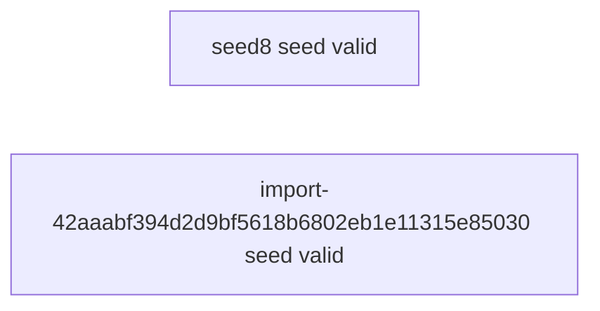

# Campaign discrete-local-v1

Export schema: `feyer-campaign-export-v1`. Snapshot: `d1c81dd2750a47e00247b04d04e440e5123581182b38007be07a4d8b02c1a222`.

[Frozen proposer context](contexts/27db3e592edd8b453cba24b490f057a1ff2c3a9e765fd89e4dca7d982c4f127c.json) — SHA256 `27db3e592edd8b453cba24b490f057a1ff2c3a9e765fd89e4dca7d982c4f127c`.

This is an evidence ledger. Scientific parents describe chosen inputs to an experiment; they are not necessarily Git parents. Phase changes are observations, not proof that one edit caused the difference. A failed attempt remains part of the history.

## Ownership and frozen policy

Campaign specification digest: `ab43e42f2273d104b7011a29517518470d89f87e9abd9d14ae35df3e3de42b7e`.

| Actor | Role | Ownership version | Active |
| --- | --- | --- | --- |
| coordinator | coordinator | 1 | True |

## Scientific lineage

Edges come from declared scientific parents, not inferred chronology or Git ancestry.



## Candidate outcomes

| Candidate | Round / lane | Scientific parents | Exact commit | State | First-run seconds | Evidence IDs |
| --- | --- | --- | --- | --- | --- | --- |
| seed8 | round-001 / discrete | root | 1e552d675c3795265be8af1ac23ffb61f90f30b1 | valid | 28.0935 | 415bab6b82ef42baa0e0a5277df7aeb9:49937d87a08c533f73470c9dcc48dbc7870c12f467d9a8b5de192dffb5484afa, 882be0c143db470c9686cd2ba9e44c77:b547550f15337f868903dbcb118fa79d025993744270cf25cc8c7816a2e5616d, e6e5badb945c47ae927e511a3ff15fd7:820c7dfc19d0099d62f3b2315da0fb1dd7ee7ee9203b875447cfc2bd07d956a2 |
| import-42aaabf394d2d9bf5618b6802eb1e11315e85030 | round-001 / discrete | root | 42aaabf394d2d9bf5618b6802eb1e11315e85030 | valid | 28.6478 | 7f9a3863201d4908b9e2607e8b925bdc:70e1da46befd5d0fd365188a88a91391f95e2df62042e7a6687de8abbaf8c611 |

## Round decisions and stalled work

### Round round-001

Frozen specification: `c9eef3c088d8fc7635ca176417db487b5d2b4472ff28d94dfbae02855d9750d3`; version: 1; closed: False.

```json
{
  "budget": {
    "max_evaluations": 28,
    "max_proposals": 1000
  },
  "constraints": [
    "not checkpoint implies not prevent_cse"
  ],
  "dimensions": {
    "checkpoint": [
      true,
      false
    ],
    "map_batch_size": [
      null,
      1,
      2,
      4,
      8
    ],
    "prevent_cse": [
      false,
      true
    ]
  },
  "lanes": {
    "discrete": {
      "dimensions": [
        "checkpoint",
        "prevent_cse",
        "map_batch_size"
      ],
      "max_proposals": 15,
      "owner": "coordinator",
      "stall_limit": 15
    }
  },
  "materializer_version": "seed8-component-execution-v1",
  "progress": {
    "absolute": 0.02,
    "relative": 0.01
  },
  "recipes": {
    "discrete": {
      "dimensions": [
        "checkpoint",
        "prevent_cse",
        "map_batch_size"
      ]
    }
  },
  "round_id": "round-001",
  "seed_parameters": {
    "checkpoint": true,
    "map_batch_size": null,
    "prevent_cse": false
  },
  "selector": "local-search"
}
```

- round-001/discrete: ready; owner coordinator; strikes 0; reason not recorded

## Candidate evidence and proposed changes

### seed8

```json
{
  "cohort_digest": "10567ad0f8dcb7122b6b182e1be342313b89eef340d4070073fdf62d6342204c",
  "commit_sha": "1e552d675c3795265be8af1ac23ffb61f90f30b1",
  "content_sha256": "8225fedb4580e39fcc3f3611e73e4e356c7c0b55e4a3353486fcad9260d77c01",
  "context_sha256": null,
  "evaluation_requests": [
    {
      "attempt": 1,
      "candidate_id": "seed8",
      "evidence_id": "415bab6b82ef42baa0e0a5277df7aeb9:49937d87a08c533f73470c9dcc48dbc7870c12f467d9a8b5de192dffb5484afa",
      "imported": true,
      "job_id": "415bab6b82ef42baa0e0a5277df7aeb9",
      "profile": "full",
      "request_id": "6ec2f32c284a4aeeb1ed30862a3ee42b",
      "status": "valid"
    },
    {
      "attempt": 2,
      "candidate_id": "seed8",
      "evidence_id": "882be0c143db470c9686cd2ba9e44c77:b547550f15337f868903dbcb118fa79d025993744270cf25cc8c7816a2e5616d",
      "imported": true,
      "job_id": "882be0c143db470c9686cd2ba9e44c77",
      "profile": "full",
      "request_id": "6378fe72ac964ae6bbeb943ce7e6cb91",
      "status": "valid"
    },
    {
      "attempt": 3,
      "candidate_id": "seed8",
      "evidence_id": "e6e5badb945c47ae927e511a3ff15fd7:820c7dfc19d0099d62f3b2315da0fb1dd7ee7ee9203b875447cfc2bd07d956a2",
      "imported": true,
      "job_id": "e6e5badb945c47ae927e511a3ff15fd7",
      "profile": "full",
      "request_id": "d687a2f43e6846fbbb9f30e1449279d1",
      "status": "valid"
    }
  ],
  "evidence": [
    {
      "artifact_digest": "49937d87a08c533f73470c9dcc48dbc7870c12f467d9a8b5de192dffb5484afa",
      "artifact_digests": {
        "comparison.json": "005847678f9babe30a632a5a1a82e2a3edbabb30000bd9d443af41d13038a7d0",
        "report.json": "33b5ce79552d7397bce63da5ef387160c7ef142d72b2acba540c0f610d3a4d2e",
        "result": "7dbb9193b3f0e69ee2b3cd2d81372c81cb5d6308ba81d48b8cc57061ad9b4bdf"
      },
      "candidate_sha": "1e552d675c3795265be8af1ac23ffb61f90f30b1",
      "category": "valid",
      "checks": {
        "official": "passed",
        "precision": "passed",
        "resource": "passed",
        "source": "passed",
        "strict": "passed",
        "workload": "passed"
      },
      "cohort": {
        "adapter_schema": "feyer-evolution-evidence-v1",
        "container_limits": {
          "cpu.max": "1600000 100000",
          "cpuset.cpus.effective": "0-127",
          "memory.max": "59055800320",
          "memory.swap.max": "0"
        },
        "memory_policy": {
          "budget_bytes": 32000000000,
          "enforcement": "sampled_process_group_rss",
          "kernel_memory_limit_enforced": false
        },
        "profile": "full",
        "protected_baseline_sha": "02ec741d8a1bf1a2278294ea74f9fc1d68f08f1f",
        "signature": {
          "environment": {
            "backend": "cpu",
            "cpu_affinity_ids": [
              2
            ],
            "cpu_model": "AMD EPYC 9334 32-Core Processor",
            "jax_enable_x64": true,
            "packages": {
              "differometor": "0.0.6",
              "jax": "0.9.0",
              "jaxlib": "0.9.0",
              "numpy": "2.5.5",
              "optax": "0.2.6"
            },
            "persistent_compilation_cache": false,
            "python": "3.12.15",
            "requested_logical_cpus": 1,
            "thread_limits": {
              "MKL_NUM_THREADS": "1",
              "NUMEXPR_NUM_THREADS": "1",
              "OMP_NUM_THREADS": "1",
              "OPENBLAS_NUM_THREADS": "1"
            },
            "xla_flags": null
          },
          "inputs": {
            "frequency_count": 101,
            "gradient_parameter_count": 193,
            "reference_sha256": "726f2cfe6986cb991fa48d5a28127b9330c3dc7e69d5bd193c8748acef03adc3",
            "setup_sha256": "ff4ba353a2a03cdce7f3e61bad729c2e00888d842c28ba9cf699f95afb87e138"
          },
          "timing": {
            "benchmark": "start-munich-2026-public-differometor-uifo-v2",
            "evaluator_sha256": "d5950bbd872e5b00ad63f0bd7081e5096fb14ba9c96c80a6854a3b714719bd4e",
            "phase_keys": [
              "build",
              "forward",
              "forward_compile",
              "forward_lower",
              "gradient",
              "gradient_compile",
              "gradient_lower",
              "host_transfer",
              "imports",
              "initialize",
              "load",
              "sensitivity",
              "sensitivity_compile",
              "sensitivity_lower"
            ],
            "scope": {
              "excluded": "validation and benchmark harness bookkeeping, repeated profiling, plot/report generation; interpreter launch before the first timer",
              "forward_residuals": "saved for separately compiled reverse pass",
              "gradient_coordinates": "physical parameter values; public grid-length tying",
              "objective": "mean(log10(sensitivity / public_reference))",
              "optimizer_steps": 0,
              "total_scope": "imports, CPU initialization, input I/O, setup, all lowering/compilation, forward, sensitivity/powers/loss, reverse-mode gradient and host transfer"
            }
          }
        },
        "strict_policy": {
          "evaluator_sha256": "1bc9b39fe0023afc3db93211b9e3d6cd37ed2b13ee281f142749c2237a16ea8f",
          "reference_arrays_sha256": "c3f6cba045f8b41f488dc19c960f5056b5f2e75cfa64f9a687b52f2a9ba2751e",
          "rtol": 1e-07,
          "scale_atol": 1e-12
        },
        "worker_sha256": "d3c212da0ab1215187407d9cd21dc2cbb5f88dc0b5ee7885135bf7f002d14b58"
      },
      "cohort_digest": "10567ad0f8dcb7122b6b182e1be342313b89eef340d4070073fdf62d6342204c",
      "cost": {
        "comparison_wall_seconds": 0.2575887069106102,
        "peak_rss_bytes": 13767028736,
        "peak_rss_kib": 13444364,
        "total_worker_wall_seconds": 111.85857847332954,
        "wall_seconds": 111.60098976641893
      },
      "eligible_full": true,
      "evidence_digest": "a8ce498a148a76b19e1a8e2e64347d75f42df5d2d63105455d314741e680dc28",
      "evidence_id": "415bab6b82ef42baa0e0a5277df7aeb9:49937d87a08c533f73470c9dcc48dbc7870c12f467d9a8b5de192dffb5484afa",
      "execution_status": "completed",
      "issues": [],
      "job_id": "415bab6b82ef42baa0e0a5277df7aeb9",
      "metrics": {
        "compilation": 12.756752016022801,
        "forward": 12.382117168977857,
        "gradient": 1.8760113269090652,
        "peak_rss_bytes": 13767028736,
        "runtime": 14.259446823969483,
        "sensitivity": 0.0008984114974737167,
        "setup": 1.0238497275859118,
        "total": 28.040048567578197,
        "transfer": 0.0004199165850877762
      },
      "phases": {
        "build": 0.7346600126475096,
        "forward": 12.382117168977857,
        "forward_compile": 4.924385312944651,
        "forward_lower": 0.870494470000267,
        "gradient": 1.8760113269090652,
        "gradient_compile": 6.096814852207899,
        "gradient_lower": 0.4077671058475971,
        "host_transfer": 0.0004199165850877762,
        "imports": 0.2848028242588043,
        "initialize": 0.0029357559978961945,
        "load": 0.0014511346817016602,
        "sensitivity": 0.0008984114974737167,
        "sensitivity_compile": 0.37297157756984234,
        "sensitivity_lower": 0.08431869745254517
      },
      "profile": "full",
      "resource_evidence": {
        "budget_bytes": 32000000000,
        "container_limits": {
          "cpu.max": "1600000 100000",
          "cpuset.cpus.effective": "0-127",
          "memory.max": "59055800320",
          "memory.swap.max": "0"
        },
        "limitation": "Sampled process-group RSS is not a kernel-enforced memory cap.",
        "memory_monitoring": {
          "budget_bytes": 32000000000,
          "enforcement": "sampled_process_group_rss",
          "exceeded": false,
          "kernel_memory_limit_enforced": false,
          "notes": "RSS sampling can miss brief peaks and counts shared pages in each process. It excludes GPU VRAM and does not reserve RAM or constrain other instance work.",
          "sampled_process_group_peak_rss_bytes": 13768077312,
          "samples": 437
        }
      },
      "schema_version": "feyer-evolution-evidence-v1",
      "scientific_strike": false,
      "screen_passed": false,
      "source_digests": {
        "clean_diff_sha256": "e3b0c44298fc1c149afbf4c8996fb92427ae41e4649b934ca495991b7852b855",
        "comparison_evaluator_sha256": "1bc9b39fe0023afc3db93211b9e3d6cd37ed2b13ee281f142749c2237a16ea8f",
        "evaluator_sha256": "d5950bbd872e5b00ad63f0bd7081e5096fb14ba9c96c80a6854a3b714719bd4e",
        "reference_arrays_sha256": "c3f6cba045f8b41f488dc19c960f5056b5f2e75cfa64f9a687b52f2a9ba2751e",
        "simulator_files_sha256": {
          "differometor/__init__.py": "505d559d5a17409680a91f555882edf23f78cbb7c98ee28845018fa9bfeba7e7",
          "differometor/build.py": "f1fdff78515500f5912907537dbedecf30c3915fa949b820bf2ad81b4c062771",
          "differometor/components.py": "2e857e19d468d94b46594f71a76221d9d8b677bad05f6cf03b9e57b0e1613593",
          "differometor/plot.py": "16735e0fb14902f2c024e3da9f2655cbea634c4dd9e06c48af1247e12d0cf606",
          "differometor/setups.py": "478b1a7391b28604c36d8245e13ffa4f6d0f6dc32eeac6c6feaf5c08aa06a76b",
          "differometor/simulate.py": "8225fedb4580e39fcc3f3611e73e4e356c7c0b55e4a3353486fcad9260d77c01",
          "differometor/utils.py": "73ee8a862cbc435363904addc363071ed7dc8b1546956f82e1746998fe3b09ff"
        },
        "worker_sha256": "d3c212da0ab1215187407d9cd21dc2cbb5f88dc0b5ee7885135bf7f002d14b58"
      },
      "validated_output_scope": "last_warm_evaluation",
      "warm_metrics": {
        "forward": 12.542850732803345,
        "gradient": 1.875739123672247,
        "host_transfer": 0.0003086775541305542,
        "sensitivity": 0.21159253269433975
      },
      "worker_error": null
    },
    {
      "artifact_digest": "b547550f15337f868903dbcb118fa79d025993744270cf25cc8c7816a2e5616d",
      "artifact_digests": {
        "comparison.json": "005847678f9babe30a632a5a1a82e2a3edbabb30000bd9d443af41d13038a7d0",
        "report.json": "6b880067010b521f1a4c6071a146d70dbbf321cad9e73d2863b371c6863e950b",
        "result": "d30369d24d849b36c214cb6ee7a1ca78beafd5c6a9dba2ceeed83625ef475246"
      },
      "candidate_sha": "1e552d675c3795265be8af1ac23ffb61f90f30b1",
      "category": "valid",
      "checks": {
        "official": "passed",
        "precision": "passed",
        "resource": "passed",
        "source": "passed",
        "strict": "passed",
        "workload": "passed"
      },
      "cohort": {
        "adapter_schema": "feyer-evolution-evidence-v1",
        "container_limits": {
          "cpu.max": "1600000 100000",
          "cpuset.cpus.effective": "0-127",
          "memory.max": "59055800320",
          "memory.swap.max": "0"
        },
        "memory_policy": {
          "budget_bytes": 32000000000,
          "enforcement": "sampled_process_group_rss",
          "kernel_memory_limit_enforced": false
        },
        "profile": "full",
        "protected_baseline_sha": "02ec741d8a1bf1a2278294ea74f9fc1d68f08f1f",
        "signature": {
          "environment": {
            "backend": "cpu",
            "cpu_affinity_ids": [
              2
            ],
            "cpu_model": "AMD EPYC 9334 32-Core Processor",
            "jax_enable_x64": true,
            "packages": {
              "differometor": "0.0.6",
              "jax": "0.9.0",
              "jaxlib": "0.9.0",
              "numpy": "2.5.5",
              "optax": "0.2.6"
            },
            "persistent_compilation_cache": false,
            "python": "3.12.15",
            "requested_logical_cpus": 1,
            "thread_limits": {
              "MKL_NUM_THREADS": "1",
              "NUMEXPR_NUM_THREADS": "1",
              "OMP_NUM_THREADS": "1",
              "OPENBLAS_NUM_THREADS": "1"
            },
            "xla_flags": null
          },
          "inputs": {
            "frequency_count": 101,
            "gradient_parameter_count": 193,
            "reference_sha256": "726f2cfe6986cb991fa48d5a28127b9330c3dc7e69d5bd193c8748acef03adc3",
            "setup_sha256": "ff4ba353a2a03cdce7f3e61bad729c2e00888d842c28ba9cf699f95afb87e138"
          },
          "timing": {
            "benchmark": "start-munich-2026-public-differometor-uifo-v2",
            "evaluator_sha256": "d5950bbd872e5b00ad63f0bd7081e5096fb14ba9c96c80a6854a3b714719bd4e",
            "phase_keys": [
              "build",
              "forward",
              "forward_compile",
              "forward_lower",
              "gradient",
              "gradient_compile",
              "gradient_lower",
              "host_transfer",
              "imports",
              "initialize",
              "load",
              "sensitivity",
              "sensitivity_compile",
              "sensitivity_lower"
            ],
            "scope": {
              "excluded": "validation and benchmark harness bookkeeping, repeated profiling, plot/report generation; interpreter launch before the first timer",
              "forward_residuals": "saved for separately compiled reverse pass",
              "gradient_coordinates": "physical parameter values; public grid-length tying",
              "objective": "mean(log10(sensitivity / public_reference))",
              "optimizer_steps": 0,
              "total_scope": "imports, CPU initialization, input I/O, setup, all lowering/compilation, forward, sensitivity/powers/loss, reverse-mode gradient and host transfer"
            }
          }
        },
        "strict_policy": {
          "evaluator_sha256": "1bc9b39fe0023afc3db93211b9e3d6cd37ed2b13ee281f142749c2237a16ea8f",
          "reference_arrays_sha256": "c3f6cba045f8b41f488dc19c960f5056b5f2e75cfa64f9a687b52f2a9ba2751e",
          "rtol": 1e-07,
          "scale_atol": 1e-12
        },
        "worker_sha256": "d3c212da0ab1215187407d9cd21dc2cbb5f88dc0b5ee7885135bf7f002d14b58"
      },
      "cohort_digest": "10567ad0f8dcb7122b6b182e1be342313b89eef340d4070073fdf62d6342204c",
      "cost": {
        "comparison_wall_seconds": 0.25682039745151997,
        "peak_rss_bytes": 13758509056,
        "peak_rss_kib": 13436044,
        "total_worker_wall_seconds": 113.93450396507978,
        "wall_seconds": 113.67768356762826
      },
      "eligible_full": true,
      "evidence_digest": "72d952d6f5137b4652e3b687174999ea816a27567db57ec1648422f791769fd4",
      "evidence_id": "882be0c143db470c9686cd2ba9e44c77:b547550f15337f868903dbcb118fa79d025993744270cf25cc8c7816a2e5616d",
      "execution_status": "completed",
      "issues": [],
      "job_id": "882be0c143db470c9686cd2ba9e44c77",
      "metrics": {
        "compilation": 13.170896405354142,
        "forward": 12.400077329948545,
        "gradient": 1.902217959985137,
        "peak_rss_bytes": 13758509056,
        "runtime": 14.30376430414617,
        "sensitivity": 0.0010634586215019226,
        "setup": 1.099603358656168,
        "total": 28.57426406815648,
        "transfer": 0.0004055555909872055
      },
      "phases": {
        "build": 0.8086971193552017,
        "forward": 12.400077329948545,
        "forward_compile": 5.102056432515383,
        "forward_lower": 0.9158173240721226,
        "gradient": 1.902217959985137,
        "gradient_compile": 6.248855207115412,
        "gradient_lower": 0.4496453870087862,
        "host_transfer": 0.0004055555909872055,
        "imports": 0.2865349929779768,
        "initialize": 0.002890240401029587,
        "load": 0.001481005921959877,
        "sensitivity": 0.0010634586215019226,
        "sensitivity_compile": 0.3675619624555111,
        "sensitivity_lower": 0.0869600921869278
      },
      "profile": "full",
      "resource_evidence": {
        "budget_bytes": 32000000000,
        "container_limits": {
          "cpu.max": "1600000 100000",
          "cpuset.cpus.effective": "0-127",
          "memory.max": "59055800320",
          "memory.swap.max": "0"
        },
        "limitation": "Sampled process-group RSS is not a kernel-enforced memory cap.",
        "memory_monitoring": {
          "budget_bytes": 32000000000,
          "enforcement": "sampled_process_group_rss",
          "exceeded": false,
          "kernel_memory_limit_enforced": false,
          "notes": "RSS sampling can miss brief peaks and counts shared pages in each process. It excludes GPU VRAM and does not reserve RAM or constrain other instance work.",
          "sampled_process_group_peak_rss_bytes": 13759557632,
          "samples": 445
        }
      },
      "schema_version": "feyer-evolution-evidence-v1",
      "scientific_strike": false,
      "screen_passed": false,
      "source_digests": {
        "clean_diff_sha256": "e3b0c44298fc1c149afbf4c8996fb92427ae41e4649b934ca495991b7852b855",
        "comparison_evaluator_sha256": "1bc9b39fe0023afc3db93211b9e3d6cd37ed2b13ee281f142749c2237a16ea8f",
        "evaluator_sha256": "d5950bbd872e5b00ad63f0bd7081e5096fb14ba9c96c80a6854a3b714719bd4e",
        "reference_arrays_sha256": "c3f6cba045f8b41f488dc19c960f5056b5f2e75cfa64f9a687b52f2a9ba2751e",
        "simulator_files_sha256": {
          "differometor/__init__.py": "505d559d5a17409680a91f555882edf23f78cbb7c98ee28845018fa9bfeba7e7",
          "differometor/build.py": "f1fdff78515500f5912907537dbedecf30c3915fa949b820bf2ad81b4c062771",
          "differometor/components.py": "2e857e19d468d94b46594f71a76221d9d8b677bad05f6cf03b9e57b0e1613593",
          "differometor/plot.py": "16735e0fb14902f2c024e3da9f2655cbea634c4dd9e06c48af1247e12d0cf606",
          "differometor/setups.py": "478b1a7391b28604c36d8245e13ffa4f6d0f6dc32eeac6c6feaf5c08aa06a76b",
          "differometor/simulate.py": "8225fedb4580e39fcc3f3611e73e4e356c7c0b55e4a3353486fcad9260d77c01",
          "differometor/utils.py": "73ee8a862cbc435363904addc363071ed7dc8b1546956f82e1746998fe3b09ff"
        },
        "worker_sha256": "d3c212da0ab1215187407d9cd21dc2cbb5f88dc0b5ee7885135bf7f002d14b58"
      },
      "validated_output_scope": "last_warm_evaluation",
      "warm_metrics": {
        "forward": 12.743575628846884,
        "gradient": 1.8781429361552,
        "host_transfer": 0.00023546814918518066,
        "sensitivity": 0.2108212560415268
      },
      "worker_error": null
    },
    {
      "artifact_digest": "820c7dfc19d0099d62f3b2315da0fb1dd7ee7ee9203b875447cfc2bd07d956a2",
      "artifact_digests": {
        "comparison.json": "005847678f9babe30a632a5a1a82e2a3edbabb30000bd9d443af41d13038a7d0",
        "report.json": "b2edb193ca235a5cd902e415ddbad328d0cce85c3c44f193a72c3f4ea10409d2",
        "result": "c7b4f4d5f713d1efa4ad20c9f07ef304bb352c40b55052971c2251f12bcd3b42"
      },
      "candidate_sha": "1e552d675c3795265be8af1ac23ffb61f90f30b1",
      "category": "valid",
      "checks": {
        "official": "passed",
        "precision": "passed",
        "resource": "passed",
        "source": "passed",
        "strict": "passed",
        "workload": "passed"
      },
      "cohort": {
        "adapter_schema": "feyer-evolution-evidence-v1",
        "container_limits": {
          "cpu.max": "1600000 100000",
          "cpuset.cpus.effective": "0-127",
          "memory.max": "59055800320",
          "memory.swap.max": "0"
        },
        "memory_policy": {
          "budget_bytes": 32000000000,
          "enforcement": "sampled_process_group_rss",
          "kernel_memory_limit_enforced": false
        },
        "profile": "full",
        "protected_baseline_sha": "02ec741d8a1bf1a2278294ea74f9fc1d68f08f1f",
        "signature": {
          "environment": {
            "backend": "cpu",
            "cpu_affinity_ids": [
              2
            ],
            "cpu_model": "AMD EPYC 9334 32-Core Processor",
            "jax_enable_x64": true,
            "packages": {
              "differometor": "0.0.6",
              "jax": "0.9.0",
              "jaxlib": "0.9.0",
              "numpy": "2.5.5",
              "optax": "0.2.6"
            },
            "persistent_compilation_cache": false,
            "python": "3.12.15",
            "requested_logical_cpus": 1,
            "thread_limits": {
              "MKL_NUM_THREADS": "1",
              "NUMEXPR_NUM_THREADS": "1",
              "OMP_NUM_THREADS": "1",
              "OPENBLAS_NUM_THREADS": "1"
            },
            "xla_flags": null
          },
          "inputs": {
            "frequency_count": 101,
            "gradient_parameter_count": 193,
            "reference_sha256": "726f2cfe6986cb991fa48d5a28127b9330c3dc7e69d5bd193c8748acef03adc3",
            "setup_sha256": "ff4ba353a2a03cdce7f3e61bad729c2e00888d842c28ba9cf699f95afb87e138"
          },
          "timing": {
            "benchmark": "start-munich-2026-public-differometor-uifo-v2",
            "evaluator_sha256": "d5950bbd872e5b00ad63f0bd7081e5096fb14ba9c96c80a6854a3b714719bd4e",
            "phase_keys": [
              "build",
              "forward",
              "forward_compile",
              "forward_lower",
              "gradient",
              "gradient_compile",
              "gradient_lower",
              "host_transfer",
              "imports",
              "initialize",
              "load",
              "sensitivity",
              "sensitivity_compile",
              "sensitivity_lower"
            ],
            "scope": {
              "excluded": "validation and benchmark harness bookkeeping, repeated profiling, plot/report generation; interpreter launch before the first timer",
              "forward_residuals": "saved for separately compiled reverse pass",
              "gradient_coordinates": "physical parameter values; public grid-length tying",
              "objective": "mean(log10(sensitivity / public_reference))",
              "optimizer_steps": 0,
              "total_scope": "imports, CPU initialization, input I/O, setup, all lowering/compilation, forward, sensitivity/powers/loss, reverse-mode gradient and host transfer"
            }
          }
        },
        "strict_policy": {
          "evaluator_sha256": "1bc9b39fe0023afc3db93211b9e3d6cd37ed2b13ee281f142749c2237a16ea8f",
          "reference_arrays_sha256": "c3f6cba045f8b41f488dc19c960f5056b5f2e75cfa64f9a687b52f2a9ba2751e",
          "rtol": 1e-07,
          "scale_atol": 1e-12
        },
        "worker_sha256": "d3c212da0ab1215187407d9cd21dc2cbb5f88dc0b5ee7885135bf7f002d14b58"
      },
      "cohort_digest": "10567ad0f8dcb7122b6b182e1be342313b89eef340d4070073fdf62d6342204c",
      "cost": {
        "comparison_wall_seconds": 0.25740163773298264,
        "peak_rss_bytes": 13754388480,
        "peak_rss_kib": 13432020,
        "total_worker_wall_seconds": 111.85716444440186,
        "wall_seconds": 111.59976280666888
      },
      "eligible_full": true,
      "evidence_digest": "e06feb15f7c2ba1e21aa1fa63f7a879f1b3784912b5b2a6d879930c01a887e22",
      "evidence_id": "e6e5badb945c47ae927e511a3ff15fd7:820c7dfc19d0099d62f3b2315da0fb1dd7ee7ee9203b875447cfc2bd07d956a2",
      "execution_status": "completed",
      "issues": [],
      "job_id": "e6e5badb945c47ae927e511a3ff15fd7",
      "metrics": {
        "compilation": 12.777620123699307,
        "forward": 12.399473497644067,
        "gradient": 1.8828602991998196,
        "peak_rss_bytes": 13754388480,
        "runtime": 14.283548314124346,
        "sensitivity": 0.0009176898747682571,
        "setup": 1.032353088259697,
        "total": 28.09352152608335,
        "transfer": 0.00029682740569114685
      },
      "phases": {
        "build": 0.7394567411392927,
        "forward": 12.399473497644067,
        "forward_compile": 4.945773968473077,
        "forward_lower": 0.8744982127100229,
        "gradient": 1.8828602991998196,
        "gradient_compile": 6.078064216300845,
        "gradient_lower": 0.41370727121829987,
        "host_transfer": 0.00029682740569114685,
        "imports": 0.2885946538299322,
        "initialize": 0.002883758395910263,
        "load": 0.0014179348945617676,
        "sensitivity": 0.0009176898747682571,
        "sensitivity_compile": 0.379582442343235,
        "sensitivity_lower": 0.08599401265382767
      },
      "profile": "full",
      "resource_evidence": {
        "budget_bytes": 32000000000,
        "container_limits": {
          "cpu.max": "1600000 100000",
          "cpuset.cpus.effective": "0-127",
          "memory.max": "59055800320",
          "memory.swap.max": "0"
        },
        "limitation": "Sampled process-group RSS is not a kernel-enforced memory cap.",
        "memory_monitoring": {
          "budget_bytes": 32000000000,
          "enforcement": "sampled_process_group_rss",
          "exceeded": false,
          "kernel_memory_limit_enforced": false,
          "notes": "RSS sampling can miss brief peaks and counts shared pages in each process. It excludes GPU VRAM and does not reserve RAM or constrain other instance work.",
          "sampled_process_group_peak_rss_bytes": 13755437056,
          "samples": 437
        }
      },
      "schema_version": "feyer-evolution-evidence-v1",
      "scientific_strike": false,
      "screen_passed": false,
      "source_digests": {
        "clean_diff_sha256": "e3b0c44298fc1c149afbf4c8996fb92427ae41e4649b934ca495991b7852b855",
        "comparison_evaluator_sha256": "1bc9b39fe0023afc3db93211b9e3d6cd37ed2b13ee281f142749c2237a16ea8f",
        "evaluator_sha256": "d5950bbd872e5b00ad63f0bd7081e5096fb14ba9c96c80a6854a3b714719bd4e",
        "reference_arrays_sha256": "c3f6cba045f8b41f488dc19c960f5056b5f2e75cfa64f9a687b52f2a9ba2751e",
        "simulator_files_sha256": {
          "differometor/__init__.py": "505d559d5a17409680a91f555882edf23f78cbb7c98ee28845018fa9bfeba7e7",
          "differometor/build.py": "f1fdff78515500f5912907537dbedecf30c3915fa949b820bf2ad81b4c062771",
          "differometor/components.py": "2e857e19d468d94b46594f71a76221d9d8b677bad05f6cf03b9e57b0e1613593",
          "differometor/plot.py": "16735e0fb14902f2c024e3da9f2655cbea634c4dd9e06c48af1247e12d0cf606",
          "differometor/setups.py": "478b1a7391b28604c36d8245e13ffa4f6d0f6dc32eeac6c6feaf5c08aa06a76b",
          "differometor/simulate.py": "8225fedb4580e39fcc3f3611e73e4e356c7c0b55e4a3353486fcad9260d77c01",
          "differometor/utils.py": "73ee8a862cbc435363904addc363071ed7dc8b1546956f82e1746998fe3b09ff"
        },
        "worker_sha256": "d3c212da0ab1215187407d9cd21dc2cbb5f88dc0b5ee7885135bf7f002d14b58"
      },
      "validated_output_scope": "last_warm_evaluation",
      "warm_metrics": {
        "forward": 12.515215031802654,
        "gradient": 1.8746604043990374,
        "host_transfer": 0.0002299882471561432,
        "sensitivity": 0.20756630413234234
      },
      "worker_error": null
    }
  ],
  "evidence_ids": [
    "415bab6b82ef42baa0e0a5277df7aeb9:49937d87a08c533f73470c9dcc48dbc7870c12f467d9a8b5de192dffb5484afa",
    "882be0c143db470c9686cd2ba9e44c77:b547550f15337f868903dbcb118fa79d025993744270cf25cc8c7816a2e5616d",
    "e6e5badb945c47ae927e511a3ff15fd7:820c7dfc19d0099d62f3b2315da0fb1dd7ee7ee9203b875447cfc2bd07d956a2"
  ],
  "git_parents": null,
  "heuristic_id": null,
  "hypothesis": null,
  "improved": false,
  "kind": "seed",
  "lane_id": "discrete",
  "metrics": {
    "compilation": 12.777620123699307,
    "forward": 12.399473497644067,
    "gradient": 1.8828602991998196,
    "peak_rss_bytes": 13758509056,
    "runtime": 14.283548314124346,
    "sensitivity": 0.0009176898747682571,
    "setup": 1.032353088259697,
    "total": 28.09352152608335,
    "transfer": 0.0004055555909872055
  },
  "model_manifest": null,
  "owner": "coordinator",
  "owner_version": 1,
  "parameters": {
    "checkpoint": true,
    "map_batch_size": null,
    "prevent_cse": false
  },
  "parameters_after": {
    "checkpoint": true,
    "map_batch_size": null,
    "prevent_cse": false
  },
  "parameters_before": null,
  "parents": [],
  "prompt_sha256": null,
  "proposal": {
    "candidate_id": "seed8",
    "commit_sha": "1e552d675c3795265be8af1ac23ffb61f90f30b1",
    "content_sha256": "8225fedb4580e39fcc3f3611e73e4e356c7c0b55e4a3353486fcad9260d77c01",
    "kind": "seed",
    "lane_id": "discrete",
    "parameters": {
      "checkpoint": true,
      "map_batch_size": null,
      "prevent_cse": false
    },
    "parents": [],
    "proposal_id": "seed8",
    "provenance": {
      "heuristic_id": "import-confirmed-strong-agent-seed",
      "model": "validated Codex seed8, three fresh full measurements"
    },
    "recipe": null,
    "round_id": "round-001"
  },
  "proposal_id": "seed8",
  "provenance": {
    "heuristic_id": "import-confirmed-strong-agent-seed",
    "model": "validated Codex seed8, three fresh full measurements"
  },
  "recipe": null,
  "response_sha256": null,
  "round_id": "round-001",
  "target_symbols": null,
  "uncertainty": "No repeat-confirmation or causality is inferred from this export. Inspect exact job evidence and matching cohorts.",
  "valid": true
}
```

### import-42aaabf394d2d9bf5618b6802eb1e11315e85030

```json
{
  "cohort_digest": "10567ad0f8dcb7122b6b182e1be342313b89eef340d4070073fdf62d6342204c",
  "commit_sha": "42aaabf394d2d9bf5618b6802eb1e11315e85030",
  "content_sha256": "ca7a299118fe3731c494910ae92526d3ed4c82ee4924a38380c2dc75c1463b19",
  "context_sha256": null,
  "evaluation_requests": [
    {
      "attempt": 1,
      "candidate_id": "import-42aaabf394d2d9bf5618b6802eb1e11315e85030",
      "evidence_id": "7f9a3863201d4908b9e2607e8b925bdc:70e1da46befd5d0fd365188a88a91391f95e2df62042e7a6687de8abbaf8c611",
      "imported": true,
      "job_id": "7f9a3863201d4908b9e2607e8b925bdc",
      "profile": "full",
      "request_id": "9986889c8d0f4e20bf78c21cdbb7423e",
      "status": "valid"
    }
  ],
  "evidence": [
    {
      "artifact_digest": "70e1da46befd5d0fd365188a88a91391f95e2df62042e7a6687de8abbaf8c611",
      "artifact_digests": {
        "comparison.json": "005847678f9babe30a632a5a1a82e2a3edbabb30000bd9d443af41d13038a7d0",
        "report.json": "99b11631ac61d413d7f19004db5545450cd93405d07cea2955d04cc5405711af",
        "result": "0a722ff95fd89fac3abbb76e680b29fa417654284b72ae5c5db7004536db19c8"
      },
      "candidate_sha": "42aaabf394d2d9bf5618b6802eb1e11315e85030",
      "category": "valid",
      "checks": {
        "official": "passed",
        "precision": "passed",
        "resource": "passed",
        "source": "passed",
        "strict": "passed",
        "workload": "passed"
      },
      "cohort": {
        "adapter_schema": "feyer-evolution-evidence-v1",
        "container_limits": {
          "cpu.max": "1600000 100000",
          "cpuset.cpus.effective": "0-127",
          "memory.max": "59055800320",
          "memory.swap.max": "0"
        },
        "memory_policy": {
          "budget_bytes": 32000000000,
          "enforcement": "sampled_process_group_rss",
          "kernel_memory_limit_enforced": false
        },
        "profile": "full",
        "protected_baseline_sha": "02ec741d8a1bf1a2278294ea74f9fc1d68f08f1f",
        "signature": {
          "environment": {
            "backend": "cpu",
            "cpu_affinity_ids": [
              2
            ],
            "cpu_model": "AMD EPYC 9334 32-Core Processor",
            "jax_enable_x64": true,
            "packages": {
              "differometor": "0.0.6",
              "jax": "0.9.0",
              "jaxlib": "0.9.0",
              "numpy": "2.5.5",
              "optax": "0.2.6"
            },
            "persistent_compilation_cache": false,
            "python": "3.12.15",
            "requested_logical_cpus": 1,
            "thread_limits": {
              "MKL_NUM_THREADS": "1",
              "NUMEXPR_NUM_THREADS": "1",
              "OMP_NUM_THREADS": "1",
              "OPENBLAS_NUM_THREADS": "1"
            },
            "xla_flags": null
          },
          "inputs": {
            "frequency_count": 101,
            "gradient_parameter_count": 193,
            "reference_sha256": "726f2cfe6986cb991fa48d5a28127b9330c3dc7e69d5bd193c8748acef03adc3",
            "setup_sha256": "ff4ba353a2a03cdce7f3e61bad729c2e00888d842c28ba9cf699f95afb87e138"
          },
          "timing": {
            "benchmark": "start-munich-2026-public-differometor-uifo-v2",
            "evaluator_sha256": "d5950bbd872e5b00ad63f0bd7081e5096fb14ba9c96c80a6854a3b714719bd4e",
            "phase_keys": [
              "build",
              "forward",
              "forward_compile",
              "forward_lower",
              "gradient",
              "gradient_compile",
              "gradient_lower",
              "host_transfer",
              "imports",
              "initialize",
              "load",
              "sensitivity",
              "sensitivity_compile",
              "sensitivity_lower"
            ],
            "scope": {
              "excluded": "validation and benchmark harness bookkeeping, repeated profiling, plot/report generation; interpreter launch before the first timer",
              "forward_residuals": "saved for separately compiled reverse pass",
              "gradient_coordinates": "physical parameter values; public grid-length tying",
              "objective": "mean(log10(sensitivity / public_reference))",
              "optimizer_steps": 0,
              "total_scope": "imports, CPU initialization, input I/O, setup, all lowering/compilation, forward, sensitivity/powers/loss, reverse-mode gradient and host transfer"
            }
          }
        },
        "strict_policy": {
          "evaluator_sha256": "1bc9b39fe0023afc3db93211b9e3d6cd37ed2b13ee281f142749c2237a16ea8f",
          "reference_arrays_sha256": "c3f6cba045f8b41f488dc19c960f5056b5f2e75cfa64f9a687b52f2a9ba2751e",
          "rtol": 1e-07,
          "scale_atol": 1e-12
        },
        "worker_sha256": "d3c212da0ab1215187407d9cd21dc2cbb5f88dc0b5ee7885135bf7f002d14b58"
      },
      "cohort_digest": "10567ad0f8dcb7122b6b182e1be342313b89eef340d4070073fdf62d6342204c",
      "cost": {
        "comparison_wall_seconds": 0.26017045602202415,
        "peak_rss_bytes": 13758693376,
        "peak_rss_kib": 13436224,
        "total_worker_wall_seconds": 112.69091638363898,
        "wall_seconds": 112.43074592761695
      },
      "eligible_full": true,
      "evidence_digest": "4a2d74726409a39254b78e01905db339de328515277cc50ea018f0f86dc2667b",
      "evidence_id": "7f9a3863201d4908b9e2607e8b925bdc:70e1da46befd5d0fd365188a88a91391f95e2df62042e7a6687de8abbaf8c611",
      "execution_status": "completed",
      "issues": [],
      "job_id": "7f9a3863201d4908b9e2607e8b925bdc",
      "metrics": {
        "compilation": 13.072265705093741,
        "forward": 12.629501961171627,
        "gradient": 1.8934158831834793,
        "peak_rss_bytes": 13758693376,
        "runtime": 14.524255460128188,
        "sensitivity": 0.0009246896952390671,
        "setup": 1.0512448493391275,
        "total": 28.647766014561057,
        "transfer": 0.0004129260778427124
      },
      "phases": {
        "build": 0.7617828771471977,
        "forward": 12.629501961171627,
        "forward_compile": 4.96721850335598,
        "forward_lower": 0.8655092362314463,
        "gradient": 1.8934158831834793,
        "gradient_compile": 6.274708459153771,
        "gradient_lower": 0.4280959088355303,
        "host_transfer": 0.0004129260778427124,
        "imports": 0.28519229404628277,
        "initialize": 0.002861395478248596,
        "load": 0.0014082826673984528,
        "sensitivity": 0.0009246896952390671,
        "sensitivity_compile": 0.4373494014143944,
        "sensitivity_lower": 0.09938419610261917
      },
      "profile": "full",
      "resource_evidence": {
        "budget_bytes": 32000000000,
        "container_limits": {
          "cpu.max": "1600000 100000",
          "cpuset.cpus.effective": "0-127",
          "memory.max": "59055800320",
          "memory.swap.max": "0"
        },
        "limitation": "Sampled process-group RSS is not a kernel-enforced memory cap.",
        "memory_monitoring": {
          "budget_bytes": 32000000000,
          "enforcement": "sampled_process_group_rss",
          "exceeded": false,
          "kernel_memory_limit_enforced": false,
          "notes": "RSS sampling can miss brief peaks and counts shared pages in each process. It excludes GPU VRAM and does not reserve RAM or constrain other instance work.",
          "sampled_process_group_peak_rss_bytes": 13759741952,
          "samples": 436
        }
      },
      "schema_version": "feyer-evolution-evidence-v1",
      "scientific_strike": false,
      "screen_passed": false,
      "source_digests": {
        "clean_diff_sha256": "e3b0c44298fc1c149afbf4c8996fb92427ae41e4649b934ca495991b7852b855",
        "comparison_evaluator_sha256": "1bc9b39fe0023afc3db93211b9e3d6cd37ed2b13ee281f142749c2237a16ea8f",
        "evaluator_sha256": "d5950bbd872e5b00ad63f0bd7081e5096fb14ba9c96c80a6854a3b714719bd4e",
        "reference_arrays_sha256": "c3f6cba045f8b41f488dc19c960f5056b5f2e75cfa64f9a687b52f2a9ba2751e",
        "simulator_files_sha256": {
          "differometor/__init__.py": "505d559d5a17409680a91f555882edf23f78cbb7c98ee28845018fa9bfeba7e7",
          "differometor/build.py": "f1fdff78515500f5912907537dbedecf30c3915fa949b820bf2ad81b4c062771",
          "differometor/components.py": "2e857e19d468d94b46594f71a76221d9d8b677bad05f6cf03b9e57b0e1613593",
          "differometor/plot.py": "16735e0fb14902f2c024e3da9f2655cbea634c4dd9e06c48af1247e12d0cf606",
          "differometor/setups.py": "478b1a7391b28604c36d8245e13ffa4f6d0f6dc32eeac6c6feaf5c08aa06a76b",
          "differometor/simulate.py": "ca7a299118fe3731c494910ae92526d3ed4c82ee4924a38380c2dc75c1463b19",
          "differometor/utils.py": "73ee8a862cbc435363904addc363071ed7dc8b1546956f82e1746998fe3b09ff"
        },
        "worker_sha256": "d3c212da0ab1215187407d9cd21dc2cbb5f88dc0b5ee7885135bf7f002d14b58"
      },
      "validated_output_scope": "last_warm_evaluation",
      "warm_metrics": {
        "forward": 12.641886975616217,
        "gradient": 1.8898078352212906,
        "host_transfer": 0.00025232695043087006,
        "sensitivity": 0.2136995568871498
      },
      "worker_error": null
    }
  ],
  "evidence_ids": [
    "7f9a3863201d4908b9e2607e8b925bdc:70e1da46befd5d0fd365188a88a91391f95e2df62042e7a6687de8abbaf8c611"
  ],
  "git_parents": null,
  "heuristic_id": null,
  "hypothesis": null,
  "improved": false,
  "kind": "seed",
  "lane_id": "discrete",
  "metrics": {
    "compilation": 13.072265705093741,
    "forward": 12.629501961171627,
    "gradient": 1.8934158831834793,
    "peak_rss_bytes": 13758693376,
    "runtime": 14.524255460128188,
    "sensitivity": 0.0009246896952390671,
    "setup": 1.0512448493391275,
    "total": 28.647766014561057,
    "transfer": 0.0004129260778427124
  },
  "model_manifest": null,
  "owner": "coordinator",
  "owner_version": 1,
  "parameters": {
    "checkpoint": true,
    "map_batch_size": null,
    "prevent_cse": true
  },
  "parameters_after": {
    "checkpoint": true,
    "map_batch_size": null,
    "prevent_cse": true
  },
  "parameters_before": null,
  "parents": [],
  "prompt_sha256": null,
  "proposal": {
    "candidate_id": "import-42aaabf394d2d9bf5618b6802eb1e11315e85030",
    "commit_sha": "42aaabf394d2d9bf5618b6802eb1e11315e85030",
    "content_sha256": "ca7a299118fe3731c494910ae92526d3ed4c82ee4924a38380c2dc75c1463b19",
    "kind": "seed",
    "lane_id": "discrete",
    "parameters": {
      "checkpoint": true,
      "map_batch_size": null,
      "prevent_cse": true
    },
    "parents": [],
    "proposal_id": "import-42aaabf394d2d9bf5618b6802eb1e11315e85030",
    "provenance": {
      "heuristic_id": "import-exact-full-evidence",
      "model_calls": 0,
      "source_branch": "explore/dag-pilot-v1",
      "source_job": "7f9a3863201d4908b9e2607e8b925bdc"
    },
    "recipe": null,
    "round_id": "round-001"
  },
  "proposal_id": "import-42aaabf394d2d9bf5618b6802eb1e11315e85030",
  "provenance": {
    "heuristic_id": "import-exact-full-evidence",
    "model_calls": 0,
    "source_branch": "explore/dag-pilot-v1",
    "source_job": "7f9a3863201d4908b9e2607e8b925bdc"
  },
  "recipe": null,
  "response_sha256": null,
  "round_id": "round-001",
  "target_symbols": null,
  "uncertainty": "No repeat-confirmation or causality is inferred from this export. Inspect exact job evidence and matching cohorts.",
  "valid": true
}
```

## Decision and failure trail

| Sequence | Event | Actor | Detail |
| --- | --- | --- | --- |
| 1 | campaign_initialized | coordinator | {"spec_digest": "ab43e42f2273d104b7011a29517518470d89f87e9abd9d14ae35df3e3de42b7e"} |
| 2 | owner_claimed | coordinator | {"actor": "coordinator", "role": "coordinator", "version": 1} |
| 3 | round_created | coordinator | {"round_id": "round-001", "spec_digest": "c9eef3c088d8fc7635ca176417db487b5d2b4472ff28d94dfbae02855d9750d3", "version": 1} |
| 4 | candidate_proposed | coordinator | {"candidate_id": "seed8", "duplicate_of": null, "owner_version": 1, "proposal_digest": "747307f72d2353b16d682ecf026725777abbb10e43471431a2f48605b8058e78", "proposal_id": "seed8"} |
| 5 | evidence_observed | coordinator | {"candidate_id": "seed8", "category": "valid", "evidence_digest": "125d6c2c23633f90c332fa3335c1140be43ba921ee2fa03b888d3b7ec2e64d02", "evidence_id": "415bab6b82ef42baa0e0a5277df7aeb9:49937d87a08c533f73470c9dcc48dbc7870c12f467d9a8b5de192dffb5484afa", "job_id": "415bab6b82ef42baa0e0a5277df7aeb9", "progress": null, "status": "valid", "strikes": 0} |
| 6 | evidence_observed | coordinator | {"candidate_id": "seed8", "category": "valid", "evidence_digest": "b749c17cf48c04b1e780aeec1f0f2bf0a923112ea66497597c3c87831f15189b", "evidence_id": "882be0c143db470c9686cd2ba9e44c77:b547550f15337f868903dbcb118fa79d025993744270cf25cc8c7816a2e5616d", "job_id": "882be0c143db470c9686cd2ba9e44c77", "progress": null, "status": "valid", "strikes": 0} |
| 7 | evidence_observed | coordinator | {"candidate_id": "seed8", "category": "valid", "evidence_digest": "fd00ecb3420f8086341aa98abbea23f6ad20bbf19e7331993219037cb0324199", "evidence_id": "e6e5badb945c47ae927e511a3ff15fd7:820c7dfc19d0099d62f3b2315da0fb1dd7ee7ee9203b875447cfc2bd07d956a2", "job_id": "e6e5badb945c47ae927e511a3ff15fd7", "progress": null, "status": "valid", "strikes": 0} |
| 8 | candidate_proposed | coordinator | {"candidate_id": "import-42aaabf394d2d9bf5618b6802eb1e11315e85030", "duplicate_of": null, "owner_version": 1, "proposal_digest": "6ea031e07c01bdacd744c7f69c1d8f05dfa3134ce9238101b68c2c946991b8e2", "proposal_id": "import-42aaabf394d2d9bf5618b6802eb1e11315e85030"} |
| 9 | evidence_observed | coordinator | {"candidate_id": "import-42aaabf394d2d9bf5618b6802eb1e11315e85030", "category": "valid", "evidence_digest": "6d68b61ba47f578b3af5297deb6228177258c8d9cef86f6a7f09ed9c4c28dbdf", "evidence_id": "7f9a3863201d4908b9e2607e8b925bdc:70e1da46befd5d0fd365188a88a91391f95e2df62042e7a6687de8abbaf8c611", "job_id": "7f9a3863201d4908b9e2607e8b925bdc", "progress": null, "status": "valid", "strikes": 0} |

Guidance may propose a new round. It cannot silently replace frozen operators, ownership, evaluation requirements or budgets. Only the coordinator can admit that round through the campaign state API. Publishing this ledger does not merge or promote candidate code.
