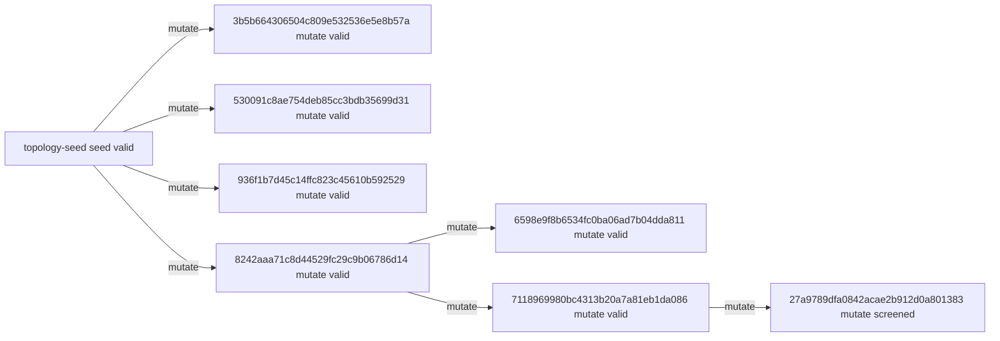

# Campaign layout-numerical-lane1

Export schema: `feyer-campaign-export-v1`. Snapshot: `feb0be791e823c1c1b9870667deca08debb2c1dfc4ccfbc2fee35406dd881740`.

[Frozen proposer context](contexts/2324dbeddb4920a5096a5913077caca6e37e03fdeec2e66f936591b29e6e966e.json) — SHA256 `2324dbeddb4920a5096a5913077caca6e37e03fdeec2e66f936591b29e6e966e`.

This is an evidence ledger. Scientific parents describe chosen inputs to an experiment; they are not necessarily Git parents. Phase changes are observations, not proof that one edit caused the difference. A failed attempt remains part of the history.

## Ownership and frozen policy

Campaign specification digest: `c5df55b766c3509dbd4b44bf174ee8bb8776d1f0731be0243569ac1af9828882`.

| Actor | Role | Ownership version | Active |
| --- | --- | --- | --- |
| coordinator | coordinator | 1 | True |

## Scientific lineage

Edges come from declared scientific parents, not inferred chronology or Git ancestry.



## Candidate outcomes

| Candidate | Round / lane | Scientific parents | Exact commit | State | First-run seconds | Evidence IDs |
| --- | --- | --- | --- | --- | --- | --- |
| topology-seed | topology-001 / tune | root | e0a1dc69f4951c100fefbc9fc08a23c3c12058dc | valid | 22.7901 | be32d82593f043489d653a13f6e2694a:c6345924647cc627855ee6d3ee1a14b13eaf26fde6952a2277cef3f5046101b9 |
| 3b5b664306504c809e532536e5e8b57a | topology-001 / tune | topology-seed | 8c67d6f1d071aebb2e0d403288d5f08f17ae5469 | valid | 23.2203 | 335506602662421987d0b851acf3d593:74d94f798c1cfa797259c64b1bba4b07b4b37554c2b1aa823af6af675a89bc12, 67de6c4aaf024c959b71352e7e54339b:c5a039f8f44ebd6fde56c5d65f9ffbcdb9510342d377312270fbce2fd819eec5 |
| 530091c8ae754deb85cc3bdb35699d31 | topology-001 / tune | topology-seed | ea8d294e7198db5cfb549502fa7872d44789da2b | valid | 23.2223 | bbfbe5f3d20a454d8516163ffea58c7b:3005be8311ae979640c085c30391ead859297cd43a05f84d6082458378556832, 0ce31ea937834cf48fd2c0b4967aeb58:c4ba2de11c76b49f4b648d3125a34fa342ef96bd269cca1fcdef71e50147af60 |
| 936f1b7d45c14ffc823c45610b592529 | topology-001 / tune | topology-seed | 4e575979c72e42a7a78f2f1aabda9477f6c4c109 | valid | 22.9817 | 1b8d66f317c740fa876eccfe0fd2372e:f8c72d105e44c9a2a9ac4d06f6d1c2cef89dc946ed25255c3b0eccec36644512, 2c21770160cc46239770fce8d5638933:355a713605c5752599403be59ec18612d75aa87339800c90dac495d69f4fb8ed |
| 8242aaa71c8d44529fc29c9b06786d14 | topology-001 / tune | topology-seed | 003a9a7e040aa630afcdf0d5ccfd800c0c3ff326 | valid | 22.6697 | 1d9276f365e44bc286b983415990edfd:19d6a7c5395d5c4794139264defcbcd6f68603a1a0cc3bfa1935b6a12c0d816e, e48cc4399692422ebbb6649fb8a813f5:cc53292ae4ee08c5a116c49a178a19b6bef2d3bbae2b7960a389111ad49bf35f |
| 6598e9f8b6534fc0ba06ad7b04dda811 | topology-001 / tune | 8242aaa71c8d44529fc29c9b06786d14 | 9cb642c9cdb7bbe7fe61ae6d8af30aff561bdee1 | valid | 23.1750 | e63e7e925bf245f482a98cae3b1340e0:a5b03303f152506ce08d3651eebd7c111a8c892f0a9408a3f9a662af1d45b568, d91dbdfe68c84d8898ec81e0fb5cbf6f:2fb8aef354aa9be04fa004b244e60bc232b825e8a673bc59767724b00f21c46d |
| 7118969980bc4313b20a7a81eb1da086 | topology-001 / tune | 8242aaa71c8d44529fc29c9b06786d14 | 161927b5028ae24b01f25919d44d239ed7df5c32 | valid | 22.4258 | ea08743d1e9f45d5a8c88856254e9863:6a4382d23f85b76e66a0080a91572cdae625d8852b242bac163ff8681a56af1d, ed0893f1f7754c7a85ba150c71d0e603:5f6920e0a8ee46c3c21ab0c073bc12241bd659dbc137923a2ed2f835d0800c8f |
| 27a9789dfa0842acae2b912d0a801383 | topology-001 / tune | 7118969980bc4313b20a7a81eb1da086 | 42d3a675e25187fd63387a4b13cf79469936668d | screened | unknown | 25fa6a704821497da52e6b2098536b2c:4a12aca2d0b56774f95a951c80516f6deffe686548401d50b64faa467e54fd1c |

## Round decisions and stalled work

### Round topology-001

Frozen specification: `3f0f3ed646e039f42d42286ac395d07432baf74ff9eac3701851199879a37f8b`; version: 1; closed: False.

```json
{
  "budget": {
    "deadline_unix": 1795296029.2574458,
    "max_evaluations": 16,
    "max_model_calls": 0,
    "max_proposals": 10
  },
  "dimensions": {
    "factor_mode": [
      "off",
      "direct"
    ],
    "merge_rhs": [
      true,
      false
    ],
    "noise_mode": [
      "broadcast",
      "shared"
    ],
    "split_rhs": [
      true,
      false
    ]
  },
  "lanes": {
    "tune": {
      "dimensions": [
        "noise_mode",
        "factor_mode",
        "split_rhs",
        "merge_rhs"
      ],
      "max_proposals": 9,
      "owner": "coordinator",
      "stall_limit": 9
    }
  },
  "materializer_version": "exact-topology-finite-v1",
  "progress": {
    "absolute": 0.02,
    "relative": 0.01
  },
  "recipes": {
    "tune": {
      "dimensions": [
        "noise_mode",
        "factor_mode",
        "split_rhs",
        "merge_rhs"
      ]
    }
  },
  "round_id": "topology-001",
  "seed_parameters": {
    "factor_mode": "off",
    "merge_rhs": true,
    "noise_mode": "broadcast",
    "split_rhs": true
  }
}
```

- topology-001/tune: active; owner coordinator; strikes 0; reason not recorded

## Candidate evidence and proposed changes

### topology-seed

```json
{
  "cohort_digest": "d78b193bdd3e61a0c054f0ba4b2645e67f80f7007e9e5fd6acea817f876795f6",
  "commit_sha": "e0a1dc69f4951c100fefbc9fc08a23c3c12058dc",
  "content_sha256": "fddf0e980eeabeda7f59782b59f9cb44487a2545dc84918de8359d3fddca1918",
  "context_sha256": null,
  "evaluation_requests": [
    {
      "attempt": 1,
      "candidate_id": "topology-seed",
      "evidence_id": "be32d82593f043489d653a13f6e2694a:c6345924647cc627855ee6d3ee1a14b13eaf26fde6952a2277cef3f5046101b9",
      "imported": true,
      "job_id": "be32d82593f043489d653a13f6e2694a",
      "profile": "full",
      "request_id": "2e3a5e0e99a1407c8ad7908867cf81b7",
      "status": "valid"
    }
  ],
  "evidence": [
    {
      "artifact_digest": "c6345924647cc627855ee6d3ee1a14b13eaf26fde6952a2277cef3f5046101b9",
      "artifact_digests": {
        "comparison.json": "15f8d46a404e1eefd7ec83ea4f7f55b145587a2b47fec4fa2c375c044307b5c3",
        "report.json": "3eacccfc4d9949dca21cc8d585c61fff0d1d1a9f744880a2510c5e4134379451",
        "result": "71afadfb7b3e0e7b6300d01d6430cd725cd3bfbceac92dbcaba50a0a8b3c11b4"
      },
      "candidate_sha": "e0a1dc69f4951c100fefbc9fc08a23c3c12058dc",
      "category": "valid",
      "checks": {
        "official": "passed",
        "precision": "passed",
        "resource": "passed",
        "source": "passed",
        "strict": "passed",
        "workload": "passed"
      },
      "cohort": {
        "adapter_schema": "feyer-evolution-evidence-v1",
        "container_limits": {
          "cpu.max": "1600000 100000",
          "cpuset.cpus.effective": "0-127",
          "memory.max": "59055800320",
          "memory.swap.max": "0"
        },
        "memory_policy": {
          "budget_bytes": 16000000000,
          "enforcement": "sampled_process_group_rss",
          "kernel_memory_limit_enforced": false
        },
        "profile": "full",
        "protected_baseline_sha": "02ec741d8a1bf1a2278294ea74f9fc1d68f08f1f",
        "signature": {
          "environment": {
            "backend": "cpu",
            "cpu_affinity_ids": [
              34
            ],
            "cpu_model": "AMD EPYC 9334 32-Core Processor",
            "jax_enable_x64": true,
            "packages": {
              "differometor": "0.0.6",
              "jax": "0.9.0",
              "jaxlib": "0.9.0",
              "numpy": "2.5.5",
              "optax": "0.2.6"
            },
            "persistent_compilation_cache": false,
            "python": "3.12.15",
            "requested_logical_cpus": 1,
            "thread_limits": {
              "MKL_NUM_THREADS": "1",
              "NUMEXPR_NUM_THREADS": "1",
              "OMP_NUM_THREADS": "1",
              "OPENBLAS_NUM_THREADS": "1"
            },
            "xla_flags": null
          },
          "inputs": {
            "frequency_count": 101,
            "gradient_parameter_count": 193,
            "reference_sha256": "726f2cfe6986cb991fa48d5a28127b9330c3dc7e69d5bd193c8748acef03adc3",
            "setup_sha256": "ff4ba353a2a03cdce7f3e61bad729c2e00888d842c28ba9cf699f95afb87e138"
          },
          "timing": {
            "benchmark": "start-munich-2026-public-differometor-uifo-v2",
            "evaluator_sha256": "d5950bbd872e5b00ad63f0bd7081e5096fb14ba9c96c80a6854a3b714719bd4e",
            "phase_keys": [
              "build",
              "forward",
              "forward_compile",
              "forward_lower",
              "gradient",
              "gradient_compile",
              "gradient_lower",
              "host_transfer",
              "imports",
              "initialize",
              "load",
              "sensitivity",
              "sensitivity_compile",
              "sensitivity_lower"
            ],
            "scope": {
              "excluded": "validation and benchmark harness bookkeeping, repeated profiling, plot/report generation; interpreter launch before the first timer",
              "forward_residuals": "saved for separately compiled reverse pass",
              "gradient_coordinates": "physical parameter values; public grid-length tying",
              "objective": "mean(log10(sensitivity / public_reference))",
              "optimizer_steps": 0,
              "total_scope": "imports, CPU initialization, input I/O, setup, all lowering/compilation, forward, sensitivity/powers/loss, reverse-mode gradient and host transfer"
            }
          }
        },
        "strict_policy": {
          "evaluator_sha256": "1bc9b39fe0023afc3db93211b9e3d6cd37ed2b13ee281f142749c2237a16ea8f",
          "reference_arrays_sha256": "c3f6cba045f8b41f488dc19c960f5056b5f2e75cfa64f9a687b52f2a9ba2751e",
          "rtol": 1e-07,
          "scale_atol": 1e-12
        },
        "worker_sha256": "d3c212da0ab1215187407d9cd21dc2cbb5f88dc0b5ee7885135bf7f002d14b58"
      },
      "cohort_digest": "d78b193bdd3e61a0c054f0ba4b2645e67f80f7007e9e5fd6acea817f876795f6",
      "cost": {
        "comparison_wall_seconds": 0.2793692760169506,
        "peak_rss_bytes": 8352460800,
        "peak_rss_kib": 8156700,
        "total_worker_wall_seconds": 89.53282411023974,
        "wall_seconds": 89.2534548342228
      },
      "eligible_full": true,
      "evidence_digest": "06ec3148d86fcea6c7079a871164c4da45a7c61b763715fd8bb58d680f5f13cd",
      "evidence_id": "be32d82593f043489d653a13f6e2694a:c6345924647cc627855ee6d3ee1a14b13eaf26fde6952a2277cef3f5046101b9",
      "execution_status": "completed",
      "issues": [],
      "job_id": "be32d82593f043489d653a13f6e2694a",
      "metrics": {
        "compilation": 11.172048164531589,
        "forward": 8.68656819500029,
        "gradient": 1.8111497070640326,
        "peak_rss_bytes": 8352460800,
        "runtime": 10.498919147998095,
        "sensitivity": 0.000886840745806694,
        "setup": 1.1191689353436232,
        "total": 22.790136247873306,
        "transfer": 0.0003144051879644394
      },
      "phases": {
        "build": 0.8141952250152826,
        "forward": 8.68656819500029,
        "forward_compile": 7.814133072271943,
        "forward_lower": 0.8559648208320141,
        "gradient": 1.8111497070640326,
        "gradient_compile": 1.9285775199532509,
        "gradient_lower": 0.19142693653702736,
        "host_transfer": 0.0003144051879644394,
        "imports": 0.30076025426387787,
        "initialize": 0.0027333125472068787,
        "load": 0.001480143517255783,
        "sensitivity": 0.000886840745806694,
        "sensitivity_compile": 0.2918199896812439,
        "sensitivity_lower": 0.09012582525610924
      },
      "profile": "full",
      "resource_evidence": {
        "budget_bytes": 16000000000,
        "container_limits": {
          "cpu.max": "1600000 100000",
          "cpuset.cpus.effective": "0-127",
          "memory.max": "59055800320",
          "memory.swap.max": "0"
        },
        "limitation": "Sampled process-group RSS is not a kernel-enforced memory cap.",
        "memory_monitoring": {
          "budget_bytes": 16000000000,
          "enforcement": "sampled_process_group_rss",
          "exceeded": false,
          "kernel_memory_limit_enforced": false,
          "notes": "RSS sampling can miss brief peaks and counts shared pages in each process. It excludes GPU VRAM and does not reserve RAM or constrain other instance work.",
          "sampled_process_group_peak_rss_bytes": 8353509376,
          "samples": 323
        }
      },
      "schema_version": "feyer-evolution-evidence-v1",
      "scientific_strike": false,
      "screen_passed": false,
      "source_digests": {
        "clean_diff_sha256": "e3b0c44298fc1c149afbf4c8996fb92427ae41e4649b934ca495991b7852b855",
        "comparison_evaluator_sha256": "1bc9b39fe0023afc3db93211b9e3d6cd37ed2b13ee281f142749c2237a16ea8f",
        "evaluator_sha256": "d5950bbd872e5b00ad63f0bd7081e5096fb14ba9c96c80a6854a3b714719bd4e",
        "reference_arrays_sha256": "c3f6cba045f8b41f488dc19c960f5056b5f2e75cfa64f9a687b52f2a9ba2751e",
        "simulator_files_sha256": {
          "differometor/__init__.py": "505d559d5a17409680a91f555882edf23f78cbb7c98ee28845018fa9bfeba7e7",
          "differometor/build.py": "12a5690f48ca736fd9f0bd5301b3b3380a5f9f0b8754cc98781f39c9d413be9b",
          "differometor/components.py": "2e857e19d468d94b46594f71a76221d9d8b677bad05f6cf03b9e57b0e1613593",
          "differometor/plot.py": "16735e0fb14902f2c024e3da9f2655cbea634c4dd9e06c48af1247e12d0cf606",
          "differometor/setups.py": "478b1a7391b28604c36d8245e13ffa4f6d0f6dc32eeac6c6feaf5c08aa06a76b",
          "differometor/simulate.py": "5a33ffb5e6ee04474cd3637e15d55ca296e83e92f7216e011bccffc1e547ba94",
          "differometor/utils.py": "73ee8a862cbc435363904addc363071ed7dc8b1546956f82e1746998fe3b09ff"
        },
        "worker_sha256": "d3c212da0ab1215187407d9cd21dc2cbb5f88dc0b5ee7885135bf7f002d14b58"
      },
      "validated_output_scope": "last_warm_evaluation",
      "warm_metrics": {
        "forward": 9.067454723641276,
        "gradient": 1.8071485236287117,
        "host_transfer": 0.00026198476552963257,
        "sensitivity": 0.10972149111330509
      },
      "worker_error": null
    }
  ],
  "evidence_ids": [
    "be32d82593f043489d653a13f6e2694a:c6345924647cc627855ee6d3ee1a14b13eaf26fde6952a2277cef3f5046101b9"
  ],
  "git_parents": null,
  "heuristic_id": null,
  "hypothesis": null,
  "improved": false,
  "kind": "seed",
  "lane_id": "tune",
  "metrics": {
    "compilation": 11.172048164531589,
    "forward": 8.68656819500029,
    "gradient": 1.8111497070640326,
    "peak_rss_bytes": 8352460800,
    "runtime": 10.498919147998095,
    "sensitivity": 0.000886840745806694,
    "setup": 1.1191689353436232,
    "total": 22.790136247873306,
    "transfer": 0.0003144051879644394
  },
  "model_manifest": null,
  "owner": "coordinator",
  "owner_version": 1,
  "parameters": {
    "factor_mode": "off",
    "merge_rhs": true,
    "noise_mode": "broadcast",
    "split_rhs": true
  },
  "parameters_after": {
    "factor_mode": "off",
    "merge_rhs": true,
    "noise_mode": "broadcast",
    "split_rhs": true
  },
  "parameters_before": null,
  "parents": [],
  "prompt_sha256": null,
  "proposal": {
    "candidate_id": "topology-seed",
    "commit_sha": "e0a1dc69f4951c100fefbc9fc08a23c3c12058dc",
    "content_sha256": "fddf0e980eeabeda7f59782b59f9cb44487a2545dc84918de8359d3fddca1918",
    "kind": "seed",
    "lane_id": "tune",
    "parameters": {
      "factor_mode": "off",
      "merge_rhs": true,
      "noise_mode": "broadcast",
      "split_rhs": true
    },
    "parents": [],
    "proposal_id": "topology-seed",
    "provenance": {
      "heuristic_id": "import-exact-claude-topology",
      "model_calls": 0
    },
    "recipe": null,
    "round_id": "topology-001"
  },
  "proposal_id": "topology-seed",
  "provenance": {
    "heuristic_id": "import-exact-claude-topology",
    "model_calls": 0
  },
  "recipe": null,
  "response_sha256": null,
  "round_id": "topology-001",
  "target_symbols": null,
  "uncertainty": "No repeat-confirmation or causality is inferred from this export. Inspect exact job evidence and matching cohorts.",
  "valid": true
}
```

### 3b5b664306504c809e532536e5e8b57a

```json
{
  "cohort_digest": "d78b193bdd3e61a0c054f0ba4b2645e67f80f7007e9e5fd6acea817f876795f6",
  "commit_sha": "8c67d6f1d071aebb2e0d403288d5f08f17ae5469",
  "content_sha256": "01f68c636170e5a75ac3cc4880b56af6a2b7cc279405c5c4e56a7a019d9291dc",
  "context_sha256": null,
  "evaluation_requests": [
    {
      "attempt": 1,
      "candidate_id": "3b5b664306504c809e532536e5e8b57a",
      "evidence_id": "335506602662421987d0b851acf3d593:74d94f798c1cfa797259c64b1bba4b07b4b37554c2b1aa823af6af675a89bc12",
      "imported": false,
      "job_id": "335506602662421987d0b851acf3d593",
      "profile": "screen",
      "request_id": "6a9ea2bb79154fbfbb0d2946c6320ae1",
      "status": "screen"
    },
    {
      "attempt": 1,
      "candidate_id": "3b5b664306504c809e532536e5e8b57a",
      "evidence_id": "67de6c4aaf024c959b71352e7e54339b:c5a039f8f44ebd6fde56c5d65f9ffbcdb9510342d377312270fbce2fd819eec5",
      "imported": false,
      "job_id": "67de6c4aaf024c959b71352e7e54339b",
      "profile": "full",
      "request_id": "faebcace3e244e358d75006fe690e318",
      "status": "valid"
    }
  ],
  "evidence": [
    {
      "artifact_digest": "74d94f798c1cfa797259c64b1bba4b07b4b37554c2b1aa823af6af675a89bc12",
      "artifact_digests": {
        "report.json": "315fd14239c7ac72e8ad08cc0e3a89af5a66b00e56f6493a10864461fea93c73",
        "result": "add6c88ec695f192d6c1f066cc5db95c202ca2f1a3ab3c3c70d5dc66529259c5"
      },
      "candidate_sha": "8c67d6f1d071aebb2e0d403288d5f08f17ae5469",
      "category": "screen",
      "checks": {
        "official": "not_run",
        "precision": "passed",
        "resource": "passed",
        "source": "passed",
        "strict": "not_run",
        "workload": "passed"
      },
      "cohort": {
        "adapter_schema": "feyer-evolution-evidence-v1",
        "container_limits": {
          "cpu.max": "1600000 100000",
          "cpuset.cpus.effective": "0-127",
          "memory.max": "59055800320",
          "memory.swap.max": "0"
        },
        "memory_policy": {
          "budget_bytes": 16000000000,
          "enforcement": "sampled_process_group_rss",
          "kernel_memory_limit_enforced": false
        },
        "profile": "screen",
        "protected_baseline_sha": "02ec741d8a1bf1a2278294ea74f9fc1d68f08f1f",
        "signature": {
          "environment": {
            "backend": "cpu",
            "cpu_affinity_ids": [
              34
            ],
            "cpu_model": "AMD EPYC 9334 32-Core Processor",
            "jax_enable_x64": true,
            "packages": {
              "differometor": "0.0.6",
              "jax": "0.9.0",
              "jaxlib": "0.9.0",
              "numpy": "2.5.5",
              "optax": "0.2.6"
            },
            "persistent_compilation_cache": false,
            "python": "3.12.15",
            "requested_logical_cpus": 1,
            "thread_limits": {
              "MKL_NUM_THREADS": "1",
              "NUMEXPR_NUM_THREADS": "1",
              "OMP_NUM_THREADS": "1",
              "OPENBLAS_NUM_THREADS": "1"
            },
            "xla_flags": null
          },
          "inputs": {
            "frequency_count": 101,
            "gradient_parameter_count": 193,
            "reference_sha256": "726f2cfe6986cb991fa48d5a28127b9330c3dc7e69d5bd193c8748acef03adc3",
            "setup_sha256": "ff4ba353a2a03cdce7f3e61bad729c2e00888d842c28ba9cf699f95afb87e138"
          },
          "timing": {
            "benchmark": "start-munich-2026-public-differometor-uifo-v2",
            "evaluator_sha256": "d5950bbd872e5b00ad63f0bd7081e5096fb14ba9c96c80a6854a3b714719bd4e",
            "phase_keys": [
              "build",
              "forward",
              "forward_compile",
              "forward_lower",
              "gradient",
              "gradient_compile",
              "gradient_lower",
              "host_transfer",
              "imports",
              "initialize",
              "load",
              "sensitivity",
              "sensitivity_compile",
              "sensitivity_lower"
            ],
            "scope": {
              "excluded": "validation and benchmark harness bookkeeping, repeated profiling, plot/report generation; interpreter launch before the first timer",
              "forward_residuals": "saved for separately compiled reverse pass",
              "gradient_coordinates": "physical parameter values; public grid-length tying",
              "objective": "mean(log10(sensitivity / public_reference))",
              "optimizer_steps": 0,
              "total_scope": "imports, CPU initialization, input I/O, setup, all lowering/compilation, forward, sensitivity/powers/loss, reverse-mode gradient and host transfer"
            }
          }
        },
        "strict_policy": null,
        "worker_sha256": "d3c212da0ab1215187407d9cd21dc2cbb5f88dc0b5ee7885135bf7f002d14b58"
      },
      "cohort_digest": "465a1051caf482041d73c67eca828452830dcc12021b720faaa0f3ab3e41cebb",
      "cost": {
        "peak_rss_bytes": 9228451840,
        "peak_rss_kib": 9012160,
        "total_worker_wall_seconds": 24.410811502486467,
        "wall_seconds": 24.410811502486467
      },
      "eligible_full": false,
      "evidence_digest": "09cfa2bec8f1a7d0c3b819e88d15674dd976ab2804a34441c988519c10309093",
      "evidence_id": "335506602662421987d0b851acf3d593:74d94f798c1cfa797259c64b1bba4b07b4b37554c2b1aa823af6af675a89bc12",
      "execution_status": "completed",
      "issues": [],
      "job_id": "335506602662421987d0b851acf3d593",
      "metrics": {
        "compilation": 11.178435128182173,
        "forward": 9.05685455352068,
        "gradient": 1.8885404095053673,
        "peak_rss_bytes": 9228451840,
        "runtime": 10.946584228426218,
        "sensitivity": 0.0008539501577615738,
        "setup": 1.1333500370383263,
        "total": 23.258369393646717,
        "transfer": 0.0003353152424097061
      },
      "phases": {
        "build": 0.8234314043074846,
        "forward": 9.05685455352068,
        "forward_compile": 7.861363155767322,
        "forward_lower": 0.8509230688214302,
        "gradient": 1.8885404095053673,
        "gradient_compile": 1.9121511485427618,
        "gradient_lower": 0.18865378759801388,
        "host_transfer": 0.0003353152424097061,
        "imports": 0.30571616627275944,
        "initialize": 0.002776229754090309,
        "load": 0.00142623670399189,
        "sensitivity": 0.0008539501577615738,
        "sensitivity_compile": 0.2786077465862036,
        "sensitivity_lower": 0.08673622086644173
      },
      "profile": "screen",
      "resource_evidence": {
        "budget_bytes": 16000000000,
        "container_limits": {
          "cpu.max": "1600000 100000",
          "cpuset.cpus.effective": "0-127",
          "memory.max": "59055800320",
          "memory.swap.max": "0"
        },
        "limitation": "Sampled process-group RSS is not a kernel-enforced memory cap.",
        "memory_monitoring": {
          "budget_bytes": 16000000000,
          "enforcement": "sampled_process_group_rss",
          "exceeded": false,
          "kernel_memory_limit_enforced": false,
          "notes": "RSS sampling can miss brief peaks and counts shared pages in each process. It excludes GPU VRAM and does not reserve RAM or constrain other instance work.",
          "sampled_process_group_peak_rss_bytes": 9229500416,
          "samples": 88
        }
      },
      "schema_version": "feyer-evolution-evidence-v1",
      "scientific_strike": false,
      "screen_passed": true,
      "source_digests": {
        "clean_diff_sha256": "e3b0c44298fc1c149afbf4c8996fb92427ae41e4649b934ca495991b7852b855",
        "evaluator_sha256": "2bf4249e453271d1f665c35356485739ad66a9b0327153d678a5b34d81192458",
        "simulator_files_sha256": {
          "differometor/__init__.py": "505d559d5a17409680a91f555882edf23f78cbb7c98ee28845018fa9bfeba7e7",
          "differometor/build.py": "12a5690f48ca736fd9f0bd5301b3b3380a5f9f0b8754cc98781f39c9d413be9b",
          "differometor/components.py": "2e857e19d468d94b46594f71a76221d9d8b677bad05f6cf03b9e57b0e1613593",
          "differometor/plot.py": "16735e0fb14902f2c024e3da9f2655cbea634c4dd9e06c48af1247e12d0cf606",
          "differometor/setups.py": "478b1a7391b28604c36d8245e13ffa4f6d0f6dc32eeac6c6feaf5c08aa06a76b",
          "differometor/simulate.py": "f8adbb9fe6a6bccf850ce1a91be4c3b7b4d05692c2e774851d560cfcbfc41932",
          "differometor/utils.py": "73ee8a862cbc435363904addc363071ed7dc8b1546956f82e1746998fe3b09ff"
        },
        "worker_sha256": "d3c212da0ab1215187407d9cd21dc2cbb5f88dc0b5ee7885135bf7f002d14b58"
      },
      "validated_output_scope": "first_evaluation",
      "warm_metrics": {},
      "worker_error": null
    },
    {
      "artifact_digest": "c5a039f8f44ebd6fde56c5d65f9ffbcdb9510342d377312270fbce2fd819eec5",
      "artifact_digests": {
        "comparison.json": "53db6296074a20f8e3e7d78deadfb85143c844ea4844432e77356e1aabd3110c",
        "report.json": "a0cdeb9bb6737e547145aecd2e05278727cd305e563c77a8830e9405c7403f05",
        "result": "612df0cad64b7c563409d7b9aae83f24d8f793587729cae5564b97c16c6740c7"
      },
      "candidate_sha": "8c67d6f1d071aebb2e0d403288d5f08f17ae5469",
      "category": "valid",
      "checks": {
        "official": "passed",
        "precision": "passed",
        "resource": "passed",
        "source": "passed",
        "strict": "passed",
        "workload": "passed"
      },
      "cohort": {
        "adapter_schema": "feyer-evolution-evidence-v1",
        "container_limits": {
          "cpu.max": "1600000 100000",
          "cpuset.cpus.effective": "0-127",
          "memory.max": "59055800320",
          "memory.swap.max": "0"
        },
        "memory_policy": {
          "budget_bytes": 16000000000,
          "enforcement": "sampled_process_group_rss",
          "kernel_memory_limit_enforced": false
        },
        "profile": "full",
        "protected_baseline_sha": "02ec741d8a1bf1a2278294ea74f9fc1d68f08f1f",
        "signature": {
          "environment": {
            "backend": "cpu",
            "cpu_affinity_ids": [
              34
            ],
            "cpu_model": "AMD EPYC 9334 32-Core Processor",
            "jax_enable_x64": true,
            "packages": {
              "differometor": "0.0.6",
              "jax": "0.9.0",
              "jaxlib": "0.9.0",
              "numpy": "2.5.5",
              "optax": "0.2.6"
            },
            "persistent_compilation_cache": false,
            "python": "3.12.15",
            "requested_logical_cpus": 1,
            "thread_limits": {
              "MKL_NUM_THREADS": "1",
              "NUMEXPR_NUM_THREADS": "1",
              "OMP_NUM_THREADS": "1",
              "OPENBLAS_NUM_THREADS": "1"
            },
            "xla_flags": null
          },
          "inputs": {
            "frequency_count": 101,
            "gradient_parameter_count": 193,
            "reference_sha256": "726f2cfe6986cb991fa48d5a28127b9330c3dc7e69d5bd193c8748acef03adc3",
            "setup_sha256": "ff4ba353a2a03cdce7f3e61bad729c2e00888d842c28ba9cf699f95afb87e138"
          },
          "timing": {
            "benchmark": "start-munich-2026-public-differometor-uifo-v2",
            "evaluator_sha256": "d5950bbd872e5b00ad63f0bd7081e5096fb14ba9c96c80a6854a3b714719bd4e",
            "phase_keys": [
              "build",
              "forward",
              "forward_compile",
              "forward_lower",
              "gradient",
              "gradient_compile",
              "gradient_lower",
              "host_transfer",
              "imports",
              "initialize",
              "load",
              "sensitivity",
              "sensitivity_compile",
              "sensitivity_lower"
            ],
            "scope": {
              "excluded": "validation and benchmark harness bookkeeping, repeated profiling, plot/report generation; interpreter launch before the first timer",
              "forward_residuals": "saved for separately compiled reverse pass",
              "gradient_coordinates": "physical parameter values; public grid-length tying",
              "objective": "mean(log10(sensitivity / public_reference))",
              "optimizer_steps": 0,
              "total_scope": "imports, CPU initialization, input I/O, setup, all lowering/compilation, forward, sensitivity/powers/loss, reverse-mode gradient and host transfer"
            }
          }
        },
        "strict_policy": {
          "evaluator_sha256": "1bc9b39fe0023afc3db93211b9e3d6cd37ed2b13ee281f142749c2237a16ea8f",
          "reference_arrays_sha256": "c3f6cba045f8b41f488dc19c960f5056b5f2e75cfa64f9a687b52f2a9ba2751e",
          "rtol": 1e-07,
          "scale_atol": 1e-12
        },
        "worker_sha256": "d3c212da0ab1215187407d9cd21dc2cbb5f88dc0b5ee7885135bf7f002d14b58"
      },
      "cohort_digest": "d78b193bdd3e61a0c054f0ba4b2645e67f80f7007e9e5fd6acea817f876795f6",
      "cost": {
        "comparison_wall_seconds": 0.28058770298957825,
        "peak_rss_bytes": 9228156928,
        "peak_rss_kib": 9011872,
        "total_worker_wall_seconds": 92.12811331637204,
        "wall_seconds": 91.84752561338246
      },
      "eligible_full": true,
      "evidence_digest": "57e5dc0d22c23449130104ccf5759679a4374b3ca1afa757cb333ea17789a3f2",
      "evidence_id": "67de6c4aaf024c959b71352e7e54339b:c5a039f8f44ebd6fde56c5d65f9ffbcdb9510342d377312270fbce2fd819eec5",
      "execution_status": "completed",
      "issues": [],
      "job_id": "67de6c4aaf024c959b71352e7e54339b",
      "metrics": {
        "compilation": 11.168694706633687,
        "forward": 9.033618746325374,
        "gradient": 1.901908177882433,
        "peak_rss_bytes": 9228156928,
        "runtime": 10.936733102425933,
        "sensitivity": 0.0008833631873130798,
        "setup": 1.1148661114275455,
        "total": 23.220293920487165,
        "transfer": 0.00032281503081321716
      },
      "phases": {
        "build": 0.8121926169842482,
        "forward": 9.033618746325374,
        "forward_compile": 7.783842878416181,
        "forward_lower": 0.8365299291908741,
        "gradient": 1.901908177882433,
        "gradient_compile": 1.9200779106467962,
        "gradient_lower": 0.18832200206816196,
        "host_transfer": 0.00032281503081321716,
        "imports": 0.2984363418072462,
        "initialize": 0.0027464404702186584,
        "load": 0.0014907121658325195,
        "sensitivity": 0.0008833631873130798,
        "sensitivity_compile": 0.3496754728257656,
        "sensitivity_lower": 0.09024651348590851
      },
      "profile": "full",
      "resource_evidence": {
        "budget_bytes": 16000000000,
        "container_limits": {
          "cpu.max": "1600000 100000",
          "cpuset.cpus.effective": "0-127",
          "memory.max": "59055800320",
          "memory.swap.max": "0"
        },
        "limitation": "Sampled process-group RSS is not a kernel-enforced memory cap.",
        "memory_monitoring": {
          "budget_bytes": 16000000000,
          "enforcement": "sampled_process_group_rss",
          "exceeded": false,
          "kernel_memory_limit_enforced": false,
          "notes": "RSS sampling can miss brief peaks and counts shared pages in each process. It excludes GPU VRAM and does not reserve RAM or constrain other instance work.",
          "sampled_process_group_peak_rss_bytes": 9229205504,
          "samples": 332
        }
      },
      "schema_version": "feyer-evolution-evidence-v1",
      "scientific_strike": false,
      "screen_passed": false,
      "source_digests": {
        "clean_diff_sha256": "e3b0c44298fc1c149afbf4c8996fb92427ae41e4649b934ca495991b7852b855",
        "comparison_evaluator_sha256": "1bc9b39fe0023afc3db93211b9e3d6cd37ed2b13ee281f142749c2237a16ea8f",
        "evaluator_sha256": "d5950bbd872e5b00ad63f0bd7081e5096fb14ba9c96c80a6854a3b714719bd4e",
        "reference_arrays_sha256": "c3f6cba045f8b41f488dc19c960f5056b5f2e75cfa64f9a687b52f2a9ba2751e",
        "simulator_files_sha256": {
          "differometor/__init__.py": "505d559d5a17409680a91f555882edf23f78cbb7c98ee28845018fa9bfeba7e7",
          "differometor/build.py": "12a5690f48ca736fd9f0bd5301b3b3380a5f9f0b8754cc98781f39c9d413be9b",
          "differometor/components.py": "2e857e19d468d94b46594f71a76221d9d8b677bad05f6cf03b9e57b0e1613593",
          "differometor/plot.py": "16735e0fb14902f2c024e3da9f2655cbea634c4dd9e06c48af1247e12d0cf606",
          "differometor/setups.py": "478b1a7391b28604c36d8245e13ffa4f6d0f6dc32eeac6c6feaf5c08aa06a76b",
          "differometor/simulate.py": "f8adbb9fe6a6bccf850ce1a91be4c3b7b4d05692c2e774851d560cfcbfc41932",
          "differometor/utils.py": "73ee8a862cbc435363904addc363071ed7dc8b1546956f82e1746998fe3b09ff"
        },
        "worker_sha256": "d3c212da0ab1215187407d9cd21dc2cbb5f88dc0b5ee7885135bf7f002d14b58"
      },
      "validated_output_scope": "last_warm_evaluation",
      "warm_metrics": {
        "forward": 9.551100613549352,
        "gradient": 1.8859653528779745,
        "host_transfer": 0.00022199749946594238,
        "sensitivity": 0.11717049591243267
      },
      "worker_error": null
    }
  ],
  "evidence_ids": [
    "335506602662421987d0b851acf3d593:74d94f798c1cfa797259c64b1bba4b07b4b37554c2b1aa823af6af675a89bc12",
    "67de6c4aaf024c959b71352e7e54339b:c5a039f8f44ebd6fde56c5d65f9ffbcdb9510342d377312270fbce2fd819eec5"
  ],
  "git_parents": null,
  "heuristic_id": null,
  "hypothesis": null,
  "improved": false,
  "kind": "mutate",
  "lane_id": "tune",
  "metrics": {
    "compilation": 11.168694706633687,
    "forward": 9.033618746325374,
    "gradient": 1.901908177882433,
    "peak_rss_bytes": 9228156928,
    "runtime": 10.936733102425933,
    "sensitivity": 0.0008833631873130798,
    "setup": 1.1148661114275455,
    "total": 23.220293920487165,
    "transfer": 0.00032281503081321716
  },
  "model_manifest": null,
  "owner": "coordinator",
  "owner_version": 1,
  "parameters": {
    "factor_mode": "off",
    "merge_rhs": false,
    "noise_mode": "broadcast",
    "split_rhs": true
  },
  "parameters_after": {
    "factor_mode": "off",
    "merge_rhs": false,
    "noise_mode": "broadcast",
    "split_rhs": true
  },
  "parameters_before": null,
  "parents": [
    "topology-seed"
  ],
  "prompt_sha256": null,
  "proposal": {
    "candidate_id": "3b5b664306504c809e532536e5e8b57a",
    "commit_sha": "8c67d6f1d071aebb2e0d403288d5f08f17ae5469",
    "content_sha256": "01f68c636170e5a75ac3cc4880b56af6a2b7cc279405c5c4e56a7a019d9291dc",
    "kind": "mutate",
    "lane_id": "tune",
    "parameters": {
      "factor_mode": "off",
      "merge_rhs": false,
      "noise_mode": "broadcast",
      "split_rhs": true
    },
    "parents": [
      "topology-seed"
    ],
    "proposal_id": "3b5b664306504c809e532536e5e8b57a",
    "provenance": {
      "context": {
        "bytes": 1886,
        "path": "contexts/aef6e9e8dfdcf2c69d481cc61336979b9d0f225d52855c3e780338ed18ecb854.json",
        "sha256": "aef6e9e8dfdcf2c69d481cc61336979b9d0f225d52855c3e780338ed18ecb854"
      },
      "context_sha256": "6891a6542a965e349774d295927de82f2aada51e80d9ad4e5dcaf470f955464e",
      "heuristic_id": "exact-topology-smac-v1",
      "hypothesis": "Measure registered topology parameters under unchanged full correctness checks",
      "model": "SMAC3 random forest + expected improvement",
      "model_calls": 0,
      "model_trained": false,
      "origin": "local-startup",
      "selection_origin": "local-startup",
      "training_configurations": 1
    },
    "recipe": "tune",
    "round_id": "topology-001"
  },
  "proposal_id": "3b5b664306504c809e532536e5e8b57a",
  "provenance": {
    "context": {
      "bytes": 1886,
      "path": "contexts/aef6e9e8dfdcf2c69d481cc61336979b9d0f225d52855c3e780338ed18ecb854.json",
      "sha256": "aef6e9e8dfdcf2c69d481cc61336979b9d0f225d52855c3e780338ed18ecb854"
    },
    "context_sha256": "6891a6542a965e349774d295927de82f2aada51e80d9ad4e5dcaf470f955464e",
    "heuristic_id": "exact-topology-smac-v1",
    "hypothesis": "Measure registered topology parameters under unchanged full correctness checks",
    "model": "SMAC3 random forest + expected improvement",
    "model_calls": 0,
    "model_trained": false,
    "origin": "local-startup",
    "selection_origin": "local-startup",
    "training_configurations": 1
  },
  "recipe": "tune",
  "response_sha256": null,
  "round_id": "topology-001",
  "target_symbols": null,
  "uncertainty": "No repeat-confirmation or causality is inferred from this export. Inspect exact job evidence and matching cohorts.",
  "valid": true
}
```

### 530091c8ae754deb85cc3bdb35699d31

```json
{
  "cohort_digest": "d78b193bdd3e61a0c054f0ba4b2645e67f80f7007e9e5fd6acea817f876795f6",
  "commit_sha": "ea8d294e7198db5cfb549502fa7872d44789da2b",
  "content_sha256": "d52e92a07a86511728d0cc8e48f448726e8deaa0e89e0079e1e2c157f046b1a7",
  "context_sha256": null,
  "evaluation_requests": [
    {
      "attempt": 1,
      "candidate_id": "530091c8ae754deb85cc3bdb35699d31",
      "evidence_id": "bbfbe5f3d20a454d8516163ffea58c7b:3005be8311ae979640c085c30391ead859297cd43a05f84d6082458378556832",
      "imported": false,
      "job_id": "bbfbe5f3d20a454d8516163ffea58c7b",
      "profile": "screen",
      "request_id": "8a30968d281141d69d107ffe7b793ff5",
      "status": "screen"
    },
    {
      "attempt": 1,
      "candidate_id": "530091c8ae754deb85cc3bdb35699d31",
      "evidence_id": "0ce31ea937834cf48fd2c0b4967aeb58:c4ba2de11c76b49f4b648d3125a34fa342ef96bd269cca1fcdef71e50147af60",
      "imported": false,
      "job_id": "0ce31ea937834cf48fd2c0b4967aeb58",
      "profile": "full",
      "request_id": "c748ce60974b4743a4711db3bfee3bb1",
      "status": "valid"
    }
  ],
  "evidence": [
    {
      "artifact_digest": "3005be8311ae979640c085c30391ead859297cd43a05f84d6082458378556832",
      "artifact_digests": {
        "report.json": "d3cd9ea68b404cc405311d0b070ff8a87b7497b2817941ddab8da9cb071f3236",
        "result": "77784ef9c8e2c55d601eead43722f2d1cdc02328ed050c50e49e893bac3217cf"
      },
      "candidate_sha": "ea8d294e7198db5cfb549502fa7872d44789da2b",
      "category": "screen",
      "checks": {
        "official": "not_run",
        "precision": "passed",
        "resource": "passed",
        "source": "passed",
        "strict": "not_run",
        "workload": "passed"
      },
      "cohort": {
        "adapter_schema": "feyer-evolution-evidence-v1",
        "container_limits": {
          "cpu.max": "1600000 100000",
          "cpuset.cpus.effective": "0-127",
          "memory.max": "59055800320",
          "memory.swap.max": "0"
        },
        "memory_policy": {
          "budget_bytes": 16000000000,
          "enforcement": "sampled_process_group_rss",
          "kernel_memory_limit_enforced": false
        },
        "profile": "screen",
        "protected_baseline_sha": "02ec741d8a1bf1a2278294ea74f9fc1d68f08f1f",
        "signature": {
          "environment": {
            "backend": "cpu",
            "cpu_affinity_ids": [
              34
            ],
            "cpu_model": "AMD EPYC 9334 32-Core Processor",
            "jax_enable_x64": true,
            "packages": {
              "differometor": "0.0.6",
              "jax": "0.9.0",
              "jaxlib": "0.9.0",
              "numpy": "2.5.5",
              "optax": "0.2.6"
            },
            "persistent_compilation_cache": false,
            "python": "3.12.15",
            "requested_logical_cpus": 1,
            "thread_limits": {
              "MKL_NUM_THREADS": "1",
              "NUMEXPR_NUM_THREADS": "1",
              "OMP_NUM_THREADS": "1",
              "OPENBLAS_NUM_THREADS": "1"
            },
            "xla_flags": null
          },
          "inputs": {
            "frequency_count": 101,
            "gradient_parameter_count": 193,
            "reference_sha256": "726f2cfe6986cb991fa48d5a28127b9330c3dc7e69d5bd193c8748acef03adc3",
            "setup_sha256": "ff4ba353a2a03cdce7f3e61bad729c2e00888d842c28ba9cf699f95afb87e138"
          },
          "timing": {
            "benchmark": "start-munich-2026-public-differometor-uifo-v2",
            "evaluator_sha256": "d5950bbd872e5b00ad63f0bd7081e5096fb14ba9c96c80a6854a3b714719bd4e",
            "phase_keys": [
              "build",
              "forward",
              "forward_compile",
              "forward_lower",
              "gradient",
              "gradient_compile",
              "gradient_lower",
              "host_transfer",
              "imports",
              "initialize",
              "load",
              "sensitivity",
              "sensitivity_compile",
              "sensitivity_lower"
            ],
            "scope": {
              "excluded": "validation and benchmark harness bookkeeping, repeated profiling, plot/report generation; interpreter launch before the first timer",
              "forward_residuals": "saved for separately compiled reverse pass",
              "gradient_coordinates": "physical parameter values; public grid-length tying",
              "objective": "mean(log10(sensitivity / public_reference))",
              "optimizer_steps": 0,
              "total_scope": "imports, CPU initialization, input I/O, setup, all lowering/compilation, forward, sensitivity/powers/loss, reverse-mode gradient and host transfer"
            }
          }
        },
        "strict_policy": null,
        "worker_sha256": "d3c212da0ab1215187407d9cd21dc2cbb5f88dc0b5ee7885135bf7f002d14b58"
      },
      "cohort_digest": "465a1051caf482041d73c67eca828452830dcc12021b720faaa0f3ab3e41cebb",
      "cost": {
        "peak_rss_bytes": 8347328512,
        "peak_rss_kib": 8151688,
        "total_worker_wall_seconds": 24.42075377702713,
        "wall_seconds": 24.42075377702713
      },
      "eligible_full": false,
      "evidence_digest": "e07939f7a835540d4069d667353be3cee3ab1f0b32c930300bebde0d5546f319",
      "evidence_id": "bbfbe5f3d20a454d8516163ffea58c7b:3005be8311ae979640c085c30391ead859297cd43a05f84d6082458378556832",
      "execution_status": "completed",
      "issues": [],
      "job_id": "bbfbe5f3d20a454d8516163ffea58c7b",
      "metrics": {
        "compilation": 11.305473819375038,
        "forward": 8.868868237361312,
        "gradient": 1.9124682024121284,
        "peak_rss_bytes": 8347328512,
        "runtime": 10.782622694969177,
        "sensitivity": 0.0009296592324972153,
        "setup": 1.1250644624233246,
        "total": 23.21316097676754,
        "transfer": 0.0003565959632396698
      },
      "phases": {
        "build": 0.8204605299979448,
        "forward": 8.868868237361312,
        "forward_compile": 7.833754988387227,
        "forward_lower": 0.8603187724947929,
        "gradient": 1.9124682024121284,
        "gradient_compile": 1.9256355110555887,
        "gradient_lower": 0.21015353687107563,
        "host_transfer": 0.0003565959632396698,
        "imports": 0.30030106753110886,
        "initialize": 0.002781519666314125,
        "load": 0.0015213452279567719,
        "sensitivity": 0.0009296592324972153,
        "sensitivity_compile": 0.3664124794304371,
        "sensitivity_lower": 0.10919853113591671
      },
      "profile": "screen",
      "resource_evidence": {
        "budget_bytes": 16000000000,
        "container_limits": {
          "cpu.max": "1600000 100000",
          "cpuset.cpus.effective": "0-127",
          "memory.max": "59055800320",
          "memory.swap.max": "0"
        },
        "limitation": "Sampled process-group RSS is not a kernel-enforced memory cap.",
        "memory_monitoring": {
          "budget_bytes": 16000000000,
          "enforcement": "sampled_process_group_rss",
          "exceeded": false,
          "kernel_memory_limit_enforced": false,
          "notes": "RSS sampling can miss brief peaks and counts shared pages in each process. It excludes GPU VRAM and does not reserve RAM or constrain other instance work.",
          "sampled_process_group_peak_rss_bytes": 8348377088,
          "samples": 88
        }
      },
      "schema_version": "feyer-evolution-evidence-v1",
      "scientific_strike": false,
      "screen_passed": true,
      "source_digests": {
        "clean_diff_sha256": "e3b0c44298fc1c149afbf4c8996fb92427ae41e4649b934ca495991b7852b855",
        "evaluator_sha256": "2bf4249e453271d1f665c35356485739ad66a9b0327153d678a5b34d81192458",
        "simulator_files_sha256": {
          "differometor/__init__.py": "505d559d5a17409680a91f555882edf23f78cbb7c98ee28845018fa9bfeba7e7",
          "differometor/build.py": "12a5690f48ca736fd9f0bd5301b3b3380a5f9f0b8754cc98781f39c9d413be9b",
          "differometor/components.py": "2e857e19d468d94b46594f71a76221d9d8b677bad05f6cf03b9e57b0e1613593",
          "differometor/plot.py": "16735e0fb14902f2c024e3da9f2655cbea634c4dd9e06c48af1247e12d0cf606",
          "differometor/setups.py": "478b1a7391b28604c36d8245e13ffa4f6d0f6dc32eeac6c6feaf5c08aa06a76b",
          "differometor/simulate.py": "869a0c8465a819ed8f305ede4d14f6e8d5966e8cc6e7cb89ece2a5cd1297468b",
          "differometor/utils.py": "73ee8a862cbc435363904addc363071ed7dc8b1546956f82e1746998fe3b09ff"
        },
        "worker_sha256": "d3c212da0ab1215187407d9cd21dc2cbb5f88dc0b5ee7885135bf7f002d14b58"
      },
      "validated_output_scope": "first_evaluation",
      "warm_metrics": {},
      "worker_error": null
    },
    {
      "artifact_digest": "c4ba2de11c76b49f4b648d3125a34fa342ef96bd269cca1fcdef71e50147af60",
      "artifact_digests": {
        "comparison.json": "15f8d46a404e1eefd7ec83ea4f7f55b145587a2b47fec4fa2c375c044307b5c3",
        "report.json": "76b02a6ba05a72d51617b7d9476e121259514fd03620c4a495052803e5aff832",
        "result": "85fce612aefa8ea569bbea561ce51c49f2294119cd79cdfc82d1c806d4a135f1"
      },
      "candidate_sha": "ea8d294e7198db5cfb549502fa7872d44789da2b",
      "category": "valid",
      "checks": {
        "official": "passed",
        "precision": "passed",
        "resource": "passed",
        "source": "passed",
        "strict": "passed",
        "workload": "passed"
      },
      "cohort": {
        "adapter_schema": "feyer-evolution-evidence-v1",
        "container_limits": {
          "cpu.max": "1600000 100000",
          "cpuset.cpus.effective": "0-127",
          "memory.max": "59055800320",
          "memory.swap.max": "0"
        },
        "memory_policy": {
          "budget_bytes": 16000000000,
          "enforcement": "sampled_process_group_rss",
          "kernel_memory_limit_enforced": false
        },
        "profile": "full",
        "protected_baseline_sha": "02ec741d8a1bf1a2278294ea74f9fc1d68f08f1f",
        "signature": {
          "environment": {
            "backend": "cpu",
            "cpu_affinity_ids": [
              34
            ],
            "cpu_model": "AMD EPYC 9334 32-Core Processor",
            "jax_enable_x64": true,
            "packages": {
              "differometor": "0.0.6",
              "jax": "0.9.0",
              "jaxlib": "0.9.0",
              "numpy": "2.5.5",
              "optax": "0.2.6"
            },
            "persistent_compilation_cache": false,
            "python": "3.12.15",
            "requested_logical_cpus": 1,
            "thread_limits": {
              "MKL_NUM_THREADS": "1",
              "NUMEXPR_NUM_THREADS": "1",
              "OMP_NUM_THREADS": "1",
              "OPENBLAS_NUM_THREADS": "1"
            },
            "xla_flags": null
          },
          "inputs": {
            "frequency_count": 101,
            "gradient_parameter_count": 193,
            "reference_sha256": "726f2cfe6986cb991fa48d5a28127b9330c3dc7e69d5bd193c8748acef03adc3",
            "setup_sha256": "ff4ba353a2a03cdce7f3e61bad729c2e00888d842c28ba9cf699f95afb87e138"
          },
          "timing": {
            "benchmark": "start-munich-2026-public-differometor-uifo-v2",
            "evaluator_sha256": "d5950bbd872e5b00ad63f0bd7081e5096fb14ba9c96c80a6854a3b714719bd4e",
            "phase_keys": [
              "build",
              "forward",
              "forward_compile",
              "forward_lower",
              "gradient",
              "gradient_compile",
              "gradient_lower",
              "host_transfer",
              "imports",
              "initialize",
              "load",
              "sensitivity",
              "sensitivity_compile",
              "sensitivity_lower"
            ],
            "scope": {
              "excluded": "validation and benchmark harness bookkeeping, repeated profiling, plot/report generation; interpreter launch before the first timer",
              "forward_residuals": "saved for separately compiled reverse pass",
              "gradient_coordinates": "physical parameter values; public grid-length tying",
              "objective": "mean(log10(sensitivity / public_reference))",
              "optimizer_steps": 0,
              "total_scope": "imports, CPU initialization, input I/O, setup, all lowering/compilation, forward, sensitivity/powers/loss, reverse-mode gradient and host transfer"
            }
          }
        },
        "strict_policy": {
          "evaluator_sha256": "1bc9b39fe0023afc3db93211b9e3d6cd37ed2b13ee281f142749c2237a16ea8f",
          "reference_arrays_sha256": "c3f6cba045f8b41f488dc19c960f5056b5f2e75cfa64f9a687b52f2a9ba2751e",
          "rtol": 1e-07,
          "scale_atol": 1e-12
        },
        "worker_sha256": "d3c212da0ab1215187407d9cd21dc2cbb5f88dc0b5ee7885135bf7f002d14b58"
      },
      "cohort_digest": "d78b193bdd3e61a0c054f0ba4b2645e67f80f7007e9e5fd6acea817f876795f6",
      "cost": {
        "comparison_wall_seconds": 0.27985996566712856,
        "peak_rss_bytes": 8353968128,
        "peak_rss_kib": 8158172,
        "total_worker_wall_seconds": 92.74023466371,
        "wall_seconds": 92.46037469804287
      },
      "eligible_full": true,
      "evidence_digest": "a18a40d2d486801b4595db1f7ef42856a00444b5a46ccbcd504d4197519f6a5b",
      "evidence_id": "0ce31ea937834cf48fd2c0b4967aeb58:c4ba2de11c76b49f4b648d3125a34fa342ef96bd269cca1fcdef71e50147af60",
      "execution_status": "completed",
      "issues": [],
      "job_id": "0ce31ea937834cf48fd2c0b4967aeb58",
      "metrics": {
        "compilation": 11.28455969132483,
        "forward": 8.899176081642509,
        "gradient": 1.9146008417010307,
        "peak_rss_bytes": 8353968128,
        "runtime": 10.81493354216218,
        "sensitivity": 0.0008382927626371384,
        "setup": 1.1228294428437948,
        "total": 23.222322676330805,
        "transfer": 0.00031832605600357056
      },
      "phases": {
        "build": 0.8165444768965244,
        "forward": 8.899176081642509,
        "forward_compile": 7.839947385713458,
        "forward_lower": 0.8575513381510973,
        "gradient": 1.9146008417010307,
        "gradient_compile": 1.9346039816737175,
        "gradient_lower": 0.19179905205965042,
        "host_transfer": 0.00031832605600357056,
        "imports": 0.30209931917488575,
        "initialize": 0.002775872126221657,
        "load": 0.0014097746461629868,
        "sensitivity": 0.0008382927626371384,
        "sensitivity_compile": 0.3577008303254843,
        "sensitivity_lower": 0.1029571034014225
      },
      "profile": "full",
      "resource_evidence": {
        "budget_bytes": 16000000000,
        "container_limits": {
          "cpu.max": "1600000 100000",
          "cpuset.cpus.effective": "0-127",
          "memory.max": "59055800320",
          "memory.swap.max": "0"
        },
        "limitation": "Sampled process-group RSS is not a kernel-enforced memory cap.",
        "memory_monitoring": {
          "budget_bytes": 16000000000,
          "enforcement": "sampled_process_group_rss",
          "exceeded": false,
          "kernel_memory_limit_enforced": false,
          "notes": "RSS sampling can miss brief peaks and counts shared pages in each process. It excludes GPU VRAM and does not reserve RAM or constrain other instance work.",
          "sampled_process_group_peak_rss_bytes": 8355016704,
          "samples": 334
        }
      },
      "schema_version": "feyer-evolution-evidence-v1",
      "scientific_strike": false,
      "screen_passed": false,
      "source_digests": {
        "clean_diff_sha256": "e3b0c44298fc1c149afbf4c8996fb92427ae41e4649b934ca495991b7852b855",
        "comparison_evaluator_sha256": "1bc9b39fe0023afc3db93211b9e3d6cd37ed2b13ee281f142749c2237a16ea8f",
        "evaluator_sha256": "d5950bbd872e5b00ad63f0bd7081e5096fb14ba9c96c80a6854a3b714719bd4e",
        "reference_arrays_sha256": "c3f6cba045f8b41f488dc19c960f5056b5f2e75cfa64f9a687b52f2a9ba2751e",
        "simulator_files_sha256": {
          "differometor/__init__.py": "505d559d5a17409680a91f555882edf23f78cbb7c98ee28845018fa9bfeba7e7",
          "differometor/build.py": "12a5690f48ca736fd9f0bd5301b3b3380a5f9f0b8754cc98781f39c9d413be9b",
          "differometor/components.py": "2e857e19d468d94b46594f71a76221d9d8b677bad05f6cf03b9e57b0e1613593",
          "differometor/plot.py": "16735e0fb14902f2c024e3da9f2655cbea634c4dd9e06c48af1247e12d0cf606",
          "differometor/setups.py": "478b1a7391b28604c36d8245e13ffa4f6d0f6dc32eeac6c6feaf5c08aa06a76b",
          "differometor/simulate.py": "869a0c8465a819ed8f305ede4d14f6e8d5966e8cc6e7cb89ece2a5cd1297468b",
          "differometor/utils.py": "73ee8a862cbc435363904addc363071ed7dc8b1546956f82e1746998fe3b09ff"
        },
        "worker_sha256": "d3c212da0ab1215187407d9cd21dc2cbb5f88dc0b5ee7885135bf7f002d14b58"
      },
      "validated_output_scope": "last_warm_evaluation",
      "warm_metrics": {
        "forward": 8.832825474441051,
        "gradient": 1.8893181793391705,
        "host_transfer": 0.00025085732340812683,
        "sensitivity": 0.18407526426017284
      },
      "worker_error": null
    }
  ],
  "evidence_ids": [
    "bbfbe5f3d20a454d8516163ffea58c7b:3005be8311ae979640c085c30391ead859297cd43a05f84d6082458378556832",
    "0ce31ea937834cf48fd2c0b4967aeb58:c4ba2de11c76b49f4b648d3125a34fa342ef96bd269cca1fcdef71e50147af60"
  ],
  "git_parents": null,
  "heuristic_id": null,
  "hypothesis": null,
  "improved": false,
  "kind": "mutate",
  "lane_id": "tune",
  "metrics": {
    "compilation": 11.28455969132483,
    "forward": 8.899176081642509,
    "gradient": 1.9146008417010307,
    "peak_rss_bytes": 8353968128,
    "runtime": 10.81493354216218,
    "sensitivity": 0.0008382927626371384,
    "setup": 1.1228294428437948,
    "total": 23.222322676330805,
    "transfer": 0.00031832605600357056
  },
  "model_manifest": null,
  "owner": "coordinator",
  "owner_version": 1,
  "parameters": {
    "factor_mode": "off",
    "merge_rhs": true,
    "noise_mode": "broadcast",
    "split_rhs": false
  },
  "parameters_after": {
    "factor_mode": "off",
    "merge_rhs": true,
    "noise_mode": "broadcast",
    "split_rhs": false
  },
  "parameters_before": null,
  "parents": [
    "topology-seed"
  ],
  "prompt_sha256": null,
  "proposal": {
    "candidate_id": "530091c8ae754deb85cc3bdb35699d31",
    "commit_sha": "ea8d294e7198db5cfb549502fa7872d44789da2b",
    "content_sha256": "d52e92a07a86511728d0cc8e48f448726e8deaa0e89e0079e1e2c157f046b1a7",
    "kind": "mutate",
    "lane_id": "tune",
    "parameters": {
      "factor_mode": "off",
      "merge_rhs": true,
      "noise_mode": "broadcast",
      "split_rhs": false
    },
    "parents": [
      "topology-seed"
    ],
    "proposal_id": "530091c8ae754deb85cc3bdb35699d31",
    "provenance": {
      "context": {
        "bytes": 2215,
        "path": "contexts/1cf0bfa1d610c256d73b2fd0c780ffc449e3d26942617b6c2f2ac8cc5ad358c8.json",
        "sha256": "1cf0bfa1d610c256d73b2fd0c780ffc449e3d26942617b6c2f2ac8cc5ad358c8"
      },
      "context_sha256": "7b237dfa0af85bd763bb0a13d768d96b0e22eade9bf03b62a8503d0f3e50f8bb",
      "heuristic_id": "exact-topology-smac-v1",
      "hypothesis": "Measure registered topology parameters under unchanged full correctness checks",
      "model": "SMAC3 random forest + expected improvement",
      "model_calls": 0,
      "model_trained": false,
      "origin": "local-startup",
      "selection_origin": "local-startup",
      "training_configurations": 2
    },
    "recipe": "tune",
    "round_id": "topology-001"
  },
  "proposal_id": "530091c8ae754deb85cc3bdb35699d31",
  "provenance": {
    "context": {
      "bytes": 2215,
      "path": "contexts/1cf0bfa1d610c256d73b2fd0c780ffc449e3d26942617b6c2f2ac8cc5ad358c8.json",
      "sha256": "1cf0bfa1d610c256d73b2fd0c780ffc449e3d26942617b6c2f2ac8cc5ad358c8"
    },
    "context_sha256": "7b237dfa0af85bd763bb0a13d768d96b0e22eade9bf03b62a8503d0f3e50f8bb",
    "heuristic_id": "exact-topology-smac-v1",
    "hypothesis": "Measure registered topology parameters under unchanged full correctness checks",
    "model": "SMAC3 random forest + expected improvement",
    "model_calls": 0,
    "model_trained": false,
    "origin": "local-startup",
    "selection_origin": "local-startup",
    "training_configurations": 2
  },
  "recipe": "tune",
  "response_sha256": null,
  "round_id": "topology-001",
  "target_symbols": null,
  "uncertainty": "No repeat-confirmation or causality is inferred from this export. Inspect exact job evidence and matching cohorts.",
  "valid": true
}
```

### 936f1b7d45c14ffc823c45610b592529

```json
{
  "cohort_digest": "d78b193bdd3e61a0c054f0ba4b2645e67f80f7007e9e5fd6acea817f876795f6",
  "commit_sha": "4e575979c72e42a7a78f2f1aabda9477f6c4c109",
  "content_sha256": "e09b7e4bdc84031b6e88620b5003910c2f0f3f2a8b459fbae9b67437d8beb926",
  "context_sha256": null,
  "evaluation_requests": [
    {
      "attempt": 1,
      "candidate_id": "936f1b7d45c14ffc823c45610b592529",
      "evidence_id": "1b8d66f317c740fa876eccfe0fd2372e:f8c72d105e44c9a2a9ac4d06f6d1c2cef89dc946ed25255c3b0eccec36644512",
      "imported": false,
      "job_id": "1b8d66f317c740fa876eccfe0fd2372e",
      "profile": "screen",
      "request_id": "8618f6950e954797815baa5826eeedba",
      "status": "screen"
    },
    {
      "attempt": 1,
      "candidate_id": "936f1b7d45c14ffc823c45610b592529",
      "evidence_id": "2c21770160cc46239770fce8d5638933:355a713605c5752599403be59ec18612d75aa87339800c90dac495d69f4fb8ed",
      "imported": false,
      "job_id": "2c21770160cc46239770fce8d5638933",
      "profile": "full",
      "request_id": "c9e4c658789346b5900f6cb915cc04a9",
      "status": "valid"
    }
  ],
  "evidence": [
    {
      "artifact_digest": "f8c72d105e44c9a2a9ac4d06f6d1c2cef89dc946ed25255c3b0eccec36644512",
      "artifact_digests": {
        "report.json": "04312db8e30eeb1bb37d68469d6a6e3698035d0e0a4408991589256130bcb228",
        "result": "ce3ba21a5c099c2160004a7bd38055fa1999ddd4a2d701ae01c59a215b3910f7"
      },
      "candidate_sha": "4e575979c72e42a7a78f2f1aabda9477f6c4c109",
      "category": "screen",
      "checks": {
        "official": "not_run",
        "precision": "passed",
        "resource": "passed",
        "source": "passed",
        "strict": "not_run",
        "workload": "passed"
      },
      "cohort": {
        "adapter_schema": "feyer-evolution-evidence-v1",
        "container_limits": {
          "cpu.max": "1600000 100000",
          "cpuset.cpus.effective": "0-127",
          "memory.max": "59055800320",
          "memory.swap.max": "0"
        },
        "memory_policy": {
          "budget_bytes": 16000000000,
          "enforcement": "sampled_process_group_rss",
          "kernel_memory_limit_enforced": false
        },
        "profile": "screen",
        "protected_baseline_sha": "02ec741d8a1bf1a2278294ea74f9fc1d68f08f1f",
        "signature": {
          "environment": {
            "backend": "cpu",
            "cpu_affinity_ids": [
              34
            ],
            "cpu_model": "AMD EPYC 9334 32-Core Processor",
            "jax_enable_x64": true,
            "packages": {
              "differometor": "0.0.6",
              "jax": "0.9.0",
              "jaxlib": "0.9.0",
              "numpy": "2.5.5",
              "optax": "0.2.6"
            },
            "persistent_compilation_cache": false,
            "python": "3.12.15",
            "requested_logical_cpus": 1,
            "thread_limits": {
              "MKL_NUM_THREADS": "1",
              "NUMEXPR_NUM_THREADS": "1",
              "OMP_NUM_THREADS": "1",
              "OPENBLAS_NUM_THREADS": "1"
            },
            "xla_flags": null
          },
          "inputs": {
            "frequency_count": 101,
            "gradient_parameter_count": 193,
            "reference_sha256": "726f2cfe6986cb991fa48d5a28127b9330c3dc7e69d5bd193c8748acef03adc3",
            "setup_sha256": "ff4ba353a2a03cdce7f3e61bad729c2e00888d842c28ba9cf699f95afb87e138"
          },
          "timing": {
            "benchmark": "start-munich-2026-public-differometor-uifo-v2",
            "evaluator_sha256": "d5950bbd872e5b00ad63f0bd7081e5096fb14ba9c96c80a6854a3b714719bd4e",
            "phase_keys": [
              "build",
              "forward",
              "forward_compile",
              "forward_lower",
              "gradient",
              "gradient_compile",
              "gradient_lower",
              "host_transfer",
              "imports",
              "initialize",
              "load",
              "sensitivity",
              "sensitivity_compile",
              "sensitivity_lower"
            ],
            "scope": {
              "excluded": "validation and benchmark harness bookkeeping, repeated profiling, plot/report generation; interpreter launch before the first timer",
              "forward_residuals": "saved for separately compiled reverse pass",
              "gradient_coordinates": "physical parameter values; public grid-length tying",
              "objective": "mean(log10(sensitivity / public_reference))",
              "optimizer_steps": 0,
              "total_scope": "imports, CPU initialization, input I/O, setup, all lowering/compilation, forward, sensitivity/powers/loss, reverse-mode gradient and host transfer"
            }
          }
        },
        "strict_policy": null,
        "worker_sha256": "d3c212da0ab1215187407d9cd21dc2cbb5f88dc0b5ee7885135bf7f002d14b58"
      },
      "cohort_digest": "465a1051caf482041d73c67eca828452830dcc12021b720faaa0f3ab3e41cebb",
      "cost": {
        "peak_rss_bytes": 8311328768,
        "peak_rss_kib": 8116532,
        "total_worker_wall_seconds": 23.876712249591947,
        "wall_seconds": 23.876712249591947
      },
      "eligible_full": false,
      "evidence_digest": "b6b9c6272bd2315dc54ca0ae0e00d314fea819ea47182cccac8dfd2d5a6702c6",
      "evidence_id": "1b8d66f317c740fa876eccfe0fd2372e:f8c72d105e44c9a2a9ac4d06f6d1c2cef89dc946ed25255c3b0eccec36644512",
      "execution_status": "completed",
      "issues": [],
      "job_id": "1b8d66f317c740fa876eccfe0fd2372e",
      "metrics": {
        "compilation": 11.385878350585699,
        "forward": 8.940991543233395,
        "gradient": 1.5818288810551167,
        "peak_rss_bytes": 8311328768,
        "runtime": 10.523975033313036,
        "sensitivity": 0.0008306112140417099,
        "setup": 1.113495372235775,
        "total": 23.02334875613451,
        "transfer": 0.0003239978104829788
      },
      "phases": {
        "build": 0.8085692673921585,
        "forward": 8.940991543233395,
        "forward_compile": 7.883698023855686,
        "forward_lower": 0.8629941735416651,
        "gradient": 1.5818288810551167,
        "gradient_compile": 1.9996591918170452,
        "gradient_lower": 0.19442074373364449,
        "host_transfer": 0.0003239978104829788,
        "imports": 0.3007630202919245,
        "initialize": 0.00275363028049469,
        "load": 0.001409454271197319,
        "sensitivity": 0.0008306112140417099,
        "sensitivity_compile": 0.354710029438138,
        "sensitivity_lower": 0.09039618819952011
      },
      "profile": "screen",
      "resource_evidence": {
        "budget_bytes": 16000000000,
        "container_limits": {
          "cpu.max": "1600000 100000",
          "cpuset.cpus.effective": "0-127",
          "memory.max": "59055800320",
          "memory.swap.max": "0"
        },
        "limitation": "Sampled process-group RSS is not a kernel-enforced memory cap.",
        "memory_monitoring": {
          "budget_bytes": 16000000000,
          "enforcement": "sampled_process_group_rss",
          "exceeded": false,
          "kernel_memory_limit_enforced": false,
          "notes": "RSS sampling can miss brief peaks and counts shared pages in each process. It excludes GPU VRAM and does not reserve RAM or constrain other instance work.",
          "sampled_process_group_peak_rss_bytes": 8312377344,
          "samples": 86
        }
      },
      "schema_version": "feyer-evolution-evidence-v1",
      "scientific_strike": false,
      "screen_passed": true,
      "source_digests": {
        "clean_diff_sha256": "e3b0c44298fc1c149afbf4c8996fb92427ae41e4649b934ca495991b7852b855",
        "evaluator_sha256": "2bf4249e453271d1f665c35356485739ad66a9b0327153d678a5b34d81192458",
        "simulator_files_sha256": {
          "differometor/__init__.py": "505d559d5a17409680a91f555882edf23f78cbb7c98ee28845018fa9bfeba7e7",
          "differometor/build.py": "12a5690f48ca736fd9f0bd5301b3b3380a5f9f0b8754cc98781f39c9d413be9b",
          "differometor/components.py": "2e857e19d468d94b46594f71a76221d9d8b677bad05f6cf03b9e57b0e1613593",
          "differometor/plot.py": "16735e0fb14902f2c024e3da9f2655cbea634c4dd9e06c48af1247e12d0cf606",
          "differometor/setups.py": "478b1a7391b28604c36d8245e13ffa4f6d0f6dc32eeac6c6feaf5c08aa06a76b",
          "differometor/simulate.py": "29d1ffcdec52c23fd8e661556fd72ea151ca292b0a7e497ca53a045338c7f6dc",
          "differometor/utils.py": "73ee8a862cbc435363904addc363071ed7dc8b1546956f82e1746998fe3b09ff"
        },
        "worker_sha256": "d3c212da0ab1215187407d9cd21dc2cbb5f88dc0b5ee7885135bf7f002d14b58"
      },
      "validated_output_scope": "first_evaluation",
      "warm_metrics": {},
      "worker_error": null
    },
    {
      "artifact_digest": "355a713605c5752599403be59ec18612d75aa87339800c90dac495d69f4fb8ed",
      "artifact_digests": {
        "comparison.json": "53db6296074a20f8e3e7d78deadfb85143c844ea4844432e77356e1aabd3110c",
        "report.json": "e6015e6f49bd0fae3044cec3232b387423c2503ec02d264b6a6cdd01717e8df6",
        "result": "f7497cae07b23e52ae08c841a6508844ddab0a77e8a68cae6f436f587711096b"
      },
      "candidate_sha": "4e575979c72e42a7a78f2f1aabda9477f6c4c109",
      "category": "valid",
      "checks": {
        "official": "passed",
        "precision": "passed",
        "resource": "passed",
        "source": "passed",
        "strict": "passed",
        "workload": "passed"
      },
      "cohort": {
        "adapter_schema": "feyer-evolution-evidence-v1",
        "container_limits": {
          "cpu.max": "1600000 100000",
          "cpuset.cpus.effective": "0-127",
          "memory.max": "59055800320",
          "memory.swap.max": "0"
        },
        "memory_policy": {
          "budget_bytes": 16000000000,
          "enforcement": "sampled_process_group_rss",
          "kernel_memory_limit_enforced": false
        },
        "profile": "full",
        "protected_baseline_sha": "02ec741d8a1bf1a2278294ea74f9fc1d68f08f1f",
        "signature": {
          "environment": {
            "backend": "cpu",
            "cpu_affinity_ids": [
              34
            ],
            "cpu_model": "AMD EPYC 9334 32-Core Processor",
            "jax_enable_x64": true,
            "packages": {
              "differometor": "0.0.6",
              "jax": "0.9.0",
              "jaxlib": "0.9.0",
              "numpy": "2.5.5",
              "optax": "0.2.6"
            },
            "persistent_compilation_cache": false,
            "python": "3.12.15",
            "requested_logical_cpus": 1,
            "thread_limits": {
              "MKL_NUM_THREADS": "1",
              "NUMEXPR_NUM_THREADS": "1",
              "OMP_NUM_THREADS": "1",
              "OPENBLAS_NUM_THREADS": "1"
            },
            "xla_flags": null
          },
          "inputs": {
            "frequency_count": 101,
            "gradient_parameter_count": 193,
            "reference_sha256": "726f2cfe6986cb991fa48d5a28127b9330c3dc7e69d5bd193c8748acef03adc3",
            "setup_sha256": "ff4ba353a2a03cdce7f3e61bad729c2e00888d842c28ba9cf699f95afb87e138"
          },
          "timing": {
            "benchmark": "start-munich-2026-public-differometor-uifo-v2",
            "evaluator_sha256": "d5950bbd872e5b00ad63f0bd7081e5096fb14ba9c96c80a6854a3b714719bd4e",
            "phase_keys": [
              "build",
              "forward",
              "forward_compile",
              "forward_lower",
              "gradient",
              "gradient_compile",
              "gradient_lower",
              "host_transfer",
              "imports",
              "initialize",
              "load",
              "sensitivity",
              "sensitivity_compile",
              "sensitivity_lower"
            ],
            "scope": {
              "excluded": "validation and benchmark harness bookkeeping, repeated profiling, plot/report generation; interpreter launch before the first timer",
              "forward_residuals": "saved for separately compiled reverse pass",
              "gradient_coordinates": "physical parameter values; public grid-length tying",
              "objective": "mean(log10(sensitivity / public_reference))",
              "optimizer_steps": 0,
              "total_scope": "imports, CPU initialization, input I/O, setup, all lowering/compilation, forward, sensitivity/powers/loss, reverse-mode gradient and host transfer"
            }
          }
        },
        "strict_policy": {
          "evaluator_sha256": "1bc9b39fe0023afc3db93211b9e3d6cd37ed2b13ee281f142749c2237a16ea8f",
          "reference_arrays_sha256": "c3f6cba045f8b41f488dc19c960f5056b5f2e75cfa64f9a687b52f2a9ba2751e",
          "rtol": 1e-07,
          "scale_atol": 1e-12
        },
        "worker_sha256": "d3c212da0ab1215187407d9cd21dc2cbb5f88dc0b5ee7885135bf7f002d14b58"
      },
      "cohort_digest": "d78b193bdd3e61a0c054f0ba4b2645e67f80f7007e9e5fd6acea817f876795f6",
      "cost": {
        "comparison_wall_seconds": 0.2796126753091812,
        "peak_rss_bytes": 8312143872,
        "peak_rss_kib": 8117328,
        "total_worker_wall_seconds": 91.71198118105531,
        "wall_seconds": 91.43236850574613
      },
      "eligible_full": true,
      "evidence_digest": "6722d603f7f3c261c015121add9cf2836bcc22e78f75e269684252c2d4cc878f",
      "evidence_id": "2c21770160cc46239770fce8d5638933:355a713605c5752599403be59ec18612d75aa87339800c90dac495d69f4fb8ed",
      "execution_status": "completed",
      "issues": [],
      "job_id": "2c21770160cc46239770fce8d5638933",
      "metrics": {
        "compilation": 11.358388669788837,
        "forward": 8.909868536517024,
        "gradient": 1.5828159358352423,
        "peak_rss_bytes": 8312143872,
        "runtime": 10.493826411664486,
        "sensitivity": 0.0008176527917385101,
        "setup": 1.129514530301094,
        "total": 22.981729611754417,
        "transfer": 0.0003242865204811096
      },
      "phases": {
        "build": 0.8240314479917288,
        "forward": 8.909868536517024,
        "forward_compile": 7.8336861822754145,
        "forward_lower": 0.8589822724461555,
        "gradient": 1.5828159358352423,
        "gradient_compile": 2.011961195617914,
        "gradient_lower": 0.19459065236151218,
        "host_transfer": 0.0003242865204811096,
        "imports": 0.30131642520427704,
        "initialize": 0.0027533210813999176,
        "load": 0.0014133360236883163,
        "sensitivity": 0.0008176527917385101,
        "sensitivity_compile": 0.3596100267022848,
        "sensitivity_lower": 0.09955834038555622
      },
      "profile": "full",
      "resource_evidence": {
        "budget_bytes": 16000000000,
        "container_limits": {
          "cpu.max": "1600000 100000",
          "cpuset.cpus.effective": "0-127",
          "memory.max": "59055800320",
          "memory.swap.max": "0"
        },
        "limitation": "Sampled process-group RSS is not a kernel-enforced memory cap.",
        "memory_monitoring": {
          "budget_bytes": 16000000000,
          "enforcement": "sampled_process_group_rss",
          "exceeded": false,
          "kernel_memory_limit_enforced": false,
          "notes": "RSS sampling can miss brief peaks and counts shared pages in each process. It excludes GPU VRAM and does not reserve RAM or constrain other instance work.",
          "sampled_process_group_peak_rss_bytes": 8313192448,
          "samples": 330
        }
      },
      "schema_version": "feyer-evolution-evidence-v1",
      "scientific_strike": false,
      "screen_passed": false,
      "source_digests": {
        "clean_diff_sha256": "e3b0c44298fc1c149afbf4c8996fb92427ae41e4649b934ca495991b7852b855",
        "comparison_evaluator_sha256": "1bc9b39fe0023afc3db93211b9e3d6cd37ed2b13ee281f142749c2237a16ea8f",
        "evaluator_sha256": "d5950bbd872e5b00ad63f0bd7081e5096fb14ba9c96c80a6854a3b714719bd4e",
        "reference_arrays_sha256": "c3f6cba045f8b41f488dc19c960f5056b5f2e75cfa64f9a687b52f2a9ba2751e",
        "simulator_files_sha256": {
          "differometor/__init__.py": "505d559d5a17409680a91f555882edf23f78cbb7c98ee28845018fa9bfeba7e7",
          "differometor/build.py": "12a5690f48ca736fd9f0bd5301b3b3380a5f9f0b8754cc98781f39c9d413be9b",
          "differometor/components.py": "2e857e19d468d94b46594f71a76221d9d8b677bad05f6cf03b9e57b0e1613593",
          "differometor/plot.py": "16735e0fb14902f2c024e3da9f2655cbea634c4dd9e06c48af1247e12d0cf606",
          "differometor/setups.py": "478b1a7391b28604c36d8245e13ffa4f6d0f6dc32eeac6c6feaf5c08aa06a76b",
          "differometor/simulate.py": "29d1ffcdec52c23fd8e661556fd72ea151ca292b0a7e497ca53a045338c7f6dc",
          "differometor/utils.py": "73ee8a862cbc435363904addc363071ed7dc8b1546956f82e1746998fe3b09ff"
        },
        "worker_sha256": "d3c212da0ab1215187407d9cd21dc2cbb5f88dc0b5ee7885135bf7f002d14b58"
      },
      "validated_output_scope": "last_warm_evaluation",
      "warm_metrics": {
        "forward": 9.35409595258534,
        "gradient": 1.5796831268817186,
        "host_transfer": 0.0002336353063583374,
        "sensitivity": 0.1786789894104004
      },
      "worker_error": null
    }
  ],
  "evidence_ids": [
    "1b8d66f317c740fa876eccfe0fd2372e:f8c72d105e44c9a2a9ac4d06f6d1c2cef89dc946ed25255c3b0eccec36644512",
    "2c21770160cc46239770fce8d5638933:355a713605c5752599403be59ec18612d75aa87339800c90dac495d69f4fb8ed"
  ],
  "git_parents": null,
  "heuristic_id": null,
  "hypothesis": null,
  "improved": false,
  "kind": "mutate",
  "lane_id": "tune",
  "metrics": {
    "compilation": 11.358388669788837,
    "forward": 8.909868536517024,
    "gradient": 1.5828159358352423,
    "peak_rss_bytes": 8312143872,
    "runtime": 10.493826411664486,
    "sensitivity": 0.0008176527917385101,
    "setup": 1.129514530301094,
    "total": 22.981729611754417,
    "transfer": 0.0003242865204811096
  },
  "model_manifest": null,
  "owner": "coordinator",
  "owner_version": 1,
  "parameters": {
    "factor_mode": "direct",
    "merge_rhs": true,
    "noise_mode": "broadcast",
    "split_rhs": false
  },
  "parameters_after": {
    "factor_mode": "direct",
    "merge_rhs": true,
    "noise_mode": "broadcast",
    "split_rhs": false
  },
  "parameters_before": null,
  "parents": [
    "topology-seed"
  ],
  "prompt_sha256": null,
  "proposal": {
    "candidate_id": "936f1b7d45c14ffc823c45610b592529",
    "commit_sha": "4e575979c72e42a7a78f2f1aabda9477f6c4c109",
    "content_sha256": "e09b7e4bdc84031b6e88620b5003910c2f0f3f2a8b459fbae9b67437d8beb926",
    "kind": "mutate",
    "lane_id": "tune",
    "parameters": {
      "factor_mode": "direct",
      "merge_rhs": true,
      "noise_mode": "broadcast",
      "split_rhs": false
    },
    "parents": [
      "topology-seed"
    ],
    "proposal_id": "936f1b7d45c14ffc823c45610b592529",
    "provenance": {
      "context": {
        "bytes": 2547,
        "path": "contexts/47c524f50c7253db1fe7414cb6eb53510a4c1400171becef77dcaaf6b1d25e4e.json",
        "sha256": "47c524f50c7253db1fe7414cb6eb53510a4c1400171becef77dcaaf6b1d25e4e"
      },
      "context_sha256": "d6bce927b4fcc8ba3443a7bb880864b4c7b5579f60c4614421df9bfd49984d6e",
      "heuristic_id": "exact-topology-smac-v1",
      "hypothesis": "Measure registered topology parameters under unchanged full correctness checks",
      "model": "SMAC3 random forest + expected improvement",
      "model_calls": 0,
      "model_trained": false,
      "origin": "local-startup",
      "selection_origin": "local-startup",
      "training_configurations": 3
    },
    "recipe": "tune",
    "round_id": "topology-001"
  },
  "proposal_id": "936f1b7d45c14ffc823c45610b592529",
  "provenance": {
    "context": {
      "bytes": 2547,
      "path": "contexts/47c524f50c7253db1fe7414cb6eb53510a4c1400171becef77dcaaf6b1d25e4e.json",
      "sha256": "47c524f50c7253db1fe7414cb6eb53510a4c1400171becef77dcaaf6b1d25e4e"
    },
    "context_sha256": "d6bce927b4fcc8ba3443a7bb880864b4c7b5579f60c4614421df9bfd49984d6e",
    "heuristic_id": "exact-topology-smac-v1",
    "hypothesis": "Measure registered topology parameters under unchanged full correctness checks",
    "model": "SMAC3 random forest + expected improvement",
    "model_calls": 0,
    "model_trained": false,
    "origin": "local-startup",
    "selection_origin": "local-startup",
    "training_configurations": 3
  },
  "recipe": "tune",
  "response_sha256": null,
  "round_id": "topology-001",
  "target_symbols": null,
  "uncertainty": "No repeat-confirmation or causality is inferred from this export. Inspect exact job evidence and matching cohorts.",
  "valid": true
}
```

### 8242aaa71c8d44529fc29c9b06786d14

```json
{
  "cohort_digest": "d78b193bdd3e61a0c054f0ba4b2645e67f80f7007e9e5fd6acea817f876795f6",
  "commit_sha": "003a9a7e040aa630afcdf0d5ccfd800c0c3ff326",
  "content_sha256": "6bf4f2b4d972047cbb2357b331346c0db213dbc2a0518e7319b4ccf81e38454e",
  "context_sha256": null,
  "evaluation_requests": [
    {
      "attempt": 1,
      "candidate_id": "8242aaa71c8d44529fc29c9b06786d14",
      "evidence_id": "1d9276f365e44bc286b983415990edfd:19d6a7c5395d5c4794139264defcbcd6f68603a1a0cc3bfa1935b6a12c0d816e",
      "imported": false,
      "job_id": "1d9276f365e44bc286b983415990edfd",
      "profile": "screen",
      "request_id": "5d98c652036847d0b0735e7967ebd9cf",
      "status": "screen"
    },
    {
      "attempt": 1,
      "candidate_id": "8242aaa71c8d44529fc29c9b06786d14",
      "evidence_id": "e48cc4399692422ebbb6649fb8a813f5:cc53292ae4ee08c5a116c49a178a19b6bef2d3bbae2b7960a389111ad49bf35f",
      "imported": false,
      "job_id": "e48cc4399692422ebbb6649fb8a813f5",
      "profile": "full",
      "request_id": "1bdadc895c0f44fcb9edceec4e5ab808",
      "status": "valid"
    }
  ],
  "evidence": [
    {
      "artifact_digest": "19d6a7c5395d5c4794139264defcbcd6f68603a1a0cc3bfa1935b6a12c0d816e",
      "artifact_digests": {
        "report.json": "df82bfe8004df2b1d12975f6557a3468aeeaae53de4ef0896426d80d92005dcd",
        "result": "bed3ef742df9e7d49cc0f9b7349106c90bb7b4932d74159bba872e2300f730dd"
      },
      "candidate_sha": "003a9a7e040aa630afcdf0d5ccfd800c0c3ff326",
      "category": "screen",
      "checks": {
        "official": "not_run",
        "precision": "passed",
        "resource": "passed",
        "source": "passed",
        "strict": "not_run",
        "workload": "passed"
      },
      "cohort": {
        "adapter_schema": "feyer-evolution-evidence-v1",
        "container_limits": {
          "cpu.max": "1600000 100000",
          "cpuset.cpus.effective": "0-127",
          "memory.max": "59055800320",
          "memory.swap.max": "0"
        },
        "memory_policy": {
          "budget_bytes": 16000000000,
          "enforcement": "sampled_process_group_rss",
          "kernel_memory_limit_enforced": false
        },
        "profile": "screen",
        "protected_baseline_sha": "02ec741d8a1bf1a2278294ea74f9fc1d68f08f1f",
        "signature": {
          "environment": {
            "backend": "cpu",
            "cpu_affinity_ids": [
              34
            ],
            "cpu_model": "AMD EPYC 9334 32-Core Processor",
            "jax_enable_x64": true,
            "packages": {
              "differometor": "0.0.6",
              "jax": "0.9.0",
              "jaxlib": "0.9.0",
              "numpy": "2.5.5",
              "optax": "0.2.6"
            },
            "persistent_compilation_cache": false,
            "python": "3.12.15",
            "requested_logical_cpus": 1,
            "thread_limits": {
              "MKL_NUM_THREADS": "1",
              "NUMEXPR_NUM_THREADS": "1",
              "OMP_NUM_THREADS": "1",
              "OPENBLAS_NUM_THREADS": "1"
            },
            "xla_flags": null
          },
          "inputs": {
            "frequency_count": 101,
            "gradient_parameter_count": 193,
            "reference_sha256": "726f2cfe6986cb991fa48d5a28127b9330c3dc7e69d5bd193c8748acef03adc3",
            "setup_sha256": "ff4ba353a2a03cdce7f3e61bad729c2e00888d842c28ba9cf699f95afb87e138"
          },
          "timing": {
            "benchmark": "start-munich-2026-public-differometor-uifo-v2",
            "evaluator_sha256": "d5950bbd872e5b00ad63f0bd7081e5096fb14ba9c96c80a6854a3b714719bd4e",
            "phase_keys": [
              "build",
              "forward",
              "forward_compile",
              "forward_lower",
              "gradient",
              "gradient_compile",
              "gradient_lower",
              "host_transfer",
              "imports",
              "initialize",
              "load",
              "sensitivity",
              "sensitivity_compile",
              "sensitivity_lower"
            ],
            "scope": {
              "excluded": "validation and benchmark harness bookkeeping, repeated profiling, plot/report generation; interpreter launch before the first timer",
              "forward_residuals": "saved for separately compiled reverse pass",
              "gradient_coordinates": "physical parameter values; public grid-length tying",
              "objective": "mean(log10(sensitivity / public_reference))",
              "optimizer_steps": 0,
              "total_scope": "imports, CPU initialization, input I/O, setup, all lowering/compilation, forward, sensitivity/powers/loss, reverse-mode gradient and host transfer"
            }
          }
        },
        "strict_policy": null,
        "worker_sha256": "d3c212da0ab1215187407d9cd21dc2cbb5f88dc0b5ee7885135bf7f002d14b58"
      },
      "cohort_digest": "465a1051caf482041d73c67eca828452830dcc12021b720faaa0f3ab3e41cebb",
      "cost": {
        "peak_rss_bytes": 8323936256,
        "peak_rss_kib": 8128844,
        "total_worker_wall_seconds": 23.647761108353734,
        "wall_seconds": 23.647761108353734
      },
      "eligible_full": false,
      "evidence_digest": "2caa159d446f53fa30b04d080e3202351958b218d686b5c87384f26c10207f2f",
      "evidence_id": "1d9276f365e44bc286b983415990edfd:19d6a7c5395d5c4794139264defcbcd6f68603a1a0cc3bfa1935b6a12c0d816e",
      "execution_status": "completed",
      "issues": [],
      "job_id": "1d9276f365e44bc286b983415990edfd",
      "metrics": {
        "compilation": 11.1116499081254,
        "forward": 8.717906260862947,
        "gradient": 1.7189512848854065,
        "peak_rss_bytes": 8323936256,
        "runtime": 10.438148241490126,
        "sensitivity": 0.0009780880063772202,
        "setup": 1.117973703891039,
        "total": 22.667771853506565,
        "transfer": 0.0003126077353954315
      },
      "phases": {
        "build": 0.8131253812462091,
        "forward": 8.717906260862947,
        "forward_compile": 7.83803403377533,
        "forward_lower": 0.8302419893443584,
        "gradient": 1.7189512848854065,
        "gradient_compile": 1.876892864704132,
        "gradient_lower": 0.18742942437529564,
        "host_transfer": 0.0003126077353954315,
        "imports": 0.30054803751409054,
        "initialize": 0.0027423016726970673,
        "load": 0.0015579834580421448,
        "sensitivity": 0.0009780880063772202,
        "sensitivity_compile": 0.29017020016908646,
        "sensitivity_lower": 0.08888139575719833
      },
      "profile": "screen",
      "resource_evidence": {
        "budget_bytes": 16000000000,
        "container_limits": {
          "cpu.max": "1600000 100000",
          "cpuset.cpus.effective": "0-127",
          "memory.max": "59055800320",
          "memory.swap.max": "0"
        },
        "limitation": "Sampled process-group RSS is not a kernel-enforced memory cap.",
        "memory_monitoring": {
          "budget_bytes": 16000000000,
          "enforcement": "sampled_process_group_rss",
          "exceeded": false,
          "kernel_memory_limit_enforced": false,
          "notes": "RSS sampling can miss brief peaks and counts shared pages in each process. It excludes GPU VRAM and does not reserve RAM or constrain other instance work.",
          "sampled_process_group_peak_rss_bytes": 8324984832,
          "samples": 85
        }
      },
      "schema_version": "feyer-evolution-evidence-v1",
      "scientific_strike": false,
      "screen_passed": true,
      "source_digests": {
        "clean_diff_sha256": "e3b0c44298fc1c149afbf4c8996fb92427ae41e4649b934ca495991b7852b855",
        "evaluator_sha256": "2bf4249e453271d1f665c35356485739ad66a9b0327153d678a5b34d81192458",
        "simulator_files_sha256": {
          "differometor/__init__.py": "505d559d5a17409680a91f555882edf23f78cbb7c98ee28845018fa9bfeba7e7",
          "differometor/build.py": "12a5690f48ca736fd9f0bd5301b3b3380a5f9f0b8754cc98781f39c9d413be9b",
          "differometor/components.py": "2e857e19d468d94b46594f71a76221d9d8b677bad05f6cf03b9e57b0e1613593",
          "differometor/plot.py": "16735e0fb14902f2c024e3da9f2655cbea634c4dd9e06c48af1247e12d0cf606",
          "differometor/setups.py": "478b1a7391b28604c36d8245e13ffa4f6d0f6dc32eeac6c6feaf5c08aa06a76b",
          "differometor/simulate.py": "16f859e43143e1cc95dd299ccd7279193c88fa0f9b89d2f52c3ffa792ae0f3bd",
          "differometor/utils.py": "73ee8a862cbc435363904addc363071ed7dc8b1546956f82e1746998fe3b09ff"
        },
        "worker_sha256": "d3c212da0ab1215187407d9cd21dc2cbb5f88dc0b5ee7885135bf7f002d14b58"
      },
      "validated_output_scope": "first_evaluation",
      "warm_metrics": {},
      "worker_error": null
    },
    {
      "artifact_digest": "cc53292ae4ee08c5a116c49a178a19b6bef2d3bbae2b7960a389111ad49bf35f",
      "artifact_digests": {
        "comparison.json": "8d853e7258e46f45a450e859401bf26efeedf5eb76c10eeff97b193bbffd93ae",
        "report.json": "b2635fd423df5600c6ffc3c0aeafb9fccbba6a3123598fe2f39a4639f9bfeb15",
        "result": "5667a1b396f16cb800855bf20f1a6a0fa01035d96c16ea8d89c0aeefdd65a6da"
      },
      "candidate_sha": "003a9a7e040aa630afcdf0d5ccfd800c0c3ff326",
      "category": "valid",
      "checks": {
        "official": "passed",
        "precision": "passed",
        "resource": "passed",
        "source": "passed",
        "strict": "passed",
        "workload": "passed"
      },
      "cohort": {
        "adapter_schema": "feyer-evolution-evidence-v1",
        "container_limits": {
          "cpu.max": "1600000 100000",
          "cpuset.cpus.effective": "0-127",
          "memory.max": "59055800320",
          "memory.swap.max": "0"
        },
        "memory_policy": {
          "budget_bytes": 16000000000,
          "enforcement": "sampled_process_group_rss",
          "kernel_memory_limit_enforced": false
        },
        "profile": "full",
        "protected_baseline_sha": "02ec741d8a1bf1a2278294ea74f9fc1d68f08f1f",
        "signature": {
          "environment": {
            "backend": "cpu",
            "cpu_affinity_ids": [
              34
            ],
            "cpu_model": "AMD EPYC 9334 32-Core Processor",
            "jax_enable_x64": true,
            "packages": {
              "differometor": "0.0.6",
              "jax": "0.9.0",
              "jaxlib": "0.9.0",
              "numpy": "2.5.5",
              "optax": "0.2.6"
            },
            "persistent_compilation_cache": false,
            "python": "3.12.15",
            "requested_logical_cpus": 1,
            "thread_limits": {
              "MKL_NUM_THREADS": "1",
              "NUMEXPR_NUM_THREADS": "1",
              "OMP_NUM_THREADS": "1",
              "OPENBLAS_NUM_THREADS": "1"
            },
            "xla_flags": null
          },
          "inputs": {
            "frequency_count": 101,
            "gradient_parameter_count": 193,
            "reference_sha256": "726f2cfe6986cb991fa48d5a28127b9330c3dc7e69d5bd193c8748acef03adc3",
            "setup_sha256": "ff4ba353a2a03cdce7f3e61bad729c2e00888d842c28ba9cf699f95afb87e138"
          },
          "timing": {
            "benchmark": "start-munich-2026-public-differometor-uifo-v2",
            "evaluator_sha256": "d5950bbd872e5b00ad63f0bd7081e5096fb14ba9c96c80a6854a3b714719bd4e",
            "phase_keys": [
              "build",
              "forward",
              "forward_compile",
              "forward_lower",
              "gradient",
              "gradient_compile",
              "gradient_lower",
              "host_transfer",
              "imports",
              "initialize",
              "load",
              "sensitivity",
              "sensitivity_compile",
              "sensitivity_lower"
            ],
            "scope": {
              "excluded": "validation and benchmark harness bookkeeping, repeated profiling, plot/report generation; interpreter launch before the first timer",
              "forward_residuals": "saved for separately compiled reverse pass",
              "gradient_coordinates": "physical parameter values; public grid-length tying",
              "objective": "mean(log10(sensitivity / public_reference))",
              "optimizer_steps": 0,
              "total_scope": "imports, CPU initialization, input I/O, setup, all lowering/compilation, forward, sensitivity/powers/loss, reverse-mode gradient and host transfer"
            }
          }
        },
        "strict_policy": {
          "evaluator_sha256": "1bc9b39fe0023afc3db93211b9e3d6cd37ed2b13ee281f142749c2237a16ea8f",
          "reference_arrays_sha256": "c3f6cba045f8b41f488dc19c960f5056b5f2e75cfa64f9a687b52f2a9ba2751e",
          "rtol": 1e-07,
          "scale_atol": 1e-12
        },
        "worker_sha256": "d3c212da0ab1215187407d9cd21dc2cbb5f88dc0b5ee7885135bf7f002d14b58"
      },
      "cohort_digest": "d78b193bdd3e61a0c054f0ba4b2645e67f80f7007e9e5fd6acea817f876795f6",
      "cost": {
        "comparison_wall_seconds": 0.27883029356598854,
        "peak_rss_bytes": 8328114176,
        "peak_rss_kib": 8132924,
        "total_worker_wall_seconds": 87.9292564690113,
        "wall_seconds": 87.65042617544532
      },
      "eligible_full": true,
      "evidence_digest": "37a4d4b93556ef9c75712846e98cafa16d265e08fa2dbc6a423b14f2e73e6f7e",
      "evidence_id": "e48cc4399692422ebbb6649fb8a813f5:cc53292ae4ee08c5a116c49a178a19b6bef2d3bbae2b7960a389111ad49bf35f",
      "execution_status": "completed",
      "issues": [],
      "job_id": "e48cc4399692422ebbb6649fb8a813f5",
      "metrics": {
        "compilation": 11.137603064998984,
        "forward": 8.694052880629897,
        "gradient": 1.7185150645673275,
        "peak_rss_bytes": 8328114176,
        "runtime": 10.413755571469665,
        "sensitivity": 0.0008723121136426926,
        "setup": 1.118373766541481,
        "total": 22.66973240301013,
        "transfer": 0.0003153141587972641
      },
      "phases": {
        "build": 0.8152833357453346,
        "forward": 8.694052880629897,
        "forward_compile": 7.8539748545736074,
        "forward_lower": 0.8389701209962368,
        "gradient": 1.7185150645673275,
        "gradient_compile": 1.878266068175435,
        "gradient_lower": 0.1899847760796547,
        "host_transfer": 0.0003153141587972641,
        "imports": 0.298946276307106,
        "initialize": 0.0027383901178836823,
        "load": 0.0014057643711566925,
        "sensitivity": 0.0008723121136426926,
        "sensitivity_compile": 0.28484279848635197,
        "sensitivity_lower": 0.09156444668769836
      },
      "profile": "full",
      "resource_evidence": {
        "budget_bytes": 16000000000,
        "container_limits": {
          "cpu.max": "1600000 100000",
          "cpuset.cpus.effective": "0-127",
          "memory.max": "59055800320",
          "memory.swap.max": "0"
        },
        "limitation": "Sampled process-group RSS is not a kernel-enforced memory cap.",
        "memory_monitoring": {
          "budget_bytes": 16000000000,
          "enforcement": "sampled_process_group_rss",
          "exceeded": false,
          "kernel_memory_limit_enforced": false,
          "notes": "RSS sampling can miss brief peaks and counts shared pages in each process. It excludes GPU VRAM and does not reserve RAM or constrain other instance work.",
          "sampled_process_group_peak_rss_bytes": 8329162752,
          "samples": 316
        }
      },
      "schema_version": "feyer-evolution-evidence-v1",
      "scientific_strike": false,
      "screen_passed": false,
      "source_digests": {
        "clean_diff_sha256": "e3b0c44298fc1c149afbf4c8996fb92427ae41e4649b934ca495991b7852b855",
        "comparison_evaluator_sha256": "1bc9b39fe0023afc3db93211b9e3d6cd37ed2b13ee281f142749c2237a16ea8f",
        "evaluator_sha256": "d5950bbd872e5b00ad63f0bd7081e5096fb14ba9c96c80a6854a3b714719bd4e",
        "reference_arrays_sha256": "c3f6cba045f8b41f488dc19c960f5056b5f2e75cfa64f9a687b52f2a9ba2751e",
        "simulator_files_sha256": {
          "differometor/__init__.py": "505d559d5a17409680a91f555882edf23f78cbb7c98ee28845018fa9bfeba7e7",
          "differometor/build.py": "12a5690f48ca736fd9f0bd5301b3b3380a5f9f0b8754cc98781f39c9d413be9b",
          "differometor/components.py": "2e857e19d468d94b46594f71a76221d9d8b677bad05f6cf03b9e57b0e1613593",
          "differometor/plot.py": "16735e0fb14902f2c024e3da9f2655cbea634c4dd9e06c48af1247e12d0cf606",
          "differometor/setups.py": "478b1a7391b28604c36d8245e13ffa4f6d0f6dc32eeac6c6feaf5c08aa06a76b",
          "differometor/simulate.py": "16f859e43143e1cc95dd299ccd7279193c88fa0f9b89d2f52c3ffa792ae0f3bd",
          "differometor/utils.py": "73ee8a862cbc435363904addc363071ed7dc8b1546956f82e1746998fe3b09ff"
        },
        "worker_sha256": "d3c212da0ab1215187407d9cd21dc2cbb5f88dc0b5ee7885135bf7f002d14b58"
      },
      "validated_output_scope": "last_warm_evaluation",
      "warm_metrics": {
        "forward": 9.155149584636092,
        "gradient": 1.6993137877434492,
        "host_transfer": 0.0002392064779996872,
        "sensitivity": 0.1143589224666357
      },
      "worker_error": null
    }
  ],
  "evidence_ids": [
    "1d9276f365e44bc286b983415990edfd:19d6a7c5395d5c4794139264defcbcd6f68603a1a0cc3bfa1935b6a12c0d816e",
    "e48cc4399692422ebbb6649fb8a813f5:cc53292ae4ee08c5a116c49a178a19b6bef2d3bbae2b7960a389111ad49bf35f"
  ],
  "git_parents": null,
  "heuristic_id": null,
  "hypothesis": null,
  "improved": true,
  "kind": "mutate",
  "lane_id": "tune",
  "metrics": {
    "compilation": 11.137603064998984,
    "forward": 8.694052880629897,
    "gradient": 1.7185150645673275,
    "peak_rss_bytes": 8328114176,
    "runtime": 10.413755571469665,
    "sensitivity": 0.0008723121136426926,
    "setup": 1.118373766541481,
    "total": 22.66973240301013,
    "transfer": 0.0003153141587972641
  },
  "model_manifest": null,
  "owner": "coordinator",
  "owner_version": 1,
  "parameters": {
    "factor_mode": "off",
    "merge_rhs": false,
    "noise_mode": "shared",
    "split_rhs": true
  },
  "parameters_after": {
    "factor_mode": "off",
    "merge_rhs": false,
    "noise_mode": "shared",
    "split_rhs": true
  },
  "parameters_before": null,
  "parents": [
    "topology-seed"
  ],
  "prompt_sha256": null,
  "proposal": {
    "candidate_id": "8242aaa71c8d44529fc29c9b06786d14",
    "commit_sha": "003a9a7e040aa630afcdf0d5ccfd800c0c3ff326",
    "content_sha256": "6bf4f2b4d972047cbb2357b331346c0db213dbc2a0518e7319b4ccf81e38454e",
    "kind": "mutate",
    "lane_id": "tune",
    "parameters": {
      "factor_mode": "off",
      "merge_rhs": false,
      "noise_mode": "shared",
      "split_rhs": true
    },
    "parents": [
      "topology-seed"
    ],
    "proposal_id": "8242aaa71c8d44529fc29c9b06786d14",
    "provenance": {
      "acquisition_rank": 1,
      "acquisition_score": 0.008990157453494824,
      "context": {
        "bytes": 3663,
        "path": "contexts/971f864e90c102b9458f4853f59963722033533d0abc69c86337d0f784530a2c.json",
        "sha256": "971f864e90c102b9458f4853f59963722033533d0abc69c86337d0f784530a2c"
      },
      "context_sha256": "9e99886a5294473624b3a67cf2dd2af2fedeb069911234f2d88c87ce1fdbf8dd",
      "heuristic_id": "exact-topology-smac-v1",
      "hypothesis": "Measure registered topology parameters under unchanged full correctness checks",
      "model": "SMAC3 random forest + expected improvement",
      "model_calls": 0,
      "model_trained": true,
      "origin": "Acquisition Function Maximizer: Exact Topology Menu",
      "ranked_options": [
        {
          "parameters": {
            "factor_mode": "off",
            "merge_rhs": false,
            "noise_mode": "shared",
            "split_rhs": true
          },
          "rank": 1,
          "score": 0.008990157453494824
        },
        {
          "parameters": {
            "factor_mode": "off",
            "merge_rhs": true,
            "noise_mode": "shared",
            "split_rhs": false
          },
          "rank": 2,
          "score": 0.004084484395757922
        },
        {
          "parameters": {
            "factor_mode": "off",
            "merge_rhs": false,
            "noise_mode": "broadcast",
            "split_rhs": false
          },
          "rank": 3,
          "score": 0.0011026170653553775
        },
        {
          "parameters": {
            "factor_mode": "off",
            "merge_rhs": false,
            "noise_mode": "shared",
            "split_rhs": false
          },
          "rank": 4,
          "score": 0.0011026170653553775
        },
        {
          "parameters": {
            "factor_mode": "direct",
            "merge_rhs": true,
            "noise_mode": "shared",
            "split_rhs": false
          },
          "rank": 5,
          "score": 1.4397176736306611e-05
        }
      ],
      "selection_origin": "Acquisition Function Maximizer: Exact Topology Menu",
      "training_configurations": 4
    },
    "recipe": "tune",
    "round_id": "topology-001"
  },
  "proposal_id": "8242aaa71c8d44529fc29c9b06786d14",
  "provenance": {
    "acquisition_rank": 1,
    "acquisition_score": 0.008990157453494824,
    "context": {
      "bytes": 3663,
      "path": "contexts/971f864e90c102b9458f4853f59963722033533d0abc69c86337d0f784530a2c.json",
      "sha256": "971f864e90c102b9458f4853f59963722033533d0abc69c86337d0f784530a2c"
    },
    "context_sha256": "9e99886a5294473624b3a67cf2dd2af2fedeb069911234f2d88c87ce1fdbf8dd",
    "heuristic_id": "exact-topology-smac-v1",
    "hypothesis": "Measure registered topology parameters under unchanged full correctness checks",
    "model": "SMAC3 random forest + expected improvement",
    "model_calls": 0,
    "model_trained": true,
    "origin": "Acquisition Function Maximizer: Exact Topology Menu",
    "ranked_options": [
      {
        "parameters": {
          "factor_mode": "off",
          "merge_rhs": false,
          "noise_mode": "shared",
          "split_rhs": true
        },
        "rank": 1,
        "score": 0.008990157453494824
      },
      {
        "parameters": {
          "factor_mode": "off",
          "merge_rhs": true,
          "noise_mode": "shared",
          "split_rhs": false
        },
        "rank": 2,
        "score": 0.004084484395757922
      },
      {
        "parameters": {
          "factor_mode": "off",
          "merge_rhs": false,
          "noise_mode": "broadcast",
          "split_rhs": false
        },
        "rank": 3,
        "score": 0.0011026170653553775
      },
      {
        "parameters": {
          "factor_mode": "off",
          "merge_rhs": false,
          "noise_mode": "shared",
          "split_rhs": false
        },
        "rank": 4,
        "score": 0.0011026170653553775
      },
      {
        "parameters": {
          "factor_mode": "direct",
          "merge_rhs": true,
          "noise_mode": "shared",
          "split_rhs": false
        },
        "rank": 5,
        "score": 1.4397176736306611e-05
      }
    ],
    "selection_origin": "Acquisition Function Maximizer: Exact Topology Menu",
    "training_configurations": 4
  },
  "recipe": "tune",
  "response_sha256": null,
  "round_id": "topology-001",
  "target_symbols": null,
  "uncertainty": "No repeat-confirmation or causality is inferred from this export. Inspect exact job evidence and matching cohorts.",
  "valid": true
}
```

### 6598e9f8b6534fc0ba06ad7b04dda811

```json
{
  "cohort_digest": "d78b193bdd3e61a0c054f0ba4b2645e67f80f7007e9e5fd6acea817f876795f6",
  "commit_sha": "9cb642c9cdb7bbe7fe61ae6d8af30aff561bdee1",
  "content_sha256": "fdb6640d91f83cce62663c770881b1b65b1d681eb7419e0f36c0588203443aea",
  "context_sha256": null,
  "evaluation_requests": [
    {
      "attempt": 1,
      "candidate_id": "6598e9f8b6534fc0ba06ad7b04dda811",
      "evidence_id": "e63e7e925bf245f482a98cae3b1340e0:a5b03303f152506ce08d3651eebd7c111a8c892f0a9408a3f9a662af1d45b568",
      "imported": false,
      "job_id": "e63e7e925bf245f482a98cae3b1340e0",
      "profile": "screen",
      "request_id": "3f314e63a13849779bba06759b5eecc5",
      "status": "screen"
    },
    {
      "attempt": 1,
      "candidate_id": "6598e9f8b6534fc0ba06ad7b04dda811",
      "evidence_id": "d91dbdfe68c84d8898ec81e0fb5cbf6f:2fb8aef354aa9be04fa004b244e60bc232b825e8a673bc59767724b00f21c46d",
      "imported": false,
      "job_id": "d91dbdfe68c84d8898ec81e0fb5cbf6f",
      "profile": "full",
      "request_id": "1cb22b67aefa4794a9f762fdc01c3abf",
      "status": "valid"
    }
  ],
  "evidence": [
    {
      "artifact_digest": "a5b03303f152506ce08d3651eebd7c111a8c892f0a9408a3f9a662af1d45b568",
      "artifact_digests": {
        "report.json": "aad6da9465dc5c4d4667dfa30d35a14f4bc732f0ccce3cb6b84db9804ab11289",
        "result": "2bb3699a51be8a3afcd4f0747e23c39a845f7cd43fdb447d005c169d9764f730"
      },
      "candidate_sha": "9cb642c9cdb7bbe7fe61ae6d8af30aff561bdee1",
      "category": "screen",
      "checks": {
        "official": "not_run",
        "precision": "passed",
        "resource": "passed",
        "source": "passed",
        "strict": "not_run",
        "workload": "passed"
      },
      "cohort": {
        "adapter_schema": "feyer-evolution-evidence-v1",
        "container_limits": {
          "cpu.max": "1600000 100000",
          "cpuset.cpus.effective": "0-127",
          "memory.max": "59055800320",
          "memory.swap.max": "0"
        },
        "memory_policy": {
          "budget_bytes": 16000000000,
          "enforcement": "sampled_process_group_rss",
          "kernel_memory_limit_enforced": false
        },
        "profile": "screen",
        "protected_baseline_sha": "02ec741d8a1bf1a2278294ea74f9fc1d68f08f1f",
        "signature": {
          "environment": {
            "backend": "cpu",
            "cpu_affinity_ids": [
              34
            ],
            "cpu_model": "AMD EPYC 9334 32-Core Processor",
            "jax_enable_x64": true,
            "packages": {
              "differometor": "0.0.6",
              "jax": "0.9.0",
              "jaxlib": "0.9.0",
              "numpy": "2.5.5",
              "optax": "0.2.6"
            },
            "persistent_compilation_cache": false,
            "python": "3.12.15",
            "requested_logical_cpus": 1,
            "thread_limits": {
              "MKL_NUM_THREADS": "1",
              "NUMEXPR_NUM_THREADS": "1",
              "OMP_NUM_THREADS": "1",
              "OPENBLAS_NUM_THREADS": "1"
            },
            "xla_flags": null
          },
          "inputs": {
            "frequency_count": 101,
            "gradient_parameter_count": 193,
            "reference_sha256": "726f2cfe6986cb991fa48d5a28127b9330c3dc7e69d5bd193c8748acef03adc3",
            "setup_sha256": "ff4ba353a2a03cdce7f3e61bad729c2e00888d842c28ba9cf699f95afb87e138"
          },
          "timing": {
            "benchmark": "start-munich-2026-public-differometor-uifo-v2",
            "evaluator_sha256": "d5950bbd872e5b00ad63f0bd7081e5096fb14ba9c96c80a6854a3b714719bd4e",
            "phase_keys": [
              "build",
              "forward",
              "forward_compile",
              "forward_lower",
              "gradient",
              "gradient_compile",
              "gradient_lower",
              "host_transfer",
              "imports",
              "initialize",
              "load",
              "sensitivity",
              "sensitivity_compile",
              "sensitivity_lower"
            ],
            "scope": {
              "excluded": "validation and benchmark harness bookkeeping, repeated profiling, plot/report generation; interpreter launch before the first timer",
              "forward_residuals": "saved for separately compiled reverse pass",
              "gradient_coordinates": "physical parameter values; public grid-length tying",
              "objective": "mean(log10(sensitivity / public_reference))",
              "optimizer_steps": 0,
              "total_scope": "imports, CPU initialization, input I/O, setup, all lowering/compilation, forward, sensitivity/powers/loss, reverse-mode gradient and host transfer"
            }
          }
        },
        "strict_policy": null,
        "worker_sha256": "d3c212da0ab1215187407d9cd21dc2cbb5f88dc0b5ee7885135bf7f002d14b58"
      },
      "cohort_digest": "465a1051caf482041d73c67eca828452830dcc12021b720faaa0f3ab3e41cebb",
      "cost": {
        "peak_rss_bytes": 8325853184,
        "peak_rss_kib": 8130716,
        "total_worker_wall_seconds": 24.167579490691423,
        "wall_seconds": 24.167579490691423
      },
      "eligible_full": false,
      "evidence_digest": "0d711829aff70c1f4b39656fb654f5a59f03de7e74805ef7b3aac650dffc9ba9",
      "evidence_id": "e63e7e925bf245f482a98cae3b1340e0:a5b03303f152506ce08d3651eebd7c111a8c892f0a9408a3f9a662af1d45b568",
      "execution_status": "completed",
      "issues": [],
      "job_id": "e63e7e925bf245f482a98cae3b1340e0",
      "metrics": {
        "compilation": 11.193469028919935,
        "forward": 8.929383784532547,
        "gradient": 1.8672107569873333,
        "peak_rss_bytes": 8325853184,
        "runtime": 10.797816649079323,
        "sensitivity": 0.0008854120969772339,
        "setup": 1.1270352974534035,
        "total": 23.11832097545266,
        "transfer": 0.00033669546246528625
      },
      "phases": {
        "build": 0.8212665673345327,
        "forward": 8.929383784532547,
        "forward_compile": 7.759891767054796,
        "forward_lower": 0.8406680505722761,
        "gradient": 1.8672107569873333,
        "gradient_compile": 1.8870328329503536,
        "gradient_lower": 0.18704459629952908,
        "host_transfer": 0.00033669546246528625,
        "imports": 0.30150612629950047,
        "initialize": 0.0027351006865501404,
        "load": 0.0015275031328201294,
        "sensitivity": 0.0008854120969772339,
        "sensitivity_compile": 0.4128405209630728,
        "sensitivity_lower": 0.10599126107990742
      },
      "profile": "screen",
      "resource_evidence": {
        "budget_bytes": 16000000000,
        "container_limits": {
          "cpu.max": "1600000 100000",
          "cpuset.cpus.effective": "0-127",
          "memory.max": "59055800320",
          "memory.swap.max": "0"
        },
        "limitation": "Sampled process-group RSS is not a kernel-enforced memory cap.",
        "memory_monitoring": {
          "budget_bytes": 16000000000,
          "enforcement": "sampled_process_group_rss",
          "exceeded": false,
          "kernel_memory_limit_enforced": false,
          "notes": "RSS sampling can miss brief peaks and counts shared pages in each process. It excludes GPU VRAM and does not reserve RAM or constrain other instance work.",
          "sampled_process_group_peak_rss_bytes": 8326901760,
          "samples": 87
        }
      },
      "schema_version": "feyer-evolution-evidence-v1",
      "scientific_strike": false,
      "screen_passed": true,
      "source_digests": {
        "clean_diff_sha256": "e3b0c44298fc1c149afbf4c8996fb92427ae41e4649b934ca495991b7852b855",
        "evaluator_sha256": "2bf4249e453271d1f665c35356485739ad66a9b0327153d678a5b34d81192458",
        "simulator_files_sha256": {
          "differometor/__init__.py": "505d559d5a17409680a91f555882edf23f78cbb7c98ee28845018fa9bfeba7e7",
          "differometor/build.py": "12a5690f48ca736fd9f0bd5301b3b3380a5f9f0b8754cc98781f39c9d413be9b",
          "differometor/components.py": "2e857e19d468d94b46594f71a76221d9d8b677bad05f6cf03b9e57b0e1613593",
          "differometor/plot.py": "16735e0fb14902f2c024e3da9f2655cbea634c4dd9e06c48af1247e12d0cf606",
          "differometor/setups.py": "478b1a7391b28604c36d8245e13ffa4f6d0f6dc32eeac6c6feaf5c08aa06a76b",
          "differometor/simulate.py": "10cbb2e5b11202ccdbe53ce0d2400e314938d8002dfd73548aebc7ed0660aa82",
          "differometor/utils.py": "73ee8a862cbc435363904addc363071ed7dc8b1546956f82e1746998fe3b09ff"
        },
        "worker_sha256": "d3c212da0ab1215187407d9cd21dc2cbb5f88dc0b5ee7885135bf7f002d14b58"
      },
      "validated_output_scope": "first_evaluation",
      "warm_metrics": {},
      "worker_error": null
    },
    {
      "artifact_digest": "2fb8aef354aa9be04fa004b244e60bc232b825e8a673bc59767724b00f21c46d",
      "artifact_digests": {
        "comparison.json": "8d853e7258e46f45a450e859401bf26efeedf5eb76c10eeff97b193bbffd93ae",
        "report.json": "1df4255404c39134b67e111c8050e50c4242caaf294c062eefd6f81563e1cc63",
        "result": "f6a2b737bf211f101914573b2555aa93cad4fbe77f5a2cbc20ea5c422ea55e50"
      },
      "candidate_sha": "9cb642c9cdb7bbe7fe61ae6d8af30aff561bdee1",
      "category": "valid",
      "checks": {
        "official": "passed",
        "precision": "passed",
        "resource": "passed",
        "source": "passed",
        "strict": "passed",
        "workload": "passed"
      },
      "cohort": {
        "adapter_schema": "feyer-evolution-evidence-v1",
        "container_limits": {
          "cpu.max": "1600000 100000",
          "cpuset.cpus.effective": "0-127",
          "memory.max": "59055800320",
          "memory.swap.max": "0"
        },
        "memory_policy": {
          "budget_bytes": 16000000000,
          "enforcement": "sampled_process_group_rss",
          "kernel_memory_limit_enforced": false
        },
        "profile": "full",
        "protected_baseline_sha": "02ec741d8a1bf1a2278294ea74f9fc1d68f08f1f",
        "signature": {
          "environment": {
            "backend": "cpu",
            "cpu_affinity_ids": [
              34
            ],
            "cpu_model": "AMD EPYC 9334 32-Core Processor",
            "jax_enable_x64": true,
            "packages": {
              "differometor": "0.0.6",
              "jax": "0.9.0",
              "jaxlib": "0.9.0",
              "numpy": "2.5.5",
              "optax": "0.2.6"
            },
            "persistent_compilation_cache": false,
            "python": "3.12.15",
            "requested_logical_cpus": 1,
            "thread_limits": {
              "MKL_NUM_THREADS": "1",
              "NUMEXPR_NUM_THREADS": "1",
              "OMP_NUM_THREADS": "1",
              "OPENBLAS_NUM_THREADS": "1"
            },
            "xla_flags": null
          },
          "inputs": {
            "frequency_count": 101,
            "gradient_parameter_count": 193,
            "reference_sha256": "726f2cfe6986cb991fa48d5a28127b9330c3dc7e69d5bd193c8748acef03adc3",
            "setup_sha256": "ff4ba353a2a03cdce7f3e61bad729c2e00888d842c28ba9cf699f95afb87e138"
          },
          "timing": {
            "benchmark": "start-munich-2026-public-differometor-uifo-v2",
            "evaluator_sha256": "d5950bbd872e5b00ad63f0bd7081e5096fb14ba9c96c80a6854a3b714719bd4e",
            "phase_keys": [
              "build",
              "forward",
              "forward_compile",
              "forward_lower",
              "gradient",
              "gradient_compile",
              "gradient_lower",
              "host_transfer",
              "imports",
              "initialize",
              "load",
              "sensitivity",
              "sensitivity_compile",
              "sensitivity_lower"
            ],
            "scope": {
              "excluded": "validation and benchmark harness bookkeeping, repeated profiling, plot/report generation; interpreter launch before the first timer",
              "forward_residuals": "saved for separately compiled reverse pass",
              "gradient_coordinates": "physical parameter values; public grid-length tying",
              "objective": "mean(log10(sensitivity / public_reference))",
              "optimizer_steps": 0,
              "total_scope": "imports, CPU initialization, input I/O, setup, all lowering/compilation, forward, sensitivity/powers/loss, reverse-mode gradient and host transfer"
            }
          }
        },
        "strict_policy": {
          "evaluator_sha256": "1bc9b39fe0023afc3db93211b9e3d6cd37ed2b13ee281f142749c2237a16ea8f",
          "reference_arrays_sha256": "c3f6cba045f8b41f488dc19c960f5056b5f2e75cfa64f9a687b52f2a9ba2751e",
          "rtol": 1e-07,
          "scale_atol": 1e-12
        },
        "worker_sha256": "d3c212da0ab1215187407d9cd21dc2cbb5f88dc0b5ee7885135bf7f002d14b58"
      },
      "cohort_digest": "d78b193bdd3e61a0c054f0ba4b2645e67f80f7007e9e5fd6acea817f876795f6",
      "cost": {
        "comparison_wall_seconds": 0.28273958899080753,
        "peak_rss_bytes": 8320004096,
        "peak_rss_kib": 8125004,
        "total_worker_wall_seconds": 91.28207579627633,
        "wall_seconds": 90.99933620728552
      },
      "eligible_full": true,
      "evidence_digest": "12da21693338628cf7ee18b0031d53ad5f5f9cd4d9440febc17a28e92be9e74c",
      "evidence_id": "d91dbdfe68c84d8898ec81e0fb5cbf6f:2fb8aef354aa9be04fa004b244e60bc232b825e8a673bc59767724b00f21c46d",
      "execution_status": "completed",
      "issues": [],
      "job_id": "d91dbdfe68c84d8898ec81e0fb5cbf6f",
      "metrics": {
        "compilation": 11.205321753397584,
        "forward": 9.026532627642155,
        "gradient": 1.8153806924819946,
        "peak_rss_bytes": 8320004096,
        "runtime": 10.843184946104884,
        "sensitivity": 0.0009461995214223862,
        "setup": 1.1265001762658358,
        "total": 23.175006875768304,
        "transfer": 0.00032542645931243896
      },
      "phases": {
        "build": 0.8219151888042688,
        "forward": 9.026532627642155,
        "forward_compile": 7.822440065443516,
        "forward_lower": 0.8411054518073797,
        "gradient": 1.8153806924819946,
        "gradient_compile": 1.8986648358404636,
        "gradient_lower": 0.18904943577945232,
        "host_transfer": 0.00032542645931243896,
        "imports": 0.3004487194120884,
        "initialize": 0.002739282324910164,
        "load": 0.001396985724568367,
        "sensitivity": 0.0009461995214223862,
        "sensitivity_compile": 0.36624580062925816,
        "sensitivity_lower": 0.08781616389751434
      },
      "profile": "full",
      "resource_evidence": {
        "budget_bytes": 16000000000,
        "container_limits": {
          "cpu.max": "1600000 100000",
          "cpuset.cpus.effective": "0-127",
          "memory.max": "59055800320",
          "memory.swap.max": "0"
        },
        "limitation": "Sampled process-group RSS is not a kernel-enforced memory cap.",
        "memory_monitoring": {
          "budget_bytes": 16000000000,
          "enforcement": "sampled_process_group_rss",
          "exceeded": false,
          "kernel_memory_limit_enforced": false,
          "notes": "RSS sampling can miss brief peaks and counts shared pages in each process. It excludes GPU VRAM and does not reserve RAM or constrain other instance work.",
          "sampled_process_group_peak_rss_bytes": 8321052672,
          "samples": 328
        }
      },
      "schema_version": "feyer-evolution-evidence-v1",
      "scientific_strike": false,
      "screen_passed": false,
      "source_digests": {
        "clean_diff_sha256": "e3b0c44298fc1c149afbf4c8996fb92427ae41e4649b934ca495991b7852b855",
        "comparison_evaluator_sha256": "1bc9b39fe0023afc3db93211b9e3d6cd37ed2b13ee281f142749c2237a16ea8f",
        "evaluator_sha256": "d5950bbd872e5b00ad63f0bd7081e5096fb14ba9c96c80a6854a3b714719bd4e",
        "reference_arrays_sha256": "c3f6cba045f8b41f488dc19c960f5056b5f2e75cfa64f9a687b52f2a9ba2751e",
        "simulator_files_sha256": {
          "differometor/__init__.py": "505d559d5a17409680a91f555882edf23f78cbb7c98ee28845018fa9bfeba7e7",
          "differometor/build.py": "12a5690f48ca736fd9f0bd5301b3b3380a5f9f0b8754cc98781f39c9d413be9b",
          "differometor/components.py": "2e857e19d468d94b46594f71a76221d9d8b677bad05f6cf03b9e57b0e1613593",
          "differometor/plot.py": "16735e0fb14902f2c024e3da9f2655cbea634c4dd9e06c48af1247e12d0cf606",
          "differometor/setups.py": "478b1a7391b28604c36d8245e13ffa4f6d0f6dc32eeac6c6feaf5c08aa06a76b",
          "differometor/simulate.py": "10cbb2e5b11202ccdbe53ce0d2400e314938d8002dfd73548aebc7ed0660aa82",
          "differometor/utils.py": "73ee8a862cbc435363904addc363071ed7dc8b1546956f82e1746998fe3b09ff"
        },
        "worker_sha256": "d3c212da0ab1215187407d9cd21dc2cbb5f88dc0b5ee7885135bf7f002d14b58"
      },
      "validated_output_scope": "last_warm_evaluation",
      "warm_metrics": {
        "forward": 8.93328295648098,
        "gradient": 1.7952441088855267,
        "host_transfer": 0.00023076869547367096,
        "sensitivity": 0.17562259174883366
      },
      "worker_error": null
    }
  ],
  "evidence_ids": [
    "e63e7e925bf245f482a98cae3b1340e0:a5b03303f152506ce08d3651eebd7c111a8c892f0a9408a3f9a662af1d45b568",
    "d91dbdfe68c84d8898ec81e0fb5cbf6f:2fb8aef354aa9be04fa004b244e60bc232b825e8a673bc59767724b00f21c46d"
  ],
  "git_parents": null,
  "heuristic_id": null,
  "hypothesis": null,
  "improved": false,
  "kind": "mutate",
  "lane_id": "tune",
  "metrics": {
    "compilation": 11.205321753397584,
    "forward": 9.026532627642155,
    "gradient": 1.8153806924819946,
    "peak_rss_bytes": 8320004096,
    "runtime": 10.843184946104884,
    "sensitivity": 0.0009461995214223862,
    "setup": 1.1265001762658358,
    "total": 23.175006875768304,
    "transfer": 0.00032542645931243896
  },
  "model_manifest": null,
  "owner": "coordinator",
  "owner_version": 1,
  "parameters": {
    "factor_mode": "off",
    "merge_rhs": false,
    "noise_mode": "shared",
    "split_rhs": false
  },
  "parameters_after": {
    "factor_mode": "off",
    "merge_rhs": false,
    "noise_mode": "shared",
    "split_rhs": false
  },
  "parameters_before": null,
  "parents": [
    "8242aaa71c8d44529fc29c9b06786d14"
  ],
  "prompt_sha256": null,
  "proposal": {
    "candidate_id": "6598e9f8b6534fc0ba06ad7b04dda811",
    "commit_sha": "9cb642c9cdb7bbe7fe61ae6d8af30aff561bdee1",
    "content_sha256": "fdb6640d91f83cce62663c770881b1b65b1d681eb7419e0f36c0588203443aea",
    "kind": "mutate",
    "lane_id": "tune",
    "parameters": {
      "factor_mode": "off",
      "merge_rhs": false,
      "noise_mode": "shared",
      "split_rhs": false
    },
    "parents": [
      "8242aaa71c8d44529fc29c9b06786d14"
    ],
    "proposal_id": "6598e9f8b6534fc0ba06ad7b04dda811",
    "provenance": {
      "acquisition_rank": 1,
      "acquisition_score": 0.029879191502635294,
      "context": {
        "bytes": 3854,
        "path": "contexts/16bde65b411be434457aabb1d4944b614948b45ebc8dc1ed8817948e6dd02d2d.json",
        "sha256": "16bde65b411be434457aabb1d4944b614948b45ebc8dc1ed8817948e6dd02d2d"
      },
      "context_sha256": "85274a2288bfd79d1e57d759367c192cf2bf69781bbde7c49b48eac1ad9a81b4",
      "heuristic_id": "exact-topology-smac-v1",
      "hypothesis": "Measure registered topology parameters under unchanged full correctness checks",
      "model": "SMAC3 random forest + expected improvement",
      "model_calls": 0,
      "model_trained": true,
      "origin": "Acquisition Function Maximizer: Exact Topology Menu",
      "ranked_options": [
        {
          "parameters": {
            "factor_mode": "off",
            "merge_rhs": false,
            "noise_mode": "shared",
            "split_rhs": false
          },
          "rank": 1,
          "score": 0.029879191502635294
        },
        {
          "parameters": {
            "factor_mode": "direct",
            "merge_rhs": true,
            "noise_mode": "shared",
            "split_rhs": false
          },
          "rank": 2,
          "score": 0.025480172311604078
        },
        {
          "parameters": {
            "factor_mode": "off",
            "merge_rhs": true,
            "noise_mode": "shared",
            "split_rhs": false
          },
          "rank": 3,
          "score": 0.024947457017385766
        },
        {
          "parameters": {
            "factor_mode": "off",
            "merge_rhs": false,
            "noise_mode": "broadcast",
            "split_rhs": false
          },
          "rank": 4,
          "score": 0.0006657162919043091
        }
      ],
      "selection_origin": "Acquisition Function Maximizer: Exact Topology Menu",
      "training_configurations": 5
    },
    "recipe": "tune",
    "round_id": "topology-001"
  },
  "proposal_id": "6598e9f8b6534fc0ba06ad7b04dda811",
  "provenance": {
    "acquisition_rank": 1,
    "acquisition_score": 0.029879191502635294,
    "context": {
      "bytes": 3854,
      "path": "contexts/16bde65b411be434457aabb1d4944b614948b45ebc8dc1ed8817948e6dd02d2d.json",
      "sha256": "16bde65b411be434457aabb1d4944b614948b45ebc8dc1ed8817948e6dd02d2d"
    },
    "context_sha256": "85274a2288bfd79d1e57d759367c192cf2bf69781bbde7c49b48eac1ad9a81b4",
    "heuristic_id": "exact-topology-smac-v1",
    "hypothesis": "Measure registered topology parameters under unchanged full correctness checks",
    "model": "SMAC3 random forest + expected improvement",
    "model_calls": 0,
    "model_trained": true,
    "origin": "Acquisition Function Maximizer: Exact Topology Menu",
    "ranked_options": [
      {
        "parameters": {
          "factor_mode": "off",
          "merge_rhs": false,
          "noise_mode": "shared",
          "split_rhs": false
        },
        "rank": 1,
        "score": 0.029879191502635294
      },
      {
        "parameters": {
          "factor_mode": "direct",
          "merge_rhs": true,
          "noise_mode": "shared",
          "split_rhs": false
        },
        "rank": 2,
        "score": 0.025480172311604078
      },
      {
        "parameters": {
          "factor_mode": "off",
          "merge_rhs": true,
          "noise_mode": "shared",
          "split_rhs": false
        },
        "rank": 3,
        "score": 0.024947457017385766
      },
      {
        "parameters": {
          "factor_mode": "off",
          "merge_rhs": false,
          "noise_mode": "broadcast",
          "split_rhs": false
        },
        "rank": 4,
        "score": 0.0006657162919043091
      }
    ],
    "selection_origin": "Acquisition Function Maximizer: Exact Topology Menu",
    "training_configurations": 5
  },
  "recipe": "tune",
  "response_sha256": null,
  "round_id": "topology-001",
  "target_symbols": null,
  "uncertainty": "No repeat-confirmation or causality is inferred from this export. Inspect exact job evidence and matching cohorts.",
  "valid": true
}
```

### 7118969980bc4313b20a7a81eb1da086

```json
{
  "cohort_digest": "d78b193bdd3e61a0c054f0ba4b2645e67f80f7007e9e5fd6acea817f876795f6",
  "commit_sha": "161927b5028ae24b01f25919d44d239ed7df5c32",
  "content_sha256": "7cffdcee31ca8c01bab2a2dec02aeeb19f043d73bdf865cec2b94246d978107e",
  "context_sha256": null,
  "evaluation_requests": [
    {
      "attempt": 1,
      "candidate_id": "7118969980bc4313b20a7a81eb1da086",
      "evidence_id": "ea08743d1e9f45d5a8c88856254e9863:6a4382d23f85b76e66a0080a91572cdae625d8852b242bac163ff8681a56af1d",
      "imported": false,
      "job_id": "ea08743d1e9f45d5a8c88856254e9863",
      "profile": "screen",
      "request_id": "a11600a085a347ea9de9677e9de1dcb8",
      "status": "screen"
    },
    {
      "attempt": 1,
      "candidate_id": "7118969980bc4313b20a7a81eb1da086",
      "evidence_id": "ed0893f1f7754c7a85ba150c71d0e603:5f6920e0a8ee46c3c21ab0c073bc12241bd659dbc137923a2ed2f835d0800c8f",
      "imported": false,
      "job_id": "ed0893f1f7754c7a85ba150c71d0e603",
      "profile": "full",
      "request_id": "57c07f32759e4f58b05ac376a389831f",
      "status": "valid"
    }
  ],
  "evidence": [
    {
      "artifact_digest": "6a4382d23f85b76e66a0080a91572cdae625d8852b242bac163ff8681a56af1d",
      "artifact_digests": {
        "report.json": "ce29b18f87df9ea5ee0cc2e7c15ac3248a638ba7239aed0e8858d099c38fb944",
        "result": "27f71cf9ffb04ec15bd8f37e711fe7a6a7c77c91d1c03194f255a0fbf664fcc2"
      },
      "candidate_sha": "161927b5028ae24b01f25919d44d239ed7df5c32",
      "category": "screen",
      "checks": {
        "official": "not_run",
        "precision": "passed",
        "resource": "passed",
        "source": "passed",
        "strict": "not_run",
        "workload": "passed"
      },
      "cohort": {
        "adapter_schema": "feyer-evolution-evidence-v1",
        "container_limits": {
          "cpu.max": "1600000 100000",
          "cpuset.cpus.effective": "0-127",
          "memory.max": "59055800320",
          "memory.swap.max": "0"
        },
        "memory_policy": {
          "budget_bytes": 16000000000,
          "enforcement": "sampled_process_group_rss",
          "kernel_memory_limit_enforced": false
        },
        "profile": "screen",
        "protected_baseline_sha": "02ec741d8a1bf1a2278294ea74f9fc1d68f08f1f",
        "signature": {
          "environment": {
            "backend": "cpu",
            "cpu_affinity_ids": [
              34
            ],
            "cpu_model": "AMD EPYC 9334 32-Core Processor",
            "jax_enable_x64": true,
            "packages": {
              "differometor": "0.0.6",
              "jax": "0.9.0",
              "jaxlib": "0.9.0",
              "numpy": "2.5.5",
              "optax": "0.2.6"
            },
            "persistent_compilation_cache": false,
            "python": "3.12.15",
            "requested_logical_cpus": 1,
            "thread_limits": {
              "MKL_NUM_THREADS": "1",
              "NUMEXPR_NUM_THREADS": "1",
              "OMP_NUM_THREADS": "1",
              "OPENBLAS_NUM_THREADS": "1"
            },
            "xla_flags": null
          },
          "inputs": {
            "frequency_count": 101,
            "gradient_parameter_count": 193,
            "reference_sha256": "726f2cfe6986cb991fa48d5a28127b9330c3dc7e69d5bd193c8748acef03adc3",
            "setup_sha256": "ff4ba353a2a03cdce7f3e61bad729c2e00888d842c28ba9cf699f95afb87e138"
          },
          "timing": {
            "benchmark": "start-munich-2026-public-differometor-uifo-v2",
            "evaluator_sha256": "d5950bbd872e5b00ad63f0bd7081e5096fb14ba9c96c80a6854a3b714719bd4e",
            "phase_keys": [
              "build",
              "forward",
              "forward_compile",
              "forward_lower",
              "gradient",
              "gradient_compile",
              "gradient_lower",
              "host_transfer",
              "imports",
              "initialize",
              "load",
              "sensitivity",
              "sensitivity_compile",
              "sensitivity_lower"
            ],
            "scope": {
              "excluded": "validation and benchmark harness bookkeeping, repeated profiling, plot/report generation; interpreter launch before the first timer",
              "forward_residuals": "saved for separately compiled reverse pass",
              "gradient_coordinates": "physical parameter values; public grid-length tying",
              "objective": "mean(log10(sensitivity / public_reference))",
              "optimizer_steps": 0,
              "total_scope": "imports, CPU initialization, input I/O, setup, all lowering/compilation, forward, sensitivity/powers/loss, reverse-mode gradient and host transfer"
            }
          }
        },
        "strict_policy": null,
        "worker_sha256": "d3c212da0ab1215187407d9cd21dc2cbb5f88dc0b5ee7885135bf7f002d14b58"
      },
      "cohort_digest": "465a1051caf482041d73c67eca828452830dcc12021b720faaa0f3ab3e41cebb",
      "cost": {
        "peak_rss_bytes": 7396708352,
        "peak_rss_kib": 7223348,
        "total_worker_wall_seconds": 23.343014024198055,
        "wall_seconds": 23.343014024198055
      },
      "eligible_full": false,
      "evidence_digest": "9a7b8aa73a2de054f748645082ad0119023f6ddabe938f8816894b566d98f1ef",
      "evidence_id": "ea08743d1e9f45d5a8c88856254e9863:6a4382d23f85b76e66a0080a91572cdae625d8852b242bac163ff8681a56af1d",
      "execution_status": "completed",
      "issues": [],
      "job_id": "ea08743d1e9f45d5a8c88856254e9863",
      "metrics": {
        "compilation": 11.335620298981667,
        "forward": 8.594874868169427,
        "gradient": 1.387976871803403,
        "peak_rss_bytes": 7396708352,
        "runtime": 9.984095627442002,
        "sensitivity": 0.0009116195142269135,
        "setup": 1.1183919999748468,
        "total": 22.438107926398516,
        "transfer": 0.00033226795494556427
      },
      "phases": {
        "build": 0.8116873353719711,
        "forward": 8.594874868169427,
        "forward_compile": 7.828419391065836,
        "forward_lower": 0.8564174547791481,
        "gradient": 1.387976871803403,
        "gradient_compile": 2.006602246314287,
        "gradient_lower": 0.1794412098824978,
        "host_transfer": 0.00033226795494556427,
        "imports": 0.30248200334608555,
        "initialize": 0.002744387835264206,
        "load": 0.0014782734215259552,
        "sensitivity": 0.0009116195142269135,
        "sensitivity_compile": 0.3736757356673479,
        "sensitivity_lower": 0.09106426127254963
      },
      "profile": "screen",
      "resource_evidence": {
        "budget_bytes": 16000000000,
        "container_limits": {
          "cpu.max": "1600000 100000",
          "cpuset.cpus.effective": "0-127",
          "memory.max": "59055800320",
          "memory.swap.max": "0"
        },
        "limitation": "Sampled process-group RSS is not a kernel-enforced memory cap.",
        "memory_monitoring": {
          "budget_bytes": 16000000000,
          "enforcement": "sampled_process_group_rss",
          "exceeded": false,
          "kernel_memory_limit_enforced": false,
          "notes": "RSS sampling can miss brief peaks and counts shared pages in each process. It excludes GPU VRAM and does not reserve RAM or constrain other instance work.",
          "sampled_process_group_peak_rss_bytes": 7392514048,
          "samples": 84
        }
      },
      "schema_version": "feyer-evolution-evidence-v1",
      "scientific_strike": false,
      "screen_passed": true,
      "source_digests": {
        "clean_diff_sha256": "e3b0c44298fc1c149afbf4c8996fb92427ae41e4649b934ca495991b7852b855",
        "evaluator_sha256": "2bf4249e453271d1f665c35356485739ad66a9b0327153d678a5b34d81192458",
        "simulator_files_sha256": {
          "differometor/__init__.py": "505d559d5a17409680a91f555882edf23f78cbb7c98ee28845018fa9bfeba7e7",
          "differometor/build.py": "12a5690f48ca736fd9f0bd5301b3b3380a5f9f0b8754cc98781f39c9d413be9b",
          "differometor/components.py": "2e857e19d468d94b46594f71a76221d9d8b677bad05f6cf03b9e57b0e1613593",
          "differometor/plot.py": "16735e0fb14902f2c024e3da9f2655cbea634c4dd9e06c48af1247e12d0cf606",
          "differometor/setups.py": "478b1a7391b28604c36d8245e13ffa4f6d0f6dc32eeac6c6feaf5c08aa06a76b",
          "differometor/simulate.py": "7a7005c62cfa621a5e0382f309580dc1cf1c66f42b92dcfd2a90774d6b54e746",
          "differometor/utils.py": "73ee8a862cbc435363904addc363071ed7dc8b1546956f82e1746998fe3b09ff"
        },
        "worker_sha256": "d3c212da0ab1215187407d9cd21dc2cbb5f88dc0b5ee7885135bf7f002d14b58"
      },
      "validated_output_scope": "first_evaluation",
      "warm_metrics": {},
      "worker_error": null
    },
    {
      "artifact_digest": "5f6920e0a8ee46c3c21ab0c073bc12241bd659dbc137923a2ed2f835d0800c8f",
      "artifact_digests": {
        "comparison.json": "8d853e7258e46f45a450e859401bf26efeedf5eb76c10eeff97b193bbffd93ae",
        "report.json": "21b482a7bc68277fe398ebd7e23f0816e2959d624193016e4f8cef3f778010b1",
        "result": "827c59a53bf264510c01e871a76a73b52c9d0ad08680ef7919b2edc774d8f7d2"
      },
      "candidate_sha": "161927b5028ae24b01f25919d44d239ed7df5c32",
      "category": "valid",
      "checks": {
        "official": "passed",
        "precision": "passed",
        "resource": "passed",
        "source": "passed",
        "strict": "passed",
        "workload": "passed"
      },
      "cohort": {
        "adapter_schema": "feyer-evolution-evidence-v1",
        "container_limits": {
          "cpu.max": "1600000 100000",
          "cpuset.cpus.effective": "0-127",
          "memory.max": "59055800320",
          "memory.swap.max": "0"
        },
        "memory_policy": {
          "budget_bytes": 16000000000,
          "enforcement": "sampled_process_group_rss",
          "kernel_memory_limit_enforced": false
        },
        "profile": "full",
        "protected_baseline_sha": "02ec741d8a1bf1a2278294ea74f9fc1d68f08f1f",
        "signature": {
          "environment": {
            "backend": "cpu",
            "cpu_affinity_ids": [
              34
            ],
            "cpu_model": "AMD EPYC 9334 32-Core Processor",
            "jax_enable_x64": true,
            "packages": {
              "differometor": "0.0.6",
              "jax": "0.9.0",
              "jaxlib": "0.9.0",
              "numpy": "2.5.5",
              "optax": "0.2.6"
            },
            "persistent_compilation_cache": false,
            "python": "3.12.15",
            "requested_logical_cpus": 1,
            "thread_limits": {
              "MKL_NUM_THREADS": "1",
              "NUMEXPR_NUM_THREADS": "1",
              "OMP_NUM_THREADS": "1",
              "OPENBLAS_NUM_THREADS": "1"
            },
            "xla_flags": null
          },
          "inputs": {
            "frequency_count": 101,
            "gradient_parameter_count": 193,
            "reference_sha256": "726f2cfe6986cb991fa48d5a28127b9330c3dc7e69d5bd193c8748acef03adc3",
            "setup_sha256": "ff4ba353a2a03cdce7f3e61bad729c2e00888d842c28ba9cf699f95afb87e138"
          },
          "timing": {
            "benchmark": "start-munich-2026-public-differometor-uifo-v2",
            "evaluator_sha256": "d5950bbd872e5b00ad63f0bd7081e5096fb14ba9c96c80a6854a3b714719bd4e",
            "phase_keys": [
              "build",
              "forward",
              "forward_compile",
              "forward_lower",
              "gradient",
              "gradient_compile",
              "gradient_lower",
              "host_transfer",
              "imports",
              "initialize",
              "load",
              "sensitivity",
              "sensitivity_compile",
              "sensitivity_lower"
            ],
            "scope": {
              "excluded": "validation and benchmark harness bookkeeping, repeated profiling, plot/report generation; interpreter launch before the first timer",
              "forward_residuals": "saved for separately compiled reverse pass",
              "gradient_coordinates": "physical parameter values; public grid-length tying",
              "objective": "mean(log10(sensitivity / public_reference))",
              "optimizer_steps": 0,
              "total_scope": "imports, CPU initialization, input I/O, setup, all lowering/compilation, forward, sensitivity/powers/loss, reverse-mode gradient and host transfer"
            }
          }
        },
        "strict_policy": {
          "evaluator_sha256": "1bc9b39fe0023afc3db93211b9e3d6cd37ed2b13ee281f142749c2237a16ea8f",
          "reference_arrays_sha256": "c3f6cba045f8b41f488dc19c960f5056b5f2e75cfa64f9a687b52f2a9ba2751e",
          "rtol": 1e-07,
          "scale_atol": 1e-12
        },
        "worker_sha256": "d3c212da0ab1215187407d9cd21dc2cbb5f88dc0b5ee7885135bf7f002d14b58"
      },
      "cohort_digest": "d78b193bdd3e61a0c054f0ba4b2645e67f80f7007e9e5fd6acea817f876795f6",
      "cost": {
        "comparison_wall_seconds": 0.2810811847448349,
        "peak_rss_bytes": 7404863488,
        "peak_rss_kib": 7231312,
        "total_worker_wall_seconds": 87.57206263020635,
        "wall_seconds": 87.29098144546151
      },
      "eligible_full": true,
      "evidence_digest": "e8c80a1a08385324209a44826afa202d847777c3540c8d89f4a952e685f36323",
      "evidence_id": "ed0893f1f7754c7a85ba150c71d0e603:5f6920e0a8ee46c3c21ab0c073bc12241bd659dbc137923a2ed2f835d0800c8f",
      "execution_status": "completed",
      "issues": [],
      "job_id": "ed0893f1f7754c7a85ba150c71d0e603",
      "metrics": {
        "compilation": 11.33724369481206,
        "forward": 8.5791343934834,
        "gradient": 1.392590994015336,
        "peak_rss_bytes": 7404863488,
        "runtime": 9.972987085580826,
        "sensitivity": 0.0009361505508422852,
        "setup": 1.1155715771019459,
        "total": 22.42580235749483,
        "transfer": 0.000325547531247139
      },
      "phases": {
        "build": 0.812938341870904,
        "forward": 8.5791343934834,
        "forward_compile": 7.806138392537832,
        "forward_lower": 0.858893346041441,
        "gradient": 1.392590994015336,
        "gradient_compile": 2.0017779171466827,
        "gradient_lower": 0.19441617839038372,
        "host_transfer": 0.000325547531247139,
        "imports": 0.2984494287520647,
        "initialize": 0.0027830805629491806,
        "load": 0.0014007259160280228,
        "sensitivity": 0.0009361505508422852,
        "sensitivity_compile": 0.3737625200301409,
        "sensitivity_lower": 0.10225534066557884
      },
      "profile": "full",
      "resource_evidence": {
        "budget_bytes": 16000000000,
        "container_limits": {
          "cpu.max": "1600000 100000",
          "cpuset.cpus.effective": "0-127",
          "memory.max": "59055800320",
          "memory.swap.max": "0"
        },
        "limitation": "Sampled process-group RSS is not a kernel-enforced memory cap.",
        "memory_monitoring": {
          "budget_bytes": 16000000000,
          "enforcement": "sampled_process_group_rss",
          "exceeded": false,
          "kernel_memory_limit_enforced": false,
          "notes": "RSS sampling can miss brief peaks and counts shared pages in each process. It excludes GPU VRAM and does not reserve RAM or constrain other instance work.",
          "sampled_process_group_peak_rss_bytes": 7405912064,
          "samples": 315
        }
      },
      "schema_version": "feyer-evolution-evidence-v1",
      "scientific_strike": false,
      "screen_passed": false,
      "source_digests": {
        "clean_diff_sha256": "e3b0c44298fc1c149afbf4c8996fb92427ae41e4649b934ca495991b7852b855",
        "comparison_evaluator_sha256": "1bc9b39fe0023afc3db93211b9e3d6cd37ed2b13ee281f142749c2237a16ea8f",
        "evaluator_sha256": "d5950bbd872e5b00ad63f0bd7081e5096fb14ba9c96c80a6854a3b714719bd4e",
        "reference_arrays_sha256": "c3f6cba045f8b41f488dc19c960f5056b5f2e75cfa64f9a687b52f2a9ba2751e",
        "simulator_files_sha256": {
          "differometor/__init__.py": "505d559d5a17409680a91f555882edf23f78cbb7c98ee28845018fa9bfeba7e7",
          "differometor/build.py": "12a5690f48ca736fd9f0bd5301b3b3380a5f9f0b8754cc98781f39c9d413be9b",
          "differometor/components.py": "2e857e19d468d94b46594f71a76221d9d8b677bad05f6cf03b9e57b0e1613593",
          "differometor/plot.py": "16735e0fb14902f2c024e3da9f2655cbea634c4dd9e06c48af1247e12d0cf606",
          "differometor/setups.py": "478b1a7391b28604c36d8245e13ffa4f6d0f6dc32eeac6c6feaf5c08aa06a76b",
          "differometor/simulate.py": "7a7005c62cfa621a5e0382f309580dc1cf1c66f42b92dcfd2a90774d6b54e746",
          "differometor/utils.py": "73ee8a862cbc435363904addc363071ed7dc8b1546956f82e1746998fe3b09ff"
        },
        "worker_sha256": "d3c212da0ab1215187407d9cd21dc2cbb5f88dc0b5ee7885135bf7f002d14b58"
      },
      "validated_output_scope": "last_warm_evaluation",
      "warm_metrics": {
        "forward": 8.899516087025404,
        "gradient": 1.3780538104474545,
        "host_transfer": 0.00020480714738368988,
        "sensitivity": 0.18895834684371948
      },
      "worker_error": null
    }
  ],
  "evidence_ids": [
    "ea08743d1e9f45d5a8c88856254e9863:6a4382d23f85b76e66a0080a91572cdae625d8852b242bac163ff8681a56af1d",
    "ed0893f1f7754c7a85ba150c71d0e603:5f6920e0a8ee46c3c21ab0c073bc12241bd659dbc137923a2ed2f835d0800c8f"
  ],
  "git_parents": null,
  "heuristic_id": null,
  "hypothesis": null,
  "improved": true,
  "kind": "mutate",
  "lane_id": "tune",
  "metrics": {
    "compilation": 11.33724369481206,
    "forward": 8.5791343934834,
    "gradient": 1.392590994015336,
    "peak_rss_bytes": 7404863488,
    "runtime": 9.972987085580826,
    "sensitivity": 0.0009361505508422852,
    "setup": 1.1155715771019459,
    "total": 22.42580235749483,
    "transfer": 0.000325547531247139
  },
  "model_manifest": null,
  "owner": "coordinator",
  "owner_version": 1,
  "parameters": {
    "factor_mode": "direct",
    "merge_rhs": true,
    "noise_mode": "shared",
    "split_rhs": false
  },
  "parameters_after": {
    "factor_mode": "direct",
    "merge_rhs": true,
    "noise_mode": "shared",
    "split_rhs": false
  },
  "parameters_before": null,
  "parents": [
    "8242aaa71c8d44529fc29c9b06786d14"
  ],
  "prompt_sha256": null,
  "proposal": {
    "candidate_id": "7118969980bc4313b20a7a81eb1da086",
    "commit_sha": "161927b5028ae24b01f25919d44d239ed7df5c32",
    "content_sha256": "7cffdcee31ca8c01bab2a2dec02aeeb19f043d73bdf865cec2b94246d978107e",
    "kind": "mutate",
    "lane_id": "tune",
    "parameters": {
      "factor_mode": "direct",
      "merge_rhs": true,
      "noise_mode": "shared",
      "split_rhs": false
    },
    "parents": [
      "8242aaa71c8d44529fc29c9b06786d14"
    ],
    "proposal_id": "7118969980bc4313b20a7a81eb1da086",
    "provenance": {
      "acquisition_rank": 1,
      "acquisition_score": 0.0048461227352186165,
      "context": {
        "bytes": 4053,
        "path": "contexts/d77ce45dbeb003825eb947d02a02d57d915ebe62f10dae4755a2180839e278ee.json",
        "sha256": "d77ce45dbeb003825eb947d02a02d57d915ebe62f10dae4755a2180839e278ee"
      },
      "context_sha256": "6c5b8e139e6f9fbef282cf29dc8c9989ad5dda3efe6b3c3d3e2c77455e13219b",
      "heuristic_id": "exact-topology-smac-v1",
      "hypothesis": "Measure registered topology parameters under unchanged full correctness checks",
      "model": "SMAC3 random forest + expected improvement",
      "model_calls": 0,
      "model_trained": true,
      "origin": "Acquisition Function Maximizer: Exact Topology Menu",
      "ranked_options": [
        {
          "parameters": {
            "factor_mode": "direct",
            "merge_rhs": true,
            "noise_mode": "shared",
            "split_rhs": false
          },
          "rank": 1,
          "score": 0.0048461227352186165
        },
        {
          "parameters": {
            "factor_mode": "off",
            "merge_rhs": true,
            "noise_mode": "shared",
            "split_rhs": false
          },
          "rank": 2,
          "score": 0.004405012656861504
        },
        {
          "parameters": {
            "factor_mode": "off",
            "merge_rhs": false,
            "noise_mode": "broadcast",
            "split_rhs": false
          },
          "rank": 3,
          "score": 1.0932498647869432e-06
        }
      ],
      "selection_origin": "Acquisition Function Maximizer: Exact Topology Menu",
      "training_configurations": 6
    },
    "recipe": "tune",
    "round_id": "topology-001"
  },
  "proposal_id": "7118969980bc4313b20a7a81eb1da086",
  "provenance": {
    "acquisition_rank": 1,
    "acquisition_score": 0.0048461227352186165,
    "context": {
      "bytes": 4053,
      "path": "contexts/d77ce45dbeb003825eb947d02a02d57d915ebe62f10dae4755a2180839e278ee.json",
      "sha256": "d77ce45dbeb003825eb947d02a02d57d915ebe62f10dae4755a2180839e278ee"
    },
    "context_sha256": "6c5b8e139e6f9fbef282cf29dc8c9989ad5dda3efe6b3c3d3e2c77455e13219b",
    "heuristic_id": "exact-topology-smac-v1",
    "hypothesis": "Measure registered topology parameters under unchanged full correctness checks",
    "model": "SMAC3 random forest + expected improvement",
    "model_calls": 0,
    "model_trained": true,
    "origin": "Acquisition Function Maximizer: Exact Topology Menu",
    "ranked_options": [
      {
        "parameters": {
          "factor_mode": "direct",
          "merge_rhs": true,
          "noise_mode": "shared",
          "split_rhs": false
        },
        "rank": 1,
        "score": 0.0048461227352186165
      },
      {
        "parameters": {
          "factor_mode": "off",
          "merge_rhs": true,
          "noise_mode": "shared",
          "split_rhs": false
        },
        "rank": 2,
        "score": 0.004405012656861504
      },
      {
        "parameters": {
          "factor_mode": "off",
          "merge_rhs": false,
          "noise_mode": "broadcast",
          "split_rhs": false
        },
        "rank": 3,
        "score": 1.0932498647869432e-06
      }
    ],
    "selection_origin": "Acquisition Function Maximizer: Exact Topology Menu",
    "training_configurations": 6
  },
  "recipe": "tune",
  "response_sha256": null,
  "round_id": "topology-001",
  "target_symbols": null,
  "uncertainty": "No repeat-confirmation or causality is inferred from this export. Inspect exact job evidence and matching cohorts.",
  "valid": true
}
```

### 27a9789dfa0842acae2b912d0a801383

```json
{
  "cohort_digest": null,
  "commit_sha": "42d3a675e25187fd63387a4b13cf79469936668d",
  "content_sha256": "d2cd43c55fcdd1a49fc9c2f844422c2de51732cd01627d72274ada5d878815b3",
  "context_sha256": null,
  "evaluation_requests": [
    {
      "attempt": 1,
      "candidate_id": "27a9789dfa0842acae2b912d0a801383",
      "evidence_id": "25fa6a704821497da52e6b2098536b2c:4a12aca2d0b56774f95a951c80516f6deffe686548401d50b64faa467e54fd1c",
      "imported": false,
      "job_id": "25fa6a704821497da52e6b2098536b2c",
      "profile": "screen",
      "request_id": "6aeeb6a8194a44369044437643e0706d",
      "status": "screen"
    }
  ],
  "evidence": [
    {
      "artifact_digest": "4a12aca2d0b56774f95a951c80516f6deffe686548401d50b64faa467e54fd1c",
      "artifact_digests": {
        "report.json": "cf4fb48cbf5651b68276e56eadf7767da04c68c4d922a76fdac1b9e1cc0236b4",
        "result": "971a56acde75823bb3568bde4344a13d112962c353078741cb3532e93e789a4a"
      },
      "candidate_sha": "42d3a675e25187fd63387a4b13cf79469936668d",
      "category": "screen",
      "checks": {
        "official": "not_run",
        "precision": "passed",
        "resource": "passed",
        "source": "passed",
        "strict": "not_run",
        "workload": "passed"
      },
      "cohort": {
        "adapter_schema": "feyer-evolution-evidence-v1",
        "container_limits": {
          "cpu.max": "1600000 100000",
          "cpuset.cpus.effective": "0-127",
          "memory.max": "59055800320",
          "memory.swap.max": "0"
        },
        "memory_policy": {
          "budget_bytes": 16000000000,
          "enforcement": "sampled_process_group_rss",
          "kernel_memory_limit_enforced": false
        },
        "profile": "screen",
        "protected_baseline_sha": "02ec741d8a1bf1a2278294ea74f9fc1d68f08f1f",
        "signature": {
          "environment": {
            "backend": "cpu",
            "cpu_affinity_ids": [
              34
            ],
            "cpu_model": "AMD EPYC 9334 32-Core Processor",
            "jax_enable_x64": true,
            "packages": {
              "differometor": "0.0.6",
              "jax": "0.9.0",
              "jaxlib": "0.9.0",
              "numpy": "2.5.5",
              "optax": "0.2.6"
            },
            "persistent_compilation_cache": false,
            "python": "3.12.15",
            "requested_logical_cpus": 1,
            "thread_limits": {
              "MKL_NUM_THREADS": "1",
              "NUMEXPR_NUM_THREADS": "1",
              "OMP_NUM_THREADS": "1",
              "OPENBLAS_NUM_THREADS": "1"
            },
            "xla_flags": null
          },
          "inputs": {
            "frequency_count": 101,
            "gradient_parameter_count": 193,
            "reference_sha256": "726f2cfe6986cb991fa48d5a28127b9330c3dc7e69d5bd193c8748acef03adc3",
            "setup_sha256": "ff4ba353a2a03cdce7f3e61bad729c2e00888d842c28ba9cf699f95afb87e138"
          },
          "timing": {
            "benchmark": "start-munich-2026-public-differometor-uifo-v2",
            "evaluator_sha256": "d5950bbd872e5b00ad63f0bd7081e5096fb14ba9c96c80a6854a3b714719bd4e",
            "phase_keys": [
              "build",
              "forward",
              "forward_compile",
              "forward_lower",
              "gradient",
              "gradient_compile",
              "gradient_lower",
              "host_transfer",
              "imports",
              "initialize",
              "load",
              "sensitivity",
              "sensitivity_compile",
              "sensitivity_lower"
            ],
            "scope": {
              "excluded": "validation and benchmark harness bookkeeping, repeated profiling, plot/report generation; interpreter launch before the first timer",
              "forward_residuals": "saved for separately compiled reverse pass",
              "gradient_coordinates": "physical parameter values; public grid-length tying",
              "objective": "mean(log10(sensitivity / public_reference))",
              "optimizer_steps": 0,
              "total_scope": "imports, CPU initialization, input I/O, setup, all lowering/compilation, forward, sensitivity/powers/loss, reverse-mode gradient and host transfer"
            }
          }
        },
        "strict_policy": null,
        "worker_sha256": "d3c212da0ab1215187407d9cd21dc2cbb5f88dc0b5ee7885135bf7f002d14b58"
      },
      "cohort_digest": "465a1051caf482041d73c67eca828452830dcc12021b720faaa0f3ab3e41cebb",
      "cost": {
        "peak_rss_bytes": 7397453824,
        "peak_rss_kib": 7224076,
        "total_worker_wall_seconds": 23.04978253133595,
        "wall_seconds": 23.04978253133595
      },
      "eligible_full": false,
      "evidence_digest": "fd67721f20ba9a5f1fee73e35e5dea94f99ee41f427461493f6a1648424f7549",
      "evidence_id": "25fa6a704821497da52e6b2098536b2c:4a12aca2d0b56774f95a951c80516f6deffe686548401d50b64faa467e54fd1c",
      "execution_status": "completed",
      "issues": [],
      "job_id": "25fa6a704821497da52e6b2098536b2c",
      "metrics": {
        "compilation": 11.154582446441054,
        "forward": 8.53429147042334,
        "gradient": 1.3733632639050484,
        "peak_rss_bytes": 7397453824,
        "runtime": 9.908816201612353,
        "sensitivity": 0.0008472800254821777,
        "setup": 1.1157871782779694,
        "total": 22.179185826331377,
        "transfer": 0.00031418725848197937
      },
      "phases": {
        "build": 0.8111882377415895,
        "forward": 8.53429147042334,
        "forward_compile": 7.721673969179392,
        "forward_lower": 0.8515393640846014,
        "gradient": 1.3733632639050484,
        "gradient_compile": 1.8822264578193426,
        "gradient_lower": 0.18930867314338684,
        "host_transfer": 0.00031418725848197937,
        "imports": 0.3003451880067587,
        "initialize": 0.002748040482401848,
        "load": 0.0015057120472192764,
        "sensitivity": 0.0008472800254821777,
        "sensitivity_compile": 0.42009953781962395,
        "sensitivity_lower": 0.08973444439470768
      },
      "profile": "screen",
      "resource_evidence": {
        "budget_bytes": 16000000000,
        "container_limits": {
          "cpu.max": "1600000 100000",
          "cpuset.cpus.effective": "0-127",
          "memory.max": "59055800320",
          "memory.swap.max": "0"
        },
        "limitation": "Sampled process-group RSS is not a kernel-enforced memory cap.",
        "memory_monitoring": {
          "budget_bytes": 16000000000,
          "enforcement": "sampled_process_group_rss",
          "exceeded": false,
          "kernel_memory_limit_enforced": false,
          "notes": "RSS sampling can miss brief peaks and counts shared pages in each process. It excludes GPU VRAM and does not reserve RAM or constrain other instance work.",
          "sampled_process_group_peak_rss_bytes": 7397453824,
          "samples": 83
        }
      },
      "schema_version": "feyer-evolution-evidence-v1",
      "scientific_strike": false,
      "screen_passed": true,
      "source_digests": {
        "clean_diff_sha256": "e3b0c44298fc1c149afbf4c8996fb92427ae41e4649b934ca495991b7852b855",
        "evaluator_sha256": "2bf4249e453271d1f665c35356485739ad66a9b0327153d678a5b34d81192458",
        "simulator_files_sha256": {
          "differometor/__init__.py": "505d559d5a17409680a91f555882edf23f78cbb7c98ee28845018fa9bfeba7e7",
          "differometor/build.py": "12a5690f48ca736fd9f0bd5301b3b3380a5f9f0b8754cc98781f39c9d413be9b",
          "differometor/components.py": "2e857e19d468d94b46594f71a76221d9d8b677bad05f6cf03b9e57b0e1613593",
          "differometor/plot.py": "16735e0fb14902f2c024e3da9f2655cbea634c4dd9e06c48af1247e12d0cf606",
          "differometor/setups.py": "478b1a7391b28604c36d8245e13ffa4f6d0f6dc32eeac6c6feaf5c08aa06a76b",
          "differometor/simulate.py": "1aced5d4732e601d5d6eb4fe966a530f7600c516b971000a2457824716317b92",
          "differometor/utils.py": "73ee8a862cbc435363904addc363071ed7dc8b1546956f82e1746998fe3b09ff"
        },
        "worker_sha256": "d3c212da0ab1215187407d9cd21dc2cbb5f88dc0b5ee7885135bf7f002d14b58"
      },
      "validated_output_scope": "first_evaluation",
      "warm_metrics": {},
      "worker_error": null
    }
  ],
  "evidence_ids": [
    "25fa6a704821497da52e6b2098536b2c:4a12aca2d0b56774f95a951c80516f6deffe686548401d50b64faa467e54fd1c"
  ],
  "git_parents": null,
  "heuristic_id": null,
  "hypothesis": null,
  "improved": false,
  "kind": "mutate",
  "lane_id": "tune",
  "metrics": null,
  "model_manifest": null,
  "owner": "coordinator",
  "owner_version": 1,
  "parameters": {
    "factor_mode": "off",
    "merge_rhs": true,
    "noise_mode": "shared",
    "split_rhs": false
  },
  "parameters_after": {
    "factor_mode": "off",
    "merge_rhs": true,
    "noise_mode": "shared",
    "split_rhs": false
  },
  "parameters_before": null,
  "parents": [
    "7118969980bc4313b20a7a81eb1da086"
  ],
  "prompt_sha256": null,
  "proposal": {
    "candidate_id": "27a9789dfa0842acae2b912d0a801383",
    "commit_sha": "42d3a675e25187fd63387a4b13cf79469936668d",
    "content_sha256": "d2cd43c55fcdd1a49fc9c2f844422c2de51732cd01627d72274ada5d878815b3",
    "kind": "mutate",
    "lane_id": "tune",
    "parameters": {
      "factor_mode": "off",
      "merge_rhs": true,
      "noise_mode": "shared",
      "split_rhs": false
    },
    "parents": [
      "7118969980bc4313b20a7a81eb1da086"
    ],
    "proposal_id": "27a9789dfa0842acae2b912d0a801383",
    "provenance": {
      "acquisition_rank": 1,
      "acquisition_score": 0.007741581083399698,
      "context": {
        "bytes": 4240,
        "path": "contexts/75172a7206891303aa12274bd5199079ca4b457d863c2a13fb5d3eef06c7a618.json",
        "sha256": "75172a7206891303aa12274bd5199079ca4b457d863c2a13fb5d3eef06c7a618"
      },
      "context_sha256": "be6e86fc894583cf0714e04e1ba9e675da411cd0f62372b7467f118dcf31f1de",
      "heuristic_id": "exact-topology-smac-v1",
      "hypothesis": "Measure registered topology parameters under unchanged full correctness checks",
      "model": "SMAC3 random forest + expected improvement",
      "model_calls": 0,
      "model_trained": true,
      "origin": "Acquisition Function Maximizer: Exact Topology Menu",
      "ranked_options": [
        {
          "parameters": {
            "factor_mode": "off",
            "merge_rhs": true,
            "noise_mode": "shared",
            "split_rhs": false
          },
          "rank": 1,
          "score": 0.007741581083399698
        },
        {
          "parameters": {
            "factor_mode": "off",
            "merge_rhs": false,
            "noise_mode": "broadcast",
            "split_rhs": false
          },
          "rank": 2,
          "score": 1.105864109443159e-46
        }
      ],
      "selection_origin": "Acquisition Function Maximizer: Exact Topology Menu",
      "training_configurations": 7
    },
    "recipe": "tune",
    "round_id": "topology-001"
  },
  "proposal_id": "27a9789dfa0842acae2b912d0a801383",
  "provenance": {
    "acquisition_rank": 1,
    "acquisition_score": 0.007741581083399698,
    "context": {
      "bytes": 4240,
      "path": "contexts/75172a7206891303aa12274bd5199079ca4b457d863c2a13fb5d3eef06c7a618.json",
      "sha256": "75172a7206891303aa12274bd5199079ca4b457d863c2a13fb5d3eef06c7a618"
    },
    "context_sha256": "be6e86fc894583cf0714e04e1ba9e675da411cd0f62372b7467f118dcf31f1de",
    "heuristic_id": "exact-topology-smac-v1",
    "hypothesis": "Measure registered topology parameters under unchanged full correctness checks",
    "model": "SMAC3 random forest + expected improvement",
    "model_calls": 0,
    "model_trained": true,
    "origin": "Acquisition Function Maximizer: Exact Topology Menu",
    "ranked_options": [
      {
        "parameters": {
          "factor_mode": "off",
          "merge_rhs": true,
          "noise_mode": "shared",
          "split_rhs": false
        },
        "rank": 1,
        "score": 0.007741581083399698
      },
      {
        "parameters": {
          "factor_mode": "off",
          "merge_rhs": false,
          "noise_mode": "broadcast",
          "split_rhs": false
        },
        "rank": 2,
        "score": 1.105864109443159e-46
      }
    ],
    "selection_origin": "Acquisition Function Maximizer: Exact Topology Menu",
    "training_configurations": 7
  },
  "recipe": "tune",
  "response_sha256": null,
  "round_id": "topology-001",
  "target_symbols": null,
  "uncertainty": "No repeat-confirmation or causality is inferred from this export. Inspect exact job evidence and matching cohorts.",
  "valid": false
}
```

## Decision and failure trail

| Sequence | Event | Actor | Detail |
| --- | --- | --- | --- |
| 1 | campaign_initialized | coordinator | {"spec_digest": "c5df55b766c3509dbd4b44bf174ee8bb8776d1f0731be0243569ac1af9828882"} |
| 2 | owner_claimed | coordinator | {"actor": "coordinator", "role": "coordinator", "version": 1} |
| 3 | round_created | coordinator | {"round_id": "topology-001", "spec_digest": "3f0f3ed646e039f42d42286ac395d07432baf74ff9eac3701851199879a37f8b", "version": 1} |
| 4 | candidate_proposed | coordinator | {"candidate_id": "topology-seed", "duplicate_of": null, "owner_version": 1, "proposal_digest": "c10c852a613fa75daf6c0a567d54f484a96669662ff462b364fda0246db8abe7", "proposal_id": "topology-seed"} |
| 5 | evidence_observed | coordinator | {"candidate_id": "topology-seed", "category": "valid", "evidence_digest": "764d7519b0a043491380335c9d5241917c2cd7f6e1bb77b25ab9893dfc62d2f6", "evidence_id": "be32d82593f043489d653a13f6e2694a:c6345924647cc627855ee6d3ee1a14b13eaf26fde6952a2277cef3f5046101b9", "job_id": "be32d82593f043489d653a13f6e2694a", "progress": null, "status": "valid", "strikes": 0} |
| 6 | decision_recorded | coordinator | {"decision_id": "3b5b664306504c809e532536e5e8b57a", "payload": {"context": {"bytes": 1886, "path": "contexts/aef6e9e8dfdcf2c69d481cc61336979b9d0f225d52855c3e780338ed18ecb854.json", "sha256": "aef6e9e8dfdcf2c69d481cc61336979b9d0f225d52855c3e780338ed18ecb854"}, "model_trained": false, "origin": "local-startup", "selection_origin": "local-startup", "training_configurations": 1}, "payload_digest": "f21480444689ad43f94d601fbd77bbaafe8143fb56013cf033e87c6aadccceb3"} |
| 7 | candidate_proposed | coordinator | {"candidate_id": "3b5b664306504c809e532536e5e8b57a", "duplicate_of": null, "owner_version": 1, "proposal_digest": "f3862682eb6be8e805aa6b1300fef1e6e6abe7259aa8bab8ad7fd446394c2fc0", "proposal_id": "3b5b664306504c809e532536e5e8b57a"} |
| 8 | evaluation_reserved | coordinator | {"attempt": 1, "candidate_id": "3b5b664306504c809e532536e5e8b57a", "profile": "screen", "request_id": "6a9ea2bb79154fbfbb0d2946c6320ae1"} |
| 9 | evaluation_bound | coordinator | {"job_id": "335506602662421987d0b851acf3d593", "request_id": "6a9ea2bb79154fbfbb0d2946c6320ae1"} |
| 10 | evidence_observed | coordinator | {"candidate_id": "3b5b664306504c809e532536e5e8b57a", "category": "screen", "evidence_digest": "34e79ba5029dea327f4ccf40546bd049ef3fb7df2897a750cebf00825ecff907", "evidence_id": "335506602662421987d0b851acf3d593:74d94f798c1cfa797259c64b1bba4b07b4b37554c2b1aa823af6af675a89bc12", "job_id": "335506602662421987d0b851acf3d593", "progress": null, "status": "screened", "strikes": 0} |
| 11 | evaluation_reserved | coordinator | {"attempt": 1, "candidate_id": "3b5b664306504c809e532536e5e8b57a", "profile": "full", "request_id": "faebcace3e244e358d75006fe690e318"} |
| 12 | evaluation_bound | coordinator | {"job_id": "67de6c4aaf024c959b71352e7e54339b", "request_id": "faebcace3e244e358d75006fe690e318"} |
| 13 | evidence_observed | coordinator | {"candidate_id": "3b5b664306504c809e532536e5e8b57a", "category": "valid", "evidence_digest": "80262ede0002a95be7d63e8e37885f18e58b63286f08f0cef3b01ec68322e58f", "evidence_id": "67de6c4aaf024c959b71352e7e54339b:c5a039f8f44ebd6fde56c5d65f9ffbcdb9510342d377312270fbce2fd819eec5", "job_id": "67de6c4aaf024c959b71352e7e54339b", "progress": {"axes": ["setup", "compilation", "forward", "sensitivity", "gradient", "transfer"], "meaningful_pareto": false, "meaningful_total": false, "policy": {"absolute": 0.02, "relative": 0.01}, "reference_best_total": 22.790136247873306, "reference_parents": ["topology-seed"]}, "status": "valid", "strikes": 1} |
| 14 | decision_recorded | coordinator | {"decision_id": "530091c8ae754deb85cc3bdb35699d31", "payload": {"context": {"bytes": 2215, "path": "contexts/1cf0bfa1d610c256d73b2fd0c780ffc449e3d26942617b6c2f2ac8cc5ad358c8.json", "sha256": "1cf0bfa1d610c256d73b2fd0c780ffc449e3d26942617b6c2f2ac8cc5ad358c8"}, "model_trained": false, "origin": "local-startup", "selection_origin": "local-startup", "training_configurations": 2}, "payload_digest": "7d119792385a8ad873ba00a0102cdc45155ad315a4dce0c4a7bded97f577a234"} |
| 15 | candidate_proposed | coordinator | {"candidate_id": "530091c8ae754deb85cc3bdb35699d31", "duplicate_of": null, "owner_version": 1, "proposal_digest": "538c42e9bc5217a69347406c8c89ae8e5599f02646ad8086288837a7abcff7ce", "proposal_id": "530091c8ae754deb85cc3bdb35699d31"} |
| 16 | evaluation_reserved | coordinator | {"attempt": 1, "candidate_id": "530091c8ae754deb85cc3bdb35699d31", "profile": "screen", "request_id": "8a30968d281141d69d107ffe7b793ff5"} |
| 17 | evaluation_bound | coordinator | {"job_id": "bbfbe5f3d20a454d8516163ffea58c7b", "request_id": "8a30968d281141d69d107ffe7b793ff5"} |
| 18 | evidence_observed | coordinator | {"candidate_id": "530091c8ae754deb85cc3bdb35699d31", "category": "screen", "evidence_digest": "6d04d018831b0907c67a84523ccae909acbb495ce0d0dff7502549d10644b698", "evidence_id": "bbfbe5f3d20a454d8516163ffea58c7b:3005be8311ae979640c085c30391ead859297cd43a05f84d6082458378556832", "job_id": "bbfbe5f3d20a454d8516163ffea58c7b", "progress": null, "status": "screened", "strikes": 1} |
| 19 | evaluation_reserved | coordinator | {"attempt": 1, "candidate_id": "530091c8ae754deb85cc3bdb35699d31", "profile": "full", "request_id": "c748ce60974b4743a4711db3bfee3bb1"} |
| 20 | evaluation_bound | coordinator | {"job_id": "0ce31ea937834cf48fd2c0b4967aeb58", "request_id": "c748ce60974b4743a4711db3bfee3bb1"} |
| 21 | evidence_observed | coordinator | {"candidate_id": "530091c8ae754deb85cc3bdb35699d31", "category": "valid", "evidence_digest": "c23e67a1ed5063636aca7c2c758323b863b607e429326fb5f027c6e5af6f9dbe", "evidence_id": "0ce31ea937834cf48fd2c0b4967aeb58:c4ba2de11c76b49f4b648d3125a34fa342ef96bd269cca1fcdef71e50147af60", "job_id": "0ce31ea937834cf48fd2c0b4967aeb58", "progress": {"axes": ["setup", "compilation", "forward", "sensitivity", "gradient", "transfer"], "meaningful_pareto": false, "meaningful_total": false, "policy": {"absolute": 0.02, "relative": 0.01}, "reference_best_total": 22.790136247873306, "reference_parents": ["topology-seed"]}, "status": "valid", "strikes": 2} |
| 22 | decision_recorded | coordinator | {"decision_id": "936f1b7d45c14ffc823c45610b592529", "payload": {"context": {"bytes": 2547, "path": "contexts/47c524f50c7253db1fe7414cb6eb53510a4c1400171becef77dcaaf6b1d25e4e.json", "sha256": "47c524f50c7253db1fe7414cb6eb53510a4c1400171becef77dcaaf6b1d25e4e"}, "model_trained": false, "origin": "local-startup", "selection_origin": "local-startup", "training_configurations": 3}, "payload_digest": "1364506a9bcc3179eff68149c960bda06c90b8005c4ad8377a53f067070ac4a7"} |
| 23 | candidate_proposed | coordinator | {"candidate_id": "936f1b7d45c14ffc823c45610b592529", "duplicate_of": null, "owner_version": 1, "proposal_digest": "391b2a305da6eb4dd39d52b8910aae5998af6837ecdc6481faaad6fa91913841", "proposal_id": "936f1b7d45c14ffc823c45610b592529"} |
| 24 | evaluation_reserved | coordinator | {"attempt": 1, "candidate_id": "936f1b7d45c14ffc823c45610b592529", "profile": "screen", "request_id": "8618f6950e954797815baa5826eeedba"} |
| 25 | evaluation_bound | coordinator | {"job_id": "1b8d66f317c740fa876eccfe0fd2372e", "request_id": "8618f6950e954797815baa5826eeedba"} |
| 26 | evidence_observed | coordinator | {"candidate_id": "936f1b7d45c14ffc823c45610b592529", "category": "screen", "evidence_digest": "5f9b22118739c0ab50e2c3445e823f5f241ba4373a66bd17a2bcb4ed36b3a9e0", "evidence_id": "1b8d66f317c740fa876eccfe0fd2372e:f8c72d105e44c9a2a9ac4d06f6d1c2cef89dc946ed25255c3b0eccec36644512", "job_id": "1b8d66f317c740fa876eccfe0fd2372e", "progress": null, "status": "screened", "strikes": 2} |
| 27 | evaluation_reserved | coordinator | {"attempt": 1, "candidate_id": "936f1b7d45c14ffc823c45610b592529", "profile": "full", "request_id": "c9e4c658789346b5900f6cb915cc04a9"} |
| 28 | evaluation_bound | coordinator | {"job_id": "2c21770160cc46239770fce8d5638933", "request_id": "c9e4c658789346b5900f6cb915cc04a9"} |
| 29 | evidence_observed | coordinator | {"candidate_id": "936f1b7d45c14ffc823c45610b592529", "category": "valid", "evidence_digest": "0c78212f13fa434872cfdcdea97f4e59dddd51210fa63f28bb0d9d3e0de9f14a", "evidence_id": "2c21770160cc46239770fce8d5638933:355a713605c5752599403be59ec18612d75aa87339800c90dac495d69f4fb8ed", "job_id": "2c21770160cc46239770fce8d5638933", "progress": {"axes": ["setup", "compilation", "forward", "sensitivity", "gradient", "transfer"], "meaningful_pareto": false, "meaningful_total": false, "policy": {"absolute": 0.02, "relative": 0.01}, "reference_best_total": 22.790136247873306, "reference_parents": ["topology-seed"]}, "status": "valid", "strikes": 3} |
| 30 | decision_recorded | coordinator | {"decision_id": "8242aaa71c8d44529fc29c9b06786d14", "payload": {"acquisition_rank": 1, "acquisition_score": 0.008990157453494824, "context": {"bytes": 3663, "path": "contexts/971f864e90c102b9458f4853f59963722033533d0abc69c86337d0f784530a2c.json", "sha256": "971f864e90c102b9458f4853f59963722033533d0abc69c86337d0f784530a2c"}, "model_trained": true, "origin": "Acquisition Function Maximizer: Exact Topology Menu", "ranked_options": [{"parameters": {"factor_mode": "off", "merge_rhs": false, "noise_mode": "shared", "split_rhs": true}, "rank": 1, "score": 0.008990157453494824}, {"parameters": {"factor_mode": "off", "merge_rhs": true, "noise_mode": "shared", "split_rhs": false}, "rank": 2, "score… [full detail in events.jsonl] |
| 31 | candidate_proposed | coordinator | {"candidate_id": "8242aaa71c8d44529fc29c9b06786d14", "duplicate_of": null, "owner_version": 1, "proposal_digest": "c2556d51a09751e9a11ad9ffc3433e8737a47c5e309585d8e5aad38ba48bf9e9", "proposal_id": "8242aaa71c8d44529fc29c9b06786d14"} |
| 32 | evaluation_reserved | coordinator | {"attempt": 1, "candidate_id": "8242aaa71c8d44529fc29c9b06786d14", "profile": "screen", "request_id": "5d98c652036847d0b0735e7967ebd9cf"} |
| 33 | evaluation_bound | coordinator | {"job_id": "1d9276f365e44bc286b983415990edfd", "request_id": "5d98c652036847d0b0735e7967ebd9cf"} |
| 34 | evidence_observed | coordinator | {"candidate_id": "8242aaa71c8d44529fc29c9b06786d14", "category": "screen", "evidence_digest": "704634179e23262a114b1b4560916522ee840ba251fa1101b7a32b6f20ffebd1", "evidence_id": "1d9276f365e44bc286b983415990edfd:19d6a7c5395d5c4794139264defcbcd6f68603a1a0cc3bfa1935b6a12c0d816e", "job_id": "1d9276f365e44bc286b983415990edfd", "progress": null, "status": "screened", "strikes": 3} |
| 35 | evaluation_reserved | coordinator | {"attempt": 1, "candidate_id": "8242aaa71c8d44529fc29c9b06786d14", "profile": "full", "request_id": "1bdadc895c0f44fcb9edceec4e5ab808"} |
| 36 | evaluation_bound | coordinator | {"job_id": "e48cc4399692422ebbb6649fb8a813f5", "request_id": "1bdadc895c0f44fcb9edceec4e5ab808"} |
| 37 | evidence_observed | coordinator | {"candidate_id": "8242aaa71c8d44529fc29c9b06786d14", "category": "valid", "evidence_digest": "7a9c84f95ac3abd6bbc1eae511f19549b9b8d0b0ae1cea8268342403782a085f", "evidence_id": "e48cc4399692422ebbb6649fb8a813f5:cc53292ae4ee08c5a116c49a178a19b6bef2d3bbae2b7960a389111ad49bf35f", "job_id": "e48cc4399692422ebbb6649fb8a813f5", "progress": {"axes": ["setup", "compilation", "forward", "sensitivity", "gradient", "transfer"], "meaningful_pareto": true, "meaningful_total": false, "policy": {"absolute": 0.02, "relative": 0.01}, "reference_best_total": 22.790136247873306, "reference_parents": ["topology-seed"]}, "status": "valid", "strikes": 0} |
| 38 | decision_recorded | coordinator | {"decision_id": "6598e9f8b6534fc0ba06ad7b04dda811", "payload": {"acquisition_rank": 1, "acquisition_score": 0.029879191502635294, "context": {"bytes": 3854, "path": "contexts/16bde65b411be434457aabb1d4944b614948b45ebc8dc1ed8817948e6dd02d2d.json", "sha256": "16bde65b411be434457aabb1d4944b614948b45ebc8dc1ed8817948e6dd02d2d"}, "model_trained": true, "origin": "Acquisition Function Maximizer: Exact Topology Menu", "ranked_options": [{"parameters": {"factor_mode": "off", "merge_rhs": false, "noise_mode": "shared", "split_rhs": false}, "rank": 1, "score": 0.029879191502635294}, {"parameters": {"factor_mode": "direct", "merge_rhs": true, "noise_mode": "shared", "split_rhs": false}, "rank": 2, "s… [full detail in events.jsonl] |
| 39 | candidate_proposed | coordinator | {"candidate_id": "6598e9f8b6534fc0ba06ad7b04dda811", "duplicate_of": null, "owner_version": 1, "proposal_digest": "ea2ff561180a5affa1c1c54edefc23f3b5a9cb67555396f365faf23965afea58", "proposal_id": "6598e9f8b6534fc0ba06ad7b04dda811"} |
| 40 | evaluation_reserved | coordinator | {"attempt": 1, "candidate_id": "6598e9f8b6534fc0ba06ad7b04dda811", "profile": "screen", "request_id": "3f314e63a13849779bba06759b5eecc5"} |
| 41 | evaluation_bound | coordinator | {"job_id": "e63e7e925bf245f482a98cae3b1340e0", "request_id": "3f314e63a13849779bba06759b5eecc5"} |
| 42 | evidence_observed | coordinator | {"candidate_id": "6598e9f8b6534fc0ba06ad7b04dda811", "category": "screen", "evidence_digest": "e22f6c448e1942a1304ac94c7652b2a5f102e515488799200205755754cafe29", "evidence_id": "e63e7e925bf245f482a98cae3b1340e0:a5b03303f152506ce08d3651eebd7c111a8c892f0a9408a3f9a662af1d45b568", "job_id": "e63e7e925bf245f482a98cae3b1340e0", "progress": null, "status": "screened", "strikes": 0} |
| 43 | evaluation_reserved | coordinator | {"attempt": 1, "candidate_id": "6598e9f8b6534fc0ba06ad7b04dda811", "profile": "full", "request_id": "1cb22b67aefa4794a9f762fdc01c3abf"} |
| 44 | evaluation_bound | coordinator | {"job_id": "d91dbdfe68c84d8898ec81e0fb5cbf6f", "request_id": "1cb22b67aefa4794a9f762fdc01c3abf"} |
| 45 | evidence_observed | coordinator | {"candidate_id": "6598e9f8b6534fc0ba06ad7b04dda811", "category": "valid", "evidence_digest": "786db7450861f7cc53963ca2ceba5e77e4bf9172be9f01edadb48b38863f2b65", "evidence_id": "d91dbdfe68c84d8898ec81e0fb5cbf6f:2fb8aef354aa9be04fa004b244e60bc232b825e8a673bc59767724b00f21c46d", "job_id": "d91dbdfe68c84d8898ec81e0fb5cbf6f", "progress": {"axes": ["setup", "compilation", "forward", "sensitivity", "gradient", "transfer"], "meaningful_pareto": false, "meaningful_total": false, "policy": {"absolute": 0.02, "relative": 0.01}, "reference_best_total": 22.66973240301013, "reference_parents": ["8242aaa71c8d44529fc29c9b06786d14"]}, "status": "valid", "strikes": 1} |
| 46 | decision_recorded | coordinator | {"decision_id": "7118969980bc4313b20a7a81eb1da086", "payload": {"acquisition_rank": 1, "acquisition_score": 0.0048461227352186165, "context": {"bytes": 4053, "path": "contexts/d77ce45dbeb003825eb947d02a02d57d915ebe62f10dae4755a2180839e278ee.json", "sha256": "d77ce45dbeb003825eb947d02a02d57d915ebe62f10dae4755a2180839e278ee"}, "model_trained": true, "origin": "Acquisition Function Maximizer: Exact Topology Menu", "ranked_options": [{"parameters": {"factor_mode": "direct", "merge_rhs": true, "noise_mode": "shared", "split_rhs": false}, "rank": 1, "score": 0.0048461227352186165}, {"parameters": {"factor_mode": "off", "merge_rhs": true, "noise_mode": "shared", "split_rhs": false}, "rank": 2, "… [full detail in events.jsonl] |
| 47 | candidate_proposed | coordinator | {"candidate_id": "7118969980bc4313b20a7a81eb1da086", "duplicate_of": null, "owner_version": 1, "proposal_digest": "c31bebc59a5cf17dc31f36b568b9a5279cad81966726b481c59d1f5456f64779", "proposal_id": "7118969980bc4313b20a7a81eb1da086"} |
| 48 | evaluation_reserved | coordinator | {"attempt": 1, "candidate_id": "7118969980bc4313b20a7a81eb1da086", "profile": "screen", "request_id": "a11600a085a347ea9de9677e9de1dcb8"} |
| 49 | evaluation_bound | coordinator | {"job_id": "ea08743d1e9f45d5a8c88856254e9863", "request_id": "a11600a085a347ea9de9677e9de1dcb8"} |
| 50 | evidence_observed | coordinator | {"candidate_id": "7118969980bc4313b20a7a81eb1da086", "category": "screen", "evidence_digest": "1860caf069876f947ead043fd91755bfeff8c9e9e742e791304d9be781cfeed5", "evidence_id": "ea08743d1e9f45d5a8c88856254e9863:6a4382d23f85b76e66a0080a91572cdae625d8852b242bac163ff8681a56af1d", "job_id": "ea08743d1e9f45d5a8c88856254e9863", "progress": null, "status": "screened", "strikes": 1} |
| 51 | evaluation_reserved | coordinator | {"attempt": 1, "candidate_id": "7118969980bc4313b20a7a81eb1da086", "profile": "full", "request_id": "57c07f32759e4f58b05ac376a389831f"} |
| 52 | evaluation_bound | coordinator | {"job_id": "ed0893f1f7754c7a85ba150c71d0e603", "request_id": "57c07f32759e4f58b05ac376a389831f"} |
| 53 | evidence_observed | coordinator | {"candidate_id": "7118969980bc4313b20a7a81eb1da086", "category": "valid", "evidence_digest": "13c036bf629f6d37d6d989edd9f3be3e84e80f571c5018ab77f12fd4f799a67b", "evidence_id": "ed0893f1f7754c7a85ba150c71d0e603:5f6920e0a8ee46c3c21ab0c073bc12241bd659dbc137923a2ed2f835d0800c8f", "job_id": "ed0893f1f7754c7a85ba150c71d0e603", "progress": {"axes": ["setup", "compilation", "forward", "sensitivity", "gradient", "transfer"], "meaningful_pareto": false, "meaningful_total": true, "policy": {"absolute": 0.02, "relative": 0.01}, "reference_best_total": 22.66973240301013, "reference_parents": ["8242aaa71c8d44529fc29c9b06786d14"]}, "status": "valid", "strikes": 0} |
| 54 | decision_recorded | coordinator | {"decision_id": "27a9789dfa0842acae2b912d0a801383", "payload": {"acquisition_rank": 1, "acquisition_score": 0.007741581083399698, "context": {"bytes": 4240, "path": "contexts/75172a7206891303aa12274bd5199079ca4b457d863c2a13fb5d3eef06c7a618.json", "sha256": "75172a7206891303aa12274bd5199079ca4b457d863c2a13fb5d3eef06c7a618"}, "model_trained": true, "origin": "Acquisition Function Maximizer: Exact Topology Menu", "ranked_options": [{"parameters": {"factor_mode": "off", "merge_rhs": true, "noise_mode": "shared", "split_rhs": false}, "rank": 1, "score": 0.007741581083399698}, {"parameters": {"factor_mode": "off", "merge_rhs": false, "noise_mode": "broadcast", "split_rhs": false}, "rank": 2, "s… [full detail in events.jsonl] |
| 55 | candidate_proposed | coordinator | {"candidate_id": "27a9789dfa0842acae2b912d0a801383", "duplicate_of": null, "owner_version": 1, "proposal_digest": "102ccc45a8f1c8148128c9bc3fb3cda3837595095888aaa4cabd6a074852b5f2", "proposal_id": "27a9789dfa0842acae2b912d0a801383"} |
| 56 | evaluation_reserved | coordinator | {"attempt": 1, "candidate_id": "27a9789dfa0842acae2b912d0a801383", "profile": "screen", "request_id": "6aeeb6a8194a44369044437643e0706d"} |
| 57 | evaluation_bound | coordinator | {"job_id": "25fa6a704821497da52e6b2098536b2c", "request_id": "6aeeb6a8194a44369044437643e0706d"} |
| 58 | evidence_observed | coordinator | {"candidate_id": "27a9789dfa0842acae2b912d0a801383", "category": "screen", "evidence_digest": "07c6e2e273d59b49d823a8766bc07921cf8daafabd17cd86e755e987e84c9159", "evidence_id": "25fa6a704821497da52e6b2098536b2c:4a12aca2d0b56774f95a951c80516f6deffe686548401d50b64faa467e54fd1c", "job_id": "25fa6a704821497da52e6b2098536b2c", "progress": null, "status": "screened", "strikes": 0} |

Guidance may propose a new round. It cannot silently replace frozen operators, ownership, evaluation requirements or budgets. Only the coordinator can admit that round through the campaign state API. Publishing this ledger does not merge or promote candidate code.
