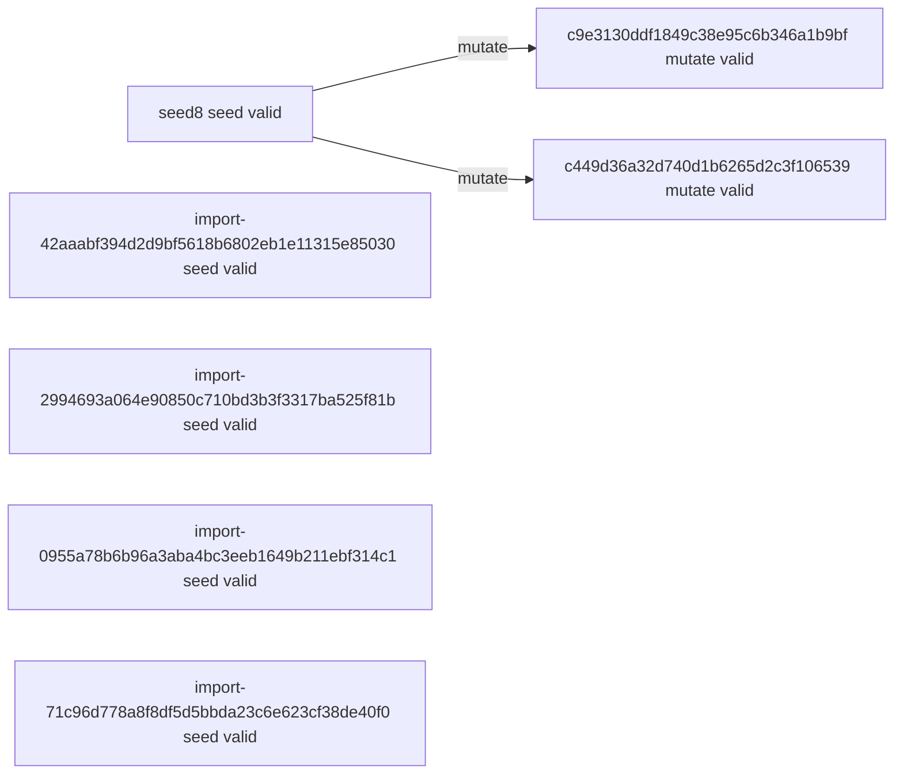

# Campaign smac-pilot-v1

Export schema: `feyer-campaign-export-v1`. Snapshot: `888f6faa037abc82ef1493b5b0c9ff1e27437e01cbe885a3094a0707b7fed7fb`.

[Frozen proposer context](contexts/02007fee7ebaa50447629a1ab12f98b9fbfddecdeadbe91c36579bba06477c19.json) — SHA256 `02007fee7ebaa50447629a1ab12f98b9fbfddecdeadbe91c36579bba06477c19`.

This is an evidence ledger. Scientific parents describe chosen inputs to an experiment; they are not necessarily Git parents. Phase changes are observations, not proof that one edit caused the difference. A failed attempt remains part of the history.

## Ownership and frozen policy

Campaign specification digest: `aa010e87c6403341d78968946867fd8a6bad7b283208f6bcb0673097dee8c193`.

| Actor | Role | Ownership version | Active |
| --- | --- | --- | --- |
| coordinator | coordinator | 1 | True |

## Scientific lineage

Edges come from declared scientific parents, not inferred chronology or Git ancestry.



## Candidate outcomes

| Candidate | Round / lane | Scientific parents | Exact commit | State | First-run seconds | Evidence IDs |
| --- | --- | --- | --- | --- | --- | --- |
| seed8 | round-001 / discrete | root | 1e552d675c3795265be8af1ac23ffb61f90f30b1 | valid | 28.0935 | 415bab6b82ef42baa0e0a5277df7aeb9:49937d87a08c533f73470c9dcc48dbc7870c12f467d9a8b5de192dffb5484afa, 882be0c143db470c9686cd2ba9e44c77:b547550f15337f868903dbcb118fa79d025993744270cf25cc8c7816a2e5616d, e6e5badb945c47ae927e511a3ff15fd7:820c7dfc19d0099d62f3b2315da0fb1dd7ee7ee9203b875447cfc2bd07d956a2 |
| import-42aaabf394d2d9bf5618b6802eb1e11315e85030 | round-001 / discrete | root | 42aaabf394d2d9bf5618b6802eb1e11315e85030 | valid | 28.6478 | 7f9a3863201d4908b9e2607e8b925bdc:70e1da46befd5d0fd365188a88a91391f95e2df62042e7a6687de8abbaf8c611 |
| import-2994693a064e90850c710bd3b3f3317ba525f81b | round-001 / discrete | root | 2994693a064e90850c710bd3b3f3317ba525f81b | valid | 36.8441 | cde035e7126e4e00a4eccc5192f41d86:97a7e880e414101b6593ca85de16889e7fe6e0c28c1e57ad796fb9a0660824be |
| import-0955a78b6b96a3aba4bc3eeb1649b211ebf314c1 | round-001 / discrete | root | 0955a78b6b96a3aba4bc3eeb1649b211ebf314c1 | valid | 50.1969 | 8d433ae433e5496b89cb4de587c0862f:e73ec4d8e0e0b141c91c65a03e7de4e446cb51042c5f42264060bcc887a94bbf |
| import-71c96d778a8f8df5d5bbda23c6e623cf38de40f0 | round-001 / discrete | root | 71c96d778a8f8df5d5bbda23c6e623cf38de40f0 | valid | 59.3904 | ec26950f0788435dbf930f9c1fb7c4a2:b8fbf377b58c48325c564e832e5e8bde6789142ffb745a4617879420f56113c2 |
| c9e3130ddf1849c38e95c6b346a1b9bf | round-001 / discrete | seed8 | e1943cc1a433b736acf9d2462fe2cdf1e8b2e554 | valid | 29.2047 | 1cc208770b824cd1b23496e996972136:7155c1256fe3c6fbc3bb5fa6e1629b4d04db9d7744b054fe0a0d4ab0b75b6131, 0cab447d06c64b75bc7a04d93157aba3:f86bc41287a7d9566bc410c5f0ff6698ab5ea3200df226e17e75eb2cb5a0ce68 |
| c449d36a32d740d1b6265d2c3f106539 | round-001 / discrete | seed8 | 117aeb29827cc84fbd34bed9ac519aee38e4512c | valid | 36.9376 | a7356c9700264509a9ca435ee63644c8:c43e8a1c116d77fe45406efbbe0bf2ef3dba5a88c8e2308b182977b81b9176d8, 00a050455c7446998974d85bb501ae60:5eac24ab30bb397a898e16903be1c1a0f95268f8dfbc358618408febd904e37d |

## Round decisions and stalled work

### Round round-001

Frozen specification: `8845f4d41a65ad79387ce3c77379b2938f526d89a6b392a20a17e4ffb686f9f4`; version: 1; closed: False.

```json
{
  "budget": {
    "max_evaluations": 6,
    "max_proposals": 1000
  },
  "constraints": [
    "not checkpoint implies not prevent_cse"
  ],
  "dimensions": {
    "checkpoint": [
      true,
      false
    ],
    "map_batch_size": [
      null,
      1,
      2,
      4,
      8
    ],
    "prevent_cse": [
      false,
      true
    ]
  },
  "lanes": {
    "discrete": {
      "dimensions": [
        "checkpoint",
        "prevent_cse",
        "map_batch_size"
      ],
      "max_proposals": 15,
      "owner": "coordinator",
      "stall_limit": 15
    }
  },
  "materializer_version": "seed8-component-execution-v1",
  "progress": {
    "absolute": 0.02,
    "relative": 0.01
  },
  "recipes": {
    "discrete": {
      "dimensions": [
        "checkpoint",
        "prevent_cse",
        "map_batch_size"
      ]
    }
  },
  "round_id": "round-001",
  "seed_parameters": {
    "checkpoint": true,
    "map_batch_size": null,
    "prevent_cse": false
  },
  "selector": "smac"
}
```

- round-001/discrete: ready; owner coordinator; strikes 2; reason not recorded

## Candidate evidence and proposed changes

### seed8

```json
{
  "cohort_digest": "10567ad0f8dcb7122b6b182e1be342313b89eef340d4070073fdf62d6342204c",
  "commit_sha": "1e552d675c3795265be8af1ac23ffb61f90f30b1",
  "content_sha256": "8225fedb4580e39fcc3f3611e73e4e356c7c0b55e4a3353486fcad9260d77c01",
  "context_sha256": null,
  "evaluation_requests": [
    {
      "attempt": 1,
      "candidate_id": "seed8",
      "evidence_id": "415bab6b82ef42baa0e0a5277df7aeb9:49937d87a08c533f73470c9dcc48dbc7870c12f467d9a8b5de192dffb5484afa",
      "imported": true,
      "job_id": "415bab6b82ef42baa0e0a5277df7aeb9",
      "profile": "full",
      "request_id": "d770730cadce47129e880ce6d6b671ba",
      "status": "valid"
    },
    {
      "attempt": 2,
      "candidate_id": "seed8",
      "evidence_id": "882be0c143db470c9686cd2ba9e44c77:b547550f15337f868903dbcb118fa79d025993744270cf25cc8c7816a2e5616d",
      "imported": true,
      "job_id": "882be0c143db470c9686cd2ba9e44c77",
      "profile": "full",
      "request_id": "de105407f18c4fa4a31999a5c86733e6",
      "status": "valid"
    },
    {
      "attempt": 3,
      "candidate_id": "seed8",
      "evidence_id": "e6e5badb945c47ae927e511a3ff15fd7:820c7dfc19d0099d62f3b2315da0fb1dd7ee7ee9203b875447cfc2bd07d956a2",
      "imported": true,
      "job_id": "e6e5badb945c47ae927e511a3ff15fd7",
      "profile": "full",
      "request_id": "c247b1f1a1c64d969b88a3474f365440",
      "status": "valid"
    }
  ],
  "evidence": [
    {
      "artifact_digest": "49937d87a08c533f73470c9dcc48dbc7870c12f467d9a8b5de192dffb5484afa",
      "artifact_digests": {
        "comparison.json": "005847678f9babe30a632a5a1a82e2a3edbabb30000bd9d443af41d13038a7d0",
        "report.json": "33b5ce79552d7397bce63da5ef387160c7ef142d72b2acba540c0f610d3a4d2e",
        "result": "7dbb9193b3f0e69ee2b3cd2d81372c81cb5d6308ba81d48b8cc57061ad9b4bdf"
      },
      "candidate_sha": "1e552d675c3795265be8af1ac23ffb61f90f30b1",
      "category": "valid",
      "checks": {
        "official": "passed",
        "precision": "passed",
        "resource": "passed",
        "source": "passed",
        "strict": "passed",
        "workload": "passed"
      },
      "cohort": {
        "adapter_schema": "feyer-evolution-evidence-v1",
        "container_limits": {
          "cpu.max": "1600000 100000",
          "cpuset.cpus.effective": "0-127",
          "memory.max": "59055800320",
          "memory.swap.max": "0"
        },
        "memory_policy": {
          "budget_bytes": 32000000000,
          "enforcement": "sampled_process_group_rss",
          "kernel_memory_limit_enforced": false
        },
        "profile": "full",
        "protected_baseline_sha": "02ec741d8a1bf1a2278294ea74f9fc1d68f08f1f",
        "signature": {
          "environment": {
            "backend": "cpu",
            "cpu_affinity_ids": [
              2
            ],
            "cpu_model": "AMD EPYC 9334 32-Core Processor",
            "jax_enable_x64": true,
            "packages": {
              "differometor": "0.0.6",
              "jax": "0.9.0",
              "jaxlib": "0.9.0",
              "numpy": "2.5.5",
              "optax": "0.2.6"
            },
            "persistent_compilation_cache": false,
            "python": "3.12.15",
            "requested_logical_cpus": 1,
            "thread_limits": {
              "MKL_NUM_THREADS": "1",
              "NUMEXPR_NUM_THREADS": "1",
              "OMP_NUM_THREADS": "1",
              "OPENBLAS_NUM_THREADS": "1"
            },
            "xla_flags": null
          },
          "inputs": {
            "frequency_count": 101,
            "gradient_parameter_count": 193,
            "reference_sha256": "726f2cfe6986cb991fa48d5a28127b9330c3dc7e69d5bd193c8748acef03adc3",
            "setup_sha256": "ff4ba353a2a03cdce7f3e61bad729c2e00888d842c28ba9cf699f95afb87e138"
          },
          "timing": {
            "benchmark": "start-munich-2026-public-differometor-uifo-v2",
            "evaluator_sha256": "d5950bbd872e5b00ad63f0bd7081e5096fb14ba9c96c80a6854a3b714719bd4e",
            "phase_keys": [
              "build",
              "forward",
              "forward_compile",
              "forward_lower",
              "gradient",
              "gradient_compile",
              "gradient_lower",
              "host_transfer",
              "imports",
              "initialize",
              "load",
              "sensitivity",
              "sensitivity_compile",
              "sensitivity_lower"
            ],
            "scope": {
              "excluded": "validation and benchmark harness bookkeeping, repeated profiling, plot/report generation; interpreter launch before the first timer",
              "forward_residuals": "saved for separately compiled reverse pass",
              "gradient_coordinates": "physical parameter values; public grid-length tying",
              "objective": "mean(log10(sensitivity / public_reference))",
              "optimizer_steps": 0,
              "total_scope": "imports, CPU initialization, input I/O, setup, all lowering/compilation, forward, sensitivity/powers/loss, reverse-mode gradient and host transfer"
            }
          }
        },
        "strict_policy": {
          "evaluator_sha256": "1bc9b39fe0023afc3db93211b9e3d6cd37ed2b13ee281f142749c2237a16ea8f",
          "reference_arrays_sha256": "c3f6cba045f8b41f488dc19c960f5056b5f2e75cfa64f9a687b52f2a9ba2751e",
          "rtol": 1e-07,
          "scale_atol": 1e-12
        },
        "worker_sha256": "d3c212da0ab1215187407d9cd21dc2cbb5f88dc0b5ee7885135bf7f002d14b58"
      },
      "cohort_digest": "10567ad0f8dcb7122b6b182e1be342313b89eef340d4070073fdf62d6342204c",
      "cost": {
        "comparison_wall_seconds": 0.2575887069106102,
        "peak_rss_bytes": 13767028736,
        "peak_rss_kib": 13444364,
        "total_worker_wall_seconds": 111.85857847332954,
        "wall_seconds": 111.60098976641893
      },
      "eligible_full": true,
      "evidence_digest": "a8ce498a148a76b19e1a8e2e64347d75f42df5d2d63105455d314741e680dc28",
      "evidence_id": "415bab6b82ef42baa0e0a5277df7aeb9:49937d87a08c533f73470c9dcc48dbc7870c12f467d9a8b5de192dffb5484afa",
      "execution_status": "completed",
      "issues": [],
      "job_id": "415bab6b82ef42baa0e0a5277df7aeb9",
      "metrics": {
        "compilation": 12.756752016022801,
        "forward": 12.382117168977857,
        "gradient": 1.8760113269090652,
        "peak_rss_bytes": 13767028736,
        "runtime": 14.259446823969483,
        "sensitivity": 0.0008984114974737167,
        "setup": 1.0238497275859118,
        "total": 28.040048567578197,
        "transfer": 0.0004199165850877762
      },
      "phases": {
        "build": 0.7346600126475096,
        "forward": 12.382117168977857,
        "forward_compile": 4.924385312944651,
        "forward_lower": 0.870494470000267,
        "gradient": 1.8760113269090652,
        "gradient_compile": 6.096814852207899,
        "gradient_lower": 0.4077671058475971,
        "host_transfer": 0.0004199165850877762,
        "imports": 0.2848028242588043,
        "initialize": 0.0029357559978961945,
        "load": 0.0014511346817016602,
        "sensitivity": 0.0008984114974737167,
        "sensitivity_compile": 0.37297157756984234,
        "sensitivity_lower": 0.08431869745254517
      },
      "profile": "full",
      "resource_evidence": {
        "budget_bytes": 32000000000,
        "container_limits": {
          "cpu.max": "1600000 100000",
          "cpuset.cpus.effective": "0-127",
          "memory.max": "59055800320",
          "memory.swap.max": "0"
        },
        "limitation": "Sampled process-group RSS is not a kernel-enforced memory cap.",
        "memory_monitoring": {
          "budget_bytes": 32000000000,
          "enforcement": "sampled_process_group_rss",
          "exceeded": false,
          "kernel_memory_limit_enforced": false,
          "notes": "RSS sampling can miss brief peaks and counts shared pages in each process. It excludes GPU VRAM and does not reserve RAM or constrain other instance work.",
          "sampled_process_group_peak_rss_bytes": 13768077312,
          "samples": 437
        }
      },
      "schema_version": "feyer-evolution-evidence-v1",
      "scientific_strike": false,
      "screen_passed": false,
      "source_digests": {
        "clean_diff_sha256": "e3b0c44298fc1c149afbf4c8996fb92427ae41e4649b934ca495991b7852b855",
        "comparison_evaluator_sha256": "1bc9b39fe0023afc3db93211b9e3d6cd37ed2b13ee281f142749c2237a16ea8f",
        "evaluator_sha256": "d5950bbd872e5b00ad63f0bd7081e5096fb14ba9c96c80a6854a3b714719bd4e",
        "reference_arrays_sha256": "c3f6cba045f8b41f488dc19c960f5056b5f2e75cfa64f9a687b52f2a9ba2751e",
        "simulator_files_sha256": {
          "differometor/__init__.py": "505d559d5a17409680a91f555882edf23f78cbb7c98ee28845018fa9bfeba7e7",
          "differometor/build.py": "f1fdff78515500f5912907537dbedecf30c3915fa949b820bf2ad81b4c062771",
          "differometor/components.py": "2e857e19d468d94b46594f71a76221d9d8b677bad05f6cf03b9e57b0e1613593",
          "differometor/plot.py": "16735e0fb14902f2c024e3da9f2655cbea634c4dd9e06c48af1247e12d0cf606",
          "differometor/setups.py": "478b1a7391b28604c36d8245e13ffa4f6d0f6dc32eeac6c6feaf5c08aa06a76b",
          "differometor/simulate.py": "8225fedb4580e39fcc3f3611e73e4e356c7c0b55e4a3353486fcad9260d77c01",
          "differometor/utils.py": "73ee8a862cbc435363904addc363071ed7dc8b1546956f82e1746998fe3b09ff"
        },
        "worker_sha256": "d3c212da0ab1215187407d9cd21dc2cbb5f88dc0b5ee7885135bf7f002d14b58"
      },
      "validated_output_scope": "last_warm_evaluation",
      "warm_metrics": {
        "forward": 12.542850732803345,
        "gradient": 1.875739123672247,
        "host_transfer": 0.0003086775541305542,
        "sensitivity": 0.21159253269433975
      },
      "worker_error": null
    },
    {
      "artifact_digest": "b547550f15337f868903dbcb118fa79d025993744270cf25cc8c7816a2e5616d",
      "artifact_digests": {
        "comparison.json": "005847678f9babe30a632a5a1a82e2a3edbabb30000bd9d443af41d13038a7d0",
        "report.json": "6b880067010b521f1a4c6071a146d70dbbf321cad9e73d2863b371c6863e950b",
        "result": "d30369d24d849b36c214cb6ee7a1ca78beafd5c6a9dba2ceeed83625ef475246"
      },
      "candidate_sha": "1e552d675c3795265be8af1ac23ffb61f90f30b1",
      "category": "valid",
      "checks": {
        "official": "passed",
        "precision": "passed",
        "resource": "passed",
        "source": "passed",
        "strict": "passed",
        "workload": "passed"
      },
      "cohort": {
        "adapter_schema": "feyer-evolution-evidence-v1",
        "container_limits": {
          "cpu.max": "1600000 100000",
          "cpuset.cpus.effective": "0-127",
          "memory.max": "59055800320",
          "memory.swap.max": "0"
        },
        "memory_policy": {
          "budget_bytes": 32000000000,
          "enforcement": "sampled_process_group_rss",
          "kernel_memory_limit_enforced": false
        },
        "profile": "full",
        "protected_baseline_sha": "02ec741d8a1bf1a2278294ea74f9fc1d68f08f1f",
        "signature": {
          "environment": {
            "backend": "cpu",
            "cpu_affinity_ids": [
              2
            ],
            "cpu_model": "AMD EPYC 9334 32-Core Processor",
            "jax_enable_x64": true,
            "packages": {
              "differometor": "0.0.6",
              "jax": "0.9.0",
              "jaxlib": "0.9.0",
              "numpy": "2.5.5",
              "optax": "0.2.6"
            },
            "persistent_compilation_cache": false,
            "python": "3.12.15",
            "requested_logical_cpus": 1,
            "thread_limits": {
              "MKL_NUM_THREADS": "1",
              "NUMEXPR_NUM_THREADS": "1",
              "OMP_NUM_THREADS": "1",
              "OPENBLAS_NUM_THREADS": "1"
            },
            "xla_flags": null
          },
          "inputs": {
            "frequency_count": 101,
            "gradient_parameter_count": 193,
            "reference_sha256": "726f2cfe6986cb991fa48d5a28127b9330c3dc7e69d5bd193c8748acef03adc3",
            "setup_sha256": "ff4ba353a2a03cdce7f3e61bad729c2e00888d842c28ba9cf699f95afb87e138"
          },
          "timing": {
            "benchmark": "start-munich-2026-public-differometor-uifo-v2",
            "evaluator_sha256": "d5950bbd872e5b00ad63f0bd7081e5096fb14ba9c96c80a6854a3b714719bd4e",
            "phase_keys": [
              "build",
              "forward",
              "forward_compile",
              "forward_lower",
              "gradient",
              "gradient_compile",
              "gradient_lower",
              "host_transfer",
              "imports",
              "initialize",
              "load",
              "sensitivity",
              "sensitivity_compile",
              "sensitivity_lower"
            ],
            "scope": {
              "excluded": "validation and benchmark harness bookkeeping, repeated profiling, plot/report generation; interpreter launch before the first timer",
              "forward_residuals": "saved for separately compiled reverse pass",
              "gradient_coordinates": "physical parameter values; public grid-length tying",
              "objective": "mean(log10(sensitivity / public_reference))",
              "optimizer_steps": 0,
              "total_scope": "imports, CPU initialization, input I/O, setup, all lowering/compilation, forward, sensitivity/powers/loss, reverse-mode gradient and host transfer"
            }
          }
        },
        "strict_policy": {
          "evaluator_sha256": "1bc9b39fe0023afc3db93211b9e3d6cd37ed2b13ee281f142749c2237a16ea8f",
          "reference_arrays_sha256": "c3f6cba045f8b41f488dc19c960f5056b5f2e75cfa64f9a687b52f2a9ba2751e",
          "rtol": 1e-07,
          "scale_atol": 1e-12
        },
        "worker_sha256": "d3c212da0ab1215187407d9cd21dc2cbb5f88dc0b5ee7885135bf7f002d14b58"
      },
      "cohort_digest": "10567ad0f8dcb7122b6b182e1be342313b89eef340d4070073fdf62d6342204c",
      "cost": {
        "comparison_wall_seconds": 0.25682039745151997,
        "peak_rss_bytes": 13758509056,
        "peak_rss_kib": 13436044,
        "total_worker_wall_seconds": 113.93450396507978,
        "wall_seconds": 113.67768356762826
      },
      "eligible_full": true,
      "evidence_digest": "72d952d6f5137b4652e3b687174999ea816a27567db57ec1648422f791769fd4",
      "evidence_id": "882be0c143db470c9686cd2ba9e44c77:b547550f15337f868903dbcb118fa79d025993744270cf25cc8c7816a2e5616d",
      "execution_status": "completed",
      "issues": [],
      "job_id": "882be0c143db470c9686cd2ba9e44c77",
      "metrics": {
        "compilation": 13.170896405354142,
        "forward": 12.400077329948545,
        "gradient": 1.902217959985137,
        "peak_rss_bytes": 13758509056,
        "runtime": 14.30376430414617,
        "sensitivity": 0.0010634586215019226,
        "setup": 1.099603358656168,
        "total": 28.57426406815648,
        "transfer": 0.0004055555909872055
      },
      "phases": {
        "build": 0.8086971193552017,
        "forward": 12.400077329948545,
        "forward_compile": 5.102056432515383,
        "forward_lower": 0.9158173240721226,
        "gradient": 1.902217959985137,
        "gradient_compile": 6.248855207115412,
        "gradient_lower": 0.4496453870087862,
        "host_transfer": 0.0004055555909872055,
        "imports": 0.2865349929779768,
        "initialize": 0.002890240401029587,
        "load": 0.001481005921959877,
        "sensitivity": 0.0010634586215019226,
        "sensitivity_compile": 0.3675619624555111,
        "sensitivity_lower": 0.0869600921869278
      },
      "profile": "full",
      "resource_evidence": {
        "budget_bytes": 32000000000,
        "container_limits": {
          "cpu.max": "1600000 100000",
          "cpuset.cpus.effective": "0-127",
          "memory.max": "59055800320",
          "memory.swap.max": "0"
        },
        "limitation": "Sampled process-group RSS is not a kernel-enforced memory cap.",
        "memory_monitoring": {
          "budget_bytes": 32000000000,
          "enforcement": "sampled_process_group_rss",
          "exceeded": false,
          "kernel_memory_limit_enforced": false,
          "notes": "RSS sampling can miss brief peaks and counts shared pages in each process. It excludes GPU VRAM and does not reserve RAM or constrain other instance work.",
          "sampled_process_group_peak_rss_bytes": 13759557632,
          "samples": 445
        }
      },
      "schema_version": "feyer-evolution-evidence-v1",
      "scientific_strike": false,
      "screen_passed": false,
      "source_digests": {
        "clean_diff_sha256": "e3b0c44298fc1c149afbf4c8996fb92427ae41e4649b934ca495991b7852b855",
        "comparison_evaluator_sha256": "1bc9b39fe0023afc3db93211b9e3d6cd37ed2b13ee281f142749c2237a16ea8f",
        "evaluator_sha256": "d5950bbd872e5b00ad63f0bd7081e5096fb14ba9c96c80a6854a3b714719bd4e",
        "reference_arrays_sha256": "c3f6cba045f8b41f488dc19c960f5056b5f2e75cfa64f9a687b52f2a9ba2751e",
        "simulator_files_sha256": {
          "differometor/__init__.py": "505d559d5a17409680a91f555882edf23f78cbb7c98ee28845018fa9bfeba7e7",
          "differometor/build.py": "f1fdff78515500f5912907537dbedecf30c3915fa949b820bf2ad81b4c062771",
          "differometor/components.py": "2e857e19d468d94b46594f71a76221d9d8b677bad05f6cf03b9e57b0e1613593",
          "differometor/plot.py": "16735e0fb14902f2c024e3da9f2655cbea634c4dd9e06c48af1247e12d0cf606",
          "differometor/setups.py": "478b1a7391b28604c36d8245e13ffa4f6d0f6dc32eeac6c6feaf5c08aa06a76b",
          "differometor/simulate.py": "8225fedb4580e39fcc3f3611e73e4e356c7c0b55e4a3353486fcad9260d77c01",
          "differometor/utils.py": "73ee8a862cbc435363904addc363071ed7dc8b1546956f82e1746998fe3b09ff"
        },
        "worker_sha256": "d3c212da0ab1215187407d9cd21dc2cbb5f88dc0b5ee7885135bf7f002d14b58"
      },
      "validated_output_scope": "last_warm_evaluation",
      "warm_metrics": {
        "forward": 12.743575628846884,
        "gradient": 1.8781429361552,
        "host_transfer": 0.00023546814918518066,
        "sensitivity": 0.2108212560415268
      },
      "worker_error": null
    },
    {
      "artifact_digest": "820c7dfc19d0099d62f3b2315da0fb1dd7ee7ee9203b875447cfc2bd07d956a2",
      "artifact_digests": {
        "comparison.json": "005847678f9babe30a632a5a1a82e2a3edbabb30000bd9d443af41d13038a7d0",
        "report.json": "b2edb193ca235a5cd902e415ddbad328d0cce85c3c44f193a72c3f4ea10409d2",
        "result": "c7b4f4d5f713d1efa4ad20c9f07ef304bb352c40b55052971c2251f12bcd3b42"
      },
      "candidate_sha": "1e552d675c3795265be8af1ac23ffb61f90f30b1",
      "category": "valid",
      "checks": {
        "official": "passed",
        "precision": "passed",
        "resource": "passed",
        "source": "passed",
        "strict": "passed",
        "workload": "passed"
      },
      "cohort": {
        "adapter_schema": "feyer-evolution-evidence-v1",
        "container_limits": {
          "cpu.max": "1600000 100000",
          "cpuset.cpus.effective": "0-127",
          "memory.max": "59055800320",
          "memory.swap.max": "0"
        },
        "memory_policy": {
          "budget_bytes": 32000000000,
          "enforcement": "sampled_process_group_rss",
          "kernel_memory_limit_enforced": false
        },
        "profile": "full",
        "protected_baseline_sha": "02ec741d8a1bf1a2278294ea74f9fc1d68f08f1f",
        "signature": {
          "environment": {
            "backend": "cpu",
            "cpu_affinity_ids": [
              2
            ],
            "cpu_model": "AMD EPYC 9334 32-Core Processor",
            "jax_enable_x64": true,
            "packages": {
              "differometor": "0.0.6",
              "jax": "0.9.0",
              "jaxlib": "0.9.0",
              "numpy": "2.5.5",
              "optax": "0.2.6"
            },
            "persistent_compilation_cache": false,
            "python": "3.12.15",
            "requested_logical_cpus": 1,
            "thread_limits": {
              "MKL_NUM_THREADS": "1",
              "NUMEXPR_NUM_THREADS": "1",
              "OMP_NUM_THREADS": "1",
              "OPENBLAS_NUM_THREADS": "1"
            },
            "xla_flags": null
          },
          "inputs": {
            "frequency_count": 101,
            "gradient_parameter_count": 193,
            "reference_sha256": "726f2cfe6986cb991fa48d5a28127b9330c3dc7e69d5bd193c8748acef03adc3",
            "setup_sha256": "ff4ba353a2a03cdce7f3e61bad729c2e00888d842c28ba9cf699f95afb87e138"
          },
          "timing": {
            "benchmark": "start-munich-2026-public-differometor-uifo-v2",
            "evaluator_sha256": "d5950bbd872e5b00ad63f0bd7081e5096fb14ba9c96c80a6854a3b714719bd4e",
            "phase_keys": [
              "build",
              "forward",
              "forward_compile",
              "forward_lower",
              "gradient",
              "gradient_compile",
              "gradient_lower",
              "host_transfer",
              "imports",
              "initialize",
              "load",
              "sensitivity",
              "sensitivity_compile",
              "sensitivity_lower"
            ],
            "scope": {
              "excluded": "validation and benchmark harness bookkeeping, repeated profiling, plot/report generation; interpreter launch before the first timer",
              "forward_residuals": "saved for separately compiled reverse pass",
              "gradient_coordinates": "physical parameter values; public grid-length tying",
              "objective": "mean(log10(sensitivity / public_reference))",
              "optimizer_steps": 0,
              "total_scope": "imports, CPU initialization, input I/O, setup, all lowering/compilation, forward, sensitivity/powers/loss, reverse-mode gradient and host transfer"
            }
          }
        },
        "strict_policy": {
          "evaluator_sha256": "1bc9b39fe0023afc3db93211b9e3d6cd37ed2b13ee281f142749c2237a16ea8f",
          "reference_arrays_sha256": "c3f6cba045f8b41f488dc19c960f5056b5f2e75cfa64f9a687b52f2a9ba2751e",
          "rtol": 1e-07,
          "scale_atol": 1e-12
        },
        "worker_sha256": "d3c212da0ab1215187407d9cd21dc2cbb5f88dc0b5ee7885135bf7f002d14b58"
      },
      "cohort_digest": "10567ad0f8dcb7122b6b182e1be342313b89eef340d4070073fdf62d6342204c",
      "cost": {
        "comparison_wall_seconds": 0.25740163773298264,
        "peak_rss_bytes": 13754388480,
        "peak_rss_kib": 13432020,
        "total_worker_wall_seconds": 111.85716444440186,
        "wall_seconds": 111.59976280666888
      },
      "eligible_full": true,
      "evidence_digest": "e06feb15f7c2ba1e21aa1fa63f7a879f1b3784912b5b2a6d879930c01a887e22",
      "evidence_id": "e6e5badb945c47ae927e511a3ff15fd7:820c7dfc19d0099d62f3b2315da0fb1dd7ee7ee9203b875447cfc2bd07d956a2",
      "execution_status": "completed",
      "issues": [],
      "job_id": "e6e5badb945c47ae927e511a3ff15fd7",
      "metrics": {
        "compilation": 12.777620123699307,
        "forward": 12.399473497644067,
        "gradient": 1.8828602991998196,
        "peak_rss_bytes": 13754388480,
        "runtime": 14.283548314124346,
        "sensitivity": 0.0009176898747682571,
        "setup": 1.032353088259697,
        "total": 28.09352152608335,
        "transfer": 0.00029682740569114685
      },
      "phases": {
        "build": 0.7394567411392927,
        "forward": 12.399473497644067,
        "forward_compile": 4.945773968473077,
        "forward_lower": 0.8744982127100229,
        "gradient": 1.8828602991998196,
        "gradient_compile": 6.078064216300845,
        "gradient_lower": 0.41370727121829987,
        "host_transfer": 0.00029682740569114685,
        "imports": 0.2885946538299322,
        "initialize": 0.002883758395910263,
        "load": 0.0014179348945617676,
        "sensitivity": 0.0009176898747682571,
        "sensitivity_compile": 0.379582442343235,
        "sensitivity_lower": 0.08599401265382767
      },
      "profile": "full",
      "resource_evidence": {
        "budget_bytes": 32000000000,
        "container_limits": {
          "cpu.max": "1600000 100000",
          "cpuset.cpus.effective": "0-127",
          "memory.max": "59055800320",
          "memory.swap.max": "0"
        },
        "limitation": "Sampled process-group RSS is not a kernel-enforced memory cap.",
        "memory_monitoring": {
          "budget_bytes": 32000000000,
          "enforcement": "sampled_process_group_rss",
          "exceeded": false,
          "kernel_memory_limit_enforced": false,
          "notes": "RSS sampling can miss brief peaks and counts shared pages in each process. It excludes GPU VRAM and does not reserve RAM or constrain other instance work.",
          "sampled_process_group_peak_rss_bytes": 13755437056,
          "samples": 437
        }
      },
      "schema_version": "feyer-evolution-evidence-v1",
      "scientific_strike": false,
      "screen_passed": false,
      "source_digests": {
        "clean_diff_sha256": "e3b0c44298fc1c149afbf4c8996fb92427ae41e4649b934ca495991b7852b855",
        "comparison_evaluator_sha256": "1bc9b39fe0023afc3db93211b9e3d6cd37ed2b13ee281f142749c2237a16ea8f",
        "evaluator_sha256": "d5950bbd872e5b00ad63f0bd7081e5096fb14ba9c96c80a6854a3b714719bd4e",
        "reference_arrays_sha256": "c3f6cba045f8b41f488dc19c960f5056b5f2e75cfa64f9a687b52f2a9ba2751e",
        "simulator_files_sha256": {
          "differometor/__init__.py": "505d559d5a17409680a91f555882edf23f78cbb7c98ee28845018fa9bfeba7e7",
          "differometor/build.py": "f1fdff78515500f5912907537dbedecf30c3915fa949b820bf2ad81b4c062771",
          "differometor/components.py": "2e857e19d468d94b46594f71a76221d9d8b677bad05f6cf03b9e57b0e1613593",
          "differometor/plot.py": "16735e0fb14902f2c024e3da9f2655cbea634c4dd9e06c48af1247e12d0cf606",
          "differometor/setups.py": "478b1a7391b28604c36d8245e13ffa4f6d0f6dc32eeac6c6feaf5c08aa06a76b",
          "differometor/simulate.py": "8225fedb4580e39fcc3f3611e73e4e356c7c0b55e4a3353486fcad9260d77c01",
          "differometor/utils.py": "73ee8a862cbc435363904addc363071ed7dc8b1546956f82e1746998fe3b09ff"
        },
        "worker_sha256": "d3c212da0ab1215187407d9cd21dc2cbb5f88dc0b5ee7885135bf7f002d14b58"
      },
      "validated_output_scope": "last_warm_evaluation",
      "warm_metrics": {
        "forward": 12.515215031802654,
        "gradient": 1.8746604043990374,
        "host_transfer": 0.0002299882471561432,
        "sensitivity": 0.20756630413234234
      },
      "worker_error": null
    }
  ],
  "evidence_ids": [
    "415bab6b82ef42baa0e0a5277df7aeb9:49937d87a08c533f73470c9dcc48dbc7870c12f467d9a8b5de192dffb5484afa",
    "882be0c143db470c9686cd2ba9e44c77:b547550f15337f868903dbcb118fa79d025993744270cf25cc8c7816a2e5616d",
    "e6e5badb945c47ae927e511a3ff15fd7:820c7dfc19d0099d62f3b2315da0fb1dd7ee7ee9203b875447cfc2bd07d956a2"
  ],
  "git_parents": null,
  "heuristic_id": null,
  "hypothesis": null,
  "improved": false,
  "kind": "seed",
  "lane_id": "discrete",
  "metrics": {
    "compilation": 12.777620123699307,
    "forward": 12.399473497644067,
    "gradient": 1.8828602991998196,
    "peak_rss_bytes": 13758509056,
    "runtime": 14.283548314124346,
    "sensitivity": 0.0009176898747682571,
    "setup": 1.032353088259697,
    "total": 28.09352152608335,
    "transfer": 0.0004055555909872055
  },
  "model_manifest": null,
  "owner": "coordinator",
  "owner_version": 1,
  "parameters": {
    "checkpoint": true,
    "map_batch_size": null,
    "prevent_cse": false
  },
  "parameters_after": {
    "checkpoint": true,
    "map_batch_size": null,
    "prevent_cse": false
  },
  "parameters_before": null,
  "parents": [],
  "prompt_sha256": null,
  "proposal": {
    "candidate_id": "seed8",
    "commit_sha": "1e552d675c3795265be8af1ac23ffb61f90f30b1",
    "content_sha256": "8225fedb4580e39fcc3f3611e73e4e356c7c0b55e4a3353486fcad9260d77c01",
    "kind": "seed",
    "lane_id": "discrete",
    "parameters": {
      "checkpoint": true,
      "map_batch_size": null,
      "prevent_cse": false
    },
    "parents": [],
    "proposal_id": "seed8",
    "provenance": {
      "heuristic_id": "import-confirmed-strong-agent-seed",
      "model": "validated Codex seed8, three fresh full measurements"
    },
    "recipe": null,
    "round_id": "round-001"
  },
  "proposal_id": "seed8",
  "provenance": {
    "heuristic_id": "import-confirmed-strong-agent-seed",
    "model": "validated Codex seed8, three fresh full measurements"
  },
  "recipe": null,
  "response_sha256": null,
  "round_id": "round-001",
  "target_symbols": null,
  "uncertainty": "No repeat-confirmation or causality is inferred from this export. Inspect exact job evidence and matching cohorts.",
  "valid": true
}
```

### import-42aaabf394d2d9bf5618b6802eb1e11315e85030

```json
{
  "cohort_digest": "10567ad0f8dcb7122b6b182e1be342313b89eef340d4070073fdf62d6342204c",
  "commit_sha": "42aaabf394d2d9bf5618b6802eb1e11315e85030",
  "content_sha256": "ca7a299118fe3731c494910ae92526d3ed4c82ee4924a38380c2dc75c1463b19",
  "context_sha256": null,
  "evaluation_requests": [
    {
      "attempt": 1,
      "candidate_id": "import-42aaabf394d2d9bf5618b6802eb1e11315e85030",
      "evidence_id": "7f9a3863201d4908b9e2607e8b925bdc:70e1da46befd5d0fd365188a88a91391f95e2df62042e7a6687de8abbaf8c611",
      "imported": true,
      "job_id": "7f9a3863201d4908b9e2607e8b925bdc",
      "profile": "full",
      "request_id": "ae71c75fe257493b8524163a7fdc8541",
      "status": "valid"
    }
  ],
  "evidence": [
    {
      "artifact_digest": "70e1da46befd5d0fd365188a88a91391f95e2df62042e7a6687de8abbaf8c611",
      "artifact_digests": {
        "comparison.json": "005847678f9babe30a632a5a1a82e2a3edbabb30000bd9d443af41d13038a7d0",
        "report.json": "99b11631ac61d413d7f19004db5545450cd93405d07cea2955d04cc5405711af",
        "result": "0a722ff95fd89fac3abbb76e680b29fa417654284b72ae5c5db7004536db19c8"
      },
      "candidate_sha": "42aaabf394d2d9bf5618b6802eb1e11315e85030",
      "category": "valid",
      "checks": {
        "official": "passed",
        "precision": "passed",
        "resource": "passed",
        "source": "passed",
        "strict": "passed",
        "workload": "passed"
      },
      "cohort": {
        "adapter_schema": "feyer-evolution-evidence-v1",
        "container_limits": {
          "cpu.max": "1600000 100000",
          "cpuset.cpus.effective": "0-127",
          "memory.max": "59055800320",
          "memory.swap.max": "0"
        },
        "memory_policy": {
          "budget_bytes": 32000000000,
          "enforcement": "sampled_process_group_rss",
          "kernel_memory_limit_enforced": false
        },
        "profile": "full",
        "protected_baseline_sha": "02ec741d8a1bf1a2278294ea74f9fc1d68f08f1f",
        "signature": {
          "environment": {
            "backend": "cpu",
            "cpu_affinity_ids": [
              2
            ],
            "cpu_model": "AMD EPYC 9334 32-Core Processor",
            "jax_enable_x64": true,
            "packages": {
              "differometor": "0.0.6",
              "jax": "0.9.0",
              "jaxlib": "0.9.0",
              "numpy": "2.5.5",
              "optax": "0.2.6"
            },
            "persistent_compilation_cache": false,
            "python": "3.12.15",
            "requested_logical_cpus": 1,
            "thread_limits": {
              "MKL_NUM_THREADS": "1",
              "NUMEXPR_NUM_THREADS": "1",
              "OMP_NUM_THREADS": "1",
              "OPENBLAS_NUM_THREADS": "1"
            },
            "xla_flags": null
          },
          "inputs": {
            "frequency_count": 101,
            "gradient_parameter_count": 193,
            "reference_sha256": "726f2cfe6986cb991fa48d5a28127b9330c3dc7e69d5bd193c8748acef03adc3",
            "setup_sha256": "ff4ba353a2a03cdce7f3e61bad729c2e00888d842c28ba9cf699f95afb87e138"
          },
          "timing": {
            "benchmark": "start-munich-2026-public-differometor-uifo-v2",
            "evaluator_sha256": "d5950bbd872e5b00ad63f0bd7081e5096fb14ba9c96c80a6854a3b714719bd4e",
            "phase_keys": [
              "build",
              "forward",
              "forward_compile",
              "forward_lower",
              "gradient",
              "gradient_compile",
              "gradient_lower",
              "host_transfer",
              "imports",
              "initialize",
              "load",
              "sensitivity",
              "sensitivity_compile",
              "sensitivity_lower"
            ],
            "scope": {
              "excluded": "validation and benchmark harness bookkeeping, repeated profiling, plot/report generation; interpreter launch before the first timer",
              "forward_residuals": "saved for separately compiled reverse pass",
              "gradient_coordinates": "physical parameter values; public grid-length tying",
              "objective": "mean(log10(sensitivity / public_reference))",
              "optimizer_steps": 0,
              "total_scope": "imports, CPU initialization, input I/O, setup, all lowering/compilation, forward, sensitivity/powers/loss, reverse-mode gradient and host transfer"
            }
          }
        },
        "strict_policy": {
          "evaluator_sha256": "1bc9b39fe0023afc3db93211b9e3d6cd37ed2b13ee281f142749c2237a16ea8f",
          "reference_arrays_sha256": "c3f6cba045f8b41f488dc19c960f5056b5f2e75cfa64f9a687b52f2a9ba2751e",
          "rtol": 1e-07,
          "scale_atol": 1e-12
        },
        "worker_sha256": "d3c212da0ab1215187407d9cd21dc2cbb5f88dc0b5ee7885135bf7f002d14b58"
      },
      "cohort_digest": "10567ad0f8dcb7122b6b182e1be342313b89eef340d4070073fdf62d6342204c",
      "cost": {
        "comparison_wall_seconds": 0.26017045602202415,
        "peak_rss_bytes": 13758693376,
        "peak_rss_kib": 13436224,
        "total_worker_wall_seconds": 112.69091638363898,
        "wall_seconds": 112.43074592761695
      },
      "eligible_full": true,
      "evidence_digest": "4a2d74726409a39254b78e01905db339de328515277cc50ea018f0f86dc2667b",
      "evidence_id": "7f9a3863201d4908b9e2607e8b925bdc:70e1da46befd5d0fd365188a88a91391f95e2df62042e7a6687de8abbaf8c611",
      "execution_status": "completed",
      "issues": [],
      "job_id": "7f9a3863201d4908b9e2607e8b925bdc",
      "metrics": {
        "compilation": 13.072265705093741,
        "forward": 12.629501961171627,
        "gradient": 1.8934158831834793,
        "peak_rss_bytes": 13758693376,
        "runtime": 14.524255460128188,
        "sensitivity": 0.0009246896952390671,
        "setup": 1.0512448493391275,
        "total": 28.647766014561057,
        "transfer": 0.0004129260778427124
      },
      "phases": {
        "build": 0.7617828771471977,
        "forward": 12.629501961171627,
        "forward_compile": 4.96721850335598,
        "forward_lower": 0.8655092362314463,
        "gradient": 1.8934158831834793,
        "gradient_compile": 6.274708459153771,
        "gradient_lower": 0.4280959088355303,
        "host_transfer": 0.0004129260778427124,
        "imports": 0.28519229404628277,
        "initialize": 0.002861395478248596,
        "load": 0.0014082826673984528,
        "sensitivity": 0.0009246896952390671,
        "sensitivity_compile": 0.4373494014143944,
        "sensitivity_lower": 0.09938419610261917
      },
      "profile": "full",
      "resource_evidence": {
        "budget_bytes": 32000000000,
        "container_limits": {
          "cpu.max": "1600000 100000",
          "cpuset.cpus.effective": "0-127",
          "memory.max": "59055800320",
          "memory.swap.max": "0"
        },
        "limitation": "Sampled process-group RSS is not a kernel-enforced memory cap.",
        "memory_monitoring": {
          "budget_bytes": 32000000000,
          "enforcement": "sampled_process_group_rss",
          "exceeded": false,
          "kernel_memory_limit_enforced": false,
          "notes": "RSS sampling can miss brief peaks and counts shared pages in each process. It excludes GPU VRAM and does not reserve RAM or constrain other instance work.",
          "sampled_process_group_peak_rss_bytes": 13759741952,
          "samples": 436
        }
      },
      "schema_version": "feyer-evolution-evidence-v1",
      "scientific_strike": false,
      "screen_passed": false,
      "source_digests": {
        "clean_diff_sha256": "e3b0c44298fc1c149afbf4c8996fb92427ae41e4649b934ca495991b7852b855",
        "comparison_evaluator_sha256": "1bc9b39fe0023afc3db93211b9e3d6cd37ed2b13ee281f142749c2237a16ea8f",
        "evaluator_sha256": "d5950bbd872e5b00ad63f0bd7081e5096fb14ba9c96c80a6854a3b714719bd4e",
        "reference_arrays_sha256": "c3f6cba045f8b41f488dc19c960f5056b5f2e75cfa64f9a687b52f2a9ba2751e",
        "simulator_files_sha256": {
          "differometor/__init__.py": "505d559d5a17409680a91f555882edf23f78cbb7c98ee28845018fa9bfeba7e7",
          "differometor/build.py": "f1fdff78515500f5912907537dbedecf30c3915fa949b820bf2ad81b4c062771",
          "differometor/components.py": "2e857e19d468d94b46594f71a76221d9d8b677bad05f6cf03b9e57b0e1613593",
          "differometor/plot.py": "16735e0fb14902f2c024e3da9f2655cbea634c4dd9e06c48af1247e12d0cf606",
          "differometor/setups.py": "478b1a7391b28604c36d8245e13ffa4f6d0f6dc32eeac6c6feaf5c08aa06a76b",
          "differometor/simulate.py": "ca7a299118fe3731c494910ae92526d3ed4c82ee4924a38380c2dc75c1463b19",
          "differometor/utils.py": "73ee8a862cbc435363904addc363071ed7dc8b1546956f82e1746998fe3b09ff"
        },
        "worker_sha256": "d3c212da0ab1215187407d9cd21dc2cbb5f88dc0b5ee7885135bf7f002d14b58"
      },
      "validated_output_scope": "last_warm_evaluation",
      "warm_metrics": {
        "forward": 12.641886975616217,
        "gradient": 1.8898078352212906,
        "host_transfer": 0.00025232695043087006,
        "sensitivity": 0.2136995568871498
      },
      "worker_error": null
    }
  ],
  "evidence_ids": [
    "7f9a3863201d4908b9e2607e8b925bdc:70e1da46befd5d0fd365188a88a91391f95e2df62042e7a6687de8abbaf8c611"
  ],
  "git_parents": null,
  "heuristic_id": null,
  "hypothesis": null,
  "improved": false,
  "kind": "seed",
  "lane_id": "discrete",
  "metrics": {
    "compilation": 13.072265705093741,
    "forward": 12.629501961171627,
    "gradient": 1.8934158831834793,
    "peak_rss_bytes": 13758693376,
    "runtime": 14.524255460128188,
    "sensitivity": 0.0009246896952390671,
    "setup": 1.0512448493391275,
    "total": 28.647766014561057,
    "transfer": 0.0004129260778427124
  },
  "model_manifest": null,
  "owner": "coordinator",
  "owner_version": 1,
  "parameters": {
    "checkpoint": true,
    "map_batch_size": null,
    "prevent_cse": true
  },
  "parameters_after": {
    "checkpoint": true,
    "map_batch_size": null,
    "prevent_cse": true
  },
  "parameters_before": null,
  "parents": [],
  "prompt_sha256": null,
  "proposal": {
    "candidate_id": "import-42aaabf394d2d9bf5618b6802eb1e11315e85030",
    "commit_sha": "42aaabf394d2d9bf5618b6802eb1e11315e85030",
    "content_sha256": "ca7a299118fe3731c494910ae92526d3ed4c82ee4924a38380c2dc75c1463b19",
    "kind": "seed",
    "lane_id": "discrete",
    "parameters": {
      "checkpoint": true,
      "map_batch_size": null,
      "prevent_cse": true
    },
    "parents": [],
    "proposal_id": "import-42aaabf394d2d9bf5618b6802eb1e11315e85030",
    "provenance": {
      "heuristic_id": "import-exact-full-evidence",
      "model_calls": 0,
      "source_branch": "explore/dag-pilot-v1",
      "source_job": "7f9a3863201d4908b9e2607e8b925bdc"
    },
    "recipe": null,
    "round_id": "round-001"
  },
  "proposal_id": "import-42aaabf394d2d9bf5618b6802eb1e11315e85030",
  "provenance": {
    "heuristic_id": "import-exact-full-evidence",
    "model_calls": 0,
    "source_branch": "explore/dag-pilot-v1",
    "source_job": "7f9a3863201d4908b9e2607e8b925bdc"
  },
  "recipe": null,
  "response_sha256": null,
  "round_id": "round-001",
  "target_symbols": null,
  "uncertainty": "No repeat-confirmation or causality is inferred from this export. Inspect exact job evidence and matching cohorts.",
  "valid": true
}
```

### import-2994693a064e90850c710bd3b3f3317ba525f81b

```json
{
  "cohort_digest": "10567ad0f8dcb7122b6b182e1be342313b89eef340d4070073fdf62d6342204c",
  "commit_sha": "2994693a064e90850c710bd3b3f3317ba525f81b",
  "content_sha256": "74f7b8428777d855961a096ad89bf59d1e6703929e489339428dc1ae645f4342",
  "context_sha256": null,
  "evaluation_requests": [
    {
      "attempt": 1,
      "candidate_id": "import-2994693a064e90850c710bd3b3f3317ba525f81b",
      "evidence_id": "cde035e7126e4e00a4eccc5192f41d86:97a7e880e414101b6593ca85de16889e7fe6e0c28c1e57ad796fb9a0660824be",
      "imported": true,
      "job_id": "cde035e7126e4e00a4eccc5192f41d86",
      "profile": "full",
      "request_id": "48377451057c43b3abd68cb59fcfdf3e",
      "status": "valid"
    }
  ],
  "evidence": [
    {
      "artifact_digest": "97a7e880e414101b6593ca85de16889e7fe6e0c28c1e57ad796fb9a0660824be",
      "artifact_digests": {
        "comparison.json": "14cee258d15cfb2281f4ae761fc590bc56d1af633055a1fc324296c2a9b781fa",
        "report.json": "6d86f368a274f747f7e84a7b7e881a504cfdf32eec0232a602e871c00c3aeee3",
        "result": "383bbd5517a259b8ad264be11cb1f2f45556df2573a11ba6d7edeaa31a8488f9"
      },
      "candidate_sha": "2994693a064e90850c710bd3b3f3317ba525f81b",
      "category": "valid",
      "checks": {
        "official": "passed",
        "precision": "passed",
        "resource": "passed",
        "source": "passed",
        "strict": "passed",
        "workload": "passed"
      },
      "cohort": {
        "adapter_schema": "feyer-evolution-evidence-v1",
        "container_limits": {
          "cpu.max": "1600000 100000",
          "cpuset.cpus.effective": "0-127",
          "memory.max": "59055800320",
          "memory.swap.max": "0"
        },
        "memory_policy": {
          "budget_bytes": 32000000000,
          "enforcement": "sampled_process_group_rss",
          "kernel_memory_limit_enforced": false
        },
        "profile": "full",
        "protected_baseline_sha": "02ec741d8a1bf1a2278294ea74f9fc1d68f08f1f",
        "signature": {
          "environment": {
            "backend": "cpu",
            "cpu_affinity_ids": [
              2
            ],
            "cpu_model": "AMD EPYC 9334 32-Core Processor",
            "jax_enable_x64": true,
            "packages": {
              "differometor": "0.0.6",
              "jax": "0.9.0",
              "jaxlib": "0.9.0",
              "numpy": "2.5.5",
              "optax": "0.2.6"
            },
            "persistent_compilation_cache": false,
            "python": "3.12.15",
            "requested_logical_cpus": 1,
            "thread_limits": {
              "MKL_NUM_THREADS": "1",
              "NUMEXPR_NUM_THREADS": "1",
              "OMP_NUM_THREADS": "1",
              "OPENBLAS_NUM_THREADS": "1"
            },
            "xla_flags": null
          },
          "inputs": {
            "frequency_count": 101,
            "gradient_parameter_count": 193,
            "reference_sha256": "726f2cfe6986cb991fa48d5a28127b9330c3dc7e69d5bd193c8748acef03adc3",
            "setup_sha256": "ff4ba353a2a03cdce7f3e61bad729c2e00888d842c28ba9cf699f95afb87e138"
          },
          "timing": {
            "benchmark": "start-munich-2026-public-differometor-uifo-v2",
            "evaluator_sha256": "d5950bbd872e5b00ad63f0bd7081e5096fb14ba9c96c80a6854a3b714719bd4e",
            "phase_keys": [
              "build",
              "forward",
              "forward_compile",
              "forward_lower",
              "gradient",
              "gradient_compile",
              "gradient_lower",
              "host_transfer",
              "imports",
              "initialize",
              "load",
              "sensitivity",
              "sensitivity_compile",
              "sensitivity_lower"
            ],
            "scope": {
              "excluded": "validation and benchmark harness bookkeeping, repeated profiling, plot/report generation; interpreter launch before the first timer",
              "forward_residuals": "saved for separately compiled reverse pass",
              "gradient_coordinates": "physical parameter values; public grid-length tying",
              "objective": "mean(log10(sensitivity / public_reference))",
              "optimizer_steps": 0,
              "total_scope": "imports, CPU initialization, input I/O, setup, all lowering/compilation, forward, sensitivity/powers/loss, reverse-mode gradient and host transfer"
            }
          }
        },
        "strict_policy": {
          "evaluator_sha256": "1bc9b39fe0023afc3db93211b9e3d6cd37ed2b13ee281f142749c2237a16ea8f",
          "reference_arrays_sha256": "c3f6cba045f8b41f488dc19c960f5056b5f2e75cfa64f9a687b52f2a9ba2751e",
          "rtol": 1e-07,
          "scale_atol": 1e-12
        },
        "worker_sha256": "d3c212da0ab1215187407d9cd21dc2cbb5f88dc0b5ee7885135bf7f002d14b58"
      },
      "cohort_digest": "10567ad0f8dcb7122b6b182e1be342313b89eef340d4070073fdf62d6342204c",
      "cost": {
        "comparison_wall_seconds": 0.2613643053919077,
        "peak_rss_bytes": 14032572416,
        "peak_rss_kib": 13703684,
        "total_worker_wall_seconds": 124.03257509320974,
        "wall_seconds": 123.77121078781784
      },
      "eligible_full": true,
      "evidence_digest": "abcc12074cde799c4e766ec7f97436a8715449f291b6c1adffc03924b85215f7",
      "evidence_id": "cde035e7126e4e00a4eccc5192f41d86:97a7e880e414101b6593ca85de16889e7fe6e0c28c1e57ad796fb9a0660824be",
      "execution_status": "completed",
      "issues": [],
      "job_id": "cde035e7126e4e00a4eccc5192f41d86",
      "metrics": {
        "compilation": 20.671813905239105,
        "forward": 12.41929541528225,
        "gradient": 2.7039095647633076,
        "peak_rss_bytes": 14032572416,
        "runtime": 15.124528743326664,
        "sensitivity": 0.0008589997887611389,
        "setup": 1.047775287181139,
        "total": 36.84411793574691,
        "transfer": 0.00046476349234580994
      },
      "phases": {
        "build": 0.748774915933609,
        "forward": 12.41929541528225,
        "forward_compile": 6.488020375370979,
        "forward_lower": 1.0782733708620071,
        "gradient": 2.7039095647633076,
        "gradient_compile": 12.20796892233193,
        "gradient_lower": 0.416846189647913,
        "host_transfer": 0.00046476349234580994,
        "imports": 0.29462870210409164,
        "initialize": 0.002879556268453598,
        "load": 0.0014921128749847412,
        "sensitivity": 0.0008589997887611389,
        "sensitivity_compile": 0.39016303792595863,
        "sensitivity_lower": 0.09054200910031796
      },
      "profile": "full",
      "resource_evidence": {
        "budget_bytes": 32000000000,
        "container_limits": {
          "cpu.max": "1600000 100000",
          "cpuset.cpus.effective": "0-127",
          "memory.max": "59055800320",
          "memory.swap.max": "0"
        },
        "limitation": "Sampled process-group RSS is not a kernel-enforced memory cap.",
        "memory_monitoring": {
          "budget_bytes": 32000000000,
          "enforcement": "sampled_process_group_rss",
          "exceeded": false,
          "kernel_memory_limit_enforced": false,
          "notes": "RSS sampling can miss brief peaks and counts shared pages in each process. It excludes GPU VRAM and does not reserve RAM or constrain other instance work.",
          "sampled_process_group_peak_rss_bytes": 13961269248,
          "samples": 480
        }
      },
      "schema_version": "feyer-evolution-evidence-v1",
      "scientific_strike": false,
      "screen_passed": false,
      "source_digests": {
        "clean_diff_sha256": "e3b0c44298fc1c149afbf4c8996fb92427ae41e4649b934ca495991b7852b855",
        "comparison_evaluator_sha256": "1bc9b39fe0023afc3db93211b9e3d6cd37ed2b13ee281f142749c2237a16ea8f",
        "evaluator_sha256": "d5950bbd872e5b00ad63f0bd7081e5096fb14ba9c96c80a6854a3b714719bd4e",
        "reference_arrays_sha256": "c3f6cba045f8b41f488dc19c960f5056b5f2e75cfa64f9a687b52f2a9ba2751e",
        "simulator_files_sha256": {
          "differometor/__init__.py": "505d559d5a17409680a91f555882edf23f78cbb7c98ee28845018fa9bfeba7e7",
          "differometor/build.py": "f1fdff78515500f5912907537dbedecf30c3915fa949b820bf2ad81b4c062771",
          "differometor/components.py": "2e857e19d468d94b46594f71a76221d9d8b677bad05f6cf03b9e57b0e1613593",
          "differometor/plot.py": "16735e0fb14902f2c024e3da9f2655cbea634c4dd9e06c48af1247e12d0cf606",
          "differometor/setups.py": "478b1a7391b28604c36d8245e13ffa4f6d0f6dc32eeac6c6feaf5c08aa06a76b",
          "differometor/simulate.py": "74f7b8428777d855961a096ad89bf59d1e6703929e489339428dc1ae645f4342",
          "differometor/utils.py": "73ee8a862cbc435363904addc363071ed7dc8b1546956f82e1746998fe3b09ff"
        },
        "worker_sha256": "d3c212da0ab1215187407d9cd21dc2cbb5f88dc0b5ee7885135bf7f002d14b58"
      },
      "validated_output_scope": "last_warm_evaluation",
      "warm_metrics": {
        "forward": 12.589301971718669,
        "gradient": 2.4600441101938486,
        "host_transfer": 0.0002547968178987503,
        "sensitivity": 0.2143464107066393
      },
      "worker_error": null
    }
  ],
  "evidence_ids": [
    "cde035e7126e4e00a4eccc5192f41d86:97a7e880e414101b6593ca85de16889e7fe6e0c28c1e57ad796fb9a0660824be"
  ],
  "git_parents": null,
  "heuristic_id": null,
  "hypothesis": null,
  "improved": false,
  "kind": "seed",
  "lane_id": "discrete",
  "metrics": {
    "compilation": 20.671813905239105,
    "forward": 12.41929541528225,
    "gradient": 2.7039095647633076,
    "peak_rss_bytes": 14032572416,
    "runtime": 15.124528743326664,
    "sensitivity": 0.0008589997887611389,
    "setup": 1.047775287181139,
    "total": 36.84411793574691,
    "transfer": 0.00046476349234580994
  },
  "model_manifest": null,
  "owner": "coordinator",
  "owner_version": 1,
  "parameters": {
    "checkpoint": true,
    "map_batch_size": 1,
    "prevent_cse": false
  },
  "parameters_after": {
    "checkpoint": true,
    "map_batch_size": 1,
    "prevent_cse": false
  },
  "parameters_before": null,
  "parents": [],
  "prompt_sha256": null,
  "proposal": {
    "candidate_id": "import-2994693a064e90850c710bd3b3f3317ba525f81b",
    "commit_sha": "2994693a064e90850c710bd3b3f3317ba525f81b",
    "content_sha256": "74f7b8428777d855961a096ad89bf59d1e6703929e489339428dc1ae645f4342",
    "kind": "seed",
    "lane_id": "discrete",
    "parameters": {
      "checkpoint": true,
      "map_batch_size": 1,
      "prevent_cse": false
    },
    "parents": [],
    "proposal_id": "import-2994693a064e90850c710bd3b3f3317ba525f81b",
    "provenance": {
      "heuristic_id": "import-exact-full-evidence",
      "model_calls": 0,
      "source_branch": "explore/discrete-local-v1",
      "source_job": "cde035e7126e4e00a4eccc5192f41d86"
    },
    "recipe": null,
    "round_id": "round-001"
  },
  "proposal_id": "import-2994693a064e90850c710bd3b3f3317ba525f81b",
  "provenance": {
    "heuristic_id": "import-exact-full-evidence",
    "model_calls": 0,
    "source_branch": "explore/discrete-local-v1",
    "source_job": "cde035e7126e4e00a4eccc5192f41d86"
  },
  "recipe": null,
  "response_sha256": null,
  "round_id": "round-001",
  "target_symbols": null,
  "uncertainty": "No repeat-confirmation or causality is inferred from this export. Inspect exact job evidence and matching cohorts.",
  "valid": true
}
```

### import-0955a78b6b96a3aba4bc3eeb1649b211ebf314c1

```json
{
  "cohort_digest": "10567ad0f8dcb7122b6b182e1be342313b89eef340d4070073fdf62d6342204c",
  "commit_sha": "0955a78b6b96a3aba4bc3eeb1649b211ebf314c1",
  "content_sha256": "56bccc56bb0c5722f6e84cafd63135f7ed19f650ec8c3e49baa03e148dfa45b9",
  "context_sha256": null,
  "evaluation_requests": [
    {
      "attempt": 1,
      "candidate_id": "import-0955a78b6b96a3aba4bc3eeb1649b211ebf314c1",
      "evidence_id": "8d433ae433e5496b89cb4de587c0862f:e73ec4d8e0e0b141c91c65a03e7de4e446cb51042c5f42264060bcc887a94bbf",
      "imported": true,
      "job_id": "8d433ae433e5496b89cb4de587c0862f",
      "profile": "full",
      "request_id": "708880d6d7aa4ca38b44f7412c1faf6a",
      "status": "valid"
    }
  ],
  "evidence": [
    {
      "artifact_digest": "e73ec4d8e0e0b141c91c65a03e7de4e446cb51042c5f42264060bcc887a94bbf",
      "artifact_digests": {
        "comparison.json": "14cee258d15cfb2281f4ae761fc590bc56d1af633055a1fc324296c2a9b781fa",
        "report.json": "797c1826ac48685784355ce1131ffee42b72b3ef2ba2ecb83cb26645537e4cec",
        "result": "531b3505bb9f03cdfa0bd2493db7250be68995dca6f77ab64673a9712ff53a5a"
      },
      "candidate_sha": "0955a78b6b96a3aba4bc3eeb1649b211ebf314c1",
      "category": "valid",
      "checks": {
        "official": "passed",
        "precision": "passed",
        "resource": "passed",
        "source": "passed",
        "strict": "passed",
        "workload": "passed"
      },
      "cohort": {
        "adapter_schema": "feyer-evolution-evidence-v1",
        "container_limits": {
          "cpu.max": "1600000 100000",
          "cpuset.cpus.effective": "0-127",
          "memory.max": "59055800320",
          "memory.swap.max": "0"
        },
        "memory_policy": {
          "budget_bytes": 32000000000,
          "enforcement": "sampled_process_group_rss",
          "kernel_memory_limit_enforced": false
        },
        "profile": "full",
        "protected_baseline_sha": "02ec741d8a1bf1a2278294ea74f9fc1d68f08f1f",
        "signature": {
          "environment": {
            "backend": "cpu",
            "cpu_affinity_ids": [
              2
            ],
            "cpu_model": "AMD EPYC 9334 32-Core Processor",
            "jax_enable_x64": true,
            "packages": {
              "differometor": "0.0.6",
              "jax": "0.9.0",
              "jaxlib": "0.9.0",
              "numpy": "2.5.5",
              "optax": "0.2.6"
            },
            "persistent_compilation_cache": false,
            "python": "3.12.15",
            "requested_logical_cpus": 1,
            "thread_limits": {
              "MKL_NUM_THREADS": "1",
              "NUMEXPR_NUM_THREADS": "1",
              "OMP_NUM_THREADS": "1",
              "OPENBLAS_NUM_THREADS": "1"
            },
            "xla_flags": null
          },
          "inputs": {
            "frequency_count": 101,
            "gradient_parameter_count": 193,
            "reference_sha256": "726f2cfe6986cb991fa48d5a28127b9330c3dc7e69d5bd193c8748acef03adc3",
            "setup_sha256": "ff4ba353a2a03cdce7f3e61bad729c2e00888d842c28ba9cf699f95afb87e138"
          },
          "timing": {
            "benchmark": "start-munich-2026-public-differometor-uifo-v2",
            "evaluator_sha256": "d5950bbd872e5b00ad63f0bd7081e5096fb14ba9c96c80a6854a3b714719bd4e",
            "phase_keys": [
              "build",
              "forward",
              "forward_compile",
              "forward_lower",
              "gradient",
              "gradient_compile",
              "gradient_lower",
              "host_transfer",
              "imports",
              "initialize",
              "load",
              "sensitivity",
              "sensitivity_compile",
              "sensitivity_lower"
            ],
            "scope": {
              "excluded": "validation and benchmark harness bookkeeping, repeated profiling, plot/report generation; interpreter launch before the first timer",
              "forward_residuals": "saved for separately compiled reverse pass",
              "gradient_coordinates": "physical parameter values; public grid-length tying",
              "objective": "mean(log10(sensitivity / public_reference))",
              "optimizer_steps": 0,
              "total_scope": "imports, CPU initialization, input I/O, setup, all lowering/compilation, forward, sensitivity/powers/loss, reverse-mode gradient and host transfer"
            }
          }
        },
        "strict_policy": {
          "evaluator_sha256": "1bc9b39fe0023afc3db93211b9e3d6cd37ed2b13ee281f142749c2237a16ea8f",
          "reference_arrays_sha256": "c3f6cba045f8b41f488dc19c960f5056b5f2e75cfa64f9a687b52f2a9ba2751e",
          "rtol": 1e-07,
          "scale_atol": 1e-12
        },
        "worker_sha256": "d3c212da0ab1215187407d9cd21dc2cbb5f88dc0b5ee7885135bf7f002d14b58"
      },
      "cohort_digest": "10567ad0f8dcb7122b6b182e1be342313b89eef340d4070073fdf62d6342204c",
      "cost": {
        "comparison_wall_seconds": 0.2599518708884716,
        "peak_rss_bytes": 14304243712,
        "peak_rss_kib": 13968988,
        "total_worker_wall_seconds": 140.6302219275385,
        "wall_seconds": 140.37027005665004
      },
      "eligible_full": true,
      "evidence_digest": "b1fbbb7be5d33412dd972fdebf85a3c00f8a5acf3727cdbd955e24ac1c30debf",
      "evidence_id": "8d433ae433e5496b89cb4de587c0862f:e73ec4d8e0e0b141c91c65a03e7de4e446cb51042c5f42264060bcc887a94bbf",
      "execution_status": "completed",
      "issues": [],
      "job_id": "8d433ae433e5496b89cb4de587c0862f",
      "metrics": {
        "compilation": 33.995546746999025,
        "forward": 12.388441178947687,
        "gradient": 2.777918366715312,
        "peak_rss_bytes": 14304243712,
        "runtime": 15.16760652884841,
        "sensitivity": 0.0009040478616952896,
        "setup": 1.0337322279810905,
        "total": 50.196885503828526,
        "transfer": 0.00034293532371520996
      },
      "phases": {
        "build": 0.7425025589764118,
        "forward": 12.388441178947687,
        "forward_compile": 10.302644226700068,
        "forward_lower": 1.5468241553753614,
        "gradient": 2.777918366715312,
        "gradient_compile": 20.9270563069731,
        "gradient_lower": 0.7372708357870579,
        "host_transfer": 0.00034293532371520996,
        "imports": 0.28691351041197777,
        "initialize": 0.0028950460255146027,
        "load": 0.0014211125671863556,
        "sensitivity": 0.0009040478616952896,
        "sensitivity_compile": 0.3865437861531973,
        "sensitivity_lower": 0.09520743601024151
      },
      "profile": "full",
      "resource_evidence": {
        "budget_bytes": 32000000000,
        "container_limits": {
          "cpu.max": "1600000 100000",
          "cpuset.cpus.effective": "0-127",
          "memory.max": "59055800320",
          "memory.swap.max": "0"
        },
        "limitation": "Sampled process-group RSS is not a kernel-enforced memory cap.",
        "memory_monitoring": {
          "budget_bytes": 32000000000,
          "enforcement": "sampled_process_group_rss",
          "exceeded": false,
          "kernel_memory_limit_enforced": false,
          "notes": "RSS sampling can miss brief peaks and counts shared pages in each process. It excludes GPU VRAM and does not reserve RAM or constrain other instance work.",
          "sampled_process_group_peak_rss_bytes": 14305292288,
          "samples": 544
        }
      },
      "schema_version": "feyer-evolution-evidence-v1",
      "scientific_strike": false,
      "screen_passed": false,
      "source_digests": {
        "clean_diff_sha256": "e3b0c44298fc1c149afbf4c8996fb92427ae41e4649b934ca495991b7852b855",
        "comparison_evaluator_sha256": "1bc9b39fe0023afc3db93211b9e3d6cd37ed2b13ee281f142749c2237a16ea8f",
        "evaluator_sha256": "d5950bbd872e5b00ad63f0bd7081e5096fb14ba9c96c80a6854a3b714719bd4e",
        "reference_arrays_sha256": "c3f6cba045f8b41f488dc19c960f5056b5f2e75cfa64f9a687b52f2a9ba2751e",
        "simulator_files_sha256": {
          "differometor/__init__.py": "505d559d5a17409680a91f555882edf23f78cbb7c98ee28845018fa9bfeba7e7",
          "differometor/build.py": "f1fdff78515500f5912907537dbedecf30c3915fa949b820bf2ad81b4c062771",
          "differometor/components.py": "2e857e19d468d94b46594f71a76221d9d8b677bad05f6cf03b9e57b0e1613593",
          "differometor/plot.py": "16735e0fb14902f2c024e3da9f2655cbea634c4dd9e06c48af1247e12d0cf606",
          "differometor/setups.py": "478b1a7391b28604c36d8245e13ffa4f6d0f6dc32eeac6c6feaf5c08aa06a76b",
          "differometor/simulate.py": "56bccc56bb0c5722f6e84cafd63135f7ed19f650ec8c3e49baa03e148dfa45b9",
          "differometor/utils.py": "73ee8a862cbc435363904addc363071ed7dc8b1546956f82e1746998fe3b09ff"
        },
        "worker_sha256": "d3c212da0ab1215187407d9cd21dc2cbb5f88dc0b5ee7885135bf7f002d14b58"
      },
      "validated_output_scope": "last_warm_evaluation",
      "warm_metrics": {
        "forward": 12.560816137120128,
        "gradient": 2.451625507324934,
        "host_transfer": 0.00027290545403957367,
        "sensitivity": 0.21060039289295673
      },
      "worker_error": null
    }
  ],
  "evidence_ids": [
    "8d433ae433e5496b89cb4de587c0862f:e73ec4d8e0e0b141c91c65a03e7de4e446cb51042c5f42264060bcc887a94bbf"
  ],
  "git_parents": null,
  "heuristic_id": null,
  "hypothesis": null,
  "improved": false,
  "kind": "seed",
  "lane_id": "discrete",
  "metrics": {
    "compilation": 33.995546746999025,
    "forward": 12.388441178947687,
    "gradient": 2.777918366715312,
    "peak_rss_bytes": 14304243712,
    "runtime": 15.16760652884841,
    "sensitivity": 0.0009040478616952896,
    "setup": 1.0337322279810905,
    "total": 50.196885503828526,
    "transfer": 0.00034293532371520996
  },
  "model_manifest": null,
  "owner": "coordinator",
  "owner_version": 1,
  "parameters": {
    "checkpoint": true,
    "map_batch_size": 2,
    "prevent_cse": false
  },
  "parameters_after": {
    "checkpoint": true,
    "map_batch_size": 2,
    "prevent_cse": false
  },
  "parameters_before": null,
  "parents": [],
  "prompt_sha256": null,
  "proposal": {
    "candidate_id": "import-0955a78b6b96a3aba4bc3eeb1649b211ebf314c1",
    "commit_sha": "0955a78b6b96a3aba4bc3eeb1649b211ebf314c1",
    "content_sha256": "56bccc56bb0c5722f6e84cafd63135f7ed19f650ec8c3e49baa03e148dfa45b9",
    "kind": "seed",
    "lane_id": "discrete",
    "parameters": {
      "checkpoint": true,
      "map_batch_size": 2,
      "prevent_cse": false
    },
    "parents": [],
    "proposal_id": "import-0955a78b6b96a3aba4bc3eeb1649b211ebf314c1",
    "provenance": {
      "heuristic_id": "import-exact-full-evidence",
      "model_calls": 0,
      "source_branch": "explore/discrete-local-v1",
      "source_job": "8d433ae433e5496b89cb4de587c0862f"
    },
    "recipe": null,
    "round_id": "round-001"
  },
  "proposal_id": "import-0955a78b6b96a3aba4bc3eeb1649b211ebf314c1",
  "provenance": {
    "heuristic_id": "import-exact-full-evidence",
    "model_calls": 0,
    "source_branch": "explore/discrete-local-v1",
    "source_job": "8d433ae433e5496b89cb4de587c0862f"
  },
  "recipe": null,
  "response_sha256": null,
  "round_id": "round-001",
  "target_symbols": null,
  "uncertainty": "No repeat-confirmation or causality is inferred from this export. Inspect exact job evidence and matching cohorts.",
  "valid": true
}
```

### import-71c96d778a8f8df5d5bbda23c6e623cf38de40f0

```json
{
  "cohort_digest": "10567ad0f8dcb7122b6b182e1be342313b89eef340d4070073fdf62d6342204c",
  "commit_sha": "71c96d778a8f8df5d5bbda23c6e623cf38de40f0",
  "content_sha256": "81def4cea2d03e38f2ba34b0ad041837d52af1b302b57a4739f6b3470994367b",
  "context_sha256": null,
  "evaluation_requests": [
    {
      "attempt": 1,
      "candidate_id": "import-71c96d778a8f8df5d5bbda23c6e623cf38de40f0",
      "evidence_id": "ec26950f0788435dbf930f9c1fb7c4a2:b8fbf377b58c48325c564e832e5e8bde6789142ffb745a4617879420f56113c2",
      "imported": true,
      "job_id": "ec26950f0788435dbf930f9c1fb7c4a2",
      "profile": "full",
      "request_id": "e24e7d629c2e4f3f86f0a3eabc0a5e3b",
      "status": "valid"
    }
  ],
  "evidence": [
    {
      "artifact_digest": "b8fbf377b58c48325c564e832e5e8bde6789142ffb745a4617879420f56113c2",
      "artifact_digests": {
        "comparison.json": "14cee258d15cfb2281f4ae761fc590bc56d1af633055a1fc324296c2a9b781fa",
        "report.json": "2980351d60dc044107937ee73e942a21d82c038ebd275f99926c0d20e8398f60",
        "result": "c226ffb7dff8a2d6f632768757fcdb10628cca4237a870fb9ab5bb3d01f6c2b0"
      },
      "candidate_sha": "71c96d778a8f8df5d5bbda23c6e623cf38de40f0",
      "category": "valid",
      "checks": {
        "official": "passed",
        "precision": "passed",
        "resource": "passed",
        "source": "passed",
        "strict": "passed",
        "workload": "passed"
      },
      "cohort": {
        "adapter_schema": "feyer-evolution-evidence-v1",
        "container_limits": {
          "cpu.max": "1600000 100000",
          "cpuset.cpus.effective": "0-127",
          "memory.max": "59055800320",
          "memory.swap.max": "0"
        },
        "memory_policy": {
          "budget_bytes": 32000000000,
          "enforcement": "sampled_process_group_rss",
          "kernel_memory_limit_enforced": false
        },
        "profile": "full",
        "protected_baseline_sha": "02ec741d8a1bf1a2278294ea74f9fc1d68f08f1f",
        "signature": {
          "environment": {
            "backend": "cpu",
            "cpu_affinity_ids": [
              2
            ],
            "cpu_model": "AMD EPYC 9334 32-Core Processor",
            "jax_enable_x64": true,
            "packages": {
              "differometor": "0.0.6",
              "jax": "0.9.0",
              "jaxlib": "0.9.0",
              "numpy": "2.5.5",
              "optax": "0.2.6"
            },
            "persistent_compilation_cache": false,
            "python": "3.12.15",
            "requested_logical_cpus": 1,
            "thread_limits": {
              "MKL_NUM_THREADS": "1",
              "NUMEXPR_NUM_THREADS": "1",
              "OMP_NUM_THREADS": "1",
              "OPENBLAS_NUM_THREADS": "1"
            },
            "xla_flags": null
          },
          "inputs": {
            "frequency_count": 101,
            "gradient_parameter_count": 193,
            "reference_sha256": "726f2cfe6986cb991fa48d5a28127b9330c3dc7e69d5bd193c8748acef03adc3",
            "setup_sha256": "ff4ba353a2a03cdce7f3e61bad729c2e00888d842c28ba9cf699f95afb87e138"
          },
          "timing": {
            "benchmark": "start-munich-2026-public-differometor-uifo-v2",
            "evaluator_sha256": "d5950bbd872e5b00ad63f0bd7081e5096fb14ba9c96c80a6854a3b714719bd4e",
            "phase_keys": [
              "build",
              "forward",
              "forward_compile",
              "forward_lower",
              "gradient",
              "gradient_compile",
              "gradient_lower",
              "host_transfer",
              "imports",
              "initialize",
              "load",
              "sensitivity",
              "sensitivity_compile",
              "sensitivity_lower"
            ],
            "scope": {
              "excluded": "validation and benchmark harness bookkeeping, repeated profiling, plot/report generation; interpreter launch before the first timer",
              "forward_residuals": "saved for separately compiled reverse pass",
              "gradient_coordinates": "physical parameter values; public grid-length tying",
              "objective": "mean(log10(sensitivity / public_reference))",
              "optimizer_steps": 0,
              "total_scope": "imports, CPU initialization, input I/O, setup, all lowering/compilation, forward, sensitivity/powers/loss, reverse-mode gradient and host transfer"
            }
          }
        },
        "strict_policy": {
          "evaluator_sha256": "1bc9b39fe0023afc3db93211b9e3d6cd37ed2b13ee281f142749c2237a16ea8f",
          "reference_arrays_sha256": "c3f6cba045f8b41f488dc19c960f5056b5f2e75cfa64f9a687b52f2a9ba2751e",
          "rtol": 1e-07,
          "scale_atol": 1e-12
        },
        "worker_sha256": "d3c212da0ab1215187407d9cd21dc2cbb5f88dc0b5ee7885135bf7f002d14b58"
      },
      "cohort_digest": "10567ad0f8dcb7122b6b182e1be342313b89eef340d4070073fdf62d6342204c",
      "cost": {
        "comparison_wall_seconds": 0.26038999296724796,
        "peak_rss_bytes": 14537732096,
        "peak_rss_kib": 14197004,
        "total_worker_wall_seconds": 153.3720710426569,
        "wall_seconds": 153.11168104968965
      },
      "eligible_full": true,
      "evidence_digest": "26bc5273041deae0a5da1d57caa002852f78ebcf65947a7fbc9af7db6fb17280",
      "evidence_id": "ec26950f0788435dbf930f9c1fb7c4a2:b8fbf377b58c48325c564e832e5e8bde6789142ffb745a4617879420f56113c2",
      "execution_status": "completed",
      "issues": [],
      "job_id": "ec26950f0788435dbf930f9c1fb7c4a2",
      "metrics": {
        "compilation": 43.16315898112953,
        "forward": 12.610477454960346,
        "gradient": 2.573538526892662,
        "peak_rss_bytes": 14537732096,
        "runtime": 15.185300404205918,
        "sensitivity": 0.0008778683841228485,
        "setup": 1.0418980438262224,
        "total": 59.39035742916167,
        "transfer": 0.0004065539687871933
      },
      "phases": {
        "build": 0.7471693307161331,
        "forward": 12.610477454960346,
        "forward_compile": 13.263008069247007,
        "forward_lower": 1.8300376143306494,
        "gradient": 2.573538526892662,
        "gradient_compile": 26.676422968506813,
        "gradient_lower": 0.9314237795770168,
        "host_transfer": 0.0004065539687871933,
        "imports": 0.29037293046712875,
        "initialize": 0.0028558485209941864,
        "load": 0.001499934121966362,
        "sensitivity": 0.0008778683841228485,
        "sensitivity_compile": 0.39844984002411366,
        "sensitivity_lower": 0.06381670944392681
      },
      "profile": "full",
      "resource_evidence": {
        "budget_bytes": 32000000000,
        "container_limits": {
          "cpu.max": "1600000 100000",
          "cpuset.cpus.effective": "0-127",
          "memory.max": "59055800320",
          "memory.swap.max": "0"
        },
        "limitation": "Sampled process-group RSS is not a kernel-enforced memory cap.",
        "memory_monitoring": {
          "budget_bytes": 32000000000,
          "enforcement": "sampled_process_group_rss",
          "exceeded": false,
          "kernel_memory_limit_enforced": false,
          "notes": "RSS sampling can miss brief peaks and counts shared pages in each process. It excludes GPU VRAM and does not reserve RAM or constrain other instance work.",
          "sampled_process_group_peak_rss_bytes": 14538780672,
          "samples": 593
        }
      },
      "schema_version": "feyer-evolution-evidence-v1",
      "scientific_strike": false,
      "screen_passed": false,
      "source_digests": {
        "clean_diff_sha256": "e3b0c44298fc1c149afbf4c8996fb92427ae41e4649b934ca495991b7852b855",
        "comparison_evaluator_sha256": "1bc9b39fe0023afc3db93211b9e3d6cd37ed2b13ee281f142749c2237a16ea8f",
        "evaluator_sha256": "d5950bbd872e5b00ad63f0bd7081e5096fb14ba9c96c80a6854a3b714719bd4e",
        "reference_arrays_sha256": "c3f6cba045f8b41f488dc19c960f5056b5f2e75cfa64f9a687b52f2a9ba2751e",
        "simulator_files_sha256": {
          "differometor/__init__.py": "505d559d5a17409680a91f555882edf23f78cbb7c98ee28845018fa9bfeba7e7",
          "differometor/build.py": "f1fdff78515500f5912907537dbedecf30c3915fa949b820bf2ad81b4c062771",
          "differometor/components.py": "2e857e19d468d94b46594f71a76221d9d8b677bad05f6cf03b9e57b0e1613593",
          "differometor/plot.py": "16735e0fb14902f2c024e3da9f2655cbea634c4dd9e06c48af1247e12d0cf606",
          "differometor/setups.py": "478b1a7391b28604c36d8245e13ffa4f6d0f6dc32eeac6c6feaf5c08aa06a76b",
          "differometor/simulate.py": "81def4cea2d03e38f2ba34b0ad041837d52af1b302b57a4739f6b3470994367b",
          "differometor/utils.py": "73ee8a862cbc435363904addc363071ed7dc8b1546956f82e1746998fe3b09ff"
        },
        "worker_sha256": "d3c212da0ab1215187407d9cd21dc2cbb5f88dc0b5ee7885135bf7f002d14b58"
      },
      "validated_output_scope": "last_warm_evaluation",
      "warm_metrics": {
        "forward": 12.529111258685589,
        "gradient": 2.5711025446653366,
        "host_transfer": 0.00031737610697746277,
        "sensitivity": 0.2083110436797142
      },
      "worker_error": null
    }
  ],
  "evidence_ids": [
    "ec26950f0788435dbf930f9c1fb7c4a2:b8fbf377b58c48325c564e832e5e8bde6789142ffb745a4617879420f56113c2"
  ],
  "git_parents": null,
  "heuristic_id": null,
  "hypothesis": null,
  "improved": false,
  "kind": "seed",
  "lane_id": "discrete",
  "metrics": {
    "compilation": 43.16315898112953,
    "forward": 12.610477454960346,
    "gradient": 2.573538526892662,
    "peak_rss_bytes": 14537732096,
    "runtime": 15.185300404205918,
    "sensitivity": 0.0008778683841228485,
    "setup": 1.0418980438262224,
    "total": 59.39035742916167,
    "transfer": 0.0004065539687871933
  },
  "model_manifest": null,
  "owner": "coordinator",
  "owner_version": 1,
  "parameters": {
    "checkpoint": true,
    "map_batch_size": 4,
    "prevent_cse": false
  },
  "parameters_after": {
    "checkpoint": true,
    "map_batch_size": 4,
    "prevent_cse": false
  },
  "parameters_before": null,
  "parents": [],
  "prompt_sha256": null,
  "proposal": {
    "candidate_id": "import-71c96d778a8f8df5d5bbda23c6e623cf38de40f0",
    "commit_sha": "71c96d778a8f8df5d5bbda23c6e623cf38de40f0",
    "content_sha256": "81def4cea2d03e38f2ba34b0ad041837d52af1b302b57a4739f6b3470994367b",
    "kind": "seed",
    "lane_id": "discrete",
    "parameters": {
      "checkpoint": true,
      "map_batch_size": 4,
      "prevent_cse": false
    },
    "parents": [],
    "proposal_id": "import-71c96d778a8f8df5d5bbda23c6e623cf38de40f0",
    "provenance": {
      "heuristic_id": "import-exact-full-evidence",
      "model_calls": 0,
      "source_branch": "explore/discrete-local-v1",
      "source_job": "ec26950f0788435dbf930f9c1fb7c4a2"
    },
    "recipe": null,
    "round_id": "round-001"
  },
  "proposal_id": "import-71c96d778a8f8df5d5bbda23c6e623cf38de40f0",
  "provenance": {
    "heuristic_id": "import-exact-full-evidence",
    "model_calls": 0,
    "source_branch": "explore/discrete-local-v1",
    "source_job": "ec26950f0788435dbf930f9c1fb7c4a2"
  },
  "recipe": null,
  "response_sha256": null,
  "round_id": "round-001",
  "target_symbols": null,
  "uncertainty": "No repeat-confirmation or causality is inferred from this export. Inspect exact job evidence and matching cohorts.",
  "valid": true
}
```

### c9e3130ddf1849c38e95c6b346a1b9bf

```json
{
  "cohort_digest": "10567ad0f8dcb7122b6b182e1be342313b89eef340d4070073fdf62d6342204c",
  "commit_sha": "e1943cc1a433b736acf9d2462fe2cdf1e8b2e554",
  "content_sha256": "9ce3242b8dd5e52dcb574ee453b8476f09ef23a7077922d8ba78f252443de7c1",
  "context_sha256": null,
  "evaluation_requests": [
    {
      "attempt": 1,
      "candidate_id": "c9e3130ddf1849c38e95c6b346a1b9bf",
      "evidence_id": "1cc208770b824cd1b23496e996972136:7155c1256fe3c6fbc3bb5fa6e1629b4d04db9d7744b054fe0a0d4ab0b75b6131",
      "imported": false,
      "job_id": "1cc208770b824cd1b23496e996972136",
      "profile": "screen",
      "request_id": "ed9ee4589b6b497f9e2714c5463266d1",
      "status": "screen"
    },
    {
      "attempt": 1,
      "candidate_id": "c9e3130ddf1849c38e95c6b346a1b9bf",
      "evidence_id": "0cab447d06c64b75bc7a04d93157aba3:f86bc41287a7d9566bc410c5f0ff6698ab5ea3200df226e17e75eb2cb5a0ce68",
      "imported": false,
      "job_id": "0cab447d06c64b75bc7a04d93157aba3",
      "profile": "full",
      "request_id": "7ee6e8cc375e4fe8a07882cc74b103f1",
      "status": "valid"
    }
  ],
  "evidence": [
    {
      "artifact_digest": "7155c1256fe3c6fbc3bb5fa6e1629b4d04db9d7744b054fe0a0d4ab0b75b6131",
      "artifact_digests": {
        "report.json": "4586c5969d95f10c13dd66c0a079bb3adb70acad1dd83f1f4d4acfb778e7b3d0",
        "result": "932e60c4033a9df5a6d235c6c8ceff33c4c90c429d2b55261ad119e5defe9ee0"
      },
      "candidate_sha": "e1943cc1a433b736acf9d2462fe2cdf1e8b2e554",
      "category": "screen",
      "checks": {
        "official": "not_run",
        "precision": "passed",
        "resource": "passed",
        "source": "passed",
        "strict": "not_run",
        "workload": "passed"
      },
      "cohort": {
        "adapter_schema": "feyer-evolution-evidence-v1",
        "container_limits": {
          "cpu.max": "1600000 100000",
          "cpuset.cpus.effective": "0-127",
          "memory.max": "59055800320",
          "memory.swap.max": "0"
        },
        "memory_policy": {
          "budget_bytes": 32000000000,
          "enforcement": "sampled_process_group_rss",
          "kernel_memory_limit_enforced": false
        },
        "profile": "screen",
        "protected_baseline_sha": "02ec741d8a1bf1a2278294ea74f9fc1d68f08f1f",
        "signature": {
          "environment": {
            "backend": "cpu",
            "cpu_affinity_ids": [
              2
            ],
            "cpu_model": "AMD EPYC 9334 32-Core Processor",
            "jax_enable_x64": true,
            "packages": {
              "differometor": "0.0.6",
              "jax": "0.9.0",
              "jaxlib": "0.9.0",
              "numpy": "2.5.5",
              "optax": "0.2.6"
            },
            "persistent_compilation_cache": false,
            "python": "3.12.15",
            "requested_logical_cpus": 1,
            "thread_limits": {
              "MKL_NUM_THREADS": "1",
              "NUMEXPR_NUM_THREADS": "1",
              "OMP_NUM_THREADS": "1",
              "OPENBLAS_NUM_THREADS": "1"
            },
            "xla_flags": null
          },
          "inputs": {
            "frequency_count": 101,
            "gradient_parameter_count": 193,
            "reference_sha256": "726f2cfe6986cb991fa48d5a28127b9330c3dc7e69d5bd193c8748acef03adc3",
            "setup_sha256": "ff4ba353a2a03cdce7f3e61bad729c2e00888d842c28ba9cf699f95afb87e138"
          },
          "timing": {
            "benchmark": "start-munich-2026-public-differometor-uifo-v2",
            "evaluator_sha256": "d5950bbd872e5b00ad63f0bd7081e5096fb14ba9c96c80a6854a3b714719bd4e",
            "phase_keys": [
              "build",
              "forward",
              "forward_compile",
              "forward_lower",
              "gradient",
              "gradient_compile",
              "gradient_lower",
              "host_transfer",
              "imports",
              "initialize",
              "load",
              "sensitivity",
              "sensitivity_compile",
              "sensitivity_lower"
            ],
            "scope": {
              "excluded": "validation and benchmark harness bookkeeping, repeated profiling, plot/report generation; interpreter launch before the first timer",
              "forward_residuals": "saved for separately compiled reverse pass",
              "gradient_coordinates": "physical parameter values; public grid-length tying",
              "objective": "mean(log10(sensitivity / public_reference))",
              "optimizer_steps": 0,
              "total_scope": "imports, CPU initialization, input I/O, setup, all lowering/compilation, forward, sensitivity/powers/loss, reverse-mode gradient and host transfer"
            }
          }
        },
        "strict_policy": null,
        "worker_sha256": "d3c212da0ab1215187407d9cd21dc2cbb5f88dc0b5ee7885135bf7f002d14b58"
      },
      "cohort_digest": "fc9228f32197f0d2653ba0de06fc01d528953444ab2039dbff6e1284cf689351",
      "cost": {
        "peak_rss_bytes": 14108606464,
        "peak_rss_kib": 13777936,
        "total_worker_wall_seconds": 30.24923308752477,
        "wall_seconds": 30.24923308752477
      },
      "eligible_full": false,
      "evidence_digest": "39d4cca968a65c5107c0bf40ebf067e4cf05faf36028e4fa7d737be2dd782592",
      "evidence_id": "1cc208770b824cd1b23496e996972136:7155c1256fe3c6fbc3bb5fa6e1629b4d04db9d7744b054fe0a0d4ab0b75b6131",
      "execution_status": "completed",
      "issues": [],
      "job_id": "1cc208770b824cd1b23496e996972136",
      "metrics": {
        "compilation": 13.825265487655997,
        "forward": 12.24995218962431,
        "gradient": 1.8640826474875212,
        "peak_rss_bytes": 14108606464,
        "runtime": 14.115208487957716,
        "sensitivity": 0.000832684338092804,
        "setup": 1.0602672770619392,
        "total": 29.000741252675653,
        "transfer": 0.00034096650779247284
      },
      "phases": {
        "build": 0.7617430556565523,
        "forward": 12.24995218962431,
        "forward_compile": 8.799958527088165,
        "forward_lower": 1.816286465153098,
        "gradient": 1.8640826474875212,
        "gradient_compile": 2.479245465248823,
        "gradient_lower": 0.2750631831586361,
        "host_transfer": 0.00034096650779247284,
        "imports": 0.2941820044070482,
        "initialize": 0.0028931908309459686,
        "load": 0.0014490261673927307,
        "sensitivity": 0.000832684338092804,
        "sensitivity_compile": 0.3856841344386339,
        "sensitivity_lower": 0.06902771256864071
      },
      "profile": "screen",
      "resource_evidence": {
        "budget_bytes": 32000000000,
        "container_limits": {
          "cpu.max": "1600000 100000",
          "cpuset.cpus.effective": "0-127",
          "memory.max": "59055800320",
          "memory.swap.max": "0"
        },
        "limitation": "Sampled process-group RSS is not a kernel-enforced memory cap.",
        "memory_monitoring": {
          "budget_bytes": 32000000000,
          "enforcement": "sampled_process_group_rss",
          "exceeded": false,
          "kernel_memory_limit_enforced": false,
          "notes": "RSS sampling can miss brief peaks and counts shared pages in each process. It excludes GPU VRAM and does not reserve RAM or constrain other instance work.",
          "sampled_process_group_peak_rss_bytes": 14109655040,
          "samples": 117
        }
      },
      "schema_version": "feyer-evolution-evidence-v1",
      "scientific_strike": false,
      "screen_passed": true,
      "source_digests": {
        "clean_diff_sha256": "e3b0c44298fc1c149afbf4c8996fb92427ae41e4649b934ca495991b7852b855",
        "evaluator_sha256": "2bf4249e453271d1f665c35356485739ad66a9b0327153d678a5b34d81192458",
        "simulator_files_sha256": {
          "differometor/__init__.py": "505d559d5a17409680a91f555882edf23f78cbb7c98ee28845018fa9bfeba7e7",
          "differometor/build.py": "f1fdff78515500f5912907537dbedecf30c3915fa949b820bf2ad81b4c062771",
          "differometor/components.py": "2e857e19d468d94b46594f71a76221d9d8b677bad05f6cf03b9e57b0e1613593",
          "differometor/plot.py": "16735e0fb14902f2c024e3da9f2655cbea634c4dd9e06c48af1247e12d0cf606",
          "differometor/setups.py": "478b1a7391b28604c36d8245e13ffa4f6d0f6dc32eeac6c6feaf5c08aa06a76b",
          "differometor/simulate.py": "9ce3242b8dd5e52dcb574ee453b8476f09ef23a7077922d8ba78f252443de7c1",
          "differometor/utils.py": "73ee8a862cbc435363904addc363071ed7dc8b1546956f82e1746998fe3b09ff"
        },
        "worker_sha256": "d3c212da0ab1215187407d9cd21dc2cbb5f88dc0b5ee7885135bf7f002d14b58"
      },
      "validated_output_scope": "first_evaluation",
      "warm_metrics": {},
      "worker_error": null
    },
    {
      "artifact_digest": "f86bc41287a7d9566bc410c5f0ff6698ab5ea3200df226e17e75eb2cb5a0ce68",
      "artifact_digests": {
        "comparison.json": "005847678f9babe30a632a5a1a82e2a3edbabb30000bd9d443af41d13038a7d0",
        "report.json": "728eba14aa42e7b319fab278883b59852cb7acf4d9a0c4c7e48c52ef05e4b2c2",
        "result": "75360b24530cf2426ac6f0d81c6892537044956af199d2020bf3ed7c7750ceda"
      },
      "candidate_sha": "e1943cc1a433b736acf9d2462fe2cdf1e8b2e554",
      "category": "valid",
      "checks": {
        "official": "passed",
        "precision": "passed",
        "resource": "passed",
        "source": "passed",
        "strict": "passed",
        "workload": "passed"
      },
      "cohort": {
        "adapter_schema": "feyer-evolution-evidence-v1",
        "container_limits": {
          "cpu.max": "1600000 100000",
          "cpuset.cpus.effective": "0-127",
          "memory.max": "59055800320",
          "memory.swap.max": "0"
        },
        "memory_policy": {
          "budget_bytes": 32000000000,
          "enforcement": "sampled_process_group_rss",
          "kernel_memory_limit_enforced": false
        },
        "profile": "full",
        "protected_baseline_sha": "02ec741d8a1bf1a2278294ea74f9fc1d68f08f1f",
        "signature": {
          "environment": {
            "backend": "cpu",
            "cpu_affinity_ids": [
              2
            ],
            "cpu_model": "AMD EPYC 9334 32-Core Processor",
            "jax_enable_x64": true,
            "packages": {
              "differometor": "0.0.6",
              "jax": "0.9.0",
              "jaxlib": "0.9.0",
              "numpy": "2.5.5",
              "optax": "0.2.6"
            },
            "persistent_compilation_cache": false,
            "python": "3.12.15",
            "requested_logical_cpus": 1,
            "thread_limits": {
              "MKL_NUM_THREADS": "1",
              "NUMEXPR_NUM_THREADS": "1",
              "OMP_NUM_THREADS": "1",
              "OPENBLAS_NUM_THREADS": "1"
            },
            "xla_flags": null
          },
          "inputs": {
            "frequency_count": 101,
            "gradient_parameter_count": 193,
            "reference_sha256": "726f2cfe6986cb991fa48d5a28127b9330c3dc7e69d5bd193c8748acef03adc3",
            "setup_sha256": "ff4ba353a2a03cdce7f3e61bad729c2e00888d842c28ba9cf699f95afb87e138"
          },
          "timing": {
            "benchmark": "start-munich-2026-public-differometor-uifo-v2",
            "evaluator_sha256": "d5950bbd872e5b00ad63f0bd7081e5096fb14ba9c96c80a6854a3b714719bd4e",
            "phase_keys": [
              "build",
              "forward",
              "forward_compile",
              "forward_lower",
              "gradient",
              "gradient_compile",
              "gradient_lower",
              "host_transfer",
              "imports",
              "initialize",
              "load",
              "sensitivity",
              "sensitivity_compile",
              "sensitivity_lower"
            ],
            "scope": {
              "excluded": "validation and benchmark harness bookkeeping, repeated profiling, plot/report generation; interpreter launch before the first timer",
              "forward_residuals": "saved for separately compiled reverse pass",
              "gradient_coordinates": "physical parameter values; public grid-length tying",
              "objective": "mean(log10(sensitivity / public_reference))",
              "optimizer_steps": 0,
              "total_scope": "imports, CPU initialization, input I/O, setup, all lowering/compilation, forward, sensitivity/powers/loss, reverse-mode gradient and host transfer"
            }
          }
        },
        "strict_policy": {
          "evaluator_sha256": "1bc9b39fe0023afc3db93211b9e3d6cd37ed2b13ee281f142749c2237a16ea8f",
          "reference_arrays_sha256": "c3f6cba045f8b41f488dc19c960f5056b5f2e75cfa64f9a687b52f2a9ba2751e",
          "rtol": 1e-07,
          "scale_atol": 1e-12
        },
        "worker_sha256": "d3c212da0ab1215187407d9cd21dc2cbb5f88dc0b5ee7885135bf7f002d14b58"
      },
      "cohort_digest": "10567ad0f8dcb7122b6b182e1be342313b89eef340d4070073fdf62d6342204c",
      "cost": {
        "comparison_wall_seconds": 0.26047130301594734,
        "peak_rss_bytes": 14114701312,
        "peak_rss_kib": 13783888,
        "total_worker_wall_seconds": 112.78608760051429,
        "wall_seconds": 112.52561629749835
      },
      "eligible_full": true,
      "evidence_digest": "022b1deeb331e499553c00e948b6461aab13f10bee1a07f084887273a1e6c61f",
      "evidence_id": "0cab447d06c64b75bc7a04d93157aba3:f86bc41287a7d9566bc410c5f0ff6698ab5ea3200df226e17e75eb2cb5a0ce68",
      "execution_status": "completed",
      "issues": [],
      "job_id": "0cab447d06c64b75bc7a04d93157aba3",
      "metrics": {
        "compilation": 13.973956521600485,
        "forward": 12.30662527680397,
        "gradient": 1.861619545146823,
        "peak_rss_bytes": 14114701312,
        "runtime": 14.170152179896832,
        "sensitivity": 0.0015719719231128693,
        "setup": 1.0605832431465387,
        "total": 29.204691944643855,
        "transfer": 0.0003353860229253769
      },
      "phases": {
        "build": 0.7686473410576582,
        "forward": 12.30662527680397,
        "forward_compile": 8.845136987045407,
        "forward_lower": 1.8854918479919434,
        "gradient": 1.861619545146823,
        "gradient_compile": 2.4180930983275175,
        "gradient_lower": 0.27509751729667187,
        "host_transfer": 0.0003353860229253769,
        "imports": 0.2875215355306864,
        "initialize": 0.0029131490737199783,
        "load": 0.0015012174844741821,
        "sensitivity": 0.0015719719231128693,
        "sensitivity_compile": 0.48348575830459595,
        "sensitivity_lower": 0.06665131263434887
      },
      "profile": "full",
      "resource_evidence": {
        "budget_bytes": 32000000000,
        "container_limits": {
          "cpu.max": "1600000 100000",
          "cpuset.cpus.effective": "0-127",
          "memory.max": "59055800320",
          "memory.swap.max": "0"
        },
        "limitation": "Sampled process-group RSS is not a kernel-enforced memory cap.",
        "memory_monitoring": {
          "budget_bytes": 32000000000,
          "enforcement": "sampled_process_group_rss",
          "exceeded": false,
          "kernel_memory_limit_enforced": false,
          "notes": "RSS sampling can miss brief peaks and counts shared pages in each process. It excludes GPU VRAM and does not reserve RAM or constrain other instance work.",
          "sampled_process_group_peak_rss_bytes": 14115749888,
          "samples": 435
        }
      },
      "schema_version": "feyer-evolution-evidence-v1",
      "scientific_strike": false,
      "screen_passed": false,
      "source_digests": {
        "clean_diff_sha256": "e3b0c44298fc1c149afbf4c8996fb92427ae41e4649b934ca495991b7852b855",
        "comparison_evaluator_sha256": "1bc9b39fe0023afc3db93211b9e3d6cd37ed2b13ee281f142749c2237a16ea8f",
        "evaluator_sha256": "d5950bbd872e5b00ad63f0bd7081e5096fb14ba9c96c80a6854a3b714719bd4e",
        "reference_arrays_sha256": "c3f6cba045f8b41f488dc19c960f5056b5f2e75cfa64f9a687b52f2a9ba2751e",
        "simulator_files_sha256": {
          "differometor/__init__.py": "505d559d5a17409680a91f555882edf23f78cbb7c98ee28845018fa9bfeba7e7",
          "differometor/build.py": "f1fdff78515500f5912907537dbedecf30c3915fa949b820bf2ad81b4c062771",
          "differometor/components.py": "2e857e19d468d94b46594f71a76221d9d8b677bad05f6cf03b9e57b0e1613593",
          "differometor/plot.py": "16735e0fb14902f2c024e3da9f2655cbea634c4dd9e06c48af1247e12d0cf606",
          "differometor/setups.py": "478b1a7391b28604c36d8245e13ffa4f6d0f6dc32eeac6c6feaf5c08aa06a76b",
          "differometor/simulate.py": "9ce3242b8dd5e52dcb574ee453b8476f09ef23a7077922d8ba78f252443de7c1",
          "differometor/utils.py": "73ee8a862cbc435363904addc363071ed7dc8b1546956f82e1746998fe3b09ff"
        },
        "worker_sha256": "d3c212da0ab1215187407d9cd21dc2cbb5f88dc0b5ee7885135bf7f002d14b58"
      },
      "validated_output_scope": "last_warm_evaluation",
      "warm_metrics": {
        "forward": 12.504532696679235,
        "gradient": 1.8432315438985825,
        "host_transfer": 0.00021653622388839722,
        "sensitivity": 0.20872792229056358
      },
      "worker_error": null
    }
  ],
  "evidence_ids": [
    "1cc208770b824cd1b23496e996972136:7155c1256fe3c6fbc3bb5fa6e1629b4d04db9d7744b054fe0a0d4ab0b75b6131",
    "0cab447d06c64b75bc7a04d93157aba3:f86bc41287a7d9566bc410c5f0ff6698ab5ea3200df226e17e75eb2cb5a0ce68"
  ],
  "git_parents": null,
  "heuristic_id": null,
  "hypothesis": null,
  "improved": false,
  "kind": "mutate",
  "lane_id": "discrete",
  "metrics": {
    "compilation": 13.973956521600485,
    "forward": 12.30662527680397,
    "gradient": 1.861619545146823,
    "peak_rss_bytes": 14114701312,
    "runtime": 14.170152179896832,
    "sensitivity": 0.0015719719231128693,
    "setup": 1.0605832431465387,
    "total": 29.204691944643855,
    "transfer": 0.0003353860229253769
  },
  "model_manifest": null,
  "owner": "coordinator",
  "owner_version": 1,
  "parameters": {
    "checkpoint": false,
    "map_batch_size": null,
    "prevent_cse": false
  },
  "parameters_after": {
    "checkpoint": false,
    "map_batch_size": null,
    "prevent_cse": false
  },
  "parameters_before": null,
  "parents": [
    "seed8"
  ],
  "prompt_sha256": null,
  "proposal": {
    "candidate_id": "c9e3130ddf1849c38e95c6b346a1b9bf",
    "commit_sha": "e1943cc1a433b736acf9d2462fe2cdf1e8b2e554",
    "content_sha256": "9ce3242b8dd5e52dcb574ee453b8476f09ef23a7077922d8ba78f252443de7c1",
    "kind": "mutate",
    "lane_id": "discrete",
    "parameters": {
      "checkpoint": false,
      "map_batch_size": null,
      "prevent_cse": false
    },
    "parents": [
      "seed8"
    ],
    "proposal_id": "c9e3130ddf1849c38e95c6b346a1b9bf",
    "provenance": {
      "acquisition_rank": 1,
      "acquisition_score": 0.0018903456046827699,
      "context": {
        "bytes": 7907,
        "path": "contexts/cf4013a49159b942ad9e4d997b14427bee6746059a52cadc4134184280568a9d.json",
        "sha256": "cf4013a49159b942ad9e4d997b14427bee6746059a52cadc4134184280568a9d"
      },
      "context_sha256": "cf4013a49159b942ad9e4d997b14427bee6746059a52cadc4134184280568a9d",
      "controller_commit": "4c96219ccce100e80d920518daa00f80acfd19da",
      "fit_and_select_seconds": 1.8412792226299644,
      "git_parent_sha": "e905c3fd5123c8efd99bf585e41d1495f5653e37",
      "heuristic_id": "smac-ask-tell-v1",
      "hypothesis": "Evaluate the SMAC3 proposal under the fixed full correctness contract; speedup is unmeasured.",
      "metadata": {
        "acquisition_maximizer": "registered-finite-set",
        "adapter_version": "smac-ask-tell-v1",
        "failure_cost": 1000000.0,
        "history": "one median of eligible full times per configuration; full scientific failures penalized",
        "max_config_calls": 1,
        "n_trees": 32,
        "n_workers": 1,
        "packages": {
          "ConfigSpace": "1.2.2",
          "numpy": "2.5.5",
          "scikit-learn": "1.9.1",
          "scipy": "1.18.1",
          "smac": "2.4.1"
        },
        "random_probability": 0.0,
        "source_sha256": "5284b879ba42976f353910adce432d68b51d95cd506a4bd7415e4b240e36fd7c",
        "space_sha256": "9993dff59a63f5dea891fcea1033af409e05880d439ad1ebd02cd8f36837e0ae",
        "space_version": "seed8-component-execution-v1",
        "startup_configs": 4
      },
      "model": "SMAC3 random forest + expected improvement",
      "model_calls": 0,
      "model_trained": true,
      "operator_version": "seed8-component-execution-v1",
      "parameters_before": {
        "checkpoint": true,
        "map_batch_size": null,
        "prevent_cse": false
      },
      "ranked_options": [
        {
          "parameters": {
            "checkpoint": false,
            "map_batch_size": null,
            "prevent_cse": false
          },
          "rank": 1,
          "score": 0.0018903456046827699
        },
        {
          "parameters": {
            "checkpoint": true,
            "map_batch_size": 1,
            "prevent_cse": true
          },
          "rank": 2,
          "score": 0.00040256528846446154
        },
        {
          "parameters": {
            "checkpoint": false,
            "map_batch_size": 1,
            "prevent_cse": false
          },
          "rank": 3,
          "score": 0.00040256528846446154
        },
        {
          "parameters": {
            "checkpoint": false,
            "map_batch_size": 2,
            "prevent_cse": false
          },
          "rank": 4,
          "score": 3.7083391068386633e-07
        },
        {
          "parameters": {
            "checkpoint": true,
            "map_batch_size": 2,
            "prevent_cse": true
          },
          "rank": 5,
          "score": 3.7083391068386633e-07
        },
        {
          "parameters": {
            "checkpoint": false,
            "map_batch_size": 4,
            "prevent_cse": false
          },
          "rank": 6,
          "score": 3.250741482819236e-07
        },
        {
          "parameters": {
            "checkpoint": true,
            "map_batch_size": 4,
            "prevent_cse": true
          },
          "rank": 7,
          "score": 3.250741482819236e-07
        },
        {
          "parameters": {
            "checkpoint": true,
            "map_batch_size": 8,
            "prevent_cse": true
          },
          "rank": 8,
          "score": 3.250741482819236e-07
        },
        {
          "parameters": {
            "checkpoint": false,
            "map_batch_size": 8,
            "prevent_cse": false
          },
          "rank": 9,
          "score": 3.250741482819236e-07
        },
        {
          "parameters": {
            "checkpoint": true,
            "map_batch_size": 8,
            "prevent_cse": false
          },
          "rank": 10,
          "score": 8.938330680841457e-47
        }
      ],
      "rejected_asks": [],
      "selection_origin": "Acquisition Function Maximizer: Registered Finite Set",
      "startup_remaining": 0,
      "target_symbols": [
        "simulate._evaluate_component",
        "simulate.update"
      ],
      "training_configurations": 5,
      "trial_seed": 0
    },
    "recipe": "discrete",
    "round_id": "round-001"
  },
  "proposal_id": "c9e3130ddf1849c38e95c6b346a1b9bf",
  "provenance": {
    "acquisition_rank": 1,
    "acquisition_score": 0.0018903456046827699,
    "context": {
      "bytes": 7907,
      "path": "contexts/cf4013a49159b942ad9e4d997b14427bee6746059a52cadc4134184280568a9d.json",
      "sha256": "cf4013a49159b942ad9e4d997b14427bee6746059a52cadc4134184280568a9d"
    },
    "context_sha256": "cf4013a49159b942ad9e4d997b14427bee6746059a52cadc4134184280568a9d",
    "controller_commit": "4c96219ccce100e80d920518daa00f80acfd19da",
    "fit_and_select_seconds": 1.8412792226299644,
    "git_parent_sha": "e905c3fd5123c8efd99bf585e41d1495f5653e37",
    "heuristic_id": "smac-ask-tell-v1",
    "hypothesis": "Evaluate the SMAC3 proposal under the fixed full correctness contract; speedup is unmeasured.",
    "metadata": {
      "acquisition_maximizer": "registered-finite-set",
      "adapter_version": "smac-ask-tell-v1",
      "failure_cost": 1000000.0,
      "history": "one median of eligible full times per configuration; full scientific failures penalized",
      "max_config_calls": 1,
      "n_trees": 32,
      "n_workers": 1,
      "packages": {
        "ConfigSpace": "1.2.2",
        "numpy": "2.5.5",
        "scikit-learn": "1.9.1",
        "scipy": "1.18.1",
        "smac": "2.4.1"
      },
      "random_probability": 0.0,
      "source_sha256": "5284b879ba42976f353910adce432d68b51d95cd506a4bd7415e4b240e36fd7c",
      "space_sha256": "9993dff59a63f5dea891fcea1033af409e05880d439ad1ebd02cd8f36837e0ae",
      "space_version": "seed8-component-execution-v1",
      "startup_configs": 4
    },
    "model": "SMAC3 random forest + expected improvement",
    "model_calls": 0,
    "model_trained": true,
    "operator_version": "seed8-component-execution-v1",
    "parameters_before": {
      "checkpoint": true,
      "map_batch_size": null,
      "prevent_cse": false
    },
    "ranked_options": [
      {
        "parameters": {
          "checkpoint": false,
          "map_batch_size": null,
          "prevent_cse": false
        },
        "rank": 1,
        "score": 0.0018903456046827699
      },
      {
        "parameters": {
          "checkpoint": true,
          "map_batch_size": 1,
          "prevent_cse": true
        },
        "rank": 2,
        "score": 0.00040256528846446154
      },
      {
        "parameters": {
          "checkpoint": false,
          "map_batch_size": 1,
          "prevent_cse": false
        },
        "rank": 3,
        "score": 0.00040256528846446154
      },
      {
        "parameters": {
          "checkpoint": false,
          "map_batch_size": 2,
          "prevent_cse": false
        },
        "rank": 4,
        "score": 3.7083391068386633e-07
      },
      {
        "parameters": {
          "checkpoint": true,
          "map_batch_size": 2,
          "prevent_cse": true
        },
        "rank": 5,
        "score": 3.7083391068386633e-07
      },
      {
        "parameters": {
          "checkpoint": false,
          "map_batch_size": 4,
          "prevent_cse": false
        },
        "rank": 6,
        "score": 3.250741482819236e-07
      },
      {
        "parameters": {
          "checkpoint": true,
          "map_batch_size": 4,
          "prevent_cse": true
        },
        "rank": 7,
        "score": 3.250741482819236e-07
      },
      {
        "parameters": {
          "checkpoint": true,
          "map_batch_size": 8,
          "prevent_cse": true
        },
        "rank": 8,
        "score": 3.250741482819236e-07
      },
      {
        "parameters": {
          "checkpoint": false,
          "map_batch_size": 8,
          "prevent_cse": false
        },
        "rank": 9,
        "score": 3.250741482819236e-07
      },
      {
        "parameters": {
          "checkpoint": true,
          "map_batch_size": 8,
          "prevent_cse": false
        },
        "rank": 10,
        "score": 8.938330680841457e-47
      }
    ],
    "rejected_asks": [],
    "selection_origin": "Acquisition Function Maximizer: Registered Finite Set",
    "startup_remaining": 0,
    "target_symbols": [
      "simulate._evaluate_component",
      "simulate.update"
    ],
    "training_configurations": 5,
    "trial_seed": 0
  },
  "recipe": "discrete",
  "response_sha256": null,
  "round_id": "round-001",
  "target_symbols": null,
  "uncertainty": "No repeat-confirmation or causality is inferred from this export. Inspect exact job evidence and matching cohorts.",
  "valid": true
}
```

### c449d36a32d740d1b6265d2c3f106539

```json
{
  "cohort_digest": "10567ad0f8dcb7122b6b182e1be342313b89eef340d4070073fdf62d6342204c",
  "commit_sha": "117aeb29827cc84fbd34bed9ac519aee38e4512c",
  "content_sha256": "03dc935eb11814877d02cc883f6f849eb085c15a484b732ee445e3e9198cbe01",
  "context_sha256": null,
  "evaluation_requests": [
    {
      "attempt": 1,
      "candidate_id": "c449d36a32d740d1b6265d2c3f106539",
      "evidence_id": "a7356c9700264509a9ca435ee63644c8:c43e8a1c116d77fe45406efbbe0bf2ef3dba5a88c8e2308b182977b81b9176d8",
      "imported": false,
      "job_id": "a7356c9700264509a9ca435ee63644c8",
      "profile": "screen",
      "request_id": "f406de2a74074118bd505b8a12994695",
      "status": "screen"
    },
    {
      "attempt": 1,
      "candidate_id": "c449d36a32d740d1b6265d2c3f106539",
      "evidence_id": "00a050455c7446998974d85bb501ae60:5eac24ab30bb397a898e16903be1c1a0f95268f8dfbc358618408febd904e37d",
      "imported": false,
      "job_id": "00a050455c7446998974d85bb501ae60",
      "profile": "full",
      "request_id": "a908657440f84e4496913f79f032c3a3",
      "status": "valid"
    }
  ],
  "evidence": [
    {
      "artifact_digest": "c43e8a1c116d77fe45406efbbe0bf2ef3dba5a88c8e2308b182977b81b9176d8",
      "artifact_digests": {
        "report.json": "0408e77b78c2e076d5873c6a56ffd0b3565099fcb55a5fa12ac9b3d50899ba93",
        "result": "1b0d68cb76913c087d3658dd5e749a7aec74f85d58043c9642192b0214428a5d"
      },
      "candidate_sha": "117aeb29827cc84fbd34bed9ac519aee38e4512c",
      "category": "screen",
      "checks": {
        "official": "not_run",
        "precision": "passed",
        "resource": "passed",
        "source": "passed",
        "strict": "not_run",
        "workload": "passed"
      },
      "cohort": {
        "adapter_schema": "feyer-evolution-evidence-v1",
        "container_limits": {
          "cpu.max": "1600000 100000",
          "cpuset.cpus.effective": "0-127",
          "memory.max": "59055800320",
          "memory.swap.max": "0"
        },
        "memory_policy": {
          "budget_bytes": 32000000000,
          "enforcement": "sampled_process_group_rss",
          "kernel_memory_limit_enforced": false
        },
        "profile": "screen",
        "protected_baseline_sha": "02ec741d8a1bf1a2278294ea74f9fc1d68f08f1f",
        "signature": {
          "environment": {
            "backend": "cpu",
            "cpu_affinity_ids": [
              2
            ],
            "cpu_model": "AMD EPYC 9334 32-Core Processor",
            "jax_enable_x64": true,
            "packages": {
              "differometor": "0.0.6",
              "jax": "0.9.0",
              "jaxlib": "0.9.0",
              "numpy": "2.5.5",
              "optax": "0.2.6"
            },
            "persistent_compilation_cache": false,
            "python": "3.12.15",
            "requested_logical_cpus": 1,
            "thread_limits": {
              "MKL_NUM_THREADS": "1",
              "NUMEXPR_NUM_THREADS": "1",
              "OMP_NUM_THREADS": "1",
              "OPENBLAS_NUM_THREADS": "1"
            },
            "xla_flags": null
          },
          "inputs": {
            "frequency_count": 101,
            "gradient_parameter_count": 193,
            "reference_sha256": "726f2cfe6986cb991fa48d5a28127b9330c3dc7e69d5bd193c8748acef03adc3",
            "setup_sha256": "ff4ba353a2a03cdce7f3e61bad729c2e00888d842c28ba9cf699f95afb87e138"
          },
          "timing": {
            "benchmark": "start-munich-2026-public-differometor-uifo-v2",
            "evaluator_sha256": "d5950bbd872e5b00ad63f0bd7081e5096fb14ba9c96c80a6854a3b714719bd4e",
            "phase_keys": [
              "build",
              "forward",
              "forward_compile",
              "forward_lower",
              "gradient",
              "gradient_compile",
              "gradient_lower",
              "host_transfer",
              "imports",
              "initialize",
              "load",
              "sensitivity",
              "sensitivity_compile",
              "sensitivity_lower"
            ],
            "scope": {
              "excluded": "validation and benchmark harness bookkeeping, repeated profiling, plot/report generation; interpreter launch before the first timer",
              "forward_residuals": "saved for separately compiled reverse pass",
              "gradient_coordinates": "physical parameter values; public grid-length tying",
              "objective": "mean(log10(sensitivity / public_reference))",
              "optimizer_steps": 0,
              "total_scope": "imports, CPU initialization, input I/O, setup, all lowering/compilation, forward, sensitivity/powers/loss, reverse-mode gradient and host transfer"
            }
          }
        },
        "strict_policy": null,
        "worker_sha256": "d3c212da0ab1215187407d9cd21dc2cbb5f88dc0b5ee7885135bf7f002d14b58"
      },
      "cohort_digest": "fc9228f32197f0d2653ba0de06fc01d528953444ab2039dbff6e1284cf689351",
      "cost": {
        "peak_rss_bytes": 13895368704,
        "peak_rss_kib": 13569696,
        "total_worker_wall_seconds": 38.27723305858672,
        "wall_seconds": 38.27723305858672
      },
      "eligible_full": false,
      "evidence_digest": "78fd1a75efcc4188a27f347418903c4bf9b9c525fd63ef923e74d07c07304c03",
      "evidence_id": "a7356c9700264509a9ca435ee63644c8:c43e8a1c116d77fe45406efbbe0bf2ef3dba5a88c8e2308b182977b81b9176d8",
      "execution_status": "completed",
      "issues": [],
      "job_id": "a7356c9700264509a9ca435ee63644c8",
      "metrics": {
        "compilation": 20.696292109787464,
        "forward": 12.483507381752133,
        "gradient": 2.6351005416363478,
        "peak_rss_bytes": 13895368704,
        "runtime": 15.119934689253569,
        "sensitivity": 0.0008851196616888046,
        "setup": 1.0411983020603657,
        "total": 36.8574251011014,
        "transfer": 0.00044164620339870453
      },
      "phases": {
        "build": 0.7476461883634329,
        "forward": 12.483507381752133,
        "forward_compile": 6.440305458381772,
        "forward_lower": 1.0197037439793348,
        "gradient": 2.6351005416363478,
        "gradient_compile": 12.34107663296163,
        "gradient_lower": 0.41302215307950974,
        "host_transfer": 0.00044164620339870453,
        "imports": 0.2893089298158884,
        "initialize": 0.002840708941221237,
        "load": 0.0014024749398231506,
        "sensitivity": 0.0008851196616888046,
        "sensitivity_compile": 0.3958481103181839,
        "sensitivity_lower": 0.08633601106703281
      },
      "profile": "screen",
      "resource_evidence": {
        "budget_bytes": 32000000000,
        "container_limits": {
          "cpu.max": "1600000 100000",
          "cpuset.cpus.effective": "0-127",
          "memory.max": "59055800320",
          "memory.swap.max": "0"
        },
        "limitation": "Sampled process-group RSS is not a kernel-enforced memory cap.",
        "memory_monitoring": {
          "budget_bytes": 32000000000,
          "enforcement": "sampled_process_group_rss",
          "exceeded": false,
          "kernel_memory_limit_enforced": false,
          "notes": "RSS sampling can miss brief peaks and counts shared pages in each process. It excludes GPU VRAM and does not reserve RAM or constrain other instance work.",
          "sampled_process_group_peak_rss_bytes": 13883834368,
          "samples": 148
        }
      },
      "schema_version": "feyer-evolution-evidence-v1",
      "scientific_strike": false,
      "screen_passed": true,
      "source_digests": {
        "clean_diff_sha256": "e3b0c44298fc1c149afbf4c8996fb92427ae41e4649b934ca495991b7852b855",
        "evaluator_sha256": "2bf4249e453271d1f665c35356485739ad66a9b0327153d678a5b34d81192458",
        "simulator_files_sha256": {
          "differometor/__init__.py": "505d559d5a17409680a91f555882edf23f78cbb7c98ee28845018fa9bfeba7e7",
          "differometor/build.py": "f1fdff78515500f5912907537dbedecf30c3915fa949b820bf2ad81b4c062771",
          "differometor/components.py": "2e857e19d468d94b46594f71a76221d9d8b677bad05f6cf03b9e57b0e1613593",
          "differometor/plot.py": "16735e0fb14902f2c024e3da9f2655cbea634c4dd9e06c48af1247e12d0cf606",
          "differometor/setups.py": "478b1a7391b28604c36d8245e13ffa4f6d0f6dc32eeac6c6feaf5c08aa06a76b",
          "differometor/simulate.py": "03dc935eb11814877d02cc883f6f849eb085c15a484b732ee445e3e9198cbe01",
          "differometor/utils.py": "73ee8a862cbc435363904addc363071ed7dc8b1546956f82e1746998fe3b09ff"
        },
        "worker_sha256": "d3c212da0ab1215187407d9cd21dc2cbb5f88dc0b5ee7885135bf7f002d14b58"
      },
      "validated_output_scope": "first_evaluation",
      "warm_metrics": {},
      "worker_error": null
    },
    {
      "artifact_digest": "5eac24ab30bb397a898e16903be1c1a0f95268f8dfbc358618408febd904e37d",
      "artifact_digests": {
        "comparison.json": "14cee258d15cfb2281f4ae761fc590bc56d1af633055a1fc324296c2a9b781fa",
        "report.json": "82a7b07e59eadef3dd6e9efa335fefea33d2b4f25691c7ee58b4e272d3776178",
        "result": "f068ccfef0828fb5cf4a6738096ec6e7db5a2af79c91d230d4826864e8a8635c"
      },
      "candidate_sha": "117aeb29827cc84fbd34bed9ac519aee38e4512c",
      "category": "valid",
      "checks": {
        "official": "passed",
        "precision": "passed",
        "resource": "passed",
        "source": "passed",
        "strict": "passed",
        "workload": "passed"
      },
      "cohort": {
        "adapter_schema": "feyer-evolution-evidence-v1",
        "container_limits": {
          "cpu.max": "1600000 100000",
          "cpuset.cpus.effective": "0-127",
          "memory.max": "59055800320",
          "memory.swap.max": "0"
        },
        "memory_policy": {
          "budget_bytes": 32000000000,
          "enforcement": "sampled_process_group_rss",
          "kernel_memory_limit_enforced": false
        },
        "profile": "full",
        "protected_baseline_sha": "02ec741d8a1bf1a2278294ea74f9fc1d68f08f1f",
        "signature": {
          "environment": {
            "backend": "cpu",
            "cpu_affinity_ids": [
              2
            ],
            "cpu_model": "AMD EPYC 9334 32-Core Processor",
            "jax_enable_x64": true,
            "packages": {
              "differometor": "0.0.6",
              "jax": "0.9.0",
              "jaxlib": "0.9.0",
              "numpy": "2.5.5",
              "optax": "0.2.6"
            },
            "persistent_compilation_cache": false,
            "python": "3.12.15",
            "requested_logical_cpus": 1,
            "thread_limits": {
              "MKL_NUM_THREADS": "1",
              "NUMEXPR_NUM_THREADS": "1",
              "OMP_NUM_THREADS": "1",
              "OPENBLAS_NUM_THREADS": "1"
            },
            "xla_flags": null
          },
          "inputs": {
            "frequency_count": 101,
            "gradient_parameter_count": 193,
            "reference_sha256": "726f2cfe6986cb991fa48d5a28127b9330c3dc7e69d5bd193c8748acef03adc3",
            "setup_sha256": "ff4ba353a2a03cdce7f3e61bad729c2e00888d842c28ba9cf699f95afb87e138"
          },
          "timing": {
            "benchmark": "start-munich-2026-public-differometor-uifo-v2",
            "evaluator_sha256": "d5950bbd872e5b00ad63f0bd7081e5096fb14ba9c96c80a6854a3b714719bd4e",
            "phase_keys": [
              "build",
              "forward",
              "forward_compile",
              "forward_lower",
              "gradient",
              "gradient_compile",
              "gradient_lower",
              "host_transfer",
              "imports",
              "initialize",
              "load",
              "sensitivity",
              "sensitivity_compile",
              "sensitivity_lower"
            ],
            "scope": {
              "excluded": "validation and benchmark harness bookkeeping, repeated profiling, plot/report generation; interpreter launch before the first timer",
              "forward_residuals": "saved for separately compiled reverse pass",
              "gradient_coordinates": "physical parameter values; public grid-length tying",
              "objective": "mean(log10(sensitivity / public_reference))",
              "optimizer_steps": 0,
              "total_scope": "imports, CPU initialization, input I/O, setup, all lowering/compilation, forward, sensitivity/powers/loss, reverse-mode gradient and host transfer"
            }
          }
        },
        "strict_policy": {
          "evaluator_sha256": "1bc9b39fe0023afc3db93211b9e3d6cd37ed2b13ee281f142749c2237a16ea8f",
          "reference_arrays_sha256": "c3f6cba045f8b41f488dc19c960f5056b5f2e75cfa64f9a687b52f2a9ba2751e",
          "rtol": 1e-07,
          "scale_atol": 1e-12
        },
        "worker_sha256": "d3c212da0ab1215187407d9cd21dc2cbb5f88dc0b5ee7885135bf7f002d14b58"
      },
      "cohort_digest": "10567ad0f8dcb7122b6b182e1be342313b89eef340d4070073fdf62d6342204c",
      "cost": {
        "comparison_wall_seconds": 0.2610985245555639,
        "peak_rss_bytes": 14016495616,
        "peak_rss_kib": 13687984,
        "total_worker_wall_seconds": 124.23359915427864,
        "wall_seconds": 123.97250062972307
      },
      "eligible_full": true,
      "evidence_digest": "19bfc9bb27253a78ba8846a3568ea30c05b9ad54e3feb3d90333553fc9790925",
      "evidence_id": "00a050455c7446998974d85bb501ae60:5eac24ab30bb397a898e16903be1c1a0f95268f8dfbc358618408febd904e37d",
      "execution_status": "completed",
      "issues": [],
      "job_id": "00a050455c7446998974d85bb501ae60",
      "metrics": {
        "compilation": 20.802921989932656,
        "forward": 12.430472142994404,
        "gradient": 2.6548838540911674,
        "peak_rss_bytes": 14016495616,
        "runtime": 15.086712133139372,
        "sensitivity": 0.0009196102619171143,
        "setup": 1.047983456403017,
        "total": 36.937617579475045,
        "transfer": 0.00043652579188346863
      },
      "phases": {
        "build": 0.7545990999788046,
        "forward": 12.430472142994404,
        "forward_compile": 6.466726550832391,
        "forward_lower": 1.0748897474259138,
        "gradient": 2.6548838540911674,
        "gradient_compile": 12.356881983578205,
        "gradient_lower": 0.4315797295421362,
        "host_transfer": 0.00043652579188346863,
        "imports": 0.2890005838125944,
        "initialize": 0.002896958962082863,
        "load": 0.0014868136495351791,
        "sensitivity": 0.0009196102619171143,
        "sensitivity_compile": 0.3808484971523285,
        "sensitivity_lower": 0.0919954814016819
      },
      "profile": "full",
      "resource_evidence": {
        "budget_bytes": 32000000000,
        "container_limits": {
          "cpu.max": "1600000 100000",
          "cpuset.cpus.effective": "0-127",
          "memory.max": "59055800320",
          "memory.swap.max": "0"
        },
        "limitation": "Sampled process-group RSS is not a kernel-enforced memory cap.",
        "memory_monitoring": {
          "budget_bytes": 32000000000,
          "enforcement": "sampled_process_group_rss",
          "exceeded": false,
          "kernel_memory_limit_enforced": false,
          "notes": "RSS sampling can miss brief peaks and counts shared pages in each process. It excludes GPU VRAM and does not reserve RAM or constrain other instance work.",
          "sampled_process_group_peak_rss_bytes": 13820178432,
          "samples": 479
        }
      },
      "schema_version": "feyer-evolution-evidence-v1",
      "scientific_strike": false,
      "screen_passed": false,
      "source_digests": {
        "clean_diff_sha256": "e3b0c44298fc1c149afbf4c8996fb92427ae41e4649b934ca495991b7852b855",
        "comparison_evaluator_sha256": "1bc9b39fe0023afc3db93211b9e3d6cd37ed2b13ee281f142749c2237a16ea8f",
        "evaluator_sha256": "d5950bbd872e5b00ad63f0bd7081e5096fb14ba9c96c80a6854a3b714719bd4e",
        "reference_arrays_sha256": "c3f6cba045f8b41f488dc19c960f5056b5f2e75cfa64f9a687b52f2a9ba2751e",
        "simulator_files_sha256": {
          "differometor/__init__.py": "505d559d5a17409680a91f555882edf23f78cbb7c98ee28845018fa9bfeba7e7",
          "differometor/build.py": "f1fdff78515500f5912907537dbedecf30c3915fa949b820bf2ad81b4c062771",
          "differometor/components.py": "2e857e19d468d94b46594f71a76221d9d8b677bad05f6cf03b9e57b0e1613593",
          "differometor/plot.py": "16735e0fb14902f2c024e3da9f2655cbea634c4dd9e06c48af1247e12d0cf606",
          "differometor/setups.py": "478b1a7391b28604c36d8245e13ffa4f6d0f6dc32eeac6c6feaf5c08aa06a76b",
          "differometor/simulate.py": "03dc935eb11814877d02cc883f6f849eb085c15a484b732ee445e3e9198cbe01",
          "differometor/utils.py": "73ee8a862cbc435363904addc363071ed7dc8b1546956f82e1746998fe3b09ff"
        },
        "worker_sha256": "d3c212da0ab1215187407d9cd21dc2cbb5f88dc0b5ee7885135bf7f002d14b58"
      },
      "validated_output_scope": "last_warm_evaluation",
      "warm_metrics": {
        "forward": 12.581970930099487,
        "gradient": 2.4657754190266132,
        "host_transfer": 0.0002724267542362213,
        "sensitivity": 0.21704130806028843
      },
      "worker_error": null
    }
  ],
  "evidence_ids": [
    "a7356c9700264509a9ca435ee63644c8:c43e8a1c116d77fe45406efbbe0bf2ef3dba5a88c8e2308b182977b81b9176d8",
    "00a050455c7446998974d85bb501ae60:5eac24ab30bb397a898e16903be1c1a0f95268f8dfbc358618408febd904e37d"
  ],
  "git_parents": null,
  "heuristic_id": null,
  "hypothesis": null,
  "improved": false,
  "kind": "mutate",
  "lane_id": "discrete",
  "metrics": {
    "compilation": 20.802921989932656,
    "forward": 12.430472142994404,
    "gradient": 2.6548838540911674,
    "peak_rss_bytes": 14016495616,
    "runtime": 15.086712133139372,
    "sensitivity": 0.0009196102619171143,
    "setup": 1.047983456403017,
    "total": 36.937617579475045,
    "transfer": 0.00043652579188346863
  },
  "model_manifest": null,
  "owner": "coordinator",
  "owner_version": 1,
  "parameters": {
    "checkpoint": true,
    "map_batch_size": 1,
    "prevent_cse": true
  },
  "parameters_after": {
    "checkpoint": true,
    "map_batch_size": 1,
    "prevent_cse": true
  },
  "parameters_before": null,
  "parents": [
    "seed8"
  ],
  "prompt_sha256": null,
  "proposal": {
    "candidate_id": "c449d36a32d740d1b6265d2c3f106539",
    "commit_sha": "117aeb29827cc84fbd34bed9ac519aee38e4512c",
    "content_sha256": "03dc935eb11814877d02cc883f6f849eb085c15a484b732ee445e3e9198cbe01",
    "kind": "mutate",
    "lane_id": "discrete",
    "parameters": {
      "checkpoint": true,
      "map_batch_size": 1,
      "prevent_cse": true
    },
    "parents": [
      "seed8"
    ],
    "proposal_id": "c449d36a32d740d1b6265d2c3f106539",
    "provenance": {
      "acquisition_rank": 1,
      "acquisition_score": 0.00032501460012125633,
      "context": {
        "bytes": 8357,
        "path": "contexts/9e707da93fb9e30f38d52d16b1f7db66d5369b3e450a1c5ed5c509e5594d08d1.json",
        "sha256": "9e707da93fb9e30f38d52d16b1f7db66d5369b3e450a1c5ed5c509e5594d08d1"
      },
      "context_sha256": "9e707da93fb9e30f38d52d16b1f7db66d5369b3e450a1c5ed5c509e5594d08d1",
      "controller_commit": "4c96219ccce100e80d920518daa00f80acfd19da",
      "fit_and_select_seconds": 1.8965340051800013,
      "git_parent_sha": "ebcd25825bb8ddaf15f0911c8579770a65b435e3",
      "heuristic_id": "smac-ask-tell-v1",
      "hypothesis": "Evaluate the SMAC3 proposal under the fixed full correctness contract; speedup is unmeasured.",
      "metadata": {
        "acquisition_maximizer": "registered-finite-set",
        "adapter_version": "smac-ask-tell-v1",
        "failure_cost": 1000000.0,
        "history": "one median of eligible full times per configuration; full scientific failures penalized",
        "max_config_calls": 1,
        "n_trees": 32,
        "n_workers": 1,
        "packages": {
          "ConfigSpace": "1.2.2",
          "numpy": "2.5.5",
          "scikit-learn": "1.9.1",
          "scipy": "1.18.1",
          "smac": "2.4.1"
        },
        "random_probability": 0.0,
        "source_sha256": "5284b879ba42976f353910adce432d68b51d95cd506a4bd7415e4b240e36fd7c",
        "space_sha256": "9993dff59a63f5dea891fcea1033af409e05880d439ad1ebd02cd8f36837e0ae",
        "space_version": "seed8-component-execution-v1",
        "startup_configs": 4
      },
      "model": "SMAC3 random forest + expected improvement",
      "model_calls": 0,
      "model_trained": true,
      "operator_version": "seed8-component-execution-v1",
      "parameters_before": {
        "checkpoint": true,
        "map_batch_size": null,
        "prevent_cse": false
      },
      "ranked_options": [
        {
          "parameters": {
            "checkpoint": true,
            "map_batch_size": 1,
            "prevent_cse": true
          },
          "rank": 1,
          "score": 0.00032501460012125633
        },
        {
          "parameters": {
            "checkpoint": false,
            "map_batch_size": 1,
            "prevent_cse": false
          },
          "rank": 2,
          "score": 1.3493494355146914e-05
        },
        {
          "parameters": {
            "checkpoint": false,
            "map_batch_size": 8,
            "prevent_cse": false
          },
          "rank": 3,
          "score": 9.896408703478727e-07
        },
        {
          "parameters": {
            "checkpoint": false,
            "map_batch_size": 4,
            "prevent_cse": false
          },
          "rank": 4,
          "score": 9.896408703478727e-07
        },
        {
          "parameters": {
            "checkpoint": false,
            "map_batch_size": 2,
            "prevent_cse": false
          },
          "rank": 5,
          "score": 6.467259898895254e-07
        },
        {
          "parameters": {
            "checkpoint": true,
            "map_batch_size": 2,
            "prevent_cse": true
          },
          "rank": 6,
          "score": 1.3825301425196735e-08
        },
        {
          "parameters": {
            "checkpoint": true,
            "map_batch_size": 4,
            "prevent_cse": true
          },
          "rank": 7,
          "score": 9.507618670494438e-09
        },
        {
          "parameters": {
            "checkpoint": true,
            "map_batch_size": 8,
            "prevent_cse": true
          },
          "rank": 8,
          "score": 9.507618670494438e-09
        },
        {
          "parameters": {
            "checkpoint": true,
            "map_batch_size": 8,
            "prevent_cse": false
          },
          "rank": 9,
          "score": 1.4659831549013626e-46
        }
      ],
      "rejected_asks": [],
      "selection_origin": "Acquisition Function Maximizer: Registered Finite Set",
      "startup_remaining": 0,
      "target_symbols": [
        "simulate._evaluate_component",
        "simulate.update"
      ],
      "training_configurations": 6,
      "trial_seed": 0
    },
    "recipe": "discrete",
    "round_id": "round-001"
  },
  "proposal_id": "c449d36a32d740d1b6265d2c3f106539",
  "provenance": {
    "acquisition_rank": 1,
    "acquisition_score": 0.00032501460012125633,
    "context": {
      "bytes": 8357,
      "path": "contexts/9e707da93fb9e30f38d52d16b1f7db66d5369b3e450a1c5ed5c509e5594d08d1.json",
      "sha256": "9e707da93fb9e30f38d52d16b1f7db66d5369b3e450a1c5ed5c509e5594d08d1"
    },
    "context_sha256": "9e707da93fb9e30f38d52d16b1f7db66d5369b3e450a1c5ed5c509e5594d08d1",
    "controller_commit": "4c96219ccce100e80d920518daa00f80acfd19da",
    "fit_and_select_seconds": 1.8965340051800013,
    "git_parent_sha": "ebcd25825bb8ddaf15f0911c8579770a65b435e3",
    "heuristic_id": "smac-ask-tell-v1",
    "hypothesis": "Evaluate the SMAC3 proposal under the fixed full correctness contract; speedup is unmeasured.",
    "metadata": {
      "acquisition_maximizer": "registered-finite-set",
      "adapter_version": "smac-ask-tell-v1",
      "failure_cost": 1000000.0,
      "history": "one median of eligible full times per configuration; full scientific failures penalized",
      "max_config_calls": 1,
      "n_trees": 32,
      "n_workers": 1,
      "packages": {
        "ConfigSpace": "1.2.2",
        "numpy": "2.5.5",
        "scikit-learn": "1.9.1",
        "scipy": "1.18.1",
        "smac": "2.4.1"
      },
      "random_probability": 0.0,
      "source_sha256": "5284b879ba42976f353910adce432d68b51d95cd506a4bd7415e4b240e36fd7c",
      "space_sha256": "9993dff59a63f5dea891fcea1033af409e05880d439ad1ebd02cd8f36837e0ae",
      "space_version": "seed8-component-execution-v1",
      "startup_configs": 4
    },
    "model": "SMAC3 random forest + expected improvement",
    "model_calls": 0,
    "model_trained": true,
    "operator_version": "seed8-component-execution-v1",
    "parameters_before": {
      "checkpoint": true,
      "map_batch_size": null,
      "prevent_cse": false
    },
    "ranked_options": [
      {
        "parameters": {
          "checkpoint": true,
          "map_batch_size": 1,
          "prevent_cse": true
        },
        "rank": 1,
        "score": 0.00032501460012125633
      },
      {
        "parameters": {
          "checkpoint": false,
          "map_batch_size": 1,
          "prevent_cse": false
        },
        "rank": 2,
        "score": 1.3493494355146914e-05
      },
      {
        "parameters": {
          "checkpoint": false,
          "map_batch_size": 8,
          "prevent_cse": false
        },
        "rank": 3,
        "score": 9.896408703478727e-07
      },
      {
        "parameters": {
          "checkpoint": false,
          "map_batch_size": 4,
          "prevent_cse": false
        },
        "rank": 4,
        "score": 9.896408703478727e-07
      },
      {
        "parameters": {
          "checkpoint": false,
          "map_batch_size": 2,
          "prevent_cse": false
        },
        "rank": 5,
        "score": 6.467259898895254e-07
      },
      {
        "parameters": {
          "checkpoint": true,
          "map_batch_size": 2,
          "prevent_cse": true
        },
        "rank": 6,
        "score": 1.3825301425196735e-08
      },
      {
        "parameters": {
          "checkpoint": true,
          "map_batch_size": 4,
          "prevent_cse": true
        },
        "rank": 7,
        "score": 9.507618670494438e-09
      },
      {
        "parameters": {
          "checkpoint": true,
          "map_batch_size": 8,
          "prevent_cse": true
        },
        "rank": 8,
        "score": 9.507618670494438e-09
      },
      {
        "parameters": {
          "checkpoint": true,
          "map_batch_size": 8,
          "prevent_cse": false
        },
        "rank": 9,
        "score": 1.4659831549013626e-46
      }
    ],
    "rejected_asks": [],
    "selection_origin": "Acquisition Function Maximizer: Registered Finite Set",
    "startup_remaining": 0,
    "target_symbols": [
      "simulate._evaluate_component",
      "simulate.update"
    ],
    "training_configurations": 6,
    "trial_seed": 0
  },
  "recipe": "discrete",
  "response_sha256": null,
  "round_id": "round-001",
  "target_symbols": null,
  "uncertainty": "No repeat-confirmation or causality is inferred from this export. Inspect exact job evidence and matching cohorts.",
  "valid": true
}
```

## Decision and failure trail

| Sequence | Event | Actor | Detail |
| --- | --- | --- | --- |
| 1 | campaign_initialized | coordinator | {"spec_digest": "aa010e87c6403341d78968946867fd8a6bad7b283208f6bcb0673097dee8c193"} |
| 2 | owner_claimed | coordinator | {"actor": "coordinator", "role": "coordinator", "version": 1} |
| 3 | round_created | coordinator | {"round_id": "round-001", "spec_digest": "8845f4d41a65ad79387ce3c77379b2938f526d89a6b392a20a17e4ffb686f9f4", "version": 1} |
| 4 | candidate_proposed | coordinator | {"candidate_id": "seed8", "duplicate_of": null, "owner_version": 1, "proposal_digest": "747307f72d2353b16d682ecf026725777abbb10e43471431a2f48605b8058e78", "proposal_id": "seed8"} |
| 5 | evidence_observed | coordinator | {"candidate_id": "seed8", "category": "valid", "evidence_digest": "125d6c2c23633f90c332fa3335c1140be43ba921ee2fa03b888d3b7ec2e64d02", "evidence_id": "415bab6b82ef42baa0e0a5277df7aeb9:49937d87a08c533f73470c9dcc48dbc7870c12f467d9a8b5de192dffb5484afa", "job_id": "415bab6b82ef42baa0e0a5277df7aeb9", "progress": null, "status": "valid", "strikes": 0} |
| 6 | evidence_observed | coordinator | {"candidate_id": "seed8", "category": "valid", "evidence_digest": "b749c17cf48c04b1e780aeec1f0f2bf0a923112ea66497597c3c87831f15189b", "evidence_id": "882be0c143db470c9686cd2ba9e44c77:b547550f15337f868903dbcb118fa79d025993744270cf25cc8c7816a2e5616d", "job_id": "882be0c143db470c9686cd2ba9e44c77", "progress": null, "status": "valid", "strikes": 0} |
| 7 | evidence_observed | coordinator | {"candidate_id": "seed8", "category": "valid", "evidence_digest": "fd00ecb3420f8086341aa98abbea23f6ad20bbf19e7331993219037cb0324199", "evidence_id": "e6e5badb945c47ae927e511a3ff15fd7:820c7dfc19d0099d62f3b2315da0fb1dd7ee7ee9203b875447cfc2bd07d956a2", "job_id": "e6e5badb945c47ae927e511a3ff15fd7", "progress": null, "status": "valid", "strikes": 0} |
| 8 | candidate_proposed | coordinator | {"candidate_id": "import-42aaabf394d2d9bf5618b6802eb1e11315e85030", "duplicate_of": null, "owner_version": 1, "proposal_digest": "6ea031e07c01bdacd744c7f69c1d8f05dfa3134ce9238101b68c2c946991b8e2", "proposal_id": "import-42aaabf394d2d9bf5618b6802eb1e11315e85030"} |
| 9 | evidence_observed | coordinator | {"candidate_id": "import-42aaabf394d2d9bf5618b6802eb1e11315e85030", "category": "valid", "evidence_digest": "6d68b61ba47f578b3af5297deb6228177258c8d9cef86f6a7f09ed9c4c28dbdf", "evidence_id": "7f9a3863201d4908b9e2607e8b925bdc:70e1da46befd5d0fd365188a88a91391f95e2df62042e7a6687de8abbaf8c611", "job_id": "7f9a3863201d4908b9e2607e8b925bdc", "progress": null, "status": "valid", "strikes": 0} |
| 10 | candidate_proposed | coordinator | {"candidate_id": "import-2994693a064e90850c710bd3b3f3317ba525f81b", "duplicate_of": null, "owner_version": 1, "proposal_digest": "3d66abb0be54f40cdca2358d7c68ab1f1d867ae7002d004460efc09b8c1f00b7", "proposal_id": "import-2994693a064e90850c710bd3b3f3317ba525f81b"} |
| 11 | evidence_observed | coordinator | {"candidate_id": "import-2994693a064e90850c710bd3b3f3317ba525f81b", "category": "valid", "evidence_digest": "4efb30e4052d596cf6aaf3be78f5694be6ae0e58348fa084b4ff8ed7077277c6", "evidence_id": "cde035e7126e4e00a4eccc5192f41d86:97a7e880e414101b6593ca85de16889e7fe6e0c28c1e57ad796fb9a0660824be", "job_id": "cde035e7126e4e00a4eccc5192f41d86", "progress": null, "status": "valid", "strikes": 0} |
| 12 | candidate_proposed | coordinator | {"candidate_id": "import-0955a78b6b96a3aba4bc3eeb1649b211ebf314c1", "duplicate_of": null, "owner_version": 1, "proposal_digest": "8e093d9e33b32286125eebbaa9a0982b1ab8bdbc7eebadb67cd6d3eefee3fa82", "proposal_id": "import-0955a78b6b96a3aba4bc3eeb1649b211ebf314c1"} |
| 13 | evidence_observed | coordinator | {"candidate_id": "import-0955a78b6b96a3aba4bc3eeb1649b211ebf314c1", "category": "valid", "evidence_digest": "becce5c3e245e12424f0b8b8c996884ca6f3c16fdb24c8543e85c809dd26237d", "evidence_id": "8d433ae433e5496b89cb4de587c0862f:e73ec4d8e0e0b141c91c65a03e7de4e446cb51042c5f42264060bcc887a94bbf", "job_id": "8d433ae433e5496b89cb4de587c0862f", "progress": null, "status": "valid", "strikes": 0} |
| 14 | candidate_proposed | coordinator | {"candidate_id": "import-71c96d778a8f8df5d5bbda23c6e623cf38de40f0", "duplicate_of": null, "owner_version": 1, "proposal_digest": "7f0cd48a16581778d762addb62a10fc024678a264de9219430483ad1c1ae37a5", "proposal_id": "import-71c96d778a8f8df5d5bbda23c6e623cf38de40f0"} |
| 15 | evidence_observed | coordinator | {"candidate_id": "import-71c96d778a8f8df5d5bbda23c6e623cf38de40f0", "category": "valid", "evidence_digest": "4a1059f1cccc94be50ff52b40c5ee0002829a444262dafae52cf1e00af64fef1", "evidence_id": "ec26950f0788435dbf930f9c1fb7c4a2:b8fbf377b58c48325c564e832e5e8bde6789142ffb745a4617879420f56113c2", "job_id": "ec26950f0788435dbf930f9c1fb7c4a2", "progress": null, "status": "valid", "strikes": 0} |
| 16 | decision_recorded | coordinator | {"decision_id": "cc77a3fd199442f2aaa9945698274706", "payload": {"plan": {"action": "mutate", "attempted_parameters": [{"checkpoint": true, "map_batch_size": null, "prevent_cse": false}, {"checkpoint": true, "map_batch_size": null, "prevent_cse": true}, {"checkpoint": true, "map_batch_size": 1, "prevent_cse": false}, {"checkpoint": true, "map_batch_size": 2, "prevent_cse": false}, {"checkpoint": true, "map_batch_size": 4, "prevent_cse": false}], "base_candidate": "seed8", "dimensions": ["checkpoint", "prevent_cse", "map_batch_size"], "lane_id": "discrete", "owner": "coordinator", "parent_candidates": ["seed8", "import-42aaabf394d2d9bf5618b6802eb1e11315e85030", "import-2994693a064e90850c710… [full detail in events.jsonl] |
| 17 | decision_recorded | coordinator | {"decision_id": "c9e3130ddf1849c38e95c6b346a1b9bf", "payload": {"acquisition_rank": 1, "acquisition_score": 0.0018903456046827699, "context": {"bytes": 7907, "path": "contexts/cf4013a49159b942ad9e4d997b14427bee6746059a52cadc4134184280568a9d.json", "sha256": "cf4013a49159b942ad9e4d997b14427bee6746059a52cadc4134184280568a9d"}, "fit_and_select_seconds": 1.8412792226299644, "heuristic_id": "smac-ask-tell-v1", "hypothesis": "Evaluate the SMAC3 proposal under the fixed full correctness contract; speedup is unmeasured.", "metadata": {"acquisition_maximizer": "registered-finite-set", "adapter_version": "smac-ask-tell-v1", "failure_cost": 1000000.0, "history": "one median of eligible full times pe… [full detail in events.jsonl] |
| 18 | candidate_proposed | coordinator | {"candidate_id": "c9e3130ddf1849c38e95c6b346a1b9bf", "duplicate_of": null, "owner_version": 1, "proposal_digest": "f85e40d50e42d6450b3bbede26588ae6a9b886aa1c7584fafc7a7f0d11fbe290", "proposal_id": "c9e3130ddf1849c38e95c6b346a1b9bf"} |
| 19 | evaluation_reserved | coordinator | {"attempt": 1, "candidate_id": "c9e3130ddf1849c38e95c6b346a1b9bf", "profile": "screen", "request_id": "ed9ee4589b6b497f9e2714c5463266d1"} |
| 20 | evaluation_bound | coordinator | {"job_id": "1cc208770b824cd1b23496e996972136", "request_id": "ed9ee4589b6b497f9e2714c5463266d1"} |
| 21 | evidence_observed | coordinator | {"candidate_id": "c9e3130ddf1849c38e95c6b346a1b9bf", "category": "screen", "evidence_digest": "8ee410629dc4de41d0096420a6a3b5507b65c9b316edf100d0cd3e9f3d85efc4", "evidence_id": "1cc208770b824cd1b23496e996972136:7155c1256fe3c6fbc3bb5fa6e1629b4d04db9d7744b054fe0a0d4ab0b75b6131", "job_id": "1cc208770b824cd1b23496e996972136", "progress": null, "status": "screened", "strikes": 0} |
| 22 | evaluation_reserved | coordinator | {"attempt": 1, "candidate_id": "c9e3130ddf1849c38e95c6b346a1b9bf", "profile": "full", "request_id": "7ee6e8cc375e4fe8a07882cc74b103f1"} |
| 23 | evaluation_bound | coordinator | {"job_id": "0cab447d06c64b75bc7a04d93157aba3", "request_id": "7ee6e8cc375e4fe8a07882cc74b103f1"} |
| 24 | evidence_observed | coordinator | {"candidate_id": "c9e3130ddf1849c38e95c6b346a1b9bf", "category": "valid", "evidence_digest": "960c46bf6d913c68ae8c3a27ae99f4c07c88a232f496f9ba2ba14e7d06331f43", "evidence_id": "0cab447d06c64b75bc7a04d93157aba3:f86bc41287a7d9566bc410c5f0ff6698ab5ea3200df226e17e75eb2cb5a0ce68", "job_id": "0cab447d06c64b75bc7a04d93157aba3", "progress": {"axes": ["compilation", "runtime", "peak_rss_bytes"], "meaningful_pareto": false, "meaningful_total": false, "policy": {"absolute": 0.02, "relative": 0.01}, "reference_best_total": 28.09352152608335, "reference_parents": ["seed8"]}, "status": "valid", "strikes": 1} |
| 25 | decision_recorded | coordinator | {"decision_id": "639e96e7d5cb45efb4ec70938fe3d26b", "payload": {"plan": {"action": "mutate", "attempted_parameters": [{"checkpoint": true, "map_batch_size": null, "prevent_cse": false}, {"checkpoint": true, "map_batch_size": null, "prevent_cse": true}, {"checkpoint": true, "map_batch_size": 1, "prevent_cse": false}, {"checkpoint": true, "map_batch_size": 2, "prevent_cse": false}, {"checkpoint": true, "map_batch_size": 4, "prevent_cse": false}, {"checkpoint": false, "map_batch_size": null, "prevent_cse": false}], "base_candidate": "seed8", "dimensions": ["checkpoint", "prevent_cse", "map_batch_size"], "lane_id": "discrete", "owner": "coordinator", "parent_candidates": ["seed8", "import-42a… [full detail in events.jsonl] |
| 26 | decision_recorded | coordinator | {"decision_id": "c449d36a32d740d1b6265d2c3f106539", "payload": {"acquisition_rank": 1, "acquisition_score": 0.00032501460012125633, "context": {"bytes": 8357, "path": "contexts/9e707da93fb9e30f38d52d16b1f7db66d5369b3e450a1c5ed5c509e5594d08d1.json", "sha256": "9e707da93fb9e30f38d52d16b1f7db66d5369b3e450a1c5ed5c509e5594d08d1"}, "fit_and_select_seconds": 1.8965340051800013, "heuristic_id": "smac-ask-tell-v1", "hypothesis": "Evaluate the SMAC3 proposal under the fixed full correctness contract; speedup is unmeasured.", "metadata": {"acquisition_maximizer": "registered-finite-set", "adapter_version": "smac-ask-tell-v1", "failure_cost": 1000000.0, "history": "one median of eligible full times p… [full detail in events.jsonl] |
| 27 | candidate_proposed | coordinator | {"candidate_id": "c449d36a32d740d1b6265d2c3f106539", "duplicate_of": null, "owner_version": 1, "proposal_digest": "8f7284561df6ed2740334dcb0571b38fae81dfb8adfa85af9714caeb03be4f61", "proposal_id": "c449d36a32d740d1b6265d2c3f106539"} |
| 28 | evaluation_reserved | coordinator | {"attempt": 1, "candidate_id": "c449d36a32d740d1b6265d2c3f106539", "profile": "screen", "request_id": "f406de2a74074118bd505b8a12994695"} |
| 29 | evaluation_bound | coordinator | {"job_id": "a7356c9700264509a9ca435ee63644c8", "request_id": "f406de2a74074118bd505b8a12994695"} |
| 30 | evidence_observed | coordinator | {"candidate_id": "c449d36a32d740d1b6265d2c3f106539", "category": "screen", "evidence_digest": "1d021bfe7b4da20d40d37f1d08f9a1f10759649faecd81326ce94a86200641b8", "evidence_id": "a7356c9700264509a9ca435ee63644c8:c43e8a1c116d77fe45406efbbe0bf2ef3dba5a88c8e2308b182977b81b9176d8", "job_id": "a7356c9700264509a9ca435ee63644c8", "progress": null, "status": "screened", "strikes": 1} |
| 31 | evaluation_reserved | coordinator | {"attempt": 1, "candidate_id": "c449d36a32d740d1b6265d2c3f106539", "profile": "full", "request_id": "a908657440f84e4496913f79f032c3a3"} |
| 32 | evaluation_bound | coordinator | {"job_id": "00a050455c7446998974d85bb501ae60", "request_id": "a908657440f84e4496913f79f032c3a3"} |
| 33 | evidence_observed | coordinator | {"candidate_id": "c449d36a32d740d1b6265d2c3f106539", "category": "valid", "evidence_digest": "49ce48bf32bc68b91c1e495258bffaf611aea65706f08efcb84e79fe6660c1ac", "evidence_id": "00a050455c7446998974d85bb501ae60:5eac24ab30bb397a898e16903be1c1a0f95268f8dfbc358618408febd904e37d", "job_id": "00a050455c7446998974d85bb501ae60", "progress": {"axes": ["compilation", "runtime", "peak_rss_bytes"], "meaningful_pareto": false, "meaningful_total": false, "policy": {"absolute": 0.02, "relative": 0.01}, "reference_best_total": 28.09352152608335, "reference_parents": ["seed8"]}, "status": "valid", "strikes": 2} |
| 34 | decision_recorded | coordinator | {"decision_id": "4bfbe24fcbf94b3e87e84ada98430ea0", "payload": {"plan": {"action": "mutate", "attempted_parameters": [{"checkpoint": true, "map_batch_size": null, "prevent_cse": false}, {"checkpoint": true, "map_batch_size": null, "prevent_cse": true}, {"checkpoint": true, "map_batch_size": 1, "prevent_cse": false}, {"checkpoint": true, "map_batch_size": 2, "prevent_cse": false}, {"checkpoint": true, "map_batch_size": 4, "prevent_cse": false}, {"checkpoint": false, "map_batch_size": null, "prevent_cse": false}, {"checkpoint": true, "map_batch_size": 1, "prevent_cse": true}], "base_candidate": "seed8", "dimensions": ["checkpoint", "prevent_cse", "map_batch_size"], "lane_id": "discrete", "o… [full detail in events.jsonl] |
| 35 | decision_recorded | coordinator | {"decision_id": "82a14a89f0c54743910d7a18c9180435", "payload": {"acquisition_rank": 1, "acquisition_score": 1.6015065146098777e-05, "context": {"bytes": 8824, "path": "contexts/ba15b7d55bb250e306a01d1e529a8ce7ab31db462ba3b67f83be8bb0870bdd0f.json", "sha256": "ba15b7d55bb250e306a01d1e529a8ce7ab31db462ba3b67f83be8bb0870bdd0f"}, "fit_and_select_seconds": 1.853755036368966, "heuristic_id": "smac-ask-tell-v1", "hypothesis": "Evaluate the SMAC3 proposal under the fixed full correctness contract; speedup is unmeasured.", "metadata": {"acquisition_maximizer": "registered-finite-set", "adapter_version": "smac-ask-tell-v1", "failure_cost": 1000000.0, "history": "one median of eligible full times pe… [full detail in events.jsonl] |

Guidance may propose a new round. It cannot silently replace frozen operators, ownership, evaluation requirements or budgets. Only the coordinator can admit that round through the campaign state API. Publishing this ledger does not merge or promote candidate code.
