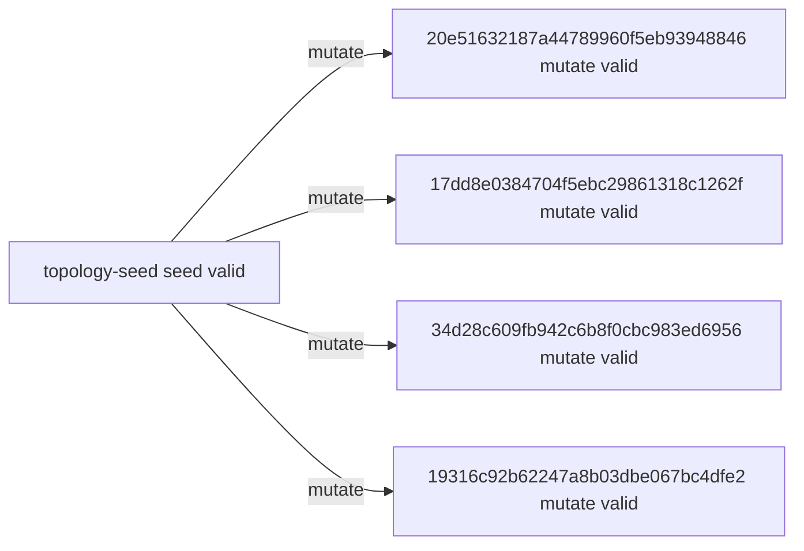

# Campaign topology-smac-v1

Export schema: `feyer-campaign-export-v1`. Snapshot: `aeedcfbb9181a02df7504129760b92aab8c8a4cdc5dc2f2211c65b72b35dd47a`.

[Frozen proposer context](contexts/8c4a5fd4e9f768bc4d99990eeb0e3cf2adf461c42a1b5f9a7e544abfd84d6ae9.json) — SHA256 `8c4a5fd4e9f768bc4d99990eeb0e3cf2adf461c42a1b5f9a7e544abfd84d6ae9`.

This is an evidence ledger. Scientific parents describe chosen inputs to an experiment; they are not necessarily Git parents. Phase changes are observations, not proof that one edit caused the difference. A failed attempt remains part of the history.

## Ownership and frozen policy

Campaign specification digest: `2bb349e1e62aecd25f8534e759dd3bbe1b50083c1e32d6cd7cdbdb61c05c4810`.

| Actor | Role | Ownership version | Active |
| --- | --- | --- | --- |
| coordinator | coordinator | 1 | True |

## Scientific lineage

Edges come from declared scientific parents, not inferred chronology or Git ancestry.



## Candidate outcomes

| Candidate | Round / lane | Scientific parents | Exact commit | State | First-run seconds | Evidence IDs |
| --- | --- | --- | --- | --- | --- | --- |
| topology-seed | topology-001 / tune | root | f3139c71ae2a5c9de2b015aad7db1a730fac0e1e | valid | 23.3201 | 5089ae06eb04473a87bc1207cb411d8c:c69386d737dffa9b68812bfa3d686126fb0e0d1415977412443757a6603a6439 |
| 20e51632187a44789960f5eb93948846 | topology-001 / tune | topology-seed | b2d63e018faaae32429af9ea7f3663c8dec53635 | valid | 23.8838 | 9e49c2fdf851489d8d0b5d855e10cd53:5dc633a525eeb1fed116343e0a1b6593cdc3465849842dea7617c5b277213592, 160efd6760d941e998dd5026d63de511:b276711c5529630ed85c3a3d9e9f22a678d105db2296fe41aedf88821ab86481 |
| 17dd8e0384704f5ebc29861318c1262f | topology-001 / tune | topology-seed | 6162e74f3571ebf44d908dcf9cc9de85b5bcd9aa | valid | 24.1942 | 9ed4a5166c0c450da139d486155e341a:00ee59a924176365736cfd93ec226cfaf4d516a98f9dac1d8e0145b953775ccf, 8893dd55d3184cf6a06c5f242d53150f:78729c0d36f656d1bb46a9fef930d7c349dc8f74da7fab12c471343be82c4ef3 |
| 34d28c609fb942c6b8f0cbc983ed6956 | topology-001 / tune | topology-seed | df667c0b765309802e09d8915d845a5ebd9f5962 | valid | 24.6346 | f947f2541792428b874bdc8a20adea2d:eaace715b2f155b930c0fbe702e76333761084d879c119c49e3879b9045e85a0, 1b05adb07a02414292da221533696b98:a902e444ac7388efb2347c1fcb14a797f1ac6c200750e38c311903a1e56e5992 |
| 19316c92b62247a8b03dbe067bc4dfe2 | topology-001 / tune | topology-seed | 4a354d07fa02f38926720ace7d7ff9544708e106 | valid | 25.4871 | 565db1876cd744f4825dd3fcfffa1ff1:4739d90bb99743d7e87aea2a17b87376c4970056e15eff9ee79c5a19ddd11dfd, f39209232e904e39b7e34e375f9ce5d2:48160b0cb77c2274432167a2ec075d3b05180aafe601f3ac4fd8a48f3b80da56 |

## Round decisions and stalled work

### Round topology-001

Frozen specification: `2efeba46fb51ad4ae20f324f85279da6764e86dc57f87673f8d83e8a7602dbc1`; version: 1; closed: False.

```json
{
  "budget": {
    "deadline_unix": 1795288990.0,
    "max_evaluations": 10,
    "max_model_calls": 0,
    "max_proposals": 9
  },
  "dimensions": {
    "frequency_chunk": [
      1,
      2,
      4,
      8
    ],
    "noise_reuse": [
      true,
      false
    ]
  },
  "lanes": {
    "tune": {
      "dimensions": [
        "noise_reuse",
        "frequency_chunk"
      ],
      "max_proposals": 8,
      "owner": "coordinator",
      "stall_limit": 8
    }
  },
  "materializer_version": "exact-topology-finite-v1",
  "progress": {
    "absolute": 0.02,
    "relative": 0.01
  },
  "recipes": {
    "tune": {
      "dimensions": [
        "noise_reuse",
        "frequency_chunk"
      ]
    }
  },
  "round_id": "topology-001",
  "seed_parameters": {
    "frequency_chunk": 1,
    "noise_reuse": true
  }
}
```

- topology-001/tune: ready; owner coordinator; strikes 4; reason not recorded

## Candidate evidence and proposed changes

### topology-seed

```json
{
  "cohort_digest": "10567ad0f8dcb7122b6b182e1be342313b89eef340d4070073fdf62d6342204c",
  "commit_sha": "f3139c71ae2a5c9de2b015aad7db1a730fac0e1e",
  "content_sha256": "7fec013c04c9daa7d25633d12743acbc5f6f2b4fc7e3d21d465c15d9af16ff62",
  "context_sha256": null,
  "evaluation_requests": [
    {
      "attempt": 1,
      "candidate_id": "topology-seed",
      "evidence_id": "5089ae06eb04473a87bc1207cb411d8c:c69386d737dffa9b68812bfa3d686126fb0e0d1415977412443757a6603a6439",
      "imported": true,
      "job_id": "5089ae06eb04473a87bc1207cb411d8c",
      "profile": "full",
      "request_id": "b735da4386044e61826b3a8a0a2c4e9d",
      "status": "valid"
    }
  ],
  "evidence": [
    {
      "artifact_digest": "c69386d737dffa9b68812bfa3d686126fb0e0d1415977412443757a6603a6439",
      "artifact_digests": {
        "comparison.json": "53db6296074a20f8e3e7d78deadfb85143c844ea4844432e77356e1aabd3110c",
        "report.json": "4ba70c4bb37c332d60ed97cd692a2c797ea853e2272750cbf6ab898b15a3284d",
        "result": "de2facc511bbc27d35987eddb7999eda7649b398735fe714f970bb3caed20fa5"
      },
      "candidate_sha": "f3139c71ae2a5c9de2b015aad7db1a730fac0e1e",
      "category": "valid",
      "checks": {
        "official": "passed",
        "precision": "passed",
        "resource": "passed",
        "source": "passed",
        "strict": "passed",
        "workload": "passed"
      },
      "cohort": {
        "adapter_schema": "feyer-evolution-evidence-v1",
        "container_limits": {
          "cpu.max": "1600000 100000",
          "cpuset.cpus.effective": "0-127",
          "memory.max": "59055800320",
          "memory.swap.max": "0"
        },
        "memory_policy": {
          "budget_bytes": 32000000000,
          "enforcement": "sampled_process_group_rss",
          "kernel_memory_limit_enforced": false
        },
        "profile": "full",
        "protected_baseline_sha": "02ec741d8a1bf1a2278294ea74f9fc1d68f08f1f",
        "signature": {
          "environment": {
            "backend": "cpu",
            "cpu_affinity_ids": [
              2
            ],
            "cpu_model": "AMD EPYC 9334 32-Core Processor",
            "jax_enable_x64": true,
            "packages": {
              "differometor": "0.0.6",
              "jax": "0.9.0",
              "jaxlib": "0.9.0",
              "numpy": "2.5.5",
              "optax": "0.2.6"
            },
            "persistent_compilation_cache": false,
            "python": "3.12.15",
            "requested_logical_cpus": 1,
            "thread_limits": {
              "MKL_NUM_THREADS": "1",
              "NUMEXPR_NUM_THREADS": "1",
              "OMP_NUM_THREADS": "1",
              "OPENBLAS_NUM_THREADS": "1"
            },
            "xla_flags": null
          },
          "inputs": {
            "frequency_count": 101,
            "gradient_parameter_count": 193,
            "reference_sha256": "726f2cfe6986cb991fa48d5a28127b9330c3dc7e69d5bd193c8748acef03adc3",
            "setup_sha256": "ff4ba353a2a03cdce7f3e61bad729c2e00888d842c28ba9cf699f95afb87e138"
          },
          "timing": {
            "benchmark": "start-munich-2026-public-differometor-uifo-v2",
            "evaluator_sha256": "d5950bbd872e5b00ad63f0bd7081e5096fb14ba9c96c80a6854a3b714719bd4e",
            "phase_keys": [
              "build",
              "forward",
              "forward_compile",
              "forward_lower",
              "gradient",
              "gradient_compile",
              "gradient_lower",
              "host_transfer",
              "imports",
              "initialize",
              "load",
              "sensitivity",
              "sensitivity_compile",
              "sensitivity_lower"
            ],
            "scope": {
              "excluded": "validation and benchmark harness bookkeeping, repeated profiling, plot/report generation; interpreter launch before the first timer",
              "forward_residuals": "saved for separately compiled reverse pass",
              "gradient_coordinates": "physical parameter values; public grid-length tying",
              "objective": "mean(log10(sensitivity / public_reference))",
              "optimizer_steps": 0,
              "total_scope": "imports, CPU initialization, input I/O, setup, all lowering/compilation, forward, sensitivity/powers/loss, reverse-mode gradient and host transfer"
            }
          }
        },
        "strict_policy": {
          "evaluator_sha256": "1bc9b39fe0023afc3db93211b9e3d6cd37ed2b13ee281f142749c2237a16ea8f",
          "reference_arrays_sha256": "c3f6cba045f8b41f488dc19c960f5056b5f2e75cfa64f9a687b52f2a9ba2751e",
          "rtol": 1e-07,
          "scale_atol": 1e-12
        },
        "worker_sha256": "d3c212da0ab1215187407d9cd21dc2cbb5f88dc0b5ee7885135bf7f002d14b58"
      },
      "cohort_digest": "10567ad0f8dcb7122b6b182e1be342313b89eef340d4070073fdf62d6342204c",
      "cost": {
        "comparison_wall_seconds": 0.2624017111957073,
        "peak_rss_bytes": 10169511936,
        "peak_rss_kib": 9931164,
        "total_worker_wall_seconds": 93.20249903015792,
        "wall_seconds": 92.94009731896222
      },
      "eligible_full": true,
      "evidence_digest": "0eb15049d36951e9dc029ebdb4924c5487965045fd1427435838fa42a1ba2e58",
      "evidence_id": "5089ae06eb04473a87bc1207cb411d8c:c69386d737dffa9b68812bfa3d686126fb0e0d1415977412443757a6603a6439",
      "execution_status": "completed",
      "issues": [],
      "job_id": "5089ae06eb04473a87bc1207cb411d8c",
      "metrics": {
        "compilation": 11.064241604879498,
        "forward": 9.220779228955507,
        "gradient": 1.9115544147789478,
        "peak_rss_bytes": 10169511936,
        "runtime": 11.133533842861652,
        "sensitivity": 0.0008762199431657791,
        "setup": 1.1223442014306784,
        "total": 23.32011964917183,
        "transfer": 0.0003239791840314865
      },
      "phases": {
        "build": 0.820046192035079,
        "forward": 9.220779228955507,
        "forward_compile": 7.679657740518451,
        "forward_lower": 0.8124177809804678,
        "gradient": 1.9115544147789478,
        "gradient_compile": 1.9631247501820326,
        "gradient_lower": 0.17493822425603867,
        "host_transfer": 0.0003239791840314865,
        "imports": 0.297987112775445,
        "initialize": 0.0029040593653917313,
        "load": 0.0014068372547626495,
        "sensitivity": 0.0008762199431657791,
        "sensitivity_compile": 0.3437984026968479,
        "sensitivity_lower": 0.09030470624566078
      },
      "profile": "full",
      "resource_evidence": {
        "budget_bytes": 32000000000,
        "container_limits": {
          "cpu.max": "1600000 100000",
          "cpuset.cpus.effective": "0-127",
          "memory.max": "59055800320",
          "memory.swap.max": "0"
        },
        "limitation": "Sampled process-group RSS is not a kernel-enforced memory cap.",
        "memory_monitoring": {
          "budget_bytes": 32000000000,
          "enforcement": "sampled_process_group_rss",
          "exceeded": false,
          "kernel_memory_limit_enforced": false,
          "notes": "RSS sampling can miss brief peaks and counts shared pages in each process. It excludes GPU VRAM and does not reserve RAM or constrain other instance work.",
          "sampled_process_group_peak_rss_bytes": 10170560512,
          "samples": 357
        }
      },
      "schema_version": "feyer-evolution-evidence-v1",
      "scientific_strike": false,
      "screen_passed": false,
      "source_digests": {
        "clean_diff_sha256": "e3b0c44298fc1c149afbf4c8996fb92427ae41e4649b934ca495991b7852b855",
        "comparison_evaluator_sha256": "1bc9b39fe0023afc3db93211b9e3d6cd37ed2b13ee281f142749c2237a16ea8f",
        "evaluator_sha256": "d5950bbd872e5b00ad63f0bd7081e5096fb14ba9c96c80a6854a3b714719bd4e",
        "reference_arrays_sha256": "c3f6cba045f8b41f488dc19c960f5056b5f2e75cfa64f9a687b52f2a9ba2751e",
        "simulator_files_sha256": {
          "differometor/__init__.py": "505d559d5a17409680a91f555882edf23f78cbb7c98ee28845018fa9bfeba7e7",
          "differometor/build.py": "12a5690f48ca736fd9f0bd5301b3b3380a5f9f0b8754cc98781f39c9d413be9b",
          "differometor/components.py": "2e857e19d468d94b46594f71a76221d9d8b677bad05f6cf03b9e57b0e1613593",
          "differometor/plot.py": "16735e0fb14902f2c024e3da9f2655cbea634c4dd9e06c48af1247e12d0cf606",
          "differometor/setups.py": "478b1a7391b28604c36d8245e13ffa4f6d0f6dc32eeac6c6feaf5c08aa06a76b",
          "differometor/simulate.py": "9671189dcc2b4885950e426c4f2d3f8aa7373fb026ccfeef4ca1d54739a5e64f",
          "differometor/utils.py": "73ee8a862cbc435363904addc363071ed7dc8b1546956f82e1746998fe3b09ff"
        },
        "worker_sha256": "d3c212da0ab1215187407d9cd21dc2cbb5f88dc0b5ee7885135bf7f002d14b58"
      },
      "validated_output_scope": "last_warm_evaluation",
      "warm_metrics": {
        "forward": 9.809957098215818,
        "gradient": 1.8867328967899084,
        "host_transfer": 0.00022433698177337646,
        "sensitivity": 0.17540879175066948
      },
      "worker_error": null
    }
  ],
  "evidence_ids": [
    "5089ae06eb04473a87bc1207cb411d8c:c69386d737dffa9b68812bfa3d686126fb0e0d1415977412443757a6603a6439"
  ],
  "git_parents": null,
  "heuristic_id": null,
  "hypothesis": null,
  "improved": false,
  "kind": "seed",
  "lane_id": "tune",
  "metrics": {
    "compilation": 11.064241604879498,
    "forward": 9.220779228955507,
    "gradient": 1.9115544147789478,
    "peak_rss_bytes": 10169511936,
    "runtime": 11.133533842861652,
    "sensitivity": 0.0008762199431657791,
    "setup": 1.1223442014306784,
    "total": 23.32011964917183,
    "transfer": 0.0003239791840314865
  },
  "model_manifest": null,
  "owner": "coordinator",
  "owner_version": 1,
  "parameters": {
    "frequency_chunk": 1,
    "noise_reuse": true
  },
  "parameters_after": {
    "frequency_chunk": 1,
    "noise_reuse": true
  },
  "parameters_before": null,
  "parents": [],
  "prompt_sha256": null,
  "proposal": {
    "candidate_id": "topology-seed",
    "commit_sha": "f3139c71ae2a5c9de2b015aad7db1a730fac0e1e",
    "content_sha256": "7fec013c04c9daa7d25633d12743acbc5f6f2b4fc7e3d21d465c15d9af16ff62",
    "kind": "seed",
    "lane_id": "tune",
    "parameters": {
      "frequency_chunk": 1,
      "noise_reuse": true
    },
    "parents": [],
    "proposal_id": "topology-seed",
    "provenance": {
      "heuristic_id": "import-exact-claude-topology",
      "model_calls": 0
    },
    "recipe": null,
    "round_id": "topology-001"
  },
  "proposal_id": "topology-seed",
  "provenance": {
    "heuristic_id": "import-exact-claude-topology",
    "model_calls": 0
  },
  "recipe": null,
  "response_sha256": null,
  "round_id": "topology-001",
  "target_symbols": null,
  "uncertainty": "No repeat-confirmation or causality is inferred from this export. Inspect exact job evidence and matching cohorts.",
  "valid": true
}
```

### 20e51632187a44789960f5eb93948846

```json
{
  "cohort_digest": "10567ad0f8dcb7122b6b182e1be342313b89eef340d4070073fdf62d6342204c",
  "commit_sha": "b2d63e018faaae32429af9ea7f3663c8dec53635",
  "content_sha256": "4595bfa80260c597ecc92bd4c907aa1d06ab243887a99463151f42a2ccdb9685",
  "context_sha256": null,
  "evaluation_requests": [
    {
      "attempt": 1,
      "candidate_id": "20e51632187a44789960f5eb93948846",
      "evidence_id": "9e49c2fdf851489d8d0b5d855e10cd53:5dc633a525eeb1fed116343e0a1b6593cdc3465849842dea7617c5b277213592",
      "imported": false,
      "job_id": "9e49c2fdf851489d8d0b5d855e10cd53",
      "profile": "screen",
      "request_id": "c2a9f8ccf0f04aae9f5cae1a5d92ba1b",
      "status": "screen"
    },
    {
      "attempt": 1,
      "candidate_id": "20e51632187a44789960f5eb93948846",
      "evidence_id": "160efd6760d941e998dd5026d63de511:b276711c5529630ed85c3a3d9e9f22a678d105db2296fe41aedf88821ab86481",
      "imported": false,
      "job_id": "160efd6760d941e998dd5026d63de511",
      "profile": "full",
      "request_id": "b933f3a0053d465d8a5c8211c9194cad",
      "status": "valid"
    }
  ],
  "evidence": [
    {
      "artifact_digest": "5dc633a525eeb1fed116343e0a1b6593cdc3465849842dea7617c5b277213592",
      "artifact_digests": {
        "report.json": "148cf40d35d69bebf71dbb9c3a6832f8b8d275afd3b838f346b4148ba395fb46",
        "result": "71fb1345caf31184a0cf75628936355ad57881e16f93bdee472b7d7ceb00f132"
      },
      "candidate_sha": "b2d63e018faaae32429af9ea7f3663c8dec53635",
      "category": "screen",
      "checks": {
        "official": "not_run",
        "precision": "passed",
        "resource": "passed",
        "source": "passed",
        "strict": "not_run",
        "workload": "passed"
      },
      "cohort": {
        "adapter_schema": "feyer-evolution-evidence-v1",
        "container_limits": {
          "cpu.max": "1600000 100000",
          "cpuset.cpus.effective": "0-127",
          "memory.max": "59055800320",
          "memory.swap.max": "0"
        },
        "memory_policy": {
          "budget_bytes": 32000000000,
          "enforcement": "sampled_process_group_rss",
          "kernel_memory_limit_enforced": false
        },
        "profile": "screen",
        "protected_baseline_sha": "02ec741d8a1bf1a2278294ea74f9fc1d68f08f1f",
        "signature": {
          "environment": {
            "backend": "cpu",
            "cpu_affinity_ids": [
              2
            ],
            "cpu_model": "AMD EPYC 9334 32-Core Processor",
            "jax_enable_x64": true,
            "packages": {
              "differometor": "0.0.6",
              "jax": "0.9.0",
              "jaxlib": "0.9.0",
              "numpy": "2.5.5",
              "optax": "0.2.6"
            },
            "persistent_compilation_cache": false,
            "python": "3.12.15",
            "requested_logical_cpus": 1,
            "thread_limits": {
              "MKL_NUM_THREADS": "1",
              "NUMEXPR_NUM_THREADS": "1",
              "OMP_NUM_THREADS": "1",
              "OPENBLAS_NUM_THREADS": "1"
            },
            "xla_flags": null
          },
          "inputs": {
            "frequency_count": 101,
            "gradient_parameter_count": 193,
            "reference_sha256": "726f2cfe6986cb991fa48d5a28127b9330c3dc7e69d5bd193c8748acef03adc3",
            "setup_sha256": "ff4ba353a2a03cdce7f3e61bad729c2e00888d842c28ba9cf699f95afb87e138"
          },
          "timing": {
            "benchmark": "start-munich-2026-public-differometor-uifo-v2",
            "evaluator_sha256": "d5950bbd872e5b00ad63f0bd7081e5096fb14ba9c96c80a6854a3b714719bd4e",
            "phase_keys": [
              "build",
              "forward",
              "forward_compile",
              "forward_lower",
              "gradient",
              "gradient_compile",
              "gradient_lower",
              "host_transfer",
              "imports",
              "initialize",
              "load",
              "sensitivity",
              "sensitivity_compile",
              "sensitivity_lower"
            ],
            "scope": {
              "excluded": "validation and benchmark harness bookkeeping, repeated profiling, plot/report generation; interpreter launch before the first timer",
              "forward_residuals": "saved for separately compiled reverse pass",
              "gradient_coordinates": "physical parameter values; public grid-length tying",
              "objective": "mean(log10(sensitivity / public_reference))",
              "optimizer_steps": 0,
              "total_scope": "imports, CPU initialization, input I/O, setup, all lowering/compilation, forward, sensitivity/powers/loss, reverse-mode gradient and host transfer"
            }
          }
        },
        "strict_policy": null,
        "worker_sha256": "d3c212da0ab1215187407d9cd21dc2cbb5f88dc0b5ee7885135bf7f002d14b58"
      },
      "cohort_digest": "fc9228f32197f0d2653ba0de06fc01d528953444ab2039dbff6e1284cf689351",
      "cost": {
        "peak_rss_bytes": 11047522304,
        "peak_rss_kib": 10788596,
        "total_worker_wall_seconds": 24.733176728710532,
        "wall_seconds": 24.733176728710532
      },
      "eligible_full": false,
      "evidence_digest": "d6717c6fa0d751dd52c7d65be1b7df91c51eca37f532782fea25b37d5d1b8c51",
      "evidence_id": "9e49c2fdf851489d8d0b5d855e10cd53:5dc633a525eeb1fed116343e0a1b6593cdc3465849842dea7617c5b277213592",
      "execution_status": "completed",
      "issues": [],
      "job_id": "9e49c2fdf851489d8d0b5d855e10cd53",
      "metrics": {
        "compilation": 10.9815673828125,
        "forward": 9.3574473336339,
        "gradient": 2.0772590953856707,
        "peak_rss_bytes": 11047522304,
        "runtime": 11.435913003981113,
        "sensitivity": 0.0008866190910339355,
        "setup": 1.110748888924718,
        "total": 23.52822927571833,
        "transfer": 0.00031995587050914764
      },
      "phases": {
        "build": 0.8157667517662048,
        "forward": 9.3574473336339,
        "forward_compile": 7.725278856232762,
        "forward_lower": 0.8093993570655584,
        "gradient": 2.0772590953856707,
        "gradient_compile": 1.8354453518986702,
        "gradient_lower": 0.1751789152622223,
        "host_transfer": 0.00031995587050914764,
        "imports": 0.29055589623749256,
        "initialize": 0.002947285771369934,
        "load": 0.0014789551496505737,
        "sensitivity": 0.0008866190910339355,
        "sensitivity_compile": 0.34368290565907955,
        "sensitivity_lower": 0.09258199669420719
      },
      "profile": "screen",
      "resource_evidence": {
        "budget_bytes": 32000000000,
        "container_limits": {
          "cpu.max": "1600000 100000",
          "cpuset.cpus.effective": "0-127",
          "memory.max": "59055800320",
          "memory.swap.max": "0"
        },
        "limitation": "Sampled process-group RSS is not a kernel-enforced memory cap.",
        "memory_monitoring": {
          "budget_bytes": 32000000000,
          "enforcement": "sampled_process_group_rss",
          "exceeded": false,
          "kernel_memory_limit_enforced": false,
          "notes": "RSS sampling can miss brief peaks and counts shared pages in each process. It excludes GPU VRAM and does not reserve RAM or constrain other instance work.",
          "sampled_process_group_peak_rss_bytes": 11047522304,
          "samples": 95
        }
      },
      "schema_version": "feyer-evolution-evidence-v1",
      "scientific_strike": false,
      "screen_passed": true,
      "source_digests": {
        "clean_diff_sha256": "e3b0c44298fc1c149afbf4c8996fb92427ae41e4649b934ca495991b7852b855",
        "evaluator_sha256": "2bf4249e453271d1f665c35356485739ad66a9b0327153d678a5b34d81192458",
        "simulator_files_sha256": {
          "differometor/__init__.py": "505d559d5a17409680a91f555882edf23f78cbb7c98ee28845018fa9bfeba7e7",
          "differometor/build.py": "12a5690f48ca736fd9f0bd5301b3b3380a5f9f0b8754cc98781f39c9d413be9b",
          "differometor/components.py": "2e857e19d468d94b46594f71a76221d9d8b677bad05f6cf03b9e57b0e1613593",
          "differometor/plot.py": "16735e0fb14902f2c024e3da9f2655cbea634c4dd9e06c48af1247e12d0cf606",
          "differometor/setups.py": "478b1a7391b28604c36d8245e13ffa4f6d0f6dc32eeac6c6feaf5c08aa06a76b",
          "differometor/simulate.py": "db79f139de5796dc99ab0bc28eb9bc605fd0af9a10405d2f93f682e851a3bb19",
          "differometor/utils.py": "73ee8a862cbc435363904addc363071ed7dc8b1546956f82e1746998fe3b09ff"
        },
        "worker_sha256": "d3c212da0ab1215187407d9cd21dc2cbb5f88dc0b5ee7885135bf7f002d14b58"
      },
      "validated_output_scope": "first_evaluation",
      "warm_metrics": {},
      "worker_error": null
    },
    {
      "artifact_digest": "b276711c5529630ed85c3a3d9e9f22a678d105db2296fe41aedf88821ab86481",
      "artifact_digests": {
        "comparison.json": "53db6296074a20f8e3e7d78deadfb85143c844ea4844432e77356e1aabd3110c",
        "report.json": "8c65970b915736a218424d0735a9103a688a1b11680afc9be57346800171b306",
        "result": "db72ab6e1e0a0748cb5e77f72caeb215aecae55867d4398322bc0e137502c374"
      },
      "candidate_sha": "b2d63e018faaae32429af9ea7f3663c8dec53635",
      "category": "valid",
      "checks": {
        "official": "passed",
        "precision": "passed",
        "resource": "passed",
        "source": "passed",
        "strict": "passed",
        "workload": "passed"
      },
      "cohort": {
        "adapter_schema": "feyer-evolution-evidence-v1",
        "container_limits": {
          "cpu.max": "1600000 100000",
          "cpuset.cpus.effective": "0-127",
          "memory.max": "59055800320",
          "memory.swap.max": "0"
        },
        "memory_policy": {
          "budget_bytes": 32000000000,
          "enforcement": "sampled_process_group_rss",
          "kernel_memory_limit_enforced": false
        },
        "profile": "full",
        "protected_baseline_sha": "02ec741d8a1bf1a2278294ea74f9fc1d68f08f1f",
        "signature": {
          "environment": {
            "backend": "cpu",
            "cpu_affinity_ids": [
              2
            ],
            "cpu_model": "AMD EPYC 9334 32-Core Processor",
            "jax_enable_x64": true,
            "packages": {
              "differometor": "0.0.6",
              "jax": "0.9.0",
              "jaxlib": "0.9.0",
              "numpy": "2.5.5",
              "optax": "0.2.6"
            },
            "persistent_compilation_cache": false,
            "python": "3.12.15",
            "requested_logical_cpus": 1,
            "thread_limits": {
              "MKL_NUM_THREADS": "1",
              "NUMEXPR_NUM_THREADS": "1",
              "OMP_NUM_THREADS": "1",
              "OPENBLAS_NUM_THREADS": "1"
            },
            "xla_flags": null
          },
          "inputs": {
            "frequency_count": 101,
            "gradient_parameter_count": 193,
            "reference_sha256": "726f2cfe6986cb991fa48d5a28127b9330c3dc7e69d5bd193c8748acef03adc3",
            "setup_sha256": "ff4ba353a2a03cdce7f3e61bad729c2e00888d842c28ba9cf699f95afb87e138"
          },
          "timing": {
            "benchmark": "start-munich-2026-public-differometor-uifo-v2",
            "evaluator_sha256": "d5950bbd872e5b00ad63f0bd7081e5096fb14ba9c96c80a6854a3b714719bd4e",
            "phase_keys": [
              "build",
              "forward",
              "forward_compile",
              "forward_lower",
              "gradient",
              "gradient_compile",
              "gradient_lower",
              "host_transfer",
              "imports",
              "initialize",
              "load",
              "sensitivity",
              "sensitivity_compile",
              "sensitivity_lower"
            ],
            "scope": {
              "excluded": "validation and benchmark harness bookkeeping, repeated profiling, plot/report generation; interpreter launch before the first timer",
              "forward_residuals": "saved for separately compiled reverse pass",
              "gradient_coordinates": "physical parameter values; public grid-length tying",
              "objective": "mean(log10(sensitivity / public_reference))",
              "optimizer_steps": 0,
              "total_scope": "imports, CPU initialization, input I/O, setup, all lowering/compilation, forward, sensitivity/powers/loss, reverse-mode gradient and host transfer"
            }
          }
        },
        "strict_policy": {
          "evaluator_sha256": "1bc9b39fe0023afc3db93211b9e3d6cd37ed2b13ee281f142749c2237a16ea8f",
          "reference_arrays_sha256": "c3f6cba045f8b41f488dc19c960f5056b5f2e75cfa64f9a687b52f2a9ba2751e",
          "rtol": 1e-07,
          "scale_atol": 1e-12
        },
        "worker_sha256": "d3c212da0ab1215187407d9cd21dc2cbb5f88dc0b5ee7885135bf7f002d14b58"
      },
      "cohort_digest": "10567ad0f8dcb7122b6b182e1be342313b89eef340d4070073fdf62d6342204c",
      "cost": {
        "comparison_wall_seconds": 0.2624255530536175,
        "peak_rss_bytes": 11056357376,
        "peak_rss_kib": 10797224,
        "total_worker_wall_seconds": 95.30964922718704,
        "wall_seconds": 95.04722367413342
      },
      "eligible_full": true,
      "evidence_digest": "77254e9558866df188d6915275742b61d86dcc4878dbe583a60646e5352d1489",
      "evidence_id": "160efd6760d941e998dd5026d63de511:b276711c5529630ed85c3a3d9e9f22a678d105db2296fe41aedf88821ab86481",
      "execution_status": "completed",
      "issues": [],
      "job_id": "160efd6760d941e998dd5026d63de511",
      "metrics": {
        "compilation": 11.181336618959904,
        "forward": 9.347755437716842,
        "gradient": 2.2090142481029034,
        "peak_rss_bytes": 11056357376,
        "runtime": 11.558163072913885,
        "sensitivity": 0.0010373406112194061,
        "setup": 1.1442589554935694,
        "total": 23.883758647367358,
        "transfer": 0.00035604648292064667
      },
      "phases": {
        "build": 0.8467485308647156,
        "forward": 9.347755437716842,
        "forward_compile": 7.905797250568867,
        "forward_lower": 0.8223588932305574,
        "gradient": 2.2090142481029034,
        "gradient_compile": 1.840641152113676,
        "gradient_lower": 0.17771470732986927,
        "host_transfer": 0.00035604648292064667,
        "imports": 0.29308460280299187,
        "initialize": 0.002941817045211792,
        "load": 0.0014840047806501389,
        "sensitivity": 0.0010373406112194061,
        "sensitivity_compile": 0.3408184237778187,
        "sensitivity_lower": 0.09400619193911552
      },
      "profile": "full",
      "resource_evidence": {
        "budget_bytes": 32000000000,
        "container_limits": {
          "cpu.max": "1600000 100000",
          "cpuset.cpus.effective": "0-127",
          "memory.max": "59055800320",
          "memory.swap.max": "0"
        },
        "limitation": "Sampled process-group RSS is not a kernel-enforced memory cap.",
        "memory_monitoring": {
          "budget_bytes": 32000000000,
          "enforcement": "sampled_process_group_rss",
          "exceeded": false,
          "kernel_memory_limit_enforced": false,
          "notes": "RSS sampling can miss brief peaks and counts shared pages in each process. It excludes GPU VRAM and does not reserve RAM or constrain other instance work.",
          "sampled_process_group_peak_rss_bytes": 11057405952,
          "samples": 365
        }
      },
      "schema_version": "feyer-evolution-evidence-v1",
      "scientific_strike": false,
      "screen_passed": false,
      "source_digests": {
        "clean_diff_sha256": "e3b0c44298fc1c149afbf4c8996fb92427ae41e4649b934ca495991b7852b855",
        "comparison_evaluator_sha256": "1bc9b39fe0023afc3db93211b9e3d6cd37ed2b13ee281f142749c2237a16ea8f",
        "evaluator_sha256": "d5950bbd872e5b00ad63f0bd7081e5096fb14ba9c96c80a6854a3b714719bd4e",
        "reference_arrays_sha256": "c3f6cba045f8b41f488dc19c960f5056b5f2e75cfa64f9a687b52f2a9ba2751e",
        "simulator_files_sha256": {
          "differometor/__init__.py": "505d559d5a17409680a91f555882edf23f78cbb7c98ee28845018fa9bfeba7e7",
          "differometor/build.py": "12a5690f48ca736fd9f0bd5301b3b3380a5f9f0b8754cc98781f39c9d413be9b",
          "differometor/components.py": "2e857e19d468d94b46594f71a76221d9d8b677bad05f6cf03b9e57b0e1613593",
          "differometor/plot.py": "16735e0fb14902f2c024e3da9f2655cbea634c4dd9e06c48af1247e12d0cf606",
          "differometor/setups.py": "478b1a7391b28604c36d8245e13ffa4f6d0f6dc32eeac6c6feaf5c08aa06a76b",
          "differometor/simulate.py": "db79f139de5796dc99ab0bc28eb9bc605fd0af9a10405d2f93f682e851a3bb19",
          "differometor/utils.py": "73ee8a862cbc435363904addc363071ed7dc8b1546956f82e1746998fe3b09ff"
        },
        "worker_sha256": "d3c212da0ab1215187407d9cd21dc2cbb5f88dc0b5ee7885135bf7f002d14b58"
      },
      "validated_output_scope": "last_warm_evaluation",
      "warm_metrics": {
        "forward": 10.004870368167758,
        "gradient": 2.0782006308436394,
        "host_transfer": 0.000221937894821167,
        "sensitivity": 0.16793840751051903
      },
      "worker_error": null
    }
  ],
  "evidence_ids": [
    "9e49c2fdf851489d8d0b5d855e10cd53:5dc633a525eeb1fed116343e0a1b6593cdc3465849842dea7617c5b277213592",
    "160efd6760d941e998dd5026d63de511:b276711c5529630ed85c3a3d9e9f22a678d105db2296fe41aedf88821ab86481"
  ],
  "git_parents": null,
  "heuristic_id": null,
  "hypothesis": null,
  "improved": false,
  "kind": "mutate",
  "lane_id": "tune",
  "metrics": {
    "compilation": 11.181336618959904,
    "forward": 9.347755437716842,
    "gradient": 2.2090142481029034,
    "peak_rss_bytes": 11056357376,
    "runtime": 11.558163072913885,
    "sensitivity": 0.0010373406112194061,
    "setup": 1.1442589554935694,
    "total": 23.883758647367358,
    "transfer": 0.00035604648292064667
  },
  "model_manifest": null,
  "owner": "coordinator",
  "owner_version": 1,
  "parameters": {
    "frequency_chunk": 1,
    "noise_reuse": false
  },
  "parameters_after": {
    "frequency_chunk": 1,
    "noise_reuse": false
  },
  "parameters_before": null,
  "parents": [
    "topology-seed"
  ],
  "prompt_sha256": null,
  "proposal": {
    "candidate_id": "20e51632187a44789960f5eb93948846",
    "commit_sha": "b2d63e018faaae32429af9ea7f3663c8dec53635",
    "content_sha256": "4595bfa80260c597ecc92bd4c907aa1d06ab243887a99463151f42a2ccdb9685",
    "kind": "mutate",
    "lane_id": "tune",
    "parameters": {
      "frequency_chunk": 1,
      "noise_reuse": false
    },
    "parents": [
      "topology-seed"
    ],
    "proposal_id": "20e51632187a44789960f5eb93948846",
    "provenance": {
      "context": {
        "bytes": 1342,
        "path": "contexts/375405d3a3f35a9214ef5476da3a4e06c461d6e83b7ac4e7daa14a3b5400bf27.json",
        "sha256": "375405d3a3f35a9214ef5476da3a4e06c461d6e83b7ac4e7daa14a3b5400bf27"
      },
      "context_sha256": "b9dafaa3c81b087c5f078d731920ef931bc083f65c8486b4658f72dec90d1c57",
      "heuristic_id": "exact-topology-smac-v1",
      "hypothesis": "Measure registered topology parameters under unchanged full correctness checks",
      "model": "SMAC3 random forest + expected improvement",
      "model_calls": 0,
      "model_trained": false,
      "origin": "local-startup",
      "selection_origin": "local-startup",
      "training_configurations": 1
    },
    "recipe": "tune",
    "round_id": "topology-001"
  },
  "proposal_id": "20e51632187a44789960f5eb93948846",
  "provenance": {
    "context": {
      "bytes": 1342,
      "path": "contexts/375405d3a3f35a9214ef5476da3a4e06c461d6e83b7ac4e7daa14a3b5400bf27.json",
      "sha256": "375405d3a3f35a9214ef5476da3a4e06c461d6e83b7ac4e7daa14a3b5400bf27"
    },
    "context_sha256": "b9dafaa3c81b087c5f078d731920ef931bc083f65c8486b4658f72dec90d1c57",
    "heuristic_id": "exact-topology-smac-v1",
    "hypothesis": "Measure registered topology parameters under unchanged full correctness checks",
    "model": "SMAC3 random forest + expected improvement",
    "model_calls": 0,
    "model_trained": false,
    "origin": "local-startup",
    "selection_origin": "local-startup",
    "training_configurations": 1
  },
  "recipe": "tune",
  "response_sha256": null,
  "round_id": "topology-001",
  "target_symbols": null,
  "uncertainty": "No repeat-confirmation or causality is inferred from this export. Inspect exact job evidence and matching cohorts.",
  "valid": true
}
```

### 17dd8e0384704f5ebc29861318c1262f

```json
{
  "cohort_digest": "10567ad0f8dcb7122b6b182e1be342313b89eef340d4070073fdf62d6342204c",
  "commit_sha": "6162e74f3571ebf44d908dcf9cc9de85b5bcd9aa",
  "content_sha256": "ff248191d6f1324c35aede88f5bdf73508034b29f04ff52f3b2a749b690d0b40",
  "context_sha256": null,
  "evaluation_requests": [
    {
      "attempt": 1,
      "candidate_id": "17dd8e0384704f5ebc29861318c1262f",
      "evidence_id": "9ed4a5166c0c450da139d486155e341a:00ee59a924176365736cfd93ec226cfaf4d516a98f9dac1d8e0145b953775ccf",
      "imported": false,
      "job_id": "9ed4a5166c0c450da139d486155e341a",
      "profile": "screen",
      "request_id": "bb780a73eb01440db0f88dfe9f4b229b",
      "status": "screen"
    },
    {
      "attempt": 1,
      "candidate_id": "17dd8e0384704f5ebc29861318c1262f",
      "evidence_id": "8893dd55d3184cf6a06c5f242d53150f:78729c0d36f656d1bb46a9fef930d7c349dc8f74da7fab12c471343be82c4ef3",
      "imported": false,
      "job_id": "8893dd55d3184cf6a06c5f242d53150f",
      "profile": "full",
      "request_id": "4994ae5896404a388b61ef1cf768ca55",
      "status": "valid"
    }
  ],
  "evidence": [
    {
      "artifact_digest": "00ee59a924176365736cfd93ec226cfaf4d516a98f9dac1d8e0145b953775ccf",
      "artifact_digests": {
        "report.json": "0c313b662a3325c212bae1f4d23d086309f69a5035cd44d5553f4f05ae30349d",
        "result": "a0d92adc687a8d786bf85e692359dbae56cf15c27b1088d93a0a29deb4a34929"
      },
      "candidate_sha": "6162e74f3571ebf44d908dcf9cc9de85b5bcd9aa",
      "category": "screen",
      "checks": {
        "official": "not_run",
        "precision": "passed",
        "resource": "passed",
        "source": "passed",
        "strict": "not_run",
        "workload": "passed"
      },
      "cohort": {
        "adapter_schema": "feyer-evolution-evidence-v1",
        "container_limits": {
          "cpu.max": "1600000 100000",
          "cpuset.cpus.effective": "0-127",
          "memory.max": "59055800320",
          "memory.swap.max": "0"
        },
        "memory_policy": {
          "budget_bytes": 32000000000,
          "enforcement": "sampled_process_group_rss",
          "kernel_memory_limit_enforced": false
        },
        "profile": "screen",
        "protected_baseline_sha": "02ec741d8a1bf1a2278294ea74f9fc1d68f08f1f",
        "signature": {
          "environment": {
            "backend": "cpu",
            "cpu_affinity_ids": [
              2
            ],
            "cpu_model": "AMD EPYC 9334 32-Core Processor",
            "jax_enable_x64": true,
            "packages": {
              "differometor": "0.0.6",
              "jax": "0.9.0",
              "jaxlib": "0.9.0",
              "numpy": "2.5.5",
              "optax": "0.2.6"
            },
            "persistent_compilation_cache": false,
            "python": "3.12.15",
            "requested_logical_cpus": 1,
            "thread_limits": {
              "MKL_NUM_THREADS": "1",
              "NUMEXPR_NUM_THREADS": "1",
              "OMP_NUM_THREADS": "1",
              "OPENBLAS_NUM_THREADS": "1"
            },
            "xla_flags": null
          },
          "inputs": {
            "frequency_count": 101,
            "gradient_parameter_count": 193,
            "reference_sha256": "726f2cfe6986cb991fa48d5a28127b9330c3dc7e69d5bd193c8748acef03adc3",
            "setup_sha256": "ff4ba353a2a03cdce7f3e61bad729c2e00888d842c28ba9cf699f95afb87e138"
          },
          "timing": {
            "benchmark": "start-munich-2026-public-differometor-uifo-v2",
            "evaluator_sha256": "d5950bbd872e5b00ad63f0bd7081e5096fb14ba9c96c80a6854a3b714719bd4e",
            "phase_keys": [
              "build",
              "forward",
              "forward_compile",
              "forward_lower",
              "gradient",
              "gradient_compile",
              "gradient_lower",
              "host_transfer",
              "imports",
              "initialize",
              "load",
              "sensitivity",
              "sensitivity_compile",
              "sensitivity_lower"
            ],
            "scope": {
              "excluded": "validation and benchmark harness bookkeeping, repeated profiling, plot/report generation; interpreter launch before the first timer",
              "forward_residuals": "saved for separately compiled reverse pass",
              "gradient_coordinates": "physical parameter values; public grid-length tying",
              "objective": "mean(log10(sensitivity / public_reference))",
              "optimizer_steps": 0,
              "total_scope": "imports, CPU initialization, input I/O, setup, all lowering/compilation, forward, sensitivity/powers/loss, reverse-mode gradient and host transfer"
            }
          }
        },
        "strict_policy": null,
        "worker_sha256": "d3c212da0ab1215187407d9cd21dc2cbb5f88dc0b5ee7885135bf7f002d14b58"
      },
      "cohort_digest": "fc9228f32197f0d2653ba0de06fc01d528953444ab2039dbff6e1284cf689351",
      "cost": {
        "peak_rss_bytes": 10202120192,
        "peak_rss_kib": 9963008,
        "total_worker_wall_seconds": 25.521623454988003,
        "wall_seconds": 25.521623454988003
      },
      "eligible_full": false,
      "evidence_digest": "1536365de2f702646bfe6728345d05392710784a82c61f99979f467c9c539619",
      "evidence_id": "9ed4a5166c0c450da139d486155e341a:00ee59a924176365736cfd93ec226cfaf4d516a98f9dac1d8e0145b953775ccf",
      "execution_status": "completed",
      "issues": [],
      "job_id": "9ed4a5166c0c450da139d486155e341a",
      "metrics": {
        "compilation": 11.971814403310418,
        "forward": 9.401635279878974,
        "gradient": 1.9232231713831425,
        "peak_rss_bytes": 10202120192,
        "runtime": 11.326088719069958,
        "sensitivity": 0.000870751217007637,
        "setup": 1.1036204788833857,
        "total": 24.40152360126376,
        "transfer": 0.00035951659083366394
      },
      "phases": {
        "build": 0.8107227832078934,
        "forward": 9.401635279878974,
        "forward_compile": 8.377394052222371,
        "forward_lower": 0.8219895474612713,
        "gradient": 1.9232231713831425,
        "gradient_compile": 2.019245048984885,
        "gradient_lower": 0.17858652770519257,
        "host_transfer": 0.00035951659083366394,
        "imports": 0.28846893832087517,
        "initialize": 0.0029321759939193726,
        "load": 0.0014965813606977463,
        "sensitivity": 0.000870751217007637,
        "sensitivity_compile": 0.47814068756997585,
        "sensitivity_lower": 0.0964585393667221
      },
      "profile": "screen",
      "resource_evidence": {
        "budget_bytes": 32000000000,
        "container_limits": {
          "cpu.max": "1600000 100000",
          "cpuset.cpus.effective": "0-127",
          "memory.max": "59055800320",
          "memory.swap.max": "0"
        },
        "limitation": "Sampled process-group RSS is not a kernel-enforced memory cap.",
        "memory_monitoring": {
          "budget_bytes": 32000000000,
          "enforcement": "sampled_process_group_rss",
          "exceeded": false,
          "kernel_memory_limit_enforced": false,
          "notes": "RSS sampling can miss brief peaks and counts shared pages in each process. It excludes GPU VRAM and does not reserve RAM or constrain other instance work.",
          "sampled_process_group_peak_rss_bytes": 10190585856,
          "samples": 98
        }
      },
      "schema_version": "feyer-evolution-evidence-v1",
      "scientific_strike": false,
      "screen_passed": true,
      "source_digests": {
        "clean_diff_sha256": "e3b0c44298fc1c149afbf4c8996fb92427ae41e4649b934ca495991b7852b855",
        "evaluator_sha256": "2bf4249e453271d1f665c35356485739ad66a9b0327153d678a5b34d81192458",
        "simulator_files_sha256": {
          "differometor/__init__.py": "505d559d5a17409680a91f555882edf23f78cbb7c98ee28845018fa9bfeba7e7",
          "differometor/build.py": "12a5690f48ca736fd9f0bd5301b3b3380a5f9f0b8754cc98781f39c9d413be9b",
          "differometor/components.py": "2e857e19d468d94b46594f71a76221d9d8b677bad05f6cf03b9e57b0e1613593",
          "differometor/plot.py": "16735e0fb14902f2c024e3da9f2655cbea634c4dd9e06c48af1247e12d0cf606",
          "differometor/setups.py": "478b1a7391b28604c36d8245e13ffa4f6d0f6dc32eeac6c6feaf5c08aa06a76b",
          "differometor/simulate.py": "0dc84eae9260c2cd777c2958aa34cefe1c0e1d4c3e959cceffc6f2da3df625ee",
          "differometor/utils.py": "73ee8a862cbc435363904addc363071ed7dc8b1546956f82e1746998fe3b09ff"
        },
        "worker_sha256": "d3c212da0ab1215187407d9cd21dc2cbb5f88dc0b5ee7885135bf7f002d14b58"
      },
      "validated_output_scope": "first_evaluation",
      "warm_metrics": {},
      "worker_error": null
    },
    {
      "artifact_digest": "78729c0d36f656d1bb46a9fef930d7c349dc8f74da7fab12c471343be82c4ef3",
      "artifact_digests": {
        "comparison.json": "53db6296074a20f8e3e7d78deadfb85143c844ea4844432e77356e1aabd3110c",
        "report.json": "0e65176556e42783817fd0cf63d5552a49eef8732b30905bc61daae0da8cc6d8",
        "result": "3d9ec32ff8a910910688459fa6ce534100750d38d78e93549f7e92e33a043638"
      },
      "candidate_sha": "6162e74f3571ebf44d908dcf9cc9de85b5bcd9aa",
      "category": "valid",
      "checks": {
        "official": "passed",
        "precision": "passed",
        "resource": "passed",
        "source": "passed",
        "strict": "passed",
        "workload": "passed"
      },
      "cohort": {
        "adapter_schema": "feyer-evolution-evidence-v1",
        "container_limits": {
          "cpu.max": "1600000 100000",
          "cpuset.cpus.effective": "0-127",
          "memory.max": "59055800320",
          "memory.swap.max": "0"
        },
        "memory_policy": {
          "budget_bytes": 32000000000,
          "enforcement": "sampled_process_group_rss",
          "kernel_memory_limit_enforced": false
        },
        "profile": "full",
        "protected_baseline_sha": "02ec741d8a1bf1a2278294ea74f9fc1d68f08f1f",
        "signature": {
          "environment": {
            "backend": "cpu",
            "cpu_affinity_ids": [
              2
            ],
            "cpu_model": "AMD EPYC 9334 32-Core Processor",
            "jax_enable_x64": true,
            "packages": {
              "differometor": "0.0.6",
              "jax": "0.9.0",
              "jaxlib": "0.9.0",
              "numpy": "2.5.5",
              "optax": "0.2.6"
            },
            "persistent_compilation_cache": false,
            "python": "3.12.15",
            "requested_logical_cpus": 1,
            "thread_limits": {
              "MKL_NUM_THREADS": "1",
              "NUMEXPR_NUM_THREADS": "1",
              "OMP_NUM_THREADS": "1",
              "OPENBLAS_NUM_THREADS": "1"
            },
            "xla_flags": null
          },
          "inputs": {
            "frequency_count": 101,
            "gradient_parameter_count": 193,
            "reference_sha256": "726f2cfe6986cb991fa48d5a28127b9330c3dc7e69d5bd193c8748acef03adc3",
            "setup_sha256": "ff4ba353a2a03cdce7f3e61bad729c2e00888d842c28ba9cf699f95afb87e138"
          },
          "timing": {
            "benchmark": "start-munich-2026-public-differometor-uifo-v2",
            "evaluator_sha256": "d5950bbd872e5b00ad63f0bd7081e5096fb14ba9c96c80a6854a3b714719bd4e",
            "phase_keys": [
              "build",
              "forward",
              "forward_compile",
              "forward_lower",
              "gradient",
              "gradient_compile",
              "gradient_lower",
              "host_transfer",
              "imports",
              "initialize",
              "load",
              "sensitivity",
              "sensitivity_compile",
              "sensitivity_lower"
            ],
            "scope": {
              "excluded": "validation and benchmark harness bookkeeping, repeated profiling, plot/report generation; interpreter launch before the first timer",
              "forward_residuals": "saved for separately compiled reverse pass",
              "gradient_coordinates": "physical parameter values; public grid-length tying",
              "objective": "mean(log10(sensitivity / public_reference))",
              "optimizer_steps": 0,
              "total_scope": "imports, CPU initialization, input I/O, setup, all lowering/compilation, forward, sensitivity/powers/loss, reverse-mode gradient and host transfer"
            }
          }
        },
        "strict_policy": {
          "evaluator_sha256": "1bc9b39fe0023afc3db93211b9e3d6cd37ed2b13ee281f142749c2237a16ea8f",
          "reference_arrays_sha256": "c3f6cba045f8b41f488dc19c960f5056b5f2e75cfa64f9a687b52f2a9ba2751e",
          "rtol": 1e-07,
          "scale_atol": 1e-12
        },
        "worker_sha256": "d3c212da0ab1215187407d9cd21dc2cbb5f88dc0b5ee7885135bf7f002d14b58"
      },
      "cohort_digest": "10567ad0f8dcb7122b6b182e1be342313b89eef340d4070073fdf62d6342204c",
      "cost": {
        "comparison_wall_seconds": 0.2625685650855303,
        "peak_rss_bytes": 10211684352,
        "peak_rss_kib": 9972348,
        "total_worker_wall_seconds": 94.8356391210109,
        "wall_seconds": 94.57307055592537
      },
      "eligible_full": true,
      "evidence_digest": "5dd0aba963e564afd605c7b1b5a32966bed90975365abf6b45164ab81f4ab566",
      "evidence_id": "8893dd55d3184cf6a06c5f242d53150f:78729c0d36f656d1bb46a9fef930d7c349dc8f74da7fab12c471343be82c4ef3",
      "execution_status": "completed",
      "issues": [],
      "job_id": "8893dd55d3184cf6a06c5f242d53150f",
      "metrics": {
        "compilation": 11.911867978051305,
        "forward": 9.279051408171654,
        "gradient": 1.901975054293871,
        "peak_rss_bytes": 10211684352,
        "runtime": 11.182187581434846,
        "sensitivity": 0.0008321609348058701,
        "setup": 1.1001602001488209,
        "total": 24.19421575963497,
        "transfer": 0.00032895803451538086
      },
      "phases": {
        "build": 0.8050933480262756,
        "forward": 9.279051408171654,
        "forward_compile": 8.37344453856349,
        "forward_lower": 0.8233618177473545,
        "gradient": 1.901975054293871,
        "gradient_compile": 2.0102167166769505,
        "gradient_lower": 0.1789193693548441,
        "host_transfer": 0.00032895803451538086,
        "imports": 0.290683900937438,
        "initialize": 0.002895347774028778,
        "load": 0.001487603411078453,
        "sensitivity": 0.0008321609348058701,
        "sensitivity_compile": 0.43442382849752903,
        "sensitivity_lower": 0.09150170721113682
      },
      "profile": "full",
      "resource_evidence": {
        "budget_bytes": 32000000000,
        "container_limits": {
          "cpu.max": "1600000 100000",
          "cpuset.cpus.effective": "0-127",
          "memory.max": "59055800320",
          "memory.swap.max": "0"
        },
        "limitation": "Sampled process-group RSS is not a kernel-enforced memory cap.",
        "memory_monitoring": {
          "budget_bytes": 32000000000,
          "enforcement": "sampled_process_group_rss",
          "exceeded": false,
          "kernel_memory_limit_enforced": false,
          "notes": "RSS sampling can miss brief peaks and counts shared pages in each process. It excludes GPU VRAM and does not reserve RAM or constrain other instance work.",
          "sampled_process_group_peak_rss_bytes": 10204114944,
          "samples": 363
        }
      },
      "schema_version": "feyer-evolution-evidence-v1",
      "scientific_strike": false,
      "screen_passed": false,
      "source_digests": {
        "clean_diff_sha256": "e3b0c44298fc1c149afbf4c8996fb92427ae41e4649b934ca495991b7852b855",
        "comparison_evaluator_sha256": "1bc9b39fe0023afc3db93211b9e3d6cd37ed2b13ee281f142749c2237a16ea8f",
        "evaluator_sha256": "d5950bbd872e5b00ad63f0bd7081e5096fb14ba9c96c80a6854a3b714719bd4e",
        "reference_arrays_sha256": "c3f6cba045f8b41f488dc19c960f5056b5f2e75cfa64f9a687b52f2a9ba2751e",
        "simulator_files_sha256": {
          "differometor/__init__.py": "505d559d5a17409680a91f555882edf23f78cbb7c98ee28845018fa9bfeba7e7",
          "differometor/build.py": "12a5690f48ca736fd9f0bd5301b3b3380a5f9f0b8754cc98781f39c9d413be9b",
          "differometor/components.py": "2e857e19d468d94b46594f71a76221d9d8b677bad05f6cf03b9e57b0e1613593",
          "differometor/plot.py": "16735e0fb14902f2c024e3da9f2655cbea634c4dd9e06c48af1247e12d0cf606",
          "differometor/setups.py": "478b1a7391b28604c36d8245e13ffa4f6d0f6dc32eeac6c6feaf5c08aa06a76b",
          "differometor/simulate.py": "0dc84eae9260c2cd777c2958aa34cefe1c0e1d4c3e959cceffc6f2da3df625ee",
          "differometor/utils.py": "73ee8a862cbc435363904addc363071ed7dc8b1546956f82e1746998fe3b09ff"
        },
        "worker_sha256": "d3c212da0ab1215187407d9cd21dc2cbb5f88dc0b5ee7885135bf7f002d14b58"
      },
      "validated_output_scope": "last_warm_evaluation",
      "warm_metrics": {
        "forward": 9.900738237425685,
        "gradient": 1.8983658328652382,
        "host_transfer": 0.00024450570344924927,
        "sensitivity": 0.17530499957501888
      },
      "worker_error": null
    }
  ],
  "evidence_ids": [
    "9ed4a5166c0c450da139d486155e341a:00ee59a924176365736cfd93ec226cfaf4d516a98f9dac1d8e0145b953775ccf",
    "8893dd55d3184cf6a06c5f242d53150f:78729c0d36f656d1bb46a9fef930d7c349dc8f74da7fab12c471343be82c4ef3"
  ],
  "git_parents": null,
  "heuristic_id": null,
  "hypothesis": null,
  "improved": false,
  "kind": "mutate",
  "lane_id": "tune",
  "metrics": {
    "compilation": 11.911867978051305,
    "forward": 9.279051408171654,
    "gradient": 1.901975054293871,
    "peak_rss_bytes": 10211684352,
    "runtime": 11.182187581434846,
    "sensitivity": 0.0008321609348058701,
    "setup": 1.1001602001488209,
    "total": 24.19421575963497,
    "transfer": 0.00032895803451538086
  },
  "model_manifest": null,
  "owner": "coordinator",
  "owner_version": 1,
  "parameters": {
    "frequency_chunk": 2,
    "noise_reuse": true
  },
  "parameters_after": {
    "frequency_chunk": 2,
    "noise_reuse": true
  },
  "parameters_before": null,
  "parents": [
    "topology-seed"
  ],
  "prompt_sha256": null,
  "proposal": {
    "candidate_id": "17dd8e0384704f5ebc29861318c1262f",
    "commit_sha": "6162e74f3571ebf44d908dcf9cc9de85b5bcd9aa",
    "content_sha256": "ff248191d6f1324c35aede88f5bdf73508034b29f04ff52f3b2a749b690d0b40",
    "kind": "mutate",
    "lane_id": "tune",
    "parameters": {
      "frequency_chunk": 2,
      "noise_reuse": true
    },
    "parents": [
      "topology-seed"
    ],
    "proposal_id": "17dd8e0384704f5ebc29861318c1262f",
    "provenance": {
      "context": {
        "bytes": 1630,
        "path": "contexts/a1a67fca5cdb43c28a74f3a6d73296fbc3a2e86700a9b8793983c8b092a08d81.json",
        "sha256": "a1a67fca5cdb43c28a74f3a6d73296fbc3a2e86700a9b8793983c8b092a08d81"
      },
      "context_sha256": "8d05f48e58e83cb06460b12628c241a27d6fa6fa742ee570332f453e4f574d08",
      "heuristic_id": "exact-topology-smac-v1",
      "hypothesis": "Measure registered topology parameters under unchanged full correctness checks",
      "model": "SMAC3 random forest + expected improvement",
      "model_calls": 0,
      "model_trained": false,
      "origin": "local-startup",
      "selection_origin": "local-startup",
      "training_configurations": 2
    },
    "recipe": "tune",
    "round_id": "topology-001"
  },
  "proposal_id": "17dd8e0384704f5ebc29861318c1262f",
  "provenance": {
    "context": {
      "bytes": 1630,
      "path": "contexts/a1a67fca5cdb43c28a74f3a6d73296fbc3a2e86700a9b8793983c8b092a08d81.json",
      "sha256": "a1a67fca5cdb43c28a74f3a6d73296fbc3a2e86700a9b8793983c8b092a08d81"
    },
    "context_sha256": "8d05f48e58e83cb06460b12628c241a27d6fa6fa742ee570332f453e4f574d08",
    "heuristic_id": "exact-topology-smac-v1",
    "hypothesis": "Measure registered topology parameters under unchanged full correctness checks",
    "model": "SMAC3 random forest + expected improvement",
    "model_calls": 0,
    "model_trained": false,
    "origin": "local-startup",
    "selection_origin": "local-startup",
    "training_configurations": 2
  },
  "recipe": "tune",
  "response_sha256": null,
  "round_id": "topology-001",
  "target_symbols": null,
  "uncertainty": "No repeat-confirmation or causality is inferred from this export. Inspect exact job evidence and matching cohorts.",
  "valid": true
}
```

### 34d28c609fb942c6b8f0cbc983ed6956

```json
{
  "cohort_digest": "10567ad0f8dcb7122b6b182e1be342313b89eef340d4070073fdf62d6342204c",
  "commit_sha": "df667c0b765309802e09d8915d845a5ebd9f5962",
  "content_sha256": "2cadc76ebe5937abd08cabd991f7e89f0961bf1fd2265f18008c4bd9d8b68616",
  "context_sha256": null,
  "evaluation_requests": [
    {
      "attempt": 1,
      "candidate_id": "34d28c609fb942c6b8f0cbc983ed6956",
      "evidence_id": "f947f2541792428b874bdc8a20adea2d:eaace715b2f155b930c0fbe702e76333761084d879c119c49e3879b9045e85a0",
      "imported": false,
      "job_id": "f947f2541792428b874bdc8a20adea2d",
      "profile": "screen",
      "request_id": "46737f753224413c9975a29e1e9ecf55",
      "status": "screen"
    },
    {
      "attempt": 1,
      "candidate_id": "34d28c609fb942c6b8f0cbc983ed6956",
      "evidence_id": "1b05adb07a02414292da221533696b98:a902e444ac7388efb2347c1fcb14a797f1ac6c200750e38c311903a1e56e5992",
      "imported": false,
      "job_id": "1b05adb07a02414292da221533696b98",
      "profile": "full",
      "request_id": "bc97e814d317451eb316696ca0909fd7",
      "status": "valid"
    }
  ],
  "evidence": [
    {
      "artifact_digest": "eaace715b2f155b930c0fbe702e76333761084d879c119c49e3879b9045e85a0",
      "artifact_digests": {
        "report.json": "5a4928bca338f8472c4b85d536fd3c28b426f75585526796ad3a00f8384d84d4",
        "result": "3cf150bcac1bd8d5fd30e9aa1adeeaebd41e86071bfd00afbca0d0762dd7f96d"
      },
      "candidate_sha": "df667c0b765309802e09d8915d845a5ebd9f5962",
      "category": "screen",
      "checks": {
        "official": "not_run",
        "precision": "passed",
        "resource": "passed",
        "source": "passed",
        "strict": "not_run",
        "workload": "passed"
      },
      "cohort": {
        "adapter_schema": "feyer-evolution-evidence-v1",
        "container_limits": {
          "cpu.max": "1600000 100000",
          "cpuset.cpus.effective": "0-127",
          "memory.max": "59055800320",
          "memory.swap.max": "0"
        },
        "memory_policy": {
          "budget_bytes": 32000000000,
          "enforcement": "sampled_process_group_rss",
          "kernel_memory_limit_enforced": false
        },
        "profile": "screen",
        "protected_baseline_sha": "02ec741d8a1bf1a2278294ea74f9fc1d68f08f1f",
        "signature": {
          "environment": {
            "backend": "cpu",
            "cpu_affinity_ids": [
              2
            ],
            "cpu_model": "AMD EPYC 9334 32-Core Processor",
            "jax_enable_x64": true,
            "packages": {
              "differometor": "0.0.6",
              "jax": "0.9.0",
              "jaxlib": "0.9.0",
              "numpy": "2.5.5",
              "optax": "0.2.6"
            },
            "persistent_compilation_cache": false,
            "python": "3.12.15",
            "requested_logical_cpus": 1,
            "thread_limits": {
              "MKL_NUM_THREADS": "1",
              "NUMEXPR_NUM_THREADS": "1",
              "OMP_NUM_THREADS": "1",
              "OPENBLAS_NUM_THREADS": "1"
            },
            "xla_flags": null
          },
          "inputs": {
            "frequency_count": 101,
            "gradient_parameter_count": 193,
            "reference_sha256": "726f2cfe6986cb991fa48d5a28127b9330c3dc7e69d5bd193c8748acef03adc3",
            "setup_sha256": "ff4ba353a2a03cdce7f3e61bad729c2e00888d842c28ba9cf699f95afb87e138"
          },
          "timing": {
            "benchmark": "start-munich-2026-public-differometor-uifo-v2",
            "evaluator_sha256": "d5950bbd872e5b00ad63f0bd7081e5096fb14ba9c96c80a6854a3b714719bd4e",
            "phase_keys": [
              "build",
              "forward",
              "forward_compile",
              "forward_lower",
              "gradient",
              "gradient_compile",
              "gradient_lower",
              "host_transfer",
              "imports",
              "initialize",
              "load",
              "sensitivity",
              "sensitivity_compile",
              "sensitivity_lower"
            ],
            "scope": {
              "excluded": "validation and benchmark harness bookkeeping, repeated profiling, plot/report generation; interpreter launch before the first timer",
              "forward_residuals": "saved for separately compiled reverse pass",
              "gradient_coordinates": "physical parameter values; public grid-length tying",
              "objective": "mean(log10(sensitivity / public_reference))",
              "optimizer_steps": 0,
              "total_scope": "imports, CPU initialization, input I/O, setup, all lowering/compilation, forward, sensitivity/powers/loss, reverse-mode gradient and host transfer"
            }
          }
        },
        "strict_policy": null,
        "worker_sha256": "d3c212da0ab1215187407d9cd21dc2cbb5f88dc0b5ee7885135bf7f002d14b58"
      },
      "cohort_digest": "fc9228f32197f0d2653ba0de06fc01d528953444ab2039dbff6e1284cf689351",
      "cost": {
        "peak_rss_bytes": 10241695744,
        "peak_rss_kib": 10001656,
        "total_worker_wall_seconds": 25.54516807757318,
        "wall_seconds": 25.54516807757318
      },
      "eligible_full": false,
      "evidence_digest": "a3472df0bc39a37b9257b520fe7d7b4507a902141ecc3382ce803f4233b82130",
      "evidence_id": "f947f2541792428b874bdc8a20adea2d:eaace715b2f155b930c0fbe702e76333761084d879c119c49e3879b9045e85a0",
      "execution_status": "completed",
      "issues": [],
      "job_id": "f947f2541792428b874bdc8a20adea2d",
      "metrics": {
        "compilation": 11.978015525266528,
        "forward": 9.339380661025643,
        "gradient": 1.9580011647194624,
        "peak_rss_bytes": 10241695744,
        "runtime": 11.298582004383206,
        "sensitivity": 0.0008887797594070435,
        "setup": 1.1137849483639002,
        "total": 24.390382478013635,
        "transfer": 0.00031139887869358063
      },
      "phases": {
        "build": 0.819596441462636,
        "forward": 9.339380661025643,
        "forward_compile": 8.44880667515099,
        "forward_lower": 0.8454104047268629,
        "gradient": 1.9580011647194624,
        "gradient_compile": 2.0672796349972486,
        "gradient_lower": 0.17751594074070454,
        "host_transfer": 0.00031139887869358063,
        "imports": 0.2898051980882883,
        "initialize": 0.0029021557420492172,
        "load": 0.0014811530709266663,
        "sensitivity": 0.0008887797594070435,
        "sensitivity_compile": 0.3462901543825865,
        "sensitivity_lower": 0.09271271526813507
      },
      "profile": "screen",
      "resource_evidence": {
        "budget_bytes": 32000000000,
        "container_limits": {
          "cpu.max": "1600000 100000",
          "cpuset.cpus.effective": "0-127",
          "memory.max": "59055800320",
          "memory.swap.max": "0"
        },
        "limitation": "Sampled process-group RSS is not a kernel-enforced memory cap.",
        "memory_monitoring": {
          "budget_bytes": 32000000000,
          "enforcement": "sampled_process_group_rss",
          "exceeded": false,
          "kernel_memory_limit_enforced": false,
          "notes": "RSS sampling can miss brief peaks and counts shared pages in each process. It excludes GPU VRAM and does not reserve RAM or constrain other instance work.",
          "sampled_process_group_peak_rss_bytes": 10242744320,
          "samples": 98
        }
      },
      "schema_version": "feyer-evolution-evidence-v1",
      "scientific_strike": false,
      "screen_passed": true,
      "source_digests": {
        "clean_diff_sha256": "e3b0c44298fc1c149afbf4c8996fb92427ae41e4649b934ca495991b7852b855",
        "evaluator_sha256": "2bf4249e453271d1f665c35356485739ad66a9b0327153d678a5b34d81192458",
        "simulator_files_sha256": {
          "differometor/__init__.py": "505d559d5a17409680a91f555882edf23f78cbb7c98ee28845018fa9bfeba7e7",
          "differometor/build.py": "12a5690f48ca736fd9f0bd5301b3b3380a5f9f0b8754cc98781f39c9d413be9b",
          "differometor/components.py": "2e857e19d468d94b46594f71a76221d9d8b677bad05f6cf03b9e57b0e1613593",
          "differometor/plot.py": "16735e0fb14902f2c024e3da9f2655cbea634c4dd9e06c48af1247e12d0cf606",
          "differometor/setups.py": "478b1a7391b28604c36d8245e13ffa4f6d0f6dc32eeac6c6feaf5c08aa06a76b",
          "differometor/simulate.py": "4022861398614bfc57aad98b1ee9da1a13474370ba3522cec7c89fe2e0075a6f",
          "differometor/utils.py": "73ee8a862cbc435363904addc363071ed7dc8b1546956f82e1746998fe3b09ff"
        },
        "worker_sha256": "d3c212da0ab1215187407d9cd21dc2cbb5f88dc0b5ee7885135bf7f002d14b58"
      },
      "validated_output_scope": "first_evaluation",
      "warm_metrics": {},
      "worker_error": null
    },
    {
      "artifact_digest": "a902e444ac7388efb2347c1fcb14a797f1ac6c200750e38c311903a1e56e5992",
      "artifact_digests": {
        "comparison.json": "53db6296074a20f8e3e7d78deadfb85143c844ea4844432e77356e1aabd3110c",
        "report.json": "20285f8d19d93652643272a61ffd47268152972498cf3504aa4fb94c7febd565",
        "result": "3df5156e28fb2c89059e14b2db6926f38903babad0efd9d0f0db45bfa22d2847"
      },
      "candidate_sha": "df667c0b765309802e09d8915d845a5ebd9f5962",
      "category": "valid",
      "checks": {
        "official": "passed",
        "precision": "passed",
        "resource": "passed",
        "source": "passed",
        "strict": "passed",
        "workload": "passed"
      },
      "cohort": {
        "adapter_schema": "feyer-evolution-evidence-v1",
        "container_limits": {
          "cpu.max": "1600000 100000",
          "cpuset.cpus.effective": "0-127",
          "memory.max": "59055800320",
          "memory.swap.max": "0"
        },
        "memory_policy": {
          "budget_bytes": 32000000000,
          "enforcement": "sampled_process_group_rss",
          "kernel_memory_limit_enforced": false
        },
        "profile": "full",
        "protected_baseline_sha": "02ec741d8a1bf1a2278294ea74f9fc1d68f08f1f",
        "signature": {
          "environment": {
            "backend": "cpu",
            "cpu_affinity_ids": [
              2
            ],
            "cpu_model": "AMD EPYC 9334 32-Core Processor",
            "jax_enable_x64": true,
            "packages": {
              "differometor": "0.0.6",
              "jax": "0.9.0",
              "jaxlib": "0.9.0",
              "numpy": "2.5.5",
              "optax": "0.2.6"
            },
            "persistent_compilation_cache": false,
            "python": "3.12.15",
            "requested_logical_cpus": 1,
            "thread_limits": {
              "MKL_NUM_THREADS": "1",
              "NUMEXPR_NUM_THREADS": "1",
              "OMP_NUM_THREADS": "1",
              "OPENBLAS_NUM_THREADS": "1"
            },
            "xla_flags": null
          },
          "inputs": {
            "frequency_count": 101,
            "gradient_parameter_count": 193,
            "reference_sha256": "726f2cfe6986cb991fa48d5a28127b9330c3dc7e69d5bd193c8748acef03adc3",
            "setup_sha256": "ff4ba353a2a03cdce7f3e61bad729c2e00888d842c28ba9cf699f95afb87e138"
          },
          "timing": {
            "benchmark": "start-munich-2026-public-differometor-uifo-v2",
            "evaluator_sha256": "d5950bbd872e5b00ad63f0bd7081e5096fb14ba9c96c80a6854a3b714719bd4e",
            "phase_keys": [
              "build",
              "forward",
              "forward_compile",
              "forward_lower",
              "gradient",
              "gradient_compile",
              "gradient_lower",
              "host_transfer",
              "imports",
              "initialize",
              "load",
              "sensitivity",
              "sensitivity_compile",
              "sensitivity_lower"
            ],
            "scope": {
              "excluded": "validation and benchmark harness bookkeeping, repeated profiling, plot/report generation; interpreter launch before the first timer",
              "forward_residuals": "saved for separately compiled reverse pass",
              "gradient_coordinates": "physical parameter values; public grid-length tying",
              "objective": "mean(log10(sensitivity / public_reference))",
              "optimizer_steps": 0,
              "total_scope": "imports, CPU initialization, input I/O, setup, all lowering/compilation, forward, sensitivity/powers/loss, reverse-mode gradient and host transfer"
            }
          }
        },
        "strict_policy": {
          "evaluator_sha256": "1bc9b39fe0023afc3db93211b9e3d6cd37ed2b13ee281f142749c2237a16ea8f",
          "reference_arrays_sha256": "c3f6cba045f8b41f488dc19c960f5056b5f2e75cfa64f9a687b52f2a9ba2751e",
          "rtol": 1e-07,
          "scale_atol": 1e-12
        },
        "worker_sha256": "d3c212da0ab1215187407d9cd21dc2cbb5f88dc0b5ee7885135bf7f002d14b58"
      },
      "cohort_digest": "10567ad0f8dcb7122b6b182e1be342313b89eef340d4070073fdf62d6342204c",
      "cost": {
        "comparison_wall_seconds": 0.2626734711229801,
        "peak_rss_bytes": 10256461824,
        "peak_rss_kib": 10016076,
        "total_worker_wall_seconds": 96.19936765357852,
        "wall_seconds": 95.93669418245554
      },
      "eligible_full": true,
      "evidence_digest": "9cb7899397c7414bfd37909a23272ca5235883af5bc1ab4a0a3dedcd361dd113",
      "evidence_id": "1b05adb07a02414292da221533696b98:a902e444ac7388efb2347c1fcb14a797f1ac6c200750e38c311903a1e56e5992",
      "execution_status": "completed",
      "issues": [],
      "job_id": "1b05adb07a02414292da221533696b98",
      "metrics": {
        "compilation": 12.1877395324409,
        "forward": 9.383921027183533,
        "gradient": 1.9196027796715498,
        "peak_rss_bytes": 10256461824,
        "runtime": 11.304771663621068,
        "sensitivity": 0.0009024497121572495,
        "setup": 1.1420795489102602,
        "total": 24.63459074497223,
        "transfer": 0.00034540705382823944
      },
      "phases": {
        "build": 0.8474922310560942,
        "forward": 9.383921027183533,
        "forward_compile": 8.534337669610977,
        "forward_lower": 0.845301466062665,
        "gradient": 1.9196027796715498,
        "gradient_compile": 2.1466373912990093,
        "gradient_lower": 0.20119236037135124,
        "host_transfer": 0.00034540705382823944,
        "imports": 0.290226174518466,
        "initialize": 0.0028800275176763535,
        "load": 0.0014811158180236816,
        "sensitivity": 0.0009024497121572495,
        "sensitivity_compile": 0.3692641817033291,
        "sensitivity_lower": 0.09100646339356899
      },
      "profile": "full",
      "resource_evidence": {
        "budget_bytes": 32000000000,
        "container_limits": {
          "cpu.max": "1600000 100000",
          "cpuset.cpus.effective": "0-127",
          "memory.max": "59055800320",
          "memory.swap.max": "0"
        },
        "limitation": "Sampled process-group RSS is not a kernel-enforced memory cap.",
        "memory_monitoring": {
          "budget_bytes": 32000000000,
          "enforcement": "sampled_process_group_rss",
          "exceeded": false,
          "kernel_memory_limit_enforced": false,
          "notes": "RSS sampling can miss brief peaks and counts shared pages in each process. It excludes GPU VRAM and does not reserve RAM or constrain other instance work.",
          "sampled_process_group_peak_rss_bytes": 10253316096,
          "samples": 368
        }
      },
      "schema_version": "feyer-evolution-evidence-v1",
      "scientific_strike": false,
      "screen_passed": false,
      "source_digests": {
        "clean_diff_sha256": "e3b0c44298fc1c149afbf4c8996fb92427ae41e4649b934ca495991b7852b855",
        "comparison_evaluator_sha256": "1bc9b39fe0023afc3db93211b9e3d6cd37ed2b13ee281f142749c2237a16ea8f",
        "evaluator_sha256": "d5950bbd872e5b00ad63f0bd7081e5096fb14ba9c96c80a6854a3b714719bd4e",
        "reference_arrays_sha256": "c3f6cba045f8b41f488dc19c960f5056b5f2e75cfa64f9a687b52f2a9ba2751e",
        "simulator_files_sha256": {
          "differometor/__init__.py": "505d559d5a17409680a91f555882edf23f78cbb7c98ee28845018fa9bfeba7e7",
          "differometor/build.py": "12a5690f48ca736fd9f0bd5301b3b3380a5f9f0b8754cc98781f39c9d413be9b",
          "differometor/components.py": "2e857e19d468d94b46594f71a76221d9d8b677bad05f6cf03b9e57b0e1613593",
          "differometor/plot.py": "16735e0fb14902f2c024e3da9f2655cbea634c4dd9e06c48af1247e12d0cf606",
          "differometor/setups.py": "478b1a7391b28604c36d8245e13ffa4f6d0f6dc32eeac6c6feaf5c08aa06a76b",
          "differometor/simulate.py": "4022861398614bfc57aad98b1ee9da1a13474370ba3522cec7c89fe2e0075a6f",
          "differometor/utils.py": "73ee8a862cbc435363904addc363071ed7dc8b1546956f82e1746998fe3b09ff"
        },
        "worker_sha256": "d3c212da0ab1215187407d9cd21dc2cbb5f88dc0b5ee7885135bf7f002d14b58"
      },
      "validated_output_scope": "last_warm_evaluation",
      "warm_metrics": {
        "forward": 9.95678978227079,
        "gradient": 1.9110631439834833,
        "host_transfer": 0.0002328585833311081,
        "sensitivity": 0.17597118765115738
      },
      "worker_error": null
    }
  ],
  "evidence_ids": [
    "f947f2541792428b874bdc8a20adea2d:eaace715b2f155b930c0fbe702e76333761084d879c119c49e3879b9045e85a0",
    "1b05adb07a02414292da221533696b98:a902e444ac7388efb2347c1fcb14a797f1ac6c200750e38c311903a1e56e5992"
  ],
  "git_parents": null,
  "heuristic_id": null,
  "hypothesis": null,
  "improved": false,
  "kind": "mutate",
  "lane_id": "tune",
  "metrics": {
    "compilation": 12.1877395324409,
    "forward": 9.383921027183533,
    "gradient": 1.9196027796715498,
    "peak_rss_bytes": 10256461824,
    "runtime": 11.304771663621068,
    "sensitivity": 0.0009024497121572495,
    "setup": 1.1420795489102602,
    "total": 24.63459074497223,
    "transfer": 0.00034540705382823944
  },
  "model_manifest": null,
  "owner": "coordinator",
  "owner_version": 1,
  "parameters": {
    "frequency_chunk": 4,
    "noise_reuse": true
  },
  "parameters_after": {
    "frequency_chunk": 4,
    "noise_reuse": true
  },
  "parameters_before": null,
  "parents": [
    "topology-seed"
  ],
  "prompt_sha256": null,
  "proposal": {
    "candidate_id": "34d28c609fb942c6b8f0cbc983ed6956",
    "commit_sha": "df667c0b765309802e09d8915d845a5ebd9f5962",
    "content_sha256": "2cadc76ebe5937abd08cabd991f7e89f0961bf1fd2265f18008c4bd9d8b68616",
    "kind": "mutate",
    "lane_id": "tune",
    "parameters": {
      "frequency_chunk": 4,
      "noise_reuse": true
    },
    "parents": [
      "topology-seed"
    ],
    "proposal_id": "34d28c609fb942c6b8f0cbc983ed6956",
    "provenance": {
      "context": {
        "bytes": 1917,
        "path": "contexts/322898faeb1070f08fa9d27cd49f6dd059aa3486cf8a612126db2ebee927cef5.json",
        "sha256": "322898faeb1070f08fa9d27cd49f6dd059aa3486cf8a612126db2ebee927cef5"
      },
      "context_sha256": "2e31787a1e3f6e6005c17a117d115298121684955bbcc74c25b54a7d99528380",
      "heuristic_id": "exact-topology-smac-v1",
      "hypothesis": "Measure registered topology parameters under unchanged full correctness checks",
      "model": "SMAC3 random forest + expected improvement",
      "model_calls": 0,
      "model_trained": false,
      "origin": "local-startup",
      "selection_origin": "local-startup",
      "training_configurations": 3
    },
    "recipe": "tune",
    "round_id": "topology-001"
  },
  "proposal_id": "34d28c609fb942c6b8f0cbc983ed6956",
  "provenance": {
    "context": {
      "bytes": 1917,
      "path": "contexts/322898faeb1070f08fa9d27cd49f6dd059aa3486cf8a612126db2ebee927cef5.json",
      "sha256": "322898faeb1070f08fa9d27cd49f6dd059aa3486cf8a612126db2ebee927cef5"
    },
    "context_sha256": "2e31787a1e3f6e6005c17a117d115298121684955bbcc74c25b54a7d99528380",
    "heuristic_id": "exact-topology-smac-v1",
    "hypothesis": "Measure registered topology parameters under unchanged full correctness checks",
    "model": "SMAC3 random forest + expected improvement",
    "model_calls": 0,
    "model_trained": false,
    "origin": "local-startup",
    "selection_origin": "local-startup",
    "training_configurations": 3
  },
  "recipe": "tune",
  "response_sha256": null,
  "round_id": "topology-001",
  "target_symbols": null,
  "uncertainty": "No repeat-confirmation or causality is inferred from this export. Inspect exact job evidence and matching cohorts.",
  "valid": true
}
```

### 19316c92b62247a8b03dbe067bc4dfe2

```json
{
  "cohort_digest": "10567ad0f8dcb7122b6b182e1be342313b89eef340d4070073fdf62d6342204c",
  "commit_sha": "4a354d07fa02f38926720ace7d7ff9544708e106",
  "content_sha256": "b68a780f887a8f633c210baba21ca7ef15304957e231db86be4f23128cd2cdeb",
  "context_sha256": null,
  "evaluation_requests": [
    {
      "attempt": 1,
      "candidate_id": "19316c92b62247a8b03dbe067bc4dfe2",
      "evidence_id": "565db1876cd744f4825dd3fcfffa1ff1:4739d90bb99743d7e87aea2a17b87376c4970056e15eff9ee79c5a19ddd11dfd",
      "imported": false,
      "job_id": "565db1876cd744f4825dd3fcfffa1ff1",
      "profile": "screen",
      "request_id": "7d4a3ca9768443e79974ff8ad8075fa9",
      "status": "screen"
    },
    {
      "attempt": 1,
      "candidate_id": "19316c92b62247a8b03dbe067bc4dfe2",
      "evidence_id": "f39209232e904e39b7e34e375f9ce5d2:48160b0cb77c2274432167a2ec075d3b05180aafe601f3ac4fd8a48f3b80da56",
      "imported": false,
      "job_id": "f39209232e904e39b7e34e375f9ce5d2",
      "profile": "full",
      "request_id": "1c36ce9ba80f49d6b56a74793da44684",
      "status": "valid"
    }
  ],
  "evidence": [
    {
      "artifact_digest": "4739d90bb99743d7e87aea2a17b87376c4970056e15eff9ee79c5a19ddd11dfd",
      "artifact_digests": {
        "report.json": "3746c5e78ee79af211633d7f6ec56ad3e8264e2c66ee235cda795bc8fe8f23d3",
        "result": "4b44197b092ce1e9182d8ff37dc4cdfc3fd94aa7432a8cb2ad9c72272c62b039"
      },
      "candidate_sha": "4a354d07fa02f38926720ace7d7ff9544708e106",
      "category": "screen",
      "checks": {
        "official": "not_run",
        "precision": "passed",
        "resource": "passed",
        "source": "passed",
        "strict": "not_run",
        "workload": "passed"
      },
      "cohort": {
        "adapter_schema": "feyer-evolution-evidence-v1",
        "container_limits": {
          "cpu.max": "1600000 100000",
          "cpuset.cpus.effective": "0-127",
          "memory.max": "59055800320",
          "memory.swap.max": "0"
        },
        "memory_policy": {
          "budget_bytes": 32000000000,
          "enforcement": "sampled_process_group_rss",
          "kernel_memory_limit_enforced": false
        },
        "profile": "screen",
        "protected_baseline_sha": "02ec741d8a1bf1a2278294ea74f9fc1d68f08f1f",
        "signature": {
          "environment": {
            "backend": "cpu",
            "cpu_affinity_ids": [
              2
            ],
            "cpu_model": "AMD EPYC 9334 32-Core Processor",
            "jax_enable_x64": true,
            "packages": {
              "differometor": "0.0.6",
              "jax": "0.9.0",
              "jaxlib": "0.9.0",
              "numpy": "2.5.5",
              "optax": "0.2.6"
            },
            "persistent_compilation_cache": false,
            "python": "3.12.15",
            "requested_logical_cpus": 1,
            "thread_limits": {
              "MKL_NUM_THREADS": "1",
              "NUMEXPR_NUM_THREADS": "1",
              "OMP_NUM_THREADS": "1",
              "OPENBLAS_NUM_THREADS": "1"
            },
            "xla_flags": null
          },
          "inputs": {
            "frequency_count": 101,
            "gradient_parameter_count": 193,
            "reference_sha256": "726f2cfe6986cb991fa48d5a28127b9330c3dc7e69d5bd193c8748acef03adc3",
            "setup_sha256": "ff4ba353a2a03cdce7f3e61bad729c2e00888d842c28ba9cf699f95afb87e138"
          },
          "timing": {
            "benchmark": "start-munich-2026-public-differometor-uifo-v2",
            "evaluator_sha256": "d5950bbd872e5b00ad63f0bd7081e5096fb14ba9c96c80a6854a3b714719bd4e",
            "phase_keys": [
              "build",
              "forward",
              "forward_compile",
              "forward_lower",
              "gradient",
              "gradient_compile",
              "gradient_lower",
              "host_transfer",
              "imports",
              "initialize",
              "load",
              "sensitivity",
              "sensitivity_compile",
              "sensitivity_lower"
            ],
            "scope": {
              "excluded": "validation and benchmark harness bookkeeping, repeated profiling, plot/report generation; interpreter launch before the first timer",
              "forward_residuals": "saved for separately compiled reverse pass",
              "gradient_coordinates": "physical parameter values; public grid-length tying",
              "objective": "mean(log10(sensitivity / public_reference))",
              "optimizer_steps": 0,
              "total_scope": "imports, CPU initialization, input I/O, setup, all lowering/compilation, forward, sensitivity/powers/loss, reverse-mode gradient and host transfer"
            }
          }
        },
        "strict_policy": null,
        "worker_sha256": "d3c212da0ab1215187407d9cd21dc2cbb5f88dc0b5ee7885135bf7f002d14b58"
      },
      "cohort_digest": "fc9228f32197f0d2653ba0de06fc01d528953444ab2039dbff6e1284cf689351",
      "cost": {
        "peak_rss_bytes": 11193131008,
        "peak_rss_kib": 10930792,
        "total_worker_wall_seconds": 26.588545743376017,
        "wall_seconds": 26.588545743376017
      },
      "eligible_full": false,
      "evidence_digest": "a0b3e39f1bab798dd0983d2ef6aa2b7e802a4d56ef907174e3840c6c0bcbcc4e",
      "evidence_id": "565db1876cd744f4825dd3fcfffa1ff1:4739d90bb99743d7e87aea2a17b87376c4970056e15eff9ee79c5a19ddd11dfd",
      "execution_status": "completed",
      "issues": [],
      "job_id": "565db1876cd744f4825dd3fcfffa1ff1",
      "metrics": {
        "compilation": 12.406327869743109,
        "forward": 9.707007678225636,
        "gradient": 2.1270965207368135,
        "peak_rss_bytes": 11193131008,
        "runtime": 11.83535397425294,
        "sensitivity": 0.0009160395711660385,
        "setup": 1.1086383983492851,
        "total": 25.350320242345333,
        "transfer": 0.00033373571932315826
      },
      "phases": {
        "build": 0.8125918954610825,
        "forward": 9.707007678225636,
        "forward_compile": 8.844117119908333,
        "forward_lower": 0.8573292121291161,
        "gradient": 2.1270965207368135,
        "gradient_compile": 2.0721828024834394,
        "gradient_lower": 0.18453989550471306,
        "host_transfer": 0.00033373571932315826,
        "imports": 0.291779151186347,
        "initialize": 0.0028817877173423767,
        "load": 0.0013855639845132828,
        "sensitivity": 0.0009160395711660385,
        "sensitivity_compile": 0.38023086823523045,
        "sensitivity_lower": 0.06792797148227692
      },
      "profile": "screen",
      "resource_evidence": {
        "budget_bytes": 32000000000,
        "container_limits": {
          "cpu.max": "1600000 100000",
          "cpuset.cpus.effective": "0-127",
          "memory.max": "59055800320",
          "memory.swap.max": "0"
        },
        "limitation": "Sampled process-group RSS is not a kernel-enforced memory cap.",
        "memory_monitoring": {
          "budget_bytes": 32000000000,
          "enforcement": "sampled_process_group_rss",
          "exceeded": false,
          "kernel_memory_limit_enforced": false,
          "notes": "RSS sampling can miss brief peaks and counts shared pages in each process. It excludes GPU VRAM and does not reserve RAM or constrain other instance work.",
          "sampled_process_group_peak_rss_bytes": 11153285120,
          "samples": 102
        }
      },
      "schema_version": "feyer-evolution-evidence-v1",
      "scientific_strike": false,
      "screen_passed": true,
      "source_digests": {
        "clean_diff_sha256": "e3b0c44298fc1c149afbf4c8996fb92427ae41e4649b934ca495991b7852b855",
        "evaluator_sha256": "2bf4249e453271d1f665c35356485739ad66a9b0327153d678a5b34d81192458",
        "simulator_files_sha256": {
          "differometor/__init__.py": "505d559d5a17409680a91f555882edf23f78cbb7c98ee28845018fa9bfeba7e7",
          "differometor/build.py": "12a5690f48ca736fd9f0bd5301b3b3380a5f9f0b8754cc98781f39c9d413be9b",
          "differometor/components.py": "2e857e19d468d94b46594f71a76221d9d8b677bad05f6cf03b9e57b0e1613593",
          "differometor/plot.py": "16735e0fb14902f2c024e3da9f2655cbea634c4dd9e06c48af1247e12d0cf606",
          "differometor/setups.py": "478b1a7391b28604c36d8245e13ffa4f6d0f6dc32eeac6c6feaf5c08aa06a76b",
          "differometor/simulate.py": "aca95d6c74bc85f46012fee3c320dabc36cdd19c6e2ac068b34d07cced20520b",
          "differometor/utils.py": "73ee8a862cbc435363904addc363071ed7dc8b1546956f82e1746998fe3b09ff"
        },
        "worker_sha256": "d3c212da0ab1215187407d9cd21dc2cbb5f88dc0b5ee7885135bf7f002d14b58"
      },
      "validated_output_scope": "first_evaluation",
      "warm_metrics": {},
      "worker_error": null
    },
    {
      "artifact_digest": "48160b0cb77c2274432167a2ec075d3b05180aafe601f3ac4fd8a48f3b80da56",
      "artifact_digests": {
        "comparison.json": "53db6296074a20f8e3e7d78deadfb85143c844ea4844432e77356e1aabd3110c",
        "report.json": "a52281364c166e9b8b92c54f46888c54b88b54295e167706c0fa7074c6163fcb",
        "result": "21de4d6b40bab5f9ee2cc66943cef421861448daa716d88d318db235cbfd9a8e"
      },
      "candidate_sha": "4a354d07fa02f38926720ace7d7ff9544708e106",
      "category": "valid",
      "checks": {
        "official": "passed",
        "precision": "passed",
        "resource": "passed",
        "source": "passed",
        "strict": "passed",
        "workload": "passed"
      },
      "cohort": {
        "adapter_schema": "feyer-evolution-evidence-v1",
        "container_limits": {
          "cpu.max": "1600000 100000",
          "cpuset.cpus.effective": "0-127",
          "memory.max": "59055800320",
          "memory.swap.max": "0"
        },
        "memory_policy": {
          "budget_bytes": 32000000000,
          "enforcement": "sampled_process_group_rss",
          "kernel_memory_limit_enforced": false
        },
        "profile": "full",
        "protected_baseline_sha": "02ec741d8a1bf1a2278294ea74f9fc1d68f08f1f",
        "signature": {
          "environment": {
            "backend": "cpu",
            "cpu_affinity_ids": [
              2
            ],
            "cpu_model": "AMD EPYC 9334 32-Core Processor",
            "jax_enable_x64": true,
            "packages": {
              "differometor": "0.0.6",
              "jax": "0.9.0",
              "jaxlib": "0.9.0",
              "numpy": "2.5.5",
              "optax": "0.2.6"
            },
            "persistent_compilation_cache": false,
            "python": "3.12.15",
            "requested_logical_cpus": 1,
            "thread_limits": {
              "MKL_NUM_THREADS": "1",
              "NUMEXPR_NUM_THREADS": "1",
              "OMP_NUM_THREADS": "1",
              "OPENBLAS_NUM_THREADS": "1"
            },
            "xla_flags": null
          },
          "inputs": {
            "frequency_count": 101,
            "gradient_parameter_count": 193,
            "reference_sha256": "726f2cfe6986cb991fa48d5a28127b9330c3dc7e69d5bd193c8748acef03adc3",
            "setup_sha256": "ff4ba353a2a03cdce7f3e61bad729c2e00888d842c28ba9cf699f95afb87e138"
          },
          "timing": {
            "benchmark": "start-munich-2026-public-differometor-uifo-v2",
            "evaluator_sha256": "d5950bbd872e5b00ad63f0bd7081e5096fb14ba9c96c80a6854a3b714719bd4e",
            "phase_keys": [
              "build",
              "forward",
              "forward_compile",
              "forward_lower",
              "gradient",
              "gradient_compile",
              "gradient_lower",
              "host_transfer",
              "imports",
              "initialize",
              "load",
              "sensitivity",
              "sensitivity_compile",
              "sensitivity_lower"
            ],
            "scope": {
              "excluded": "validation and benchmark harness bookkeeping, repeated profiling, plot/report generation; interpreter launch before the first timer",
              "forward_residuals": "saved for separately compiled reverse pass",
              "gradient_coordinates": "physical parameter values; public grid-length tying",
              "objective": "mean(log10(sensitivity / public_reference))",
              "optimizer_steps": 0,
              "total_scope": "imports, CPU initialization, input I/O, setup, all lowering/compilation, forward, sensitivity/powers/loss, reverse-mode gradient and host transfer"
            }
          }
        },
        "strict_policy": {
          "evaluator_sha256": "1bc9b39fe0023afc3db93211b9e3d6cd37ed2b13ee281f142749c2237a16ea8f",
          "reference_arrays_sha256": "c3f6cba045f8b41f488dc19c960f5056b5f2e75cfa64f9a687b52f2a9ba2751e",
          "rtol": 1e-07,
          "scale_atol": 1e-12
        },
        "worker_sha256": "d3c212da0ab1215187407d9cd21dc2cbb5f88dc0b5ee7885135bf7f002d14b58"
      },
      "cohort_digest": "10567ad0f8dcb7122b6b182e1be342313b89eef340d4070073fdf62d6342204c",
      "cost": {
        "comparison_wall_seconds": 0.2624632380902767,
        "peak_rss_bytes": 11194073088,
        "peak_rss_kib": 10931712,
        "total_worker_wall_seconds": 99.62269607372582,
        "wall_seconds": 99.36023283563554
      },
      "eligible_full": true,
      "evidence_digest": "4e05904535706665d1219caab88e0dbfd407e9e05e6e92bc19b841dd14d62c27",
      "evidence_id": "f39209232e904e39b7e34e375f9ce5d2:48160b0cb77c2274432167a2ec075d3b05180aafe601f3ac4fd8a48f3b80da56",
      "execution_status": "completed",
      "issues": [],
      "job_id": "f39209232e904e39b7e34e375f9ce5d2",
      "metrics": {
        "compilation": 12.517574112862349,
        "forward": 9.709040492773056,
        "gradient": 2.1108843572437763,
        "peak_rss_bytes": 11194073088,
        "runtime": 11.821261713281274,
        "sensitivity": 0.0009787976741790771,
        "setup": 1.1482866629958153,
        "total": 25.487122489139438,
        "transfer": 0.000358065590262413
      },
      "phases": {
        "build": 0.8362375553697348,
        "forward": 9.709040492773056,
        "forward_compile": 8.813449891284108,
        "forward_lower": 0.8799830600619316,
        "gradient": 2.1108843572437763,
        "gradient_compile": 2.0855567287653685,
        "gradient_lower": 0.18557230569422245,
        "host_transfer": 0.000358065590262413,
        "imports": 0.3076055198907852,
        "initialize": 0.002937236800789833,
        "load": 0.0015063509345054626,
        "sensitivity": 0.0009787976741790771,
        "sensitivity_compile": 0.4614529050886631,
        "sensitivity_lower": 0.09155922196805477
      },
      "profile": "full",
      "resource_evidence": {
        "budget_bytes": 32000000000,
        "container_limits": {
          "cpu.max": "1600000 100000",
          "cpuset.cpus.effective": "0-127",
          "memory.max": "59055800320",
          "memory.swap.max": "0"
        },
        "limitation": "Sampled process-group RSS is not a kernel-enforced memory cap.",
        "memory_monitoring": {
          "budget_bytes": 32000000000,
          "enforcement": "sampled_process_group_rss",
          "exceeded": false,
          "kernel_memory_limit_enforced": false,
          "notes": "RSS sampling can miss brief peaks and counts shared pages in each process. It excludes GPU VRAM and does not reserve RAM or constrain other instance work.",
          "sampled_process_group_peak_rss_bytes": 11195121664,
          "samples": 381
        }
      },
      "schema_version": "feyer-evolution-evidence-v1",
      "scientific_strike": false,
      "screen_passed": false,
      "source_digests": {
        "clean_diff_sha256": "e3b0c44298fc1c149afbf4c8996fb92427ae41e4649b934ca495991b7852b855",
        "comparison_evaluator_sha256": "1bc9b39fe0023afc3db93211b9e3d6cd37ed2b13ee281f142749c2237a16ea8f",
        "evaluator_sha256": "d5950bbd872e5b00ad63f0bd7081e5096fb14ba9c96c80a6854a3b714719bd4e",
        "reference_arrays_sha256": "c3f6cba045f8b41f488dc19c960f5056b5f2e75cfa64f9a687b52f2a9ba2751e",
        "simulator_files_sha256": {
          "differometor/__init__.py": "505d559d5a17409680a91f555882edf23f78cbb7c98ee28845018fa9bfeba7e7",
          "differometor/build.py": "12a5690f48ca736fd9f0bd5301b3b3380a5f9f0b8754cc98781f39c9d413be9b",
          "differometor/components.py": "2e857e19d468d94b46594f71a76221d9d8b677bad05f6cf03b9e57b0e1613593",
          "differometor/plot.py": "16735e0fb14902f2c024e3da9f2655cbea634c4dd9e06c48af1247e12d0cf606",
          "differometor/setups.py": "478b1a7391b28604c36d8245e13ffa4f6d0f6dc32eeac6c6feaf5c08aa06a76b",
          "differometor/simulate.py": "aca95d6c74bc85f46012fee3c320dabc36cdd19c6e2ac068b34d07cced20520b",
          "differometor/utils.py": "73ee8a862cbc435363904addc363071ed7dc8b1546956f82e1746998fe3b09ff"
        },
        "worker_sha256": "d3c212da0ab1215187407d9cd21dc2cbb5f88dc0b5ee7885135bf7f002d14b58"
      },
      "validated_output_scope": "last_warm_evaluation",
      "warm_metrics": {
        "forward": 10.23186282068491,
        "gradient": 2.151702443137765,
        "host_transfer": 0.0002354402095079422,
        "sensitivity": 0.1970699094235897
      },
      "worker_error": null
    }
  ],
  "evidence_ids": [
    "565db1876cd744f4825dd3fcfffa1ff1:4739d90bb99743d7e87aea2a17b87376c4970056e15eff9ee79c5a19ddd11dfd",
    "f39209232e904e39b7e34e375f9ce5d2:48160b0cb77c2274432167a2ec075d3b05180aafe601f3ac4fd8a48f3b80da56"
  ],
  "git_parents": null,
  "heuristic_id": null,
  "hypothesis": null,
  "improved": false,
  "kind": "mutate",
  "lane_id": "tune",
  "metrics": {
    "compilation": 12.517574112862349,
    "forward": 9.709040492773056,
    "gradient": 2.1108843572437763,
    "peak_rss_bytes": 11194073088,
    "runtime": 11.821261713281274,
    "sensitivity": 0.0009787976741790771,
    "setup": 1.1482866629958153,
    "total": 25.487122489139438,
    "transfer": 0.000358065590262413
  },
  "model_manifest": null,
  "owner": "coordinator",
  "owner_version": 1,
  "parameters": {
    "frequency_chunk": 4,
    "noise_reuse": false
  },
  "parameters_after": {
    "frequency_chunk": 4,
    "noise_reuse": false
  },
  "parameters_before": null,
  "parents": [
    "topology-seed"
  ],
  "prompt_sha256": null,
  "proposal": {
    "candidate_id": "19316c92b62247a8b03dbe067bc4dfe2",
    "commit_sha": "4a354d07fa02f38926720ace7d7ff9544708e106",
    "content_sha256": "b68a780f887a8f633c210baba21ca7ef15304957e231db86be4f23128cd2cdeb",
    "kind": "mutate",
    "lane_id": "tune",
    "parameters": {
      "frequency_chunk": 4,
      "noise_reuse": false
    },
    "parents": [
      "topology-seed"
    ],
    "proposal_id": "19316c92b62247a8b03dbe067bc4dfe2",
    "provenance": {
      "acquisition_rank": 1,
      "acquisition_score": 2.164662898350893e-09,
      "context": {
        "bytes": 2707,
        "path": "contexts/dc0e80dc54e0a03889b161f7e845009159ca85bb288b77daefeec03d8a243e18.json",
        "sha256": "dc0e80dc54e0a03889b161f7e845009159ca85bb288b77daefeec03d8a243e18"
      },
      "context_sha256": "a528b09e152fc8357fe6aed76b7ea381e88a652beabe9853d22f5282ae8f7f64",
      "heuristic_id": "exact-topology-smac-v1",
      "hypothesis": "Measure registered topology parameters under unchanged full correctness checks",
      "model": "SMAC3 random forest + expected improvement",
      "model_calls": 0,
      "model_trained": true,
      "origin": "Acquisition Function Maximizer: Exact Topology Menu",
      "ranked_options": [
        {
          "parameters": {
            "frequency_chunk": 4,
            "noise_reuse": false
          },
          "rank": 1,
          "score": 2.164662898350893e-09
        },
        {
          "parameters": {
            "frequency_chunk": 8,
            "noise_reuse": false
          },
          "rank": 2,
          "score": 2.164662898350893e-09
        },
        {
          "parameters": {
            "frequency_chunk": 2,
            "noise_reuse": false
          },
          "rank": 3,
          "score": 8.549842219051732e-12
        },
        {
          "parameters": {
            "frequency_chunk": 8,
            "noise_reuse": true
          },
          "rank": 4,
          "score": 5.946221663625395e-29
        }
      ],
      "selection_origin": "Acquisition Function Maximizer: Exact Topology Menu",
      "training_configurations": 4
    },
    "recipe": "tune",
    "round_id": "topology-001"
  },
  "proposal_id": "19316c92b62247a8b03dbe067bc4dfe2",
  "provenance": {
    "acquisition_rank": 1,
    "acquisition_score": 2.164662898350893e-09,
    "context": {
      "bytes": 2707,
      "path": "contexts/dc0e80dc54e0a03889b161f7e845009159ca85bb288b77daefeec03d8a243e18.json",
      "sha256": "dc0e80dc54e0a03889b161f7e845009159ca85bb288b77daefeec03d8a243e18"
    },
    "context_sha256": "a528b09e152fc8357fe6aed76b7ea381e88a652beabe9853d22f5282ae8f7f64",
    "heuristic_id": "exact-topology-smac-v1",
    "hypothesis": "Measure registered topology parameters under unchanged full correctness checks",
    "model": "SMAC3 random forest + expected improvement",
    "model_calls": 0,
    "model_trained": true,
    "origin": "Acquisition Function Maximizer: Exact Topology Menu",
    "ranked_options": [
      {
        "parameters": {
          "frequency_chunk": 4,
          "noise_reuse": false
        },
        "rank": 1,
        "score": 2.164662898350893e-09
      },
      {
        "parameters": {
          "frequency_chunk": 8,
          "noise_reuse": false
        },
        "rank": 2,
        "score": 2.164662898350893e-09
      },
      {
        "parameters": {
          "frequency_chunk": 2,
          "noise_reuse": false
        },
        "rank": 3,
        "score": 8.549842219051732e-12
      },
      {
        "parameters": {
          "frequency_chunk": 8,
          "noise_reuse": true
        },
        "rank": 4,
        "score": 5.946221663625395e-29
      }
    ],
    "selection_origin": "Acquisition Function Maximizer: Exact Topology Menu",
    "training_configurations": 4
  },
  "recipe": "tune",
  "response_sha256": null,
  "round_id": "topology-001",
  "target_symbols": null,
  "uncertainty": "No repeat-confirmation or causality is inferred from this export. Inspect exact job evidence and matching cohorts.",
  "valid": true
}
```

## Decision and failure trail

| Sequence | Event | Actor | Detail |
| --- | --- | --- | --- |
| 1 | campaign_initialized | coordinator | {"spec_digest": "2bb349e1e62aecd25f8534e759dd3bbe1b50083c1e32d6cd7cdbdb61c05c4810"} |
| 2 | owner_claimed | coordinator | {"actor": "coordinator", "role": "coordinator", "version": 1} |
| 3 | round_created | coordinator | {"round_id": "topology-001", "spec_digest": "2efeba46fb51ad4ae20f324f85279da6764e86dc57f87673f8d83e8a7602dbc1", "version": 1} |
| 4 | candidate_proposed | coordinator | {"candidate_id": "topology-seed", "duplicate_of": null, "owner_version": 1, "proposal_digest": "c19d9cbe3fafeed9cf090ff5c9527ce0aaeb93a9eba80050d62353b06f2fd4e8", "proposal_id": "topology-seed"} |
| 5 | evidence_observed | coordinator | {"candidate_id": "topology-seed", "category": "valid", "evidence_digest": "21dfe1c6a6a5517a408827a39806f6807626fd1e3142e48c3c7c75994518bde5", "evidence_id": "5089ae06eb04473a87bc1207cb411d8c:c69386d737dffa9b68812bfa3d686126fb0e0d1415977412443757a6603a6439", "job_id": "5089ae06eb04473a87bc1207cb411d8c", "progress": null, "status": "valid", "strikes": 0} |
| 6 | decision_recorded | coordinator | {"decision_id": "20e51632187a44789960f5eb93948846", "payload": {"context": {"bytes": 1342, "path": "contexts/375405d3a3f35a9214ef5476da3a4e06c461d6e83b7ac4e7daa14a3b5400bf27.json", "sha256": "375405d3a3f35a9214ef5476da3a4e06c461d6e83b7ac4e7daa14a3b5400bf27"}, "model_trained": false, "origin": "local-startup", "selection_origin": "local-startup", "training_configurations": 1}, "payload_digest": "5b246337dde4662e96006f6ef6966cfcccfb6887328c0a7cc57e75065aed538f"} |
| 7 | candidate_proposed | coordinator | {"candidate_id": "20e51632187a44789960f5eb93948846", "duplicate_of": null, "owner_version": 1, "proposal_digest": "2461000ca3f36c632ab6340c632bb199d6525cab9e10d77f9bceba9f5c51a19b", "proposal_id": "20e51632187a44789960f5eb93948846"} |
| 8 | evaluation_reserved | coordinator | {"attempt": 1, "candidate_id": "20e51632187a44789960f5eb93948846", "profile": "screen", "request_id": "c2a9f8ccf0f04aae9f5cae1a5d92ba1b"} |
| 9 | evaluation_bound | coordinator | {"job_id": "9e49c2fdf851489d8d0b5d855e10cd53", "request_id": "c2a9f8ccf0f04aae9f5cae1a5d92ba1b"} |
| 10 | evidence_observed | coordinator | {"candidate_id": "20e51632187a44789960f5eb93948846", "category": "screen", "evidence_digest": "e47f80ab561a6b2ad9d21baf6995c2464b13c0264e02a04ac7fb6052809033d2", "evidence_id": "9e49c2fdf851489d8d0b5d855e10cd53:5dc633a525eeb1fed116343e0a1b6593cdc3465849842dea7617c5b277213592", "job_id": "9e49c2fdf851489d8d0b5d855e10cd53", "progress": null, "status": "screened", "strikes": 0} |
| 11 | evaluation_reserved | coordinator | {"attempt": 1, "candidate_id": "20e51632187a44789960f5eb93948846", "profile": "full", "request_id": "b933f3a0053d465d8a5c8211c9194cad"} |
| 12 | evaluation_bound | coordinator | {"job_id": "160efd6760d941e998dd5026d63de511", "request_id": "b933f3a0053d465d8a5c8211c9194cad"} |
| 13 | evidence_observed | coordinator | {"candidate_id": "20e51632187a44789960f5eb93948846", "category": "valid", "evidence_digest": "cdb1a5c8948673a347cd5ac6a8b2ec06f8ae6376611585cc674b7b387740fa5c", "evidence_id": "160efd6760d941e998dd5026d63de511:b276711c5529630ed85c3a3d9e9f22a678d105db2296fe41aedf88821ab86481", "job_id": "160efd6760d941e998dd5026d63de511", "progress": {"axes": ["setup", "compilation", "forward", "sensitivity", "gradient", "transfer"], "meaningful_pareto": false, "meaningful_total": false, "policy": {"absolute": 0.02, "relative": 0.01}, "reference_best_total": 23.32011964917183, "reference_parents": ["topology-seed"]}, "status": "valid", "strikes": 1} |
| 14 | decision_recorded | coordinator | {"decision_id": "17dd8e0384704f5ebc29861318c1262f", "payload": {"context": {"bytes": 1630, "path": "contexts/a1a67fca5cdb43c28a74f3a6d73296fbc3a2e86700a9b8793983c8b092a08d81.json", "sha256": "a1a67fca5cdb43c28a74f3a6d73296fbc3a2e86700a9b8793983c8b092a08d81"}, "model_trained": false, "origin": "local-startup", "selection_origin": "local-startup", "training_configurations": 2}, "payload_digest": "033df6b377c29dff137fb62fde352d5fa176eb2f8c5edd10de9129f551e337f5"} |
| 15 | candidate_proposed | coordinator | {"candidate_id": "17dd8e0384704f5ebc29861318c1262f", "duplicate_of": null, "owner_version": 1, "proposal_digest": "06d3f031bb8ad99823118706317ccdecdc8073c24e7d69feda58a23e2670b545", "proposal_id": "17dd8e0384704f5ebc29861318c1262f"} |
| 16 | evaluation_reserved | coordinator | {"attempt": 1, "candidate_id": "17dd8e0384704f5ebc29861318c1262f", "profile": "screen", "request_id": "bb780a73eb01440db0f88dfe9f4b229b"} |
| 17 | evaluation_bound | coordinator | {"job_id": "9ed4a5166c0c450da139d486155e341a", "request_id": "bb780a73eb01440db0f88dfe9f4b229b"} |
| 18 | evidence_observed | coordinator | {"candidate_id": "17dd8e0384704f5ebc29861318c1262f", "category": "screen", "evidence_digest": "3636ebc8bc981a3b91f3d65b93f6702de31323d379aadd00ea8dd0ef962a4f87", "evidence_id": "9ed4a5166c0c450da139d486155e341a:00ee59a924176365736cfd93ec226cfaf4d516a98f9dac1d8e0145b953775ccf", "job_id": "9ed4a5166c0c450da139d486155e341a", "progress": null, "status": "screened", "strikes": 1} |
| 19 | evaluation_reserved | coordinator | {"attempt": 1, "candidate_id": "17dd8e0384704f5ebc29861318c1262f", "profile": "full", "request_id": "4994ae5896404a388b61ef1cf768ca55"} |
| 20 | evaluation_bound | coordinator | {"job_id": "8893dd55d3184cf6a06c5f242d53150f", "request_id": "4994ae5896404a388b61ef1cf768ca55"} |
| 21 | evidence_observed | coordinator | {"candidate_id": "17dd8e0384704f5ebc29861318c1262f", "category": "valid", "evidence_digest": "6bde429a19a93c0d1be0c5d4ebdfcf1a0a843a015498791f9da064406e5dc18a", "evidence_id": "8893dd55d3184cf6a06c5f242d53150f:78729c0d36f656d1bb46a9fef930d7c349dc8f74da7fab12c471343be82c4ef3", "job_id": "8893dd55d3184cf6a06c5f242d53150f", "progress": {"axes": ["setup", "compilation", "forward", "sensitivity", "gradient", "transfer"], "meaningful_pareto": false, "meaningful_total": false, "policy": {"absolute": 0.02, "relative": 0.01}, "reference_best_total": 23.32011964917183, "reference_parents": ["topology-seed"]}, "status": "valid", "strikes": 2} |
| 22 | decision_recorded | coordinator | {"decision_id": "34d28c609fb942c6b8f0cbc983ed6956", "payload": {"context": {"bytes": 1917, "path": "contexts/322898faeb1070f08fa9d27cd49f6dd059aa3486cf8a612126db2ebee927cef5.json", "sha256": "322898faeb1070f08fa9d27cd49f6dd059aa3486cf8a612126db2ebee927cef5"}, "model_trained": false, "origin": "local-startup", "selection_origin": "local-startup", "training_configurations": 3}, "payload_digest": "cbbca5bd3294b3eadcec6c13e68118bf1d7aa9778e8f7bc6bc2a5836606880b7"} |
| 23 | candidate_proposed | coordinator | {"candidate_id": "34d28c609fb942c6b8f0cbc983ed6956", "duplicate_of": null, "owner_version": 1, "proposal_digest": "4cfa9605d4768fb517220f2c76536cea196cd123deb6acd01f49cc7f4101ac62", "proposal_id": "34d28c609fb942c6b8f0cbc983ed6956"} |
| 24 | evaluation_reserved | coordinator | {"attempt": 1, "candidate_id": "34d28c609fb942c6b8f0cbc983ed6956", "profile": "screen", "request_id": "46737f753224413c9975a29e1e9ecf55"} |
| 25 | evaluation_bound | coordinator | {"job_id": "f947f2541792428b874bdc8a20adea2d", "request_id": "46737f753224413c9975a29e1e9ecf55"} |
| 26 | evidence_observed | coordinator | {"candidate_id": "34d28c609fb942c6b8f0cbc983ed6956", "category": "screen", "evidence_digest": "d19da73d3b0683b08264a614f584252c34635695173190b8c228014430de29da", "evidence_id": "f947f2541792428b874bdc8a20adea2d:eaace715b2f155b930c0fbe702e76333761084d879c119c49e3879b9045e85a0", "job_id": "f947f2541792428b874bdc8a20adea2d", "progress": null, "status": "screened", "strikes": 2} |
| 27 | evaluation_reserved | coordinator | {"attempt": 1, "candidate_id": "34d28c609fb942c6b8f0cbc983ed6956", "profile": "full", "request_id": "bc97e814d317451eb316696ca0909fd7"} |
| 28 | evaluation_bound | coordinator | {"job_id": "1b05adb07a02414292da221533696b98", "request_id": "bc97e814d317451eb316696ca0909fd7"} |
| 29 | evidence_observed | coordinator | {"candidate_id": "34d28c609fb942c6b8f0cbc983ed6956", "category": "valid", "evidence_digest": "e2a8c7131a00fd5bc77a08bb8265f2c9240e0874c5c489362e9866abd5eb4ee4", "evidence_id": "1b05adb07a02414292da221533696b98:a902e444ac7388efb2347c1fcb14a797f1ac6c200750e38c311903a1e56e5992", "job_id": "1b05adb07a02414292da221533696b98", "progress": {"axes": ["setup", "compilation", "forward", "sensitivity", "gradient", "transfer"], "meaningful_pareto": false, "meaningful_total": false, "policy": {"absolute": 0.02, "relative": 0.01}, "reference_best_total": 23.32011964917183, "reference_parents": ["topology-seed"]}, "status": "valid", "strikes": 3} |
| 30 | decision_recorded | coordinator | {"decision_id": "19316c92b62247a8b03dbe067bc4dfe2", "payload": {"acquisition_rank": 1, "acquisition_score": 2.164662898350893e-09, "context": {"bytes": 2707, "path": "contexts/dc0e80dc54e0a03889b161f7e845009159ca85bb288b77daefeec03d8a243e18.json", "sha256": "dc0e80dc54e0a03889b161f7e845009159ca85bb288b77daefeec03d8a243e18"}, "model_trained": true, "origin": "Acquisition Function Maximizer: Exact Topology Menu", "ranked_options": [{"parameters": {"frequency_chunk": 4, "noise_reuse": false}, "rank": 1, "score": 2.164662898350893e-09}, {"parameters": {"frequency_chunk": 8, "noise_reuse": false}, "rank": 2, "score": 2.164662898350893e-09}, {"parameters": {"frequency_chunk": 2, "noise_reuse": … [full detail in events.jsonl] |
| 31 | candidate_proposed | coordinator | {"candidate_id": "19316c92b62247a8b03dbe067bc4dfe2", "duplicate_of": null, "owner_version": 1, "proposal_digest": "c8fa110a35f0f6d12ca90bac51cfb78cc67b4ec68342c01dd981387ec372dbf9", "proposal_id": "19316c92b62247a8b03dbe067bc4dfe2"} |
| 32 | evaluation_reserved | coordinator | {"attempt": 1, "candidate_id": "19316c92b62247a8b03dbe067bc4dfe2", "profile": "screen", "request_id": "7d4a3ca9768443e79974ff8ad8075fa9"} |
| 33 | evaluation_bound | coordinator | {"job_id": "565db1876cd744f4825dd3fcfffa1ff1", "request_id": "7d4a3ca9768443e79974ff8ad8075fa9"} |
| 34 | evidence_observed | coordinator | {"candidate_id": "19316c92b62247a8b03dbe067bc4dfe2", "category": "screen", "evidence_digest": "3e0c9d4fef29e8c73d9d1bfa62d598db4bdc884bd0ed5508bb5daac50b35f4b5", "evidence_id": "565db1876cd744f4825dd3fcfffa1ff1:4739d90bb99743d7e87aea2a17b87376c4970056e15eff9ee79c5a19ddd11dfd", "job_id": "565db1876cd744f4825dd3fcfffa1ff1", "progress": null, "status": "screened", "strikes": 3} |
| 35 | evaluation_reserved | coordinator | {"attempt": 1, "candidate_id": "19316c92b62247a8b03dbe067bc4dfe2", "profile": "full", "request_id": "1c36ce9ba80f49d6b56a74793da44684"} |
| 36 | evaluation_bound | coordinator | {"job_id": "f39209232e904e39b7e34e375f9ce5d2", "request_id": "1c36ce9ba80f49d6b56a74793da44684"} |
| 37 | evidence_observed | coordinator | {"candidate_id": "19316c92b62247a8b03dbe067bc4dfe2", "category": "valid", "evidence_digest": "f993511273b259f4e1b219607d53a66fa42c1afdf6970ca9dbac45b6f87ee07e", "evidence_id": "f39209232e904e39b7e34e375f9ce5d2:48160b0cb77c2274432167a2ec075d3b05180aafe601f3ac4fd8a48f3b80da56", "job_id": "f39209232e904e39b7e34e375f9ce5d2", "progress": {"axes": ["setup", "compilation", "forward", "sensitivity", "gradient", "transfer"], "meaningful_pareto": false, "meaningful_total": false, "policy": {"absolute": 0.02, "relative": 0.01}, "reference_best_total": 23.32011964917183, "reference_parents": ["topology-seed"]}, "status": "valid", "strikes": 4} |

Guidance may propose a new round. It cannot silently replace frozen operators, ownership, evaluation requirements or budgets. Only the coordinator can admit that round through the campaign state API. Publishing this ledger does not merge or promote candidate code.
